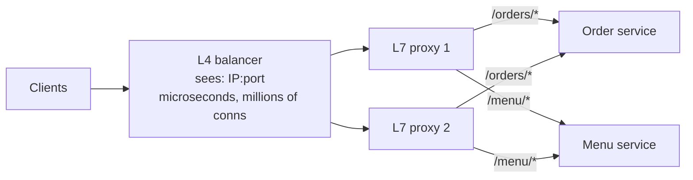
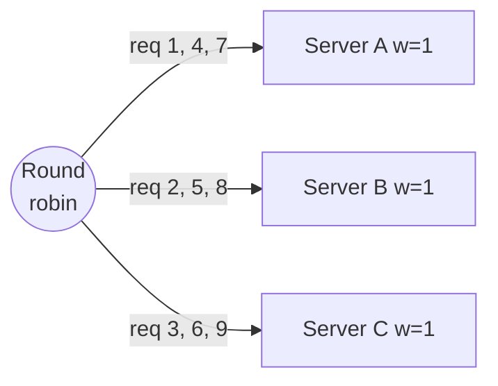
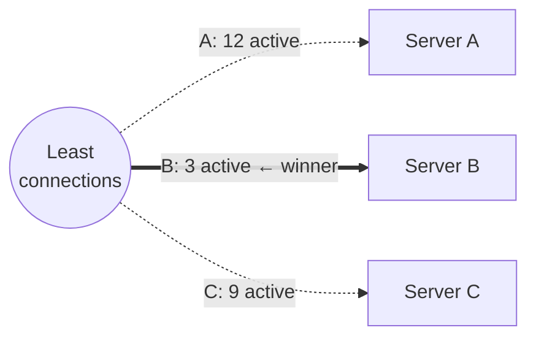
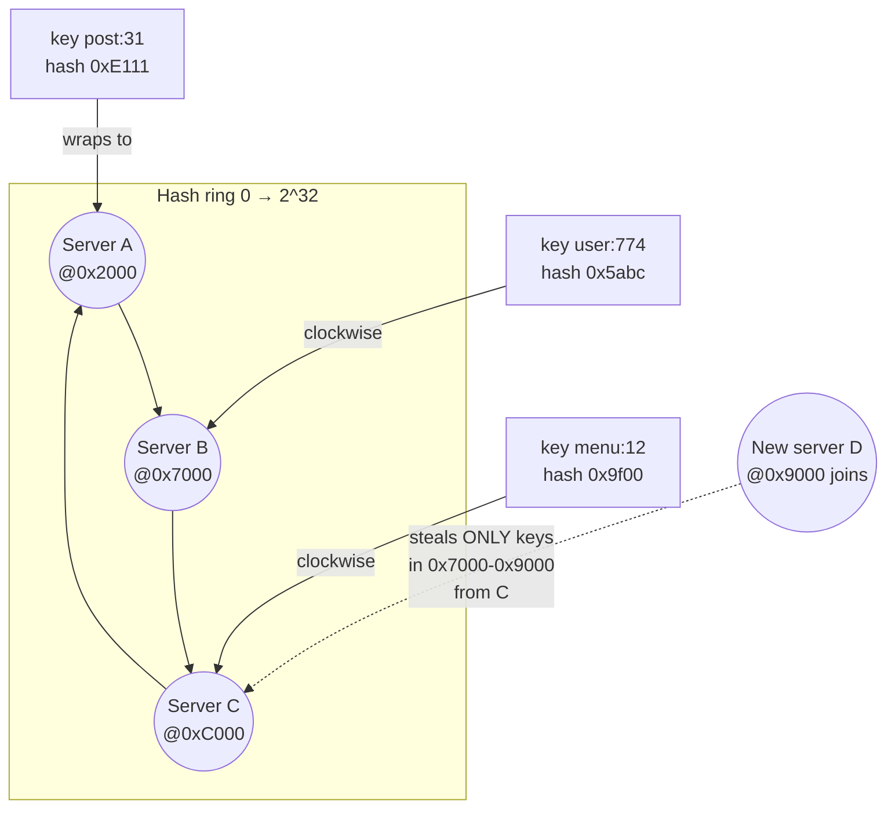
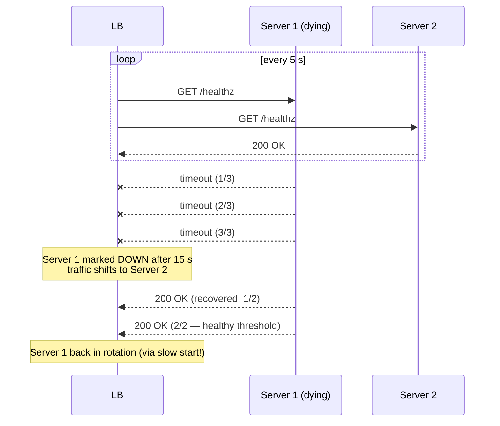
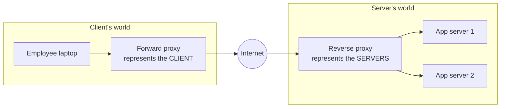
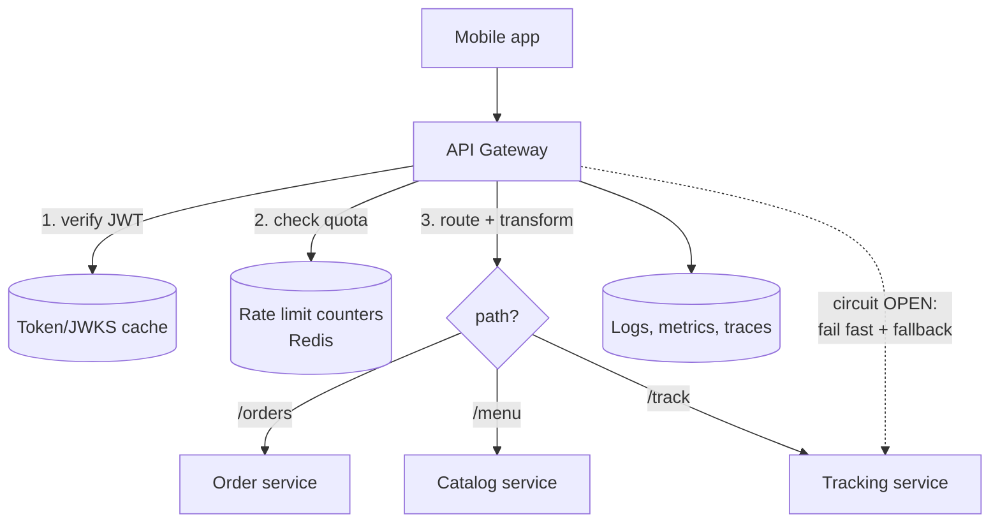
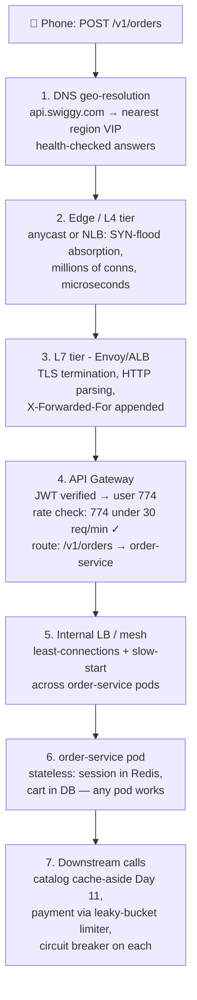

# Day 12 — Load Balancing, Proxies & API Gateways

> Series: System Design Mastery

---

## Table of Contents

1. [Why Load Balancing Exists](#1-why-load-balancing-exists)
2. [L4 vs L7: What Each Layer Can See](#2-l4-vs-l7-what-each-layer-can-see)
3. [Balancing Algorithms](#3-balancing-algorithms)
   - [Round Robin & Weighted Round Robin](#31-round-robin--weighted-round-robin)
   - [Least Connections](#32-least-connections)
   - [IP Hash](#33-ip-hash)
   - [Consistent Hashing (the full story)](#34-consistent-hashing-the-full-story)
4. [Health Checks, Draining & Sticky Sessions](#4-health-checks-draining--sticky-sessions)
5. [Reverse Proxy vs Forward Proxy](#5-reverse-proxy-vs-forward-proxy)
6. [API Gateways vs "Just nginx"](#6-api-gateways-vs-just-nginx)
7. [Rate Limiting In Depth](#7-rate-limiting-in-depth)
8. [Who Balances the Balancer? (SPOF)](#8-who-balances-the-balancer-spof)
9. [Worked Example: A Swiggy Order, Phone to Service](#9-worked-example-a-swiggy-order-phone-to-service)
10. [Self-Check](#10-self-check)
11. [Apply (1 hour)](#11-apply-1-hour)

---

## 1. Why Load Balancing Exists

**In plain words:** Think of a busy restaurant with one host at the door sending diners to whichever waiter is free. If a waiter goes on break, the host just stops seating them — the diners never notice. A load balancer is that host for web servers: it spreads requests across many identical servers and quietly routes around any that fall over. The point isn't only handling more customers; it's that any single waiter can vanish without ruining anyone's dinner.

**Why.** One server has a ceiling — maybe 5–10k req/s for a lean API, a few hundred for anything doing real work. Instagram sees hundreds of thousands of requests per second; Swiggy at 8 p.m. on a rainy Friday sees order traffic spike 5–10x baseline in minutes. But the deeper reason isn't throughput, it's *mortality*: every server eventually dies, gets deployed to, or gets patched. A load balancer converts "a machine died" from an outage into a non-event.

**What.** A load balancer (LB) sits in front of a fleet of identical servers, distributes incoming requests among them, and stops sending traffic to servers that fail health checks.

**When.** The moment you have two servers — which should be the moment you care about uptime at all, since one server = one failure from zero servers.

**How.** Via an algorithm (Section 3) applied at L4 or L7 (Section 2), fed by health checks (Section 4).

**Where.** At every hop: DNS → edge LB → regional LB → service-to-service LBs (a mesh sidecar is a tiny per-pod L7 LB). Big systems balance load 3–5 times per request.

> **🤔 Wait — I only have a couple of servers, do I really need a load balancer yet?**
> The moment you have two servers, yes — not mainly for throughput but for *mortality*. Every server eventually dies, gets deployed to, or patched; an LB turns "a machine died" from an outage into a non-event.

**✅ Good scenario (where it saves you):** A rolling deploy at Instagram takes servers out one at a time behind the LB; users never see a blip because the LB simply stops routing to draining boxes.

**❌ Bad scenario (the pain without it / when misused):** A single server with no LB gets a routine kernel patch at 8 p.m.; the whole app is down for 4 minutes during Swiggy's dinner peak — an entirely avoidable outage.

**When NOT to:** For a personal side project or an internal tool with one user and acceptable downtime, an LB is premature — one box plus a restart script is fine.

**The Dark Side.** An LB assumes servers are interchangeable — *stateless*. Every shortcut that breaks this (in-memory sessions, local file uploads, in-process caches of per-user data) quietly re-couples users to machines, and the LB's core promise dies. Most "we need sticky sessions" conversations are really "we stored state in the wrong place" confessions (Section 4).

---

## 2. L4 vs L7: What Each Layer Can See

**In plain words:** Imagine mail sorting. An L4 balancer is like a sorter who only reads the address on the envelope — fast, but it has no idea what's inside. An L7 balancer opens the envelope and reads the letter, so it can decide "this is a complaint, send it to the complaints desk" — smarter, but slower because it has to read everything. L4 routes on network address and port; L7 routes on the actual content of the HTTP request (URL, headers, cookies).

**Why.** The OSI layer at which the LB operates determines what information it can route on — and what it costs.

An **L4 (transport) balancer** sees only the TCP/UDP packet header: source IP, source port, destination IP, destination port, protocol. It forwards packets (often via NAT or direct server return) without ever assembling them into an HTTP request. An **L7 (application) balancer** terminates the TCP connection (and usually TLS), reads the full HTTP request, and can route on anything in it.

| Dimension | L4 (e.g., AWS NLB, IPVS, HAProxy in TCP mode) | L7 (e.g., AWS ALB, nginx, Envoy, HAProxy in HTTP mode) |
|---|---|---|
| Can see | IPs, ports, protocol | URL path, headers, cookies, method, body, gRPC service/method |
| Can route on | Connection tuple only | `/api/orders` → order service, `Authorization` header, canary cookie |
| TLS | Passes through (or TLS at L4 without HTTP inspection) | Terminates TLS; can re-encrypt to backend |
| Latency added | ~tens of microseconds | ~0.5–2 ms (parse + terminate + re-open) |
| Throughput | Millions of connections; NLBs handle tens of millions of req/s | High but lower; each request is parsed |
| Features | Almost none — fast, dumb, reliable | Retries, rewrites, compression, WAF, rate limits, sticky cookies |
| Sees client IP | Yes natively | Backend needs `X-Forwarded-For` / PROXY protocol |
| Use when | Raw TCP (databases, MQTT for rider GPS), extreme throughput, non-HTTP | HTTP/gRPC APIs — i.e., almost all app traffic |

**The classic production pattern is both:** an L4 balancer at the very edge (fast, resilient, handles SYN floods) feeding a fleet of L7 proxies (smart routing). AWS: NLB → ALB/Envoy. Google: Maglev (L4) → GFE (L7).



*The two-tier edge: L4 for brute-force packet spreading, L7 for decisions that need to read the request.*

> **🤔 Wait — L7 can route on anything, so why would I ever use a dumb L4 balancer?**
> Because "reads the whole request" is exactly the cost. For a firehose of tiny non-HTTP messages, terminating TLS and parsing HTTP per packet is wasted work; L4 spreads packets in microseconds and survives SYN floods the L7 tier can't.

**✅ Good scenario (where it saves you):** Swiggy's rider-GPS ingest (200k riders × 1 ping/3 s) rides an L4 NLB straight to an MQTT tier — microsecond forwarding, millions of connections, no per-message parsing tax.

**❌ Bad scenario (the pain without it / when misused):** A team runs all app traffic through L4 only "because it's faster"; they lose retries, per-route timeouts, and canary routing, then rebuild them badly and inconsistently in every client library.

**When NOT to:** For ordinary HTTP/gRPC APIs, don't drop to L4 for raw speed — the microseconds saved cost you every L7 feature; use the two-tier pattern (L4 edge → L7 proxies) instead.

**The Dark Side.** "L7 everywhere" is the trendy default, but terminating TLS and parsing HTTP for a firehose of tiny messages (Swiggy rider location pings: 200k riders × 1 ping / 3 s) is a waste — those want L4 straight to an MQTT/UDP ingest tier. Conversely, "L4 is faster" is a trap for app traffic: without L7 you lose retries, per-route timeouts, and canary routing, and you'll rebuild them badly in every client.

---

## 3. Balancing Algorithms

**In plain words:** Once you have several servers, you need a rule for picking which one gets the next request. These algorithms are just different fairness rules — like deciding how to hand out chores among roommates. Some go strictly in turn, some give more to whoever looks least busy, and some always give the same chore to the same person so they build up expertise. Each rule shines in a different situation and fails in its own embarrassing way.

### 3.1 Round Robin & Weighted Round Robin

**In plain words:** Round robin is dealing cards — one to each player in a circle, over and over. Weighted round robin is the same, but the bigger, stronger players get dealt more cards each pass. It's dead simple and fair by headcount, but it assumes every card (request) costs the same effort.

**Why/What.** Round robin hands request 1 to server A, 2 to B, 3 to C, 4 to A... Weighted RR sends proportionally more to bigger boxes (weights 3:1 during a rolling migration from 4-core to 16-core machines).

**When.** Stateless, uniform, short requests — the 80% case. It's the default in nginx for a reason.



*Round robin: perfectly fair in request count, perfectly blind to request cost.*

**The Dark Side.** RR counts requests, not work. If request 7 is "generate the monthly settlement report" (30 s) and requests 8–9 are health pings (2 ms), server A silently accumulates the heavy ones. With heterogeneous request costs, RR produces the classic mystery: "all servers get equal traffic, one is at 95% CPU." Also, with multiple independent LB nodes each doing its own RR, global fairness degrades — fine in practice, surprising in graphs.

### 3.2 Least Connections

**In plain words:** Picture a supermarket where you always join the shortest checkout line. That's least connections: send the next request to whichever server currently has the fewest jobs in progress. It automatically steers traffic away from servers stuck on slow work, without needing to know why they're slow.

**Why/What.** Route each new request to the server with the fewest in-flight connections. Connection count is a cheap proxy for "current load," so slow requests naturally push traffic away from busy servers.

**When.** Variable request durations — API fleets with a mix of 5 ms and 5 s endpoints, long-polling, websockets.



*Least connections: route to whoever looks idlest right now — load-aware where round robin is load-blind.*

**The Dark Side.** A freshly booted (or just-recovered) server has **zero** connections, so least-connections dogpiles it with every new request while its caches are cold and its JIT is unwarmed — and it topples. This is why real systems pair least-connections with **slow start** (ramp a new server from 10% to 100% of its share over 30–60 s; nginx `slow_start`, Envoy `slow_start_config`). Also: "least connections" ≠ "least loaded" — 3 websockets can be heavier than 30 REST calls. The refinement used by Envoy/Google is **power of two choices**: pick 2 random servers, send to the less loaded — nearly optimal, no global state.

### 3.3 IP Hash

**In plain words:** Imagine a school assigning students to houses by the first letter of their surname — the same name always lands in the same house, no lookup table needed. IP hash does that with a client's IP address: run it through a formula and you always get the same server for that client. Cheap stickiness, but it breaks badly when many people share one address or when you add a server.

**Why/What.** `server = hash(client_ip) % N`. The same client always lands on the same server without cookies or shared state.

**When.** Crude stickiness for L4 balancers (which can't see cookies), or per-client in-memory rate limiting.

**The Dark Side.** Two killers. (1) **NAT clumping:** an entire office, campus, or carrier-grade-NAT mobile network (most of India's mobile traffic!) shares a few public IPs — one "client" is 100k Swiggy users, and one server gets them all. (2) **The modulo problem:** when N changes from 5 to 6, `hash(ip) % N` changes for ~5/6 of all clients — nearly *everyone* is remapped. Which is the exact problem consistent hashing exists to solve.

### 3.4 Consistent Hashing (the full story)

**In plain words:** Picture a big round clock face, and you place both your servers and your data at various hour positions around it. To find which server owns a piece of data, you start at the data's position and walk clockwise until you bump into a server. The magic: if you add or remove one server, only the data sitting in that server's little arc has to move — everyone else stays put. Plain `% N` hashing, by contrast, reshuffles almost everything whenever the server count changes, which is a disaster when servers hold data.

**Why.** Any scheme of the form `hash(key) % N` remaps almost all keys when N changes. For a stateless web fleet, remapping is harmless. But when the destination holds *state associated with the key* — a cache shard holding that key's data, a websocket server holding that user's connection, a game server holding that match — remapping is catastrophic: add one cache node with modulo hashing and ~N/(N+1) of keys now point at nodes that don't have them. Instantly your 95% hit ratio becomes ~5%, and yesterday's stampede lesson (Day 11) plays out across *every* key at once. Real outages have started exactly this way.

**What.** Map the hash space onto a ring (0 to 2³²−1). Hash each *server* onto the ring. To place a key, hash it and walk clockwise to the first server. Adding or removing a server only remaps the keys between it and its ring predecessor — on average **only K/N keys move** (K keys, N servers), instead of nearly all of them.



*The ring: adding server D moves only the arc between B and D — every other key stays exactly where it was.*

**How.** One subtlety makes it production-grade: with only N points on the ring, arc sizes are wildly uneven (one server can own 3x its share), and when a server dies its *entire* load lands on one neighbor. The fix is **virtual nodes**: hash each physical server onto the ring 100–200 times. Arcs even out statistically, and a dead server's load scatters across everyone.

```java
import java.nio.charset.StandardCharsets;
import java.security.MessageDigest;
import java.math.BigInteger;
import java.util.*;

// A consistent hash ring with virtual nodes.
// TreeMap keeps the ring positions sorted for us, and gives an
// O(log n) "find the next position clockwise" via ceilingKey/firstKey.
public class ConsistentHashRing {

    private final int vnodes;                         // how many points each physical node occupies
    private final TreeMap<BigInteger, String> ring;   // ring position -> physical node name

    public ConsistentHashRing(List<String> nodes, int vnodes) {
        this.vnodes = vnodes;
        this.ring = new TreeMap<>();
        if (nodes != null) {
            for (String node : nodes) {
                addNode(node);
            }
        }
    }

    // Hash a string to a big unsigned integer using MD5 (same idea as the ring space 0..2^128-1).
    private BigInteger hash(String key) {
        try {
            MessageDigest md = MessageDigest.getInstance("MD5");
            byte[] digest = md.digest(key.getBytes(StandardCharsets.UTF_8));
            // Leading 1 byte forces a positive BigInteger (no sign confusion).
            return new BigInteger(1, digest);
        } catch (Exception e) {
            throw new RuntimeException("MD5 not available", e); // 'raise' becomes 'throw' in Java
        }
    }

    // Sprinkle one physical node across the ring 'vnodes' times.
    public void addNode(String node) {
        for (int i = 0; i < vnodes; i++) {
            BigInteger pos = hash(node + "#vn" + i);
            ring.put(pos, node);
        }
    }

    // Remove every virtual point that belonged to this node.
    public void removeNode(String node) {
        for (int i = 0; i < vnodes; i++) {
            BigInteger pos = hash(node + "#vn" + i);
            ring.remove(pos);
        }
    }

    // Place a key: hash it, then walk clockwise to the first server at or after that point.
    public String getNode(String key) {
        BigInteger pos = hash(key);
        // ceilingKey = smallest ring position >= pos (the next server clockwise).
        BigInteger target = ring.ceilingKey(pos);
        if (target == null) {           // walked past the top of the ring -> wrap around to the start
            target = ring.firstKey();
        }
        return ring.get(target);
    }

    public static void main(String[] args) {
        ConsistentHashRing ring =
            new ConsistentHashRing(List.of("cache-a", "cache-b", "cache-c"), 150);
        ring.addNode("cache-d");   // only ~25% of keys remap, not ~75%
    }
}
```

**Where.** Redis/Memcached client-side sharding, DynamoDB and Cassandra partitioning, Envoy's ring-hash LB policy, CDN cache assignment, Discord/Slack websocket-server assignment — and tomorrow, database sharding (Day 13). This is arguably the single highest-reuse idea in distributed systems.

> **🤔 Wait — hashing already spreads keys evenly, so why the elaborate ring?**
> Because plain `hash(key) % N` remaps almost *every* key the instant N changes. That's harmless for stateless servers but catastrophic when the destination holds the key's state — add one cache node and your 95% hit ratio collapses to ~5% as every key points at the wrong node.

**✅ Good scenario (where it saves you):** Adding a 5th cache node to a consistent-hash ring remaps only ~20% of keys (K/N), so the hit ratio dips slightly instead of collapsing — the cluster scales without a stampede.

**❌ Bad scenario (the pain without it / when misused):** A team shards Redis with `hash % N` and adds a node during a traffic spike; ~80% of keys remap at once, the DB gets the full miss storm, and the "scaling up" action triggers the very outage it was meant to prevent.

**When NOT to:** For a stateless web fleet where any server can handle any request, don't use consistent hashing — plain round robin is strictly simpler and better; reserve the ring for key-affine state (caches, websocket/session servers, shards).

**The Dark Side.** Consistent hashing distributes *keys*, not *load* — the celebrity hot-key problem from Day 11 survives intact (one arc, one melted node). And it adds real complexity: every client must agree on the ring (same hash function, same vnode count, same membership view), or two app servers will read/write the same key on different cache nodes and you get "phantom staleness" nobody can reproduce. For a stateless web fleet, plain round robin remains strictly better — use consistent hashing only when the destination holds key-affine state.

---

## 4. Health Checks, Draining & Sticky Sessions

**In plain words:** A load balancer needs to know which servers are actually well enough to take work — like a nurse doing rounds to check who's fit for duty. Health checks are those rounds. Draining is politely letting a server finish its current tasks before sending it home (instead of yanking it mid-task). Sticky sessions are pinning a customer to the same server every time — convenient, but it quietly undoes the whole "any server can handle anyone" promise.

### Health checks: active vs passive

**In plain words:** There are two ways to tell if a server is sick. Active checking is knocking on its door every few seconds and asking "you okay?" (a health-check request). Passive checking is watching the real work go by and noticing it's suddenly failing or timing out — like realizing a coworker is unwell because their output went haywire, without asking. Good systems do both.

| | Active | Passive (outlier detection) |
|---|---|---|
| Mechanism | LB probes `GET /healthz` every N seconds | LB watches real traffic: 5xx rates, timeouts, connection resets |
| Detects | Dead/hung process, failed dependency (if the check is deep) | Degradation that a synthetic probe misses (only `/checkout` is broken) |
| Failure detection speed | Interval × unhealthy-threshold, e.g. 5 s × 3 = 15 s of errors | Often faster — first few real failures trigger ejection |
| Risk | Shallow check lies ("process up, DB unreachable") | Needs traffic to detect; can eject on user-caused errors if misconfigured |

Best practice is both: active checks for liveness, passive outlier ejection for quality. **The deep-health-check trap:** if `/healthz` checks the database, then a DB blip makes *every* server report unhealthy simultaneously, the LB removes *all* of them, and you convert a partial degradation into a total outage. Mature setups distinguish liveness ("I'm alive, keep routing") from readiness ("I can serve"), and LBs "fail open" — if everyone looks unhealthy, route to everyone anyway.



*Active health checking: thresholds on both sides prevent flapping — one bad probe shouldn't eject, one good probe shouldn't readmit.*

### Connection draining (graceful deregistration)

**In plain words:** When a shop is closing, it stops letting new customers in but still serves everyone already inside. Connection draining is exactly that for a server: stop routing new requests to it, but let the in-flight ones finish before shutting it down. Without draining, every deploy would abruptly cut off users mid-request.

When you deploy or scale in, yanking a server mid-request turns every in-flight order placement into a user-visible error. Draining: the LB stops sending **new** requests but lets in-flight ones finish, up to a timeout (typically 30–300 s). The deploy pipeline sequence: mark draining → wait for in-flight to hit zero (or timeout) → terminate → start new version → pass health checks → slow-start back in. Long-lived connections (websockets, gRPC streams) are the hard case — you must also *tell* clients to reconnect (GOAWAY frames, close messages), or draining waits forever.

### Sticky sessions — the honest treatment

**In plain words:** Sticky sessions are like always being served by the same waiter because only they remember your order. Nice until that waiter calls in sick and nobody else knows what you wanted. The real fix is writing the order down somewhere shared (a database or Redis) so any waiter can pick it up — that's what "stateless servers" means.

**What.** The LB pins a user to one server (cookie-based at L7, IP-hash at L4) so in-memory session state keeps working.

**Why they're a Dark-Side crutch.** Stickiness breaks every promise of load balancing: the pinned server dies → those users are logged out or lose carts (Swiggy user loses a half-built biryani order — that's revenue, not inconvenience); load skews because users don't arrive uniformly; scaling out doesn't help existing users (they stay pinned); deploys get painful (draining must wait for *sessions*, hours, not requests, seconds). The correct fix is externalizing state: sessions in Redis (Day 11), carts in the DB, JWTs for auth. Stateless servers are the foundation everything else today stands on.

**When they're actually fine.** (1) Websocket/long-poll connections — the connection itself is legitimately stateful; you sticky the *connection*, with reconnect logic for failover. (2) Server-side per-user caches where a stickiness *preference* (not requirement) boosts hit ratios — fine because failover merely costs cache misses. (3) The pragmatic bridge: a legacy app you're strangling can run sticky for a year while you migrate. Crutches are fine while the leg heals; the sin is calling the crutch a leg.

> **🤔 Wait — sticky sessions keep a user on one server, isn't that a simple, sensible optimization?**
> Usually it's a confession that state landed in the wrong place. Stickiness re-couples users to machines and breaks every promise of load balancing — the pinned server dies and those users lose their carts. The real fix is externalizing state (Redis, DB, JWT), not pinning.

**✅ Good scenario (where it saves you):** Sticky routing for a websocket *connection* is legitimate — the connection itself is stateful — paired with client reconnect logic so failover just re-establishes it.

**❌ Bad scenario (the pain without it / when misused):** A team keeps sessions in server memory and turns on cookie stickiness; a deploy now drains for *sessions* (hours, not seconds), and when one server dies thousands of Swiggy users lose half-built orders — revenue, not inconvenience.

**When NOT to:** Don't reach for sticky sessions to paper over in-memory session state — externalize the state instead; the only honest uses are stateful connections or a stickiness *preference* where failover merely costs a cache miss.

---

## 5. Reverse Proxy vs Forward Proxy

**In plain words:** A proxy is a middleman that speaks on someone's behalf. A forward proxy stands in front of *you* (the client) — like a company mailroom that sends all your outgoing letters so the outside world only sees the mailroom's address. A reverse proxy stands in front of the *servers* — like a receptionist who takes all visitors and quietly routes them to the right person in back, so visitors never learn how the office is organized. Same idea, opposite direction, different job.

The same technology pointed in opposite directions — the question is *who is being represented*.

| | Forward proxy | Reverse proxy |
|---|---|---|
| Sits in front of | **Clients** | **Servers** |
| Server knows the real client? | No — sees the proxy's IP | Client knows the real server? No — sees the proxy |
| Who deploys it | The client's org (or the client) | The server's org |
| Purposes | Egress control, anonymity, corporate filtering, geo-unblocking, outbound allow-lists | Load balancing, TLS termination, caching, compression, WAF, hiding topology |
| Examples | Squid, corporate proxies, VPN-ish services | nginx, HAProxy, Envoy, Varnish, every CDN and LB |



*Forward proxy: the server never learns who the client was. Reverse proxy: the client never learns how many servers exist.*

Every load balancer discussed today *is* a reverse proxy (L7 ones literally; L4 ones in spirit). A useful production detail: because the reverse proxy terminates the client connection, your app sees the proxy's IP unless it forwards `X-Forwarded-For` — and naively trusting that header lets clients spoof their IP past your rate limiter. Only trust it from your own proxy tier.

> **🤔 Wait — forward proxy, reverse proxy — aren't they just the same middleman?**
> Same technology, opposite direction. A forward proxy represents the *client* (the server never learns who you are); a reverse proxy represents the *servers* (the client never learns how many there are). Confusing them means putting the security control on the wrong side.

**✅ Good scenario (where it saves you):** A reverse proxy (nginx/Envoy) terminates TLS, hides your topology, and load-balances — the client sees one address while you scale servers freely behind it.

**❌ Bad scenario (the pain without it / when misused):** An app naively trusts `X-Forwarded-For` from anyone, not just its own proxy tier; clients spoof their IP and sail past the per-IP rate limiter — a control defeated by a single header line.

**When NOT to:** For purely internal service-to-service calls inside one trust boundary, you may not need a forward proxy at all — egress control and anonymity are the client-side problems it solves, not internal routing.

---

## 6. API Gateways vs "Just nginx"

**In plain words:** An API gateway is the single front desk of a large building. Instead of every department checking your ID, stamping your visitor log, and enforcing the rules separately, the front desk does all of that once and then sends you where you need to go. It handles the shared chores — checking who you are, counting your visits, logging your entry — so the 15 departments (microservices) behind it don't each have to.

**Why.** Once you have 15 microservices, cross-cutting concerns multiply: every service needs auth, rate limiting, logging, TLS. Implementing them 15 times in 4 languages guarantees 15 slightly different security bugs. The gateway centralizes them at the front door.

**What — the canonical responsibilities:**

| Responsibility | What it means | Example |
|---|---|---|
| **Routing** | Map external routes to internal services, hide topology | `/v1/orders` → order-service; `/v1/menu` → catalog-service |
| **AuthN (+ coarse AuthZ)** | Validate JWT/session once; pass verified identity downstream as a trusted header | Reject bad tokens with 401 before they cost a service call |
| **Rate limiting** | Per-user/key/IP quotas (Section 7) | Free-tier partner API: 100 req/min |
| **Request transformation** | Protocol translation, header injection, response shaping | External REST → internal gRPC; strip internal fields; API versioning shims |
| **Circuit breaking** | Stop calling a failing backend; fail fast; recover gradually | Menu-service is timing out → serve cached/degraded menus for 30 s instead of stacking up threads |
| **Observability** | One choke point for request IDs, access logs, latency metrics | Trace ID minted at the gateway, propagated everywhere |

Plus: TLS termination, request validation, response caching, canary/A-B routing. Products: Kong, AWS API Gateway, Apigee, Zuul/Spring Cloud Gateway, Envoy-based (Ambassador/Gloo/Istio ingress).



*The gateway is the one place a request is authenticated, counted, routed, and logged — 15 services get these for free.*

> **🤔 Wait — nginx already routes and terminates TLS, why add a whole API gateway?**
> Because a gateway centralizes the cross-cutting concerns nginx doesn't manage as a *product*: per-consumer API keys, quota plans, JWT auth, circuit breaking, and partner-facing analytics. With 15 microservices, doing auth 15 times in 4 languages guarantees 15 subtly different security bugs.

**✅ Good scenario (where it saves you):** One gateway verifies the JWT, checks the quota, mints a trace ID, and routes — so all 15 services get auth, rate limiting, and observability for free and consistently.

**❌ Bad scenario (the pain without it / when misused):** A team implements auth and rate limiting inside each of 15 services; one team's token-validation bug ships a hole, and there's no single place to onboard a new partner or rotate a policy.

**When NOT to:** A monolith with 5 endpoints behind managed nginx doesn't need Kong — reach for a real gateway only when the API itself is a *product* (API-key management, quota plans, partner program); otherwise it's just another hop, cluster, and bottleneck team.

**When a gateway is overkill — the Dark Side.** A monolith with 5 endpoints behind managed nginx does not need Kong. What the gateway costs: another hop of latency (~1–5 ms), another cluster to operate/upgrade/secure, a config surface that becomes a bottleneck team ("file a ticket to add a route"), and the slide toward the **anti-pattern of the smart pipe**: business logic creeping into gateway config (response-stitching Lua scripts, orchestration in route rules) until you've rebuilt the Enterprise Service Bus everyone spent the 2010s escaping. Keep gateways to *cross-cutting* concerns; keep *domain* logic in services. And be honest about the middle ground: nginx + a few standard modules covers routing, TLS, basic rate limiting, and caching. Reach for a real gateway when you need per-consumer API-key management, quota plans, or a partner-facing API program — that is, when the API itself is a *product*.

---

## 7. Rate Limiting In Depth

**In plain words:** Rate limiting is the velvet rope at a club: only so many people in per minute, no matter how big the crowd. It stops any one visitor (a buggy app, a scraper, a partner gone haywire) from hogging the whole system and ruining it for everyone. The different algorithms below are just different bouncer styles — some allow a quick rush then slow down, others let people trickle in at a perfectly steady pace.

**Why.** Protects against overload (retry storms are self-inflicted DDoS), abuse (scrapers, credential stuffing), and noisy neighbors (one partner's bug consuming everyone's capacity). It is also a fairness and monetization mechanism (tiered API plans).

| Algorithm | Mechanics | Allows bursts? | Memory/key | Edge behavior | Use for |
|---|---|---|---|---|---|
| **Fixed window** | Counter per window: `count(user, minute)` | Yes — badly | 1 counter | **2x leak at boundary:** 100 req at 00:59 + 100 at 01:00 = 200 in 2 s | Crude quotas where precision is irrelevant |
| **Sliding window log** | Store timestamp of every request; count last 60 s | Exact control | O(requests) — heavy | Perfectly accurate | Low-volume, high-value (login attempts) |
| **Sliding window counter** | Weighted blend of current+previous fixed windows | Approximately | 2 counters | Smooths the boundary leak; slight approximation | High-scale general limiting (what most infra uses) |
| **Token bucket** | Bucket holds up to B tokens, refills at r/s; request costs a token | Yes — by design, up to B | 2 values (tokens, timestamp) | Burst of B allowed, then throttled to r | The default: APIs, AWS-style limits |
| **Leaky bucket** | Queue drains at fixed rate; overflow dropped | No — flattens everything | Queue (or counter) | Perfectly smooth output rate | Protecting rigid downstreams (payment processor accepting exactly 100 TPS) |

The token-vs-leaky intuition: **token bucket shapes the *input* allowance (bursts OK), leaky bucket shapes the *output* rate (bursts flattened).** Users love token buckets (a burst of 20 taps works); fragile downstreams love leaky buckets.

```java
// Lazy-refill token bucket: no background thread —
// tokens are computed from elapsed time whenever we check.
public class TokenBucket {

    private final double rate;      // steady-state refill rate (tokens per second)
    private final double capacity;  // max burst size (bucket can never hold more than this)
    private double tokens;          // tokens available right now
    private long lastNanos;         // last time we refilled, in nanoseconds

    public TokenBucket(double ratePerSec, double capacity) {
        this.rate = ratePerSec;
        this.capacity = capacity;
        this.tokens = capacity;              // start full
        this.lastNanos = System.nanoTime();  // monotonic clock, immune to wall-clock jumps
    }

    // synchronized so concurrent request threads don't corrupt the token count.
    public synchronized boolean allow(double cost) {
        long now = System.nanoTime();
        double elapsedSeconds = (now - lastNanos) / 1_000_000_000.0;
        // Add the tokens earned since last check, but never overflow the capacity.
        this.tokens = Math.min(capacity, this.tokens + elapsedSeconds * rate);
        this.lastNanos = now;
        if (this.tokens >= cost) {
            this.tokens -= cost;
            return true;   // request allowed
        }
        return false;      // no tokens left -> caller should return HTTP 429
    }

    public boolean allow() {
        return allow(1.0);  // default cost of one token per request
    }
}

// 10 req/s steady, bursts up to 25:
TokenBucket limiter = new TokenBucket(10, 25);
if (!limiter.allow()) {
    // In Spring Boot you'd return a ResponseEntity with status 429 and a Retry-After header:
    return ResponseEntity.status(429).header("Retry-After", "1").build();
}
```

Production notes: (1) **Distributed limiting needs shared state** — per-node buckets multiply the real limit by the node count; the standard fix is counters in Redis with a Lua script for atomic check-and-decrement, accepting ~1 RTT per check (or local buckets that sync asynchronously, accepting small overshoot). (2) **Always return 429 with `Retry-After`** — well-behaved clients back off; without the header, they retry immediately and your limiter creates its own thundering herd. (3) Limit on multiple keys at once: per-IP (abuse), per-user (fairness), per-endpoint (protect the expensive ones), global (capacity).

> **🤔 Wait — isn't rate limiting just one counter per user? Why five algorithms?**
> Because *where* you shape traffic matters. Token bucket shapes the input allowance (bursts OK, users happy); leaky bucket shapes the output rate (bursts flattened, fragile downstreams safe). Pick the wrong one and you either reject legitimate bursts or overwhelm a rigid backend.

**✅ Good scenario (where it saves you):** Token bucket on Swiggy's public API lets a mobile client's burst of 20 taps through, while a leaky bucket in front of the payment processor holds it to exactly 100 TPS — each backend protected by the right shape.

**❌ Bad scenario (the pain without it / when misused):** A team uses fixed-window limiting at 100/min; a client sends 100 requests at 00:59 and 100 at 01:00 — 200 in 2 seconds, never limited — and the boundary leak lets the exact burst it was meant to stop straight through.

**When NOT to:** In mobile-first markets, don't rate-limit per-IP — 100k users behind one carrier-grade-NAT IP will demolish any per-IP limit; key on per-user or per-device instead.

**The Dark Side.** Rate limiting *users* to protect against *your own* retry storms is treating the wrong patient — fix client backoff (exponential + jitter) too. And overly tight limits show up as mysterious mobile-app failures in exactly the NAT'd networks IP-hash struggles with: 100k users behind one carrier-grade NAT IP will demolish any per-IP limit. Per-user or per-device keys beat per-IP in mobile-first markets.

---

## 8. Who Balances the Balancer? (SPOF)

**In plain words:** You put a load balancer in front so no single server can take you down — but now the load balancer itself is the one box that can. That's a "single point of failure" (SPOF). The fix is redundancy all the way up: pairs of balancers that hand off to each other, backup regions your DNS can point at, and clever routing that reaches the nearest healthy site automatically. If a part is critical, it needs a twin.

**Why.** You added an LB so no single server is critical — congratulations, the LB itself is now the single most critical box in the system. Redundancy must go all the way up.

**Layer 1 — LB pairs (active-passive / active-active).** Two LB nodes share a **virtual IP (VIP)**. The active node holds the VIP; heartbeats (VRRP/keepalived) let the passive node detect failure and claim the VIP in ~1–3 s (gratuitous ARP repoints the network). Active-active variants (ECMP from routers spreading across N LB nodes) waste no standby capacity.

```mermaid
sequenceDiagram
    participant Client
    participant VIP as VIP 10.0.0.100
    participant LB1 as LB-1 (active)
    participant LB2 as LB-2 (passive)
    LB1->>LB2: VRRP heartbeat (every 1 s)
    Client->>VIP: request → LB-1 answers
    Note over LB1: LB-1 crashes
    LB2--xLB1: heartbeat missed x3
    LB2->>VIP: claims VIP, sends gratuitous ARP
    Client->>VIP: request → LB-2 answers (~2-3 s gap)
    Note over Client,LB2: in-flight TCP connections on LB-1 are lost;<br/>clients must retry
```

*Active-passive failover: the VIP is a name that outlives any single machine — clients never learn the LB changed.*

**Layer 2 — DNS failover / geo-DNS.** Multiple regional VIPs behind one DNS name with health-checked answers (Route 53 etc.). Handles whole-site/region failure. The catch: **TTL disobedience** — you set TTL=60 but resolvers, OSes, and apps cache longer; a slice of traffic keeps hitting the dead region for minutes. DNS failover is a minutes-scale mechanism, not seconds.

**Layer 3 — Anycast (mention-depth).** Advertise the *same IP* from many locations via BGP; internet routing delivers each client to the nearest site. Failover is automatic route reconvergence (seconds), no DNS TTL problem. This is how CDNs, `8.8.8.8`, and modern edges (Cloudflare, AWS Global Accelerator) work. Cost: BGP expertise and long-lived TCP flows can reroute mid-connection.

Cloud users get layer 1 for free — an ALB/NLB *is* a managed, multi-AZ, auto-scaling fleet behind one name. You still own layer 2/3 (multi-region).

> **🤔 Wait — I added a load balancer so nothing is a SPOF, so I'm covered, right?**
> You just moved the SPOF: the LB is now the single most critical box. Redundancy has to go all the way up — LB pairs sharing a VIP, DNS/anycast across regions — or one dead balancer takes down everything behind it.

**✅ Good scenario (where it saves you):** An active-passive VRRP pair lets the standby claim the VIP in ~2–3 s when the active LB crashes; clients retry and never learn the balancer changed.

**❌ Bad scenario (the pain without it / when misused):** A single LB with no pair fails at peak; every healthy server behind it is now unreachable, and the redundancy you built for the app tier is worthless because the front door fell off.

**When NOT to:** On a cloud ALB/NLB you get multi-AZ LB redundancy for free — don't hand-build VRRP/keepalived there; spend the effort on the layer you still own (multi-region DNS/anycast).

**The Dark Side.** Failover machinery is itself a source of outages: a flapping heartbeat network makes both LBs claim the VIP (split-brain — a preview of Day 13's scariest topic), and untested failover is fiction — the passive node's config drifted eight months ago and nobody noticed because it never ran. If you don't regularly *drill* failover (chaos testing, game days), you have redundancy theater, not redundancy.

---

## 9. Worked Example: A Swiggy Order, Phone to Service

**In plain words:** This section follows one food order from your phone to the kitchen, passing every checkpoint we've discussed in order. It's the "put it all together" tour — DNS finds the nearest region, an L4 tier absorbs the raw flood, an L7 tier reads the request, the gateway checks who you are and your quota, an internal balancer picks a server, and downstream calls are protected by circuit breakers. Seeing them in sequence is what makes the whole day click.

Every concept from today, in the order a real request meets them:



*Seven hops, five load-balancing decisions, zero machines that are allowed to matter individually.*

Walk the failure drills against this picture: a pod dies (health check ejects in ~15 s; retries at hop 5 mask it); an AZ dies (hop 3/5 pools shrink; capacity headroom absorbs it); a region dies (hop 1 DNS/anycast shifts traffic — minutes or seconds respectively); payment provider slows to 30 s (hop 7 circuit breaker opens — orders queue for async payment rather than stacking threads until order-service itself dies). If you can narrate this chain and what breaks at each hop, you can answer 80% of "how does X stay up?" interview questions.

---

## 10. Self-Check

1. An LB sees `dst port 443` and nothing else. What layer is it, what three routing features are impossible for it, and where would you still choose it over L7?
2. Least-connections routes a flood of traffic to a just-recovered server and kills it again. Explain the mechanism and the two-word feature that fixes it.
3. Your cache cluster grows from 4 to 5 nodes. Compute the approximate fraction of keys remapped under `hash % N` vs consistent hashing, and explain — using Day 11's stampede material — why the modulo version can take down your database.
4. Why do virtual nodes exist? Give both problems they solve (load evenness and failure redistribution).
5. Your `/healthz` endpoint pings the database. Describe the outage this design causes during a 10-second DB blip, and the liveness/readiness split that prevents it.
6. Make the strongest honest case *for* sticky sessions in two scenarios, then explain why "our sessions live in server memory" is not one of them.
7. A partner integration must never send your payment processor more than 100 TPS, but your public API should tolerate bursty mobile clients. Which rate-limiting algorithm goes where, and why are they different?
8. Fixed-window limiting at 100 req/min: construct the exact request timeline that achieves ~200 requests in 2 seconds without ever being limited.
9. Your per-IP rate limit of 60 req/min starts blocking thousands of legitimate users in Mumbai every evening. What's happening, and what key should you limit on instead?
10. Rank by failover speed and explain each mechanism's catch: VRRP VIP takeover, DNS failover with 60 s TTL, anycast BGP reconvergence.

---

## Tomorrow

**Day 13 — Database Replication & Sharding.** Today's tricks assumed the servers behind the LB were interchangeable because they're stateless. Tomorrow we hit the layer where that's impossible — the database — and meet replication lag, failover promotion, split-brain, and the art (and expensive regret) of choosing a shard key. Consistent hashing comes back within the first ten minutes.

---

## 11. Apply (1 hour)

1. **(20 min)** Run two copies of a toy HTTP server (Java: a minimal Spring Boot app whose `/` endpoint returns its own port via `@Value("${server.port}")`, or a plain `com.sun.net.httpserver.HttpServer` returning `ManagementFactory.getRuntimeMXBean().getName()` so you can tell the instances apart). Put nginx in front (`upstream` block, Docker is fine). Verify round robin with `curl` in a loop; then set `weight=3` on one and verify the 3:1 split over 100 requests.
2. **(10 min)** Kill one backend. Observe nginx's passive failure handling (`proxy_next_upstream`). Add `max_fails=2 fail_timeout=10s` and watch ejection/readmission timing with a curl loop.
3. **(15 min)** Implement the `ConsistentHashRing` from Section 3.4. Insert 100k synthetic keys across 5 nodes; print each node's key count with vnodes=1 vs vnodes=150 (see the imbalance shrink). Then remove one node and count how many keys moved — compare against the ~20% theory and against a `hash % N` control (~80%).
4. **(10 min)** Implement the `TokenBucket` from Section 7 and wire it into a Spring Boot request filter (implement `HandlerInterceptor.preHandle`, or a servlet `Filter`) keyed by a `X-User-Id` header — keep one bucket per user in a `ConcurrentHashMap<String, TokenBucket>`. Hammer it with 50 rapid requests: verify you get exactly `capacity` successes up front, then ~`rate` per second, and that responses include `Retry-After`.
5. **(5 min)** On paper, redraw the Section 9 Swiggy diagram from memory, then annotate what fails and what masks it for: one pod OOMs, one AZ loses network, the payment provider goes to 30 s latency.
