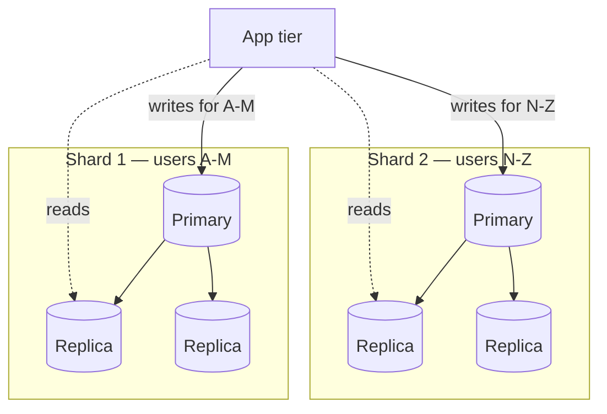
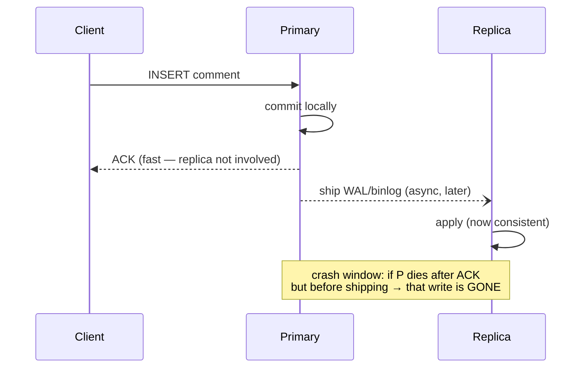
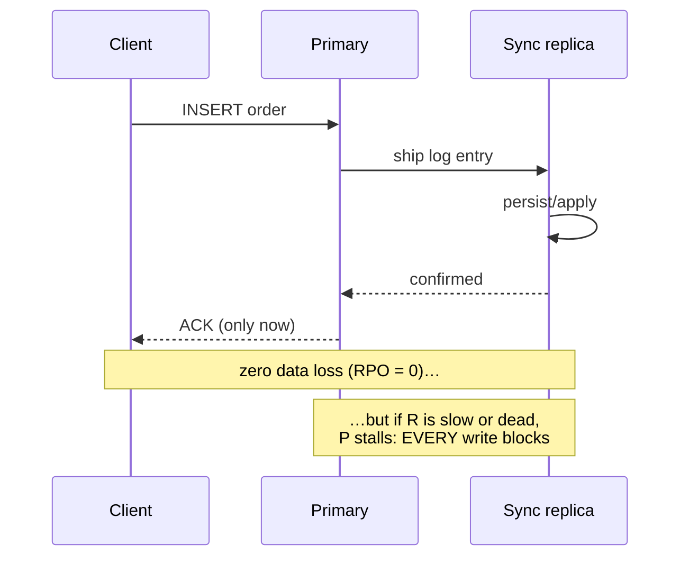
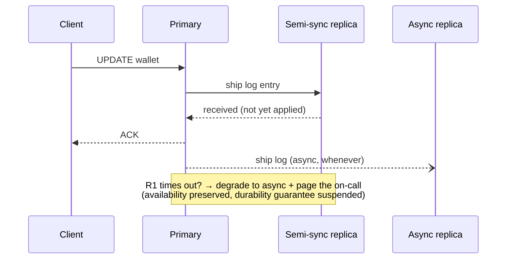
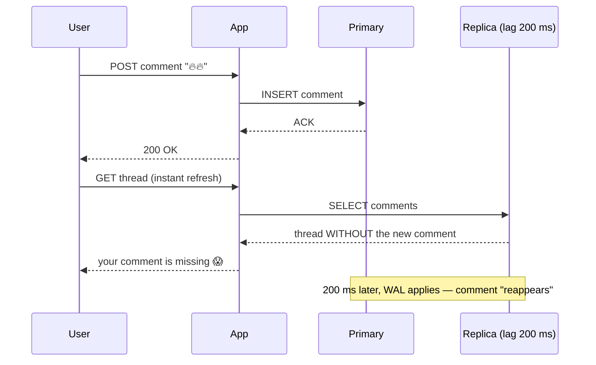
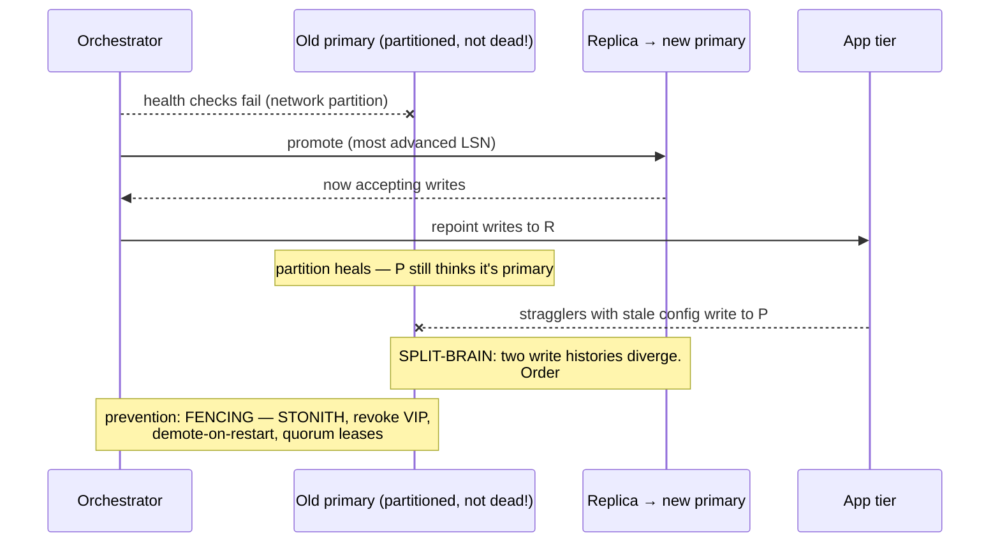
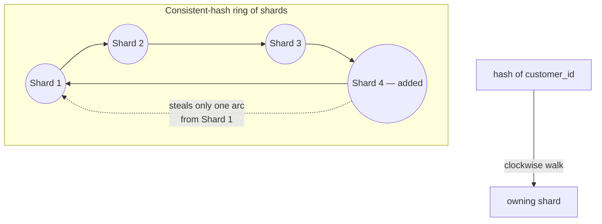
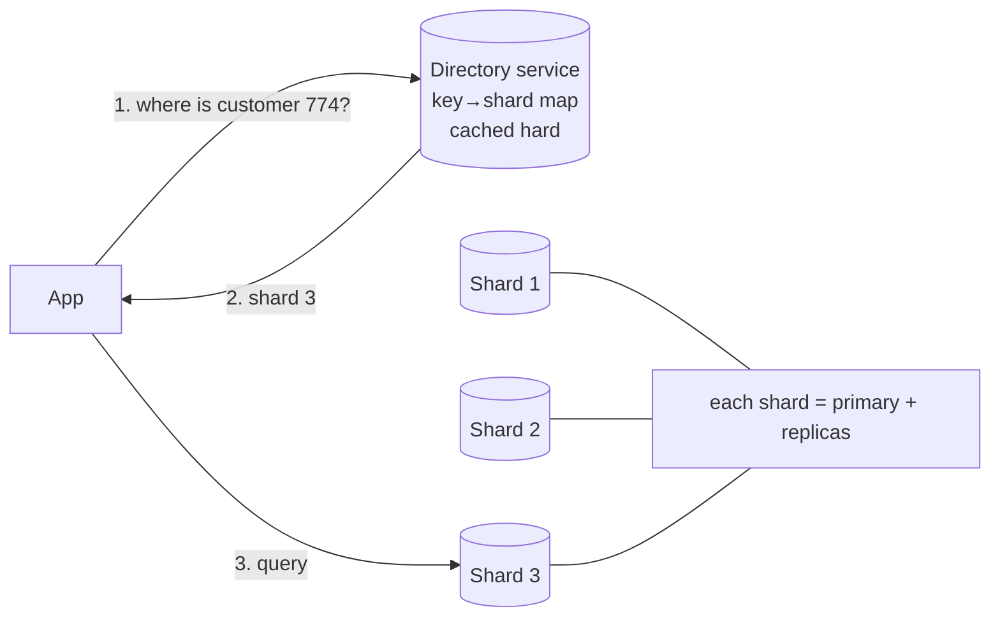
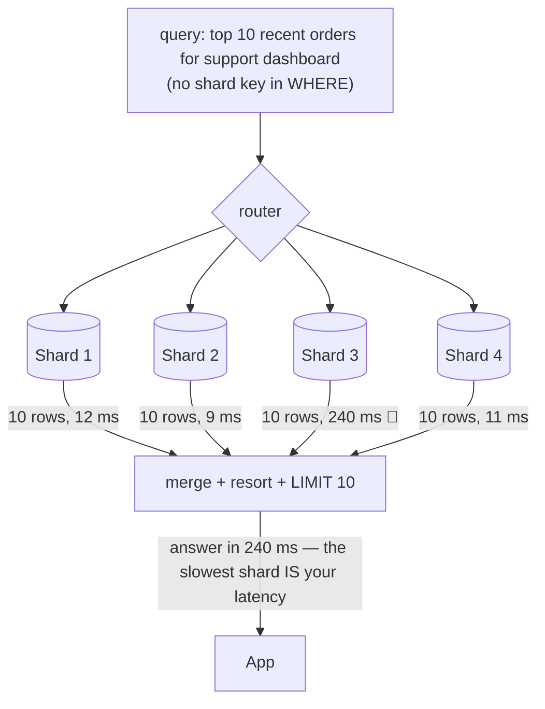
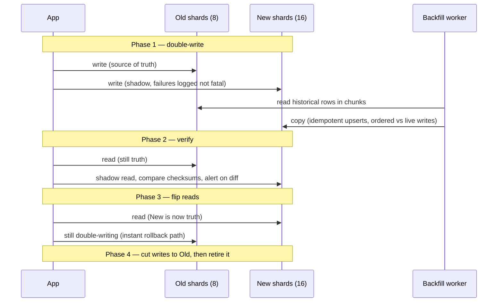

# Day 13 — Database Replication & Sharding

> Series: System Design Mastery

---

## Table of Contents

1. [The Two Different Problems](#1-the-two-different-problems)
2. [Replication: Primary–Replica](#2-replication-primaryreplica)
   - [Asynchronous Replication](#21-asynchronous-replication)
   - [Synchronous Replication](#22-synchronous-replication)
   - [Semi-Synchronous Replication](#23-semi-synchronous-replication)
3. [What Replication Lag Breaks](#3-what-replication-lag-breaks)
4. [Failover Mechanics & Split-Brain](#4-failover-mechanics--split-brain)
5. [Multi-Primary (Briefly, and Warily)](#5-multi-primary-briefly-and-warily)
6. [Sharding: When and Why](#6-sharding-when-and-why)
7. [Sharding Strategies](#7-sharding-strategies)
8. [Choosing a Shard Key — the Swiggy Orders Worked Example](#8-choosing-a-shard-key--the-swiggy-orders-worked-example)
9. [The Celebrity / Hot-Shard Problem](#9-the-celebrity--hot-shard-problem)
10. [Cross-Shard Queries & Transactions](#10-cross-shard-queries--transactions)
11. [Resharding Without Downtime](#11-resharding-without-downtime)
12. [The Dark Side: Sharding Too Early](#12-the-dark-side-sharding-too-early)
13. [Self-Check](#13-self-check)
14. [Apply (1 hour)](#14-apply-1-hour)

---

## 1. The Two Different Problems

**In plain words:** Imagine a busy restaurant. *Replication* is photocopying the same menu so every waiter carries an identical copy — great when lots of people want to *read* the menu, useless if the kitchen can't cook faster. *Sharding* is splitting the kitchen into stations (grill, salad, dessert) so more *cooking* happens at once — but now each station only knows its own dishes. One copies the whole thing for reads and safety; the other cuts the whole thing into pieces to handle more writes.

Replication and sharding get lumped together, but they solve different problems and you must never confuse them in an interview:

| | Replication | Sharding (partitioning) |
|---|---|---|
| Each node holds | A **full copy** of the data | A **slice** of the data |
| Solves | Read scale, availability, durability, geo-latency | **Write** scale, dataset size beyond one machine |
| Does NOT solve | Write scale (every write hits every copy), dataset size | Availability (a shard is still one point of failure — so you replicate each shard) |
| Complexity | Moderate (lag, failover) | High (key choice, cross-shard queries, resharding) |
| Order of adoption | First. Almost always. | Last. After caching (Day 11), read replicas, and vertical scaling are exhausted |

Production systems compose them: **N shards × M replicas each.** Instagram's Postgres history is exactly this shape; so is every serious MySQL fleet.



*Sharding splits the data; replication copies each split — write scale and read scale are two different axes.*

> **🤔 Wait — why not just add more read replicas instead of the whole sharding headache?**
> Because replicas copy the *whole* dataset, so every write still hits every copy — replicas add zero write capacity and don't shrink the data. When your bottleneck is write throughput or raw size, more replicas do nothing; only sharding splits the writes.

**✅ Good scenario (where it saves you):** Instagram's 90%+ read workload is absorbed by read replicas for years — the primary handles writes while replicas soak up hundreds of thousands of reads/s, no sharding needed.

**❌ Bad scenario (the pain without it / when misused):** A team drowning in 40k writes/s keeps bolting on replicas; each new replica must replay every write too, lag climbs, and write latency doesn't budge — they scaled the wrong axis entirely.

**When NOT to:** Don't reach for sharding when your problem is read scale or availability — replicas are simpler and solve those; shard only when writes or dataset size have hit the single-primary wall.

---

## 2. Replication: Primary–Replica

**In plain words:** Think of one head chef (the *primary*) who is the only person allowed to change the recipe book, and several apprentices (*replicas*) who each keep a live copy by watching over the chef's shoulder. Customers can ask any apprentice to read a recipe, spreading the load. The single big question is: does the chef wait for the apprentices to finish copying before telling you "done," or does the chef say "done" immediately and let them catch up?

**Why.** Three reasons, in honest priority order: (1) **durability/availability** — a single DB machine will eventually lose a disk, and a replica is a live, seconds-fresh copy; (2) **read scale** — most workloads are 90%+ reads, and replicas absorb them; (3) **geo-latency** — a replica in the reader's region turns 200 ms reads into 5 ms reads.

**What.** One node (primary) accepts all writes and streams its change log (MySQL binlog, Postgres WAL) to replicas that replay it. Replicas serve reads. The only real design question: **does the primary wait for replicas before confirming a write?**

> **🤔 Wait — if the primary handles writes fine, why add replicas at all?**
> Three reasons in priority order: durability (a single disk *will* die; a replica is a live, seconds-fresh copy), read scale (90%+ of most workloads are reads), and geo-latency (a local replica turns 200 ms reads into 5 ms). A production DB without a replica isn't a design choice — it's a countdown.

**✅ Good scenario (where it saves you):** A geo-replica in the reader's region turns cross-continent 200 ms reads into 5 ms local reads while also standing ready to take over if the primary's disk fails.

**❌ Bad scenario (the pain without it / when misused):** A single-node production DB with no replica loses a disk at 2 a.m.; there's no live copy, so recovery means restoring last night's backup — hours of downtime and a day of lost writes.

**When NOT to:** For a throwaway dev/test database or an ephemeral, rebuildable store, a replica is overkill — the durability guarantee it buys has no value there.

**When/Where.** Immediately, everywhere. A production database without a replica isn't a design choice, it's a countdown.

### 2.1 Asynchronous Replication

**In plain words:** The chef writes the recipe down, tells you "done!" right away, and copies it to the apprentices whenever there's a spare moment. Super fast for you — but if the chef faints in the seconds before copying, that recipe is lost forever, and for a short while the apprentices are slightly out of date.

The primary commits locally, acknowledges the client, and ships the log entry whenever. Replicas typically apply it **10–500 ms** later; under load spikes, long transactions, or replica I/O stalls, lag stretches to **seconds or minutes** (every on-call engineer has watched a lag graph climb past 300 s during a backfill).



*Async: the client's ACK and the replica's copy are decoupled — you bought speed with a window of potential data loss.*

**Trade:** fastest writes, zero availability coupling (dead replica affects nothing) — but a primary crash loses the un-shipped tail of writes (RPO > 0), and lag is a permanent fact of life (Section 3).

### 2.2 Synchronous Replication

**In plain words:** The chef refuses to say "done!" until at least one apprentice has confirmed they've copied the recipe. Nothing is ever lost — the recipe always exists in two places. The price: you wait longer, and if that apprentice is asleep or gone, the chef stands there frozen and *nobody* can write anything.

The primary waits until the replica has (at least) received — often applied — the write before ACKing the client.



*Sync: the write is on two machines before anyone is told it happened — durability bought with latency and coupled availability.*

**Trade:** zero loss on failover, but write latency = local commit + RTT + remote persist (add ~1 ms same-DC, ~30–80 ms cross-region), and — the killer — **a slow or dead sync replica halts all writes**. Fully sync to all replicas is essentially never done; sync to *one* (or a quorum) is.

### 2.3 Semi-Synchronous Replication

**In plain words:** A sensible compromise — the chef waits for just *one* apprentice to say "got it," then says "done!" and lets the rest catch up later. And if that one apprentice doesn't answer within a few seconds, the chef stops waiting, carries on anyway, and rings an alarm so a human can check what's wrong. You keep most of the safety without freezing the whole kitchen.

The pragmatic middle: at least one replica must confirm *receipt* (not necessarily apply); other replicas remain async. If no sync replica responds within a timeout, most implementations **degrade to async** and alarm, rather than stopping the world.



*Semi-sync: one confirmed copy before ACK, everyone else best-effort — MySQL's semisync and Postgres's `synchronous_standby_names` quorum live here.*

| | Async | Semi-sync | Sync |
|---|---|---|---|
| Write latency penalty | ~0 | +0.5–2 ms (same DC) | +RTT to slowest required replica |
| Data loss on primary crash (RPO) | Last 10 ms–minutes of writes | ~0 (one copy guaranteed) | 0 |
| Dead replica impact | None | Degrades to async (configurable) | **Writes stop** |
| Use for | Feeds, analytics, most things | Orders, payments metadata — the default for OLTP that matters | Regulated ledgers, with quorum not single-replica |

**The Dark Side.** Teams choose async "for now," never revisit it, and discover the RPO during the failover itself — the worst possible moment to learn 40 seconds of Swiggy orders vanished (customers charged, orders unrecorded). Decide RPO *per table's worth of data*, on purpose, in writing. Conversely, cargo-culting sync-to-remote-region "for safety" silently adds 60 ms to every write and someone spends a quarter hunting the "slow database."

---

## 3. What Replication Lag Breaks

**In plain words:** "Lag" is the short delay before the apprentices catch up to the chef. It sounds harmless until you write something and then immediately look for it on an apprentice who hasn't copied it yet — so *your own thing seems to have vanished*. You post your comment, refresh, don't see it, and post again thinking it failed. The system is working exactly as built, but the user is convinced it's broken.

Lag isn't an ops metric — it's a *user-visible product bug* wearing an ops costume. The canonical victim:

**Read-your-own-writes, Instagram edition.** You comment on a friend's post. The write goes to the primary. The app immediately re-fetches the thread — from a replica that is 200 ms behind. **Your comment isn't there.** You assume the app ate it, so you post it again. Now the lag catches up and you look like a spammer, twice. Every support ticket that says "my edit disappeared and came back" is this diagram:



*Read-your-own-writes violation: the system is behaving exactly as configured, and the user is certain it's broken.*

**Fixes, in ascending complexity:**

1. **Read-from-primary-after-write (pinning).** After a user writes, route *that user's* reads to the primary for a grace window (or: pin reads *of things you might have just written* — your own profile, your own comments — to the primary always). Implementation: on write, set `last_write_ts` in the session/JWT/Redis; the read path sends any read with `now − last_write_ts < 5 s` to the primary. Simple, effective, and the most common real-world answer. Cost: a write-heavy user cohort partially un-scales your replicas.
2. **Monotonic reads.** Weaker but important guarantee: a user never sees time go *backwards* (refresh shows the comment, refresh again — different, more-lagged replica — it's gone again; that flicker is worse than consistent staleness). Fix: pin each session to one replica (hash user → replica — consistent hashing again, from Day 12).
3. **Wait-for-catch-up.** Client tracks the primary's log position (LSN/GTID) of its write; replicas serve the read only once they've applied past it (or the proxy waits). Precise; adds machinery and possible read latency.
4. **Version echo.** The write returns the new row version; the app renders the user's own write from the response itself (optimistic UI) and doesn't re-read at all. Frontend-cheap, and honestly what most social apps do.

Here is fix #1 (read-from-primary-after-write) as small, idiomatic Java. A write stamps "this user just wrote" into a fast store (Redis); the read path checks that stamp and, if it's recent, sends the query to the primary instead of a lagging replica:

```java
// A tiny router that pins a user's reads to the primary for a grace window
// after they write. "DataSource" is Java's standard handle to a database.
public class ReadRoutingService {

    private static final long PIN_WINDOW_MS = 5_000; // 5 seconds

    private final StringRedisTemplate redis;   // Spring's Redis client
    private final DataSource primary;          // the write node
    private final DataSource replica;          // a read-only copy (may lag)

    public ReadRoutingService(StringRedisTemplate redis,
                              DataSource primary,
                              DataSource replica) {
        this.redis = redis;
        this.primary = primary;
        this.replica = replica;
    }

    // Call this right AFTER a user performs a write.
    public void markUserWrote(long userId) {
        // Store the current time; auto-expire the key after the window so
        // Redis cleans up on its own (no stale pins linger).
        redis.opsForValue().set(
            "lastWrite:" + userId,
            String.valueOf(System.currentTimeMillis()),
            Duration.ofMillis(PIN_WINDOW_MS));
    }

    // Call this on EVERY read to pick the right database.
    public DataSource dataSourceForRead(long userId) {
        String stamp = redis.opsForValue().get("lastWrite:" + userId);
        if (stamp != null) {
            long elapsed = System.currentTimeMillis() - Long.parseLong(stamp);
            if (elapsed < PIN_WINDOW_MS) {
                // The user wrote very recently — read from the primary so they
                // always see their own change (read-your-own-writes).
                return primary;
            }
        }
        // Otherwise it's safe to use a replica and spread the read load.
        return replica;
    }
}
```

**Swiggy flavor:** restaurant marks itself "closed" on the partner app → replica-lagged customer app still shows it open → order placed at a closed restaurant → auto-cancellation, refund, angry everyone. Availability toggles are a read-your-writes problem *between two different users*, which is why that specific read often goes to the primary or an event-invalidated cache (Day 11) instead.

> **🤔 Wait — replication lag is just milliseconds, is it really worth engineering around?**
> It's not an ops metric, it's a user-visible product bug. A user posts a comment, the instant refresh reads a 200 ms-lagged replica, the comment isn't there, so they post again thinking it failed. The system is behaving exactly as configured and the user is certain it's broken.

**✅ Good scenario (where it saves you):** Read-your-own-writes pinning (route a user's reads to the primary for 5 s after they write) fixes the "my comment vanished" bug with a tiny Redis stamp — cheap, and the most common real-world answer.

**❌ Bad scenario (the pain without it / when misused):** A team serves all reads from replicas; every Swiggy restaurant that marks itself "closed" still shows open to lagged customers, orders land at closed kitchens, and auto-cancellations/refunds pile up.

**When NOT to:** Don't "fix" lag by reading everything from the primary — that recreates the single-node bottleneck replicas exist to escape; pin only the reads that genuinely need read-your-writes.

**The Dark Side.** The maximalist fix — "just read everything from the primary" — quietly recreates the single-node bottleneck you added replicas to escape; teams do this during a lag incident and never undo it. The other trap: assuming lag is bounded. It isn't. Design for the p99 lag (seconds), not the median (50 ms), and instrument it (`pg_last_wal_replay_lsn` deltas, `Seconds_Behind_Source`).

---

## 4. Failover Mechanics & Split-Brain

**In plain words:** *Failover* is what happens when the head chef collapses and an apprentice has to be promoted to head chef mid-service. The danger isn't the chef being *dead* — it's the chef being merely *unconscious* (network-cut-off, not truly gone). If the old chef wakes up still believing they're in charge while the new one is already taking orders, you get two people writing conflicting recipes: *split-brain*. The cure is making absolutely sure the old chef knows they've been replaced before the new one starts — that's called "fencing."

**Why.** The primary is mortal. Failover is how a replica becomes the new primary — and it is the most dangerous routine operation in databases.

**How promotion actually works:**

1. **Detect** — health checks on the primary fail for longer than a threshold (typically 5–30 s; too short = flappy false failovers, too long = extended outage).
2. **Choose** — pick the replica with the most advanced log position (least data loss). Orchestrators: Patroni (Postgres, consensus via etcd), MySQL Orchestrator, or the cloud does it for you (RDS Multi-AZ: ~60–120 s typical).
3. **Promote** — replica stops replaying, opens for writes.
4. **Repoint** — every client/proxy/DNS entry must now find the new primary (VIP move, proxy config push, service-discovery update — Day 12's machinery).
5. **Fence the old primary** — the crucial, most-skipped step. If the old primary was merely *partitioned* (not dead) and comes back accepting writes, you now have **two primaries**: **split-brain.**



*Failover's true enemy isn't the dead primary — it's the not-quite-dead one. Fencing (STONITH: "shoot the other node in the head") makes sure the loser knows it lost.*

Defenses: **quorum-based detection** (only fail over if a majority of observers agree the primary is gone — Patroni/etcd, Raft-based systems), **fencing** (kill the old node's power/VIP/credentials before promoting), and **primaries that demote themselves** when they lose their lease. Note the async-replication corollary: promotion of a lagged replica **discards** the old primary's un-replicated tail — your RPO decision from Section 2 comes due exactly here.

> **🤔 Wait — if the primary dies, just promote a replica — what's the big deal?**
> The danger isn't a *dead* primary, it's a *not-quite-dead* one. If the old primary was only network-partitioned and comes back still accepting writes while the new primary is live, you get two write histories that can't be merged — split-brain. Fencing (making the loser know it lost) is the crucial, most-skipped step.

**✅ Good scenario (where it saves you):** Quorum-based detection + fencing (STONITH / revoke the VIP) ensures only one primary ever accepts writes, so a partition heals cleanly instead of forking order #881 into two conflicting versions.

**❌ Bad scenario (the pain without it / when misused):** A team skips fencing; a 10 s network blip promotes a replica while the old primary keeps taking writes, and now the same order ID exists differently on two nodes — a data-surgery incident with no automatic merge.

**When NOT to:** Don't set failover detection too aggressive (5 s) on a flappy network — a transient blip triggers a needless promotion at peak; mature teams often keep failover semi-automatic (auto-detect, human-confirm).

**The Dark Side.** Auto-failover that's too eager causes more outages than it prevents: a 10-second network blip triggers promotion, the old primary was fine, and now you're in split-brain or a needless topology change at peak traffic. Some very mature teams keep failover *semi*-automatic (auto-detect, human-confirmed) for exactly this reason. And an untested failover, like Day 12's untested LB failover, is a fairy tale: run drills quarterly, at minimum.

---

## 5. Multi-Primary (Briefly, and Warily)

**In plain words:** What if you had *several* head chefs, each allowed to change the recipe book, all trying to stay in sync? Tempting — writers in every region get a local chef. But two chefs can edit the same recipe at the same moment and now nobody knows which version is correct. There's no magic way to merge "Alice claimed the username" with "Bob claimed the same username." That's why the standing advice is: keep one chef per kitchen (one primary per shard).

**What.** Multiple nodes accept writes, replicating to each other. Attractive for multi-region write latency (each region writes locally) and write availability.

**The conflict problem.** Two primaries accept conflicting writes in the same lag window: the same Instagram username claimed in Virginia and Mumbai simultaneously; a Swiggy inventory count decremented in both. Resolution options are all bad in different ways: **last-writer-wins** (silently discards one user's write — data loss disguised as a policy), **CRDTs** (mathematically merge — beautiful, but only for data types that merge, like counters and sets, not "who got the username"), or **app-level conflict handlers** (you now write merge code for every table). 

**When it's legitimate:** each primary owns a *disjoint* key range (region-homed users write only to their home region) — which is really sharding-by-geography wearing a replication hat; or offline-first sync (Calendars, Notes) where conflicts are inherent and the UX surfaces them. **Otherwise, the standing advice holds: one primary per shard, and get your multi-region writes via sharding, not multi-primary.**

> **🤔 Wait — multi-primary lets every region write locally, isn't that the obvious way to scale writes globally?**
> It's a trap for most data. Two primaries can accept conflicting writes in the same lag window — the same username claimed in Virginia and Mumbai — and there's no correct automatic merge for "who got the username." Last-writer-wins is data loss dressed as policy.

**✅ Good scenario (where it saves you):** Multi-primary is legitimate when each primary owns a *disjoint* key range (region-homed users write only to their home region) — which is really sharding-by-geography, so conflicts are structurally impossible.

**❌ Bad scenario (the pain without it / when misused):** A team enables multi-primary across regions for a shared inventory table; the same "last 2 items" count decrements in both regions at once, oversells stock, and every conflict resolution silently drops one customer's write.

**When NOT to:** For any data with contended keys (usernames, inventory, balances), don't use multi-primary — keep one primary per shard and get multi-region writes via geo-sharding instead.

---

## 6. Sharding: When and Why

**In plain words:** Copying (replication) helps you *read* more and stay safe, but every copy still has to accept *every* write, so it can't help you write faster or store more than one machine holds. When one database is drowning in writes or has grown too big to back up or index, you split the data across several independent databases — each holding a *slice* of the rows. That's sharding. It's powerful but expensive to live with, so it should be your *last* scaling move, not your first.

**Why.** Two walls that replication cannot move: (1) **write throughput** — every write must be applied by every replica, so replicas add zero write capacity; a single beefy Postgres/MySQL primary tops out around **10–50k simple writes/s** (workload-dependent), and there is no bigger box after the biggest box (~128 vCPU, several TB RAM, and the price curve goes vertical well before that); (2) **dataset size** — past a few TB in one node, backups take hours, indexes stop fitting in RAM (every lookup becomes an SSD trip — Day 11's latency ladder collects its debt), schema migrations take days, and a 5-billion-row table makes even `VACUUM` an event.

**What.** Split the data horizontally: each shard holds a subset of rows, is itself a primary+replicas cluster, and knows nothing of the others.

**When.** Honest checklist before sharding (see also Section 12): primary write CPU/IO sustained > ~60–70% at peak with tuning done; table sizes heading past ~1–2 TB or row counts where index depth hurts; vertical scaling next step is either unavailable or absurdly priced; caching and read replicas already deployed. If you can't check most of these, you're early.

> **🤔 Wait — my database feels slow, should I shard it?**
> Almost certainly not yet. Sharding solves exactly two walls replication can't move: write throughput beyond one primary (~10–50k writes/s) and dataset size beyond one node (~1–2 TB). If your slowness is missing indexes, connection storms, or read load, sharding is cosplay — cheaper levers fix it.

**✅ Good scenario (where it saves you):** A team hitting sustained 60–70% write CPU at peak *after* tuning, with tables heading past 2 TB and vertical scaling exhausted, shards — and finally moves the write wall nothing else could.

**❌ Bad scenario (the pain without it / when misused):** A team shards at 200 GB and 800 writes/s "to be ready"; they inherit cross-shard JOINs, scatter-gather, and N-of-everything ops forever — for a load a single Postgres would have shrugged off.

**When NOT to:** If you have < 1 TB and < 5k writes/s, don't shard — add indexes, caching, read replicas, and PgBouncer first; sharding is the last move, not the first.

---

## 7. Sharding Strategies

**In plain words:** Once you've decided to split the data, you need a rule for *which slice each row goes to*. Think of sorting mail into P.O. boxes: you could sort by last-name ranges (A–M, N–Z), by scrambling the address into a number and taking the remainder, or by a lookup sheet that says "this customer lives in box 3." Each rule has a personality — some are great for range scans, some spread load perfectly, some are easy to rearrange later. Picking the wrong rule is painful to undo, so understand the trade-offs first.

| Strategy | Route by | Range queries | Rebalancing | Hot-spot risk | Used by |
|---|---|---|---|---|---|
| **Range** | key interval (A–M / N–Z, or time) | Excellent (contiguous) | Split hot ranges | **High** — newest range gets all inserts | HBase, MongoDB (ranged), time-series stores |
| **Hash** | `hash(key) % N` | Dead (keys scattered) | **Terrible** — N changes remap ~everything | Low (uniform spread) | Simple MySQL sharding, many home-grown |
| **Consistent hash** | position on hash ring | Dead | Good — ~K/N keys move | Low (with vnodes) | Cassandra, DynamoDB, Riak |
| **Geo** | user/entity region | Within region | Rare (regions are stable) | Uneven region sizes | Multi-region SaaS, data-residency laws |
| **Directory** | lookup table: key → shard | N/A (explicit) | **Best** — move a key, update the row | Managed manually | Slack, many mature in-house systems |

**Range** — beautiful for scans (`orders from July 1–15` touches one or two shards), but sequential keys create a **hot tail**: sharding orders by `order_id` ranges means *every insert tonight* lands on the last shard while shards 1–9 hold cold history. Time-range sharding has the same shape (and is sometimes *desired* — old shards become cheap archives).

**Hash** — uniform by construction, but you inherit Day 12's modulo problem at database scale: going from 8 to 10 shards remaps ~80% of *rows*, and rows are much heavier to move than cache entries. This is resharding pain (Section 11) in its worst form.

**Consistent hash** — the same ring from Day 12, applied to storage: adding a shard steals only its arc's keys. Cassandra and DynamoDB are built on this.



*The ring, third appearance this week: Day 11 (cache hot keys), Day 12 (LB and cache clusters), now storage — one idea, three layers.*

Here are the two hash strategies as plain Java, so the difference is concrete. Notice how the naive modulo version reshuffles almost everything when the shard count changes, while the ring version moves only a small slice:

```java
// --- Strategy 1: naive hash % N (simple, but resharding is brutal) ---
public class ModuloRouter {
    private final int shardCount;

    public ModuloRouter(int shardCount) {
        this.shardCount = shardCount;
    }

    public int shardFor(String key) {
        // Math.floorMod keeps the result non-negative even for negative hashes.
        // Downside: change shardCount from 8 to 10 and ~80% of keys move.
        return Math.floorMod(key.hashCode(), shardCount);
    }
}

// --- Strategy 2: consistent hashing (adding a shard moves only ~K/N keys) ---
public class ConsistentHashRouter {
    // A sorted ring: hash position -> shard name.
    private final SortedMap<Long, String> ring = new TreeMap<>();
    private final int virtualNodesPerShard;

    public ConsistentHashRouter(int virtualNodesPerShard) {
        this.virtualNodesPerShard = virtualNodesPerShard;
    }

    // Place a shard at many points ("virtual nodes") so load stays even.
    public void addShard(String shard) {
        for (int i = 0; i < virtualNodesPerShard; i++) {
            ring.put(hash(shard + "#" + i), shard);
        }
    }

    public String shardFor(String key) {
        if (ring.isEmpty()) {
            throw new IllegalStateException("No shards registered");
        }
        long h = hash(key);
        // Walk clockwise: find the first ring point >= our hash.
        SortedMap<Long, String> tail = ring.tailMap(h);
        // If we ran off the end, wrap around to the first point on the ring.
        Long pointKey = tail.isEmpty() ? ring.firstKey() : tail.firstKey();
        return ring.get(pointKey);
    }

    // A simple, well-spread 64-bit hash (illustrative, not cryptographic).
    private long hash(String s) {
        long h = 1125899906842597L; // a large prime seed
        for (int i = 0; i < s.length(); i++) {
            h = 31 * h + s.charAt(i);
        }
        return h;
    }
}
```

**Directory-based** — a mapping service holds `key → shard` explicitly. Maximum flexibility (move one hot customer to a dedicated shard; put EU tenants on EU shards) at the cost of a lookup on every query — so the directory must be aggressively cached (Day 11) and highly available: it is the one component every shard depends on.



*Directory sharding: pay one indirection per query, buy the freedom to place any key anywhere — including moving it later.*

> **🤔 Wait — sharding is sharding, does the *strategy* really change much?**
> It changes everything you can and can't do later. Range gives great scans but a hot tail (all new inserts hit the last shard); plain hash spreads evenly but remaps ~80% of rows when you add a shard; consistent hash and directory make rebalancing cheap. The strategy fixes your resharding pain and hot-spot risk for the life of the table.

**✅ Good scenario (where it saves you):** Consistent-hash sharding (Cassandra/DynamoDB) lets you add a shard and move only ~K/N keys — growth is incremental, not a full-fleet reshuffle.

**❌ Bad scenario (the pain without it / when misused):** A team shards orders by `order_id` *range*; every insert tonight lands on the last shard while shards 1–9 hold cold history — a self-inflicted hot shard that no hardware balances.

**When NOT to:** Don't pick plain `hash % N` for data you'll ever grow — going 8→10 shards remaps ~80% of rows (far heavier than cache entries); use consistent hashing or a directory when resharding is foreseeable.

---

## 8. Choosing a Shard Key — the Swiggy Orders Worked Example

**In plain words:** The *shard key* is the column you sort rows by when deciding which database each row lives in — like choosing whether to file paperwork by customer, by order number, or by city. This one choice quietly decides whether writes spread evenly, whether your most common lookups hit a single database or have to bother all of them, and whether you even have enough distinct values to split cleanly. Pick well and most queries stay fast and simple; pick badly and you're stuck, because changing it later means physically moving every row.

**Why the key is the whole game.** The shard key decides three things forever: (1) **write distribution** — do inserts spread evenly? (2) **query isolation** — do your common queries hit one shard or all of them? (3) **cardinality** — are there enough distinct values to split finely? You cannot fix a bad key with more shards; you can only reshard (Section 11), which is surgery.

**The candidates for Swiggy's `orders` table** (say 5M orders/day, common queries: customer order history, restaurant's live orders, city ops dashboards, order-by-id lookup):

| Criterion | `order_id` (hash) | `customer_id` (hash) | `city` |
|---|---|---|---|
| Cardinality | Effectively infinite ✅ | Tens of millions ✅ | ~500 ⚠️ low |
| Write distribution | Perfectly uniform ✅ | Near-uniform ✅ (rare whale accounts) | **Skewed** ❌ — Bangalore ≫ Bhopal |
| "Order by id" lookup | 1 shard ✅ | Scatter-gather ❌ (unless id encodes customer) | Scatter ❌ (unless id encodes city) |
| "Customer's order history" | **All shards** ❌ — the top customer-facing query fans out | 1 shard ✅ | Scatter ❌ |
| "Restaurant's live orders" | All shards ❌ | All shards ❌ | 1 shard ✅ (restaurant lives in one city) |
| "City ops dashboard" | All shards ❌ | All shards ❌ | 1 shard ✅ |
| Hot-spot behavior | None | Mild | **Severe** — Bangalore shard melts at 8 p.m. |

**Honest analysis.** `order_id` gives flawless writes and terrible reads — *every* meaningful query fans out; it optimizes the dimension nobody was worried about. `city` matches ops/restaurant queries beautifully and fails fundamentals: 500 values can't spread across 64 shards evenly, and load follows city size, so it's really "one giant Bangalore DB plus souvenirs." `customer_id` wins the customer-facing workload (history, active orders, support lookups — all single-shard) with uniform writes; restaurant and ops queries lose.

**The senior answer:** shard by `customer_id`, then fix the losers *outside the shard key*: encode the shard into the order ID itself (`{shard_hint}{sequence}` — Instagram's famous ID scheme packs shard ID into 64-bit IDs) so id-lookups route directly; serve restaurant live-orders from a purpose-built store fed by an order-events stream (a materialized view partitioned by `restaurant_id`); serve city dashboards from analytics infra fed by the same stream — dashboards never belonged on the OLTP path anyway. **Lesson: one shard key per table, chosen for the dominant OLTP access pattern; every other pattern gets a derived, differently-partitioned view.** (Yes — that's denormalization returning; Section 10.)

Here is the Instagram-style trick in Java: pack the shard number *into* the 64-bit ID itself, so an "order by id" lookup can figure out its shard without a directory or a scatter-gather:

```java
// Encode the shard into the top bits of a 64-bit ID, then a timestamp and a
// per-shard sequence number in the lower bits. Reading the shard back is
// just bit-shifting — no extra lookup needed.
public final class ShardedIdCodec {

    private static final int SHARD_BITS = 13;   // up to 8192 logical shards
    private static final int SEQUENCE_BITS = 10; // 1024 IDs per ms per shard
    private static final long CUSTOM_EPOCH = 1_500_000_000_000L; // fixed start

    // Build an ID from its parts.
    public static long makeId(int shardId, long sequence) {
        long millis = System.currentTimeMillis() - CUSTOM_EPOCH;
        return (millis << (SHARD_BITS + SEQUENCE_BITS))
             | ((long) shardId << SEQUENCE_BITS)
             | sequence;
    }

    // Recover the shard from any ID — this is how an id-lookup routes itself.
    public static int shardOf(long id) {
        return (int) ((id >> SEQUENCE_BITS) & ((1L << SHARD_BITS) - 1));
    }
}
```

> **🤔 Wait — can't I just pick any high-cardinality column as the shard key and move on?**
> The shard key silently decides three things forever: write distribution, which queries hit one shard vs all of them, and whether there are enough distinct values to split. Optimize the wrong dimension (like `order_id` — flawless writes, but every read fans out) and you've tuned the axis nobody worried about.

**✅ Good scenario (where it saves you):** Sharding Swiggy orders by `customer_id` makes the dominant customer-facing queries (history, active orders, support) single-shard with uniform writes; the loser queries get purpose-built derived views.

**❌ Bad scenario (the pain without it / when misused):** A team shards by `city` because dashboards query by city; 500 low-cardinality values can't spread across 64 shards, and the Bangalore shard melts at 8 p.m. while Bhopal's idles — "one giant DB plus souvenirs."

**When NOT to:** Don't chase every access pattern with the shard key — pick it for the dominant OLTP query and serve the rest from derived, differently-partitioned views; trying to satisfy all of them satisfies none well.

---

## 9. The Celebrity / Hot-Shard Problem

**In plain words:** Even if you spread rows perfectly evenly, *traffic* isn't even — one row can be wildly more popular than the rest. Shard by user and Justin Bieber's data lands on one poor database that gets hammered while its neighbors nap. Big social companies literally call this the "Bieber problem." The fixes range from cheap (cache the celebrity, since most of the traffic is reads) to fancy (give the superstar their own dedicated database, or a completely different design).

**What.** Uniform key *distribution* does not mean uniform *load* — Day 11's hot-key lesson at storage scale. Shard Instagram data by `user_id` and Justin Bieber's row set — 300M followers' worth of likes, comments, fan-out — lands on one shard whose neighbors idle. This is literally called the **Bieber problem** inside large social companies.

**Swiggy version:** a viral cricket-final promo makes one restaurant chain's `restaurant_id` the destination of 20% of national traffic; if any table shards by restaurant, that shard is on fire.

**Mitigations, cheapest first:**

1. **Cache the celebrity** (Day 11 in full: local caches, key replication) — most celebrity traffic is *reads*, and reads are what caches eat.
2. **Isolate the whale** — with directory-based sharding, move the hot key to its own dedicated shard (Slack does this per giant workspace). One row in the directory, huge relief.
3. **Split the key** — for hot *writes*: append a random suffix (`bieber_likes:{0..15}`) spreading one logical key across 16 shards; readers aggregate. Classic DynamoDB write-sharding.
4. **Different architecture for the head** — many social systems literally special-case celebrities (pull-based feeds for celebrity followers vs push-based fan-out for normal users). The top 0.01% of keys often deserve a different design, not a bigger shard.

> **🤔 Wait — if I spread rows evenly across shards, isn't the hot-spot problem solved?**
> Even key *distribution* doesn't mean even *load*. One row can be wildly more popular than the rest — shard by user and Justin Bieber's row lands on one shard that gets hammered while neighbors nap. Big social companies literally call this the "Bieber problem."

**✅ Good scenario (where it saves you):** Caching the celebrity (most of their traffic is reads) plus isolating the whale onto a dedicated shard via directory sharding relieves the hot shard cheaply — one directory row, huge relief.

**❌ Bad scenario (the pain without it / when misused):** A team ignores hot shards; a viral cricket-final promo sends 20% of national traffic to one restaurant chain's shard, which melts while the other 63 idle — a partial outage that looks total to those users.

**When NOT to:** Don't pre-build celebrity write-sharding (random suffixes) for a product that has no celebrity — it multiplies every read by 16 and breaks counters/transactions; detect a real hot key first, then cure.

**The Dark Side.** Suffix-splitting spreads writes but multiplies read cost (every read = 16 sub-reads) and breaks counters and transactions on that key. Detect before you cure: per-shard QPS dashboards and top-key sampling. Most systems don't have a Bieber; don't pre-build for one.

---

## 10. Cross-Shard Queries & Transactions

**In plain words:** On a single database, JOINs (combining related tables) and transactions (all-or-nothing updates) are free and easy. Once your data lives on separate machines, the database can no longer stitch two tables together for you — *you* have to query each shard and merge the results by hand. And an all-or-nothing update spanning two shards has no single "COMMIT" that covers both. The senior move is to *avoid* the problem: keep data that's used together on the *same* shard, and duplicate a few fields at write time so reads stay local.

**Why this hurts.** The moment data spans shards, two of SQL's crown jewels degrade: JOINs and ACID transactions. There is no `JOIN` across two machines' B-trees — the database can't do it, so *you* become the query planner.

**Scatter-gather.** Any query not containing the shard key goes to *all* N shards; the app (or proxy like Vitess) merges results. Latency = the **slowest** shard (p99 of N samples — with 32 shards you hit each shard's tail constantly); cost = N × single-shard cost. Fine for rare admin queries; fatal as a hot path. `ORDER BY … LIMIT 10` across shards means fetching 10 from each and re-sorting 320 rows to keep 10 — pagination gets worse the deeper you go.

**Why JOINs die and denormalization returns.** `orders JOIN customers` is free when both rows share a shard (co-location — child tables sharded by the parent's key), impossible in-database when they don't. The escapes, all forms of denormalization: **duplicate the fields** you join for (copy `customer_name`, `city` into the order row at write time — storage is cheap, cross-shard reads are not; accept that renames propagate lazily); **materialized views** partitioned by the *other* access dimension, fed by an event stream (Section 8's restaurant live-orders view); **replicate small reference tables** (cities, cuisine types) in full to every shard so they're always joinable locally. Third normal form was a single-node luxury. At shard scale, *write-time duplication buys read-time locality* — that's the trade, make it consciously.

**Cross-shard transactions.** Debit a wallet on shard 3, mark an order paid on shard 7 — no single-machine COMMIT covers both. Options: **two-phase commit (2PC)** — a coordinator asks all shards to prepare, then commit; correct, but the coordinator is an SPOF and prepared transactions hold locks while it's uncertain — throughput and availability suffer, which is why most teams avoid it; **sagas** — a sequence of local transactions with compensating actions (refund the wallet if order-marking fails) — the pragmatic standard, at the price of intermediate states being visible; or **design them away** — the best option: co-locate data that must be transactional (wallet and orders sharded by the same `customer_id` land on the same shard, and a plain local ACID transaction works). A good shard key eliminates most distributed transactions before they exist.



*Scatter-gather: you pay every shard's cost and wait for the slowest — one straggler sets the response time for everyone.*

> **🤔 Wait — my ORM does JOINs fine, why would sharding break them?**
> Because there's no JOIN across two machines' B-trees — the database can't stitch rows on different shards, so *you* become the query planner, querying each shard and merging by hand. And no single COMMIT covers writes on two shards. The senior move is to design the problem away, not solve it at runtime.

**✅ Good scenario (where it saves you):** Co-locating wallet and orders under the same `customer_id` shard means a checkout that debits the wallet and marks the order paid is a plain local ACID transaction — no 2PC, no saga.

**❌ Bad scenario (the pain without it / when misused):** A team runs `ORDER BY created_at LIMIT 10` with no shard key in the WHERE across 32 shards; every query fetches 10 from each, re-sorts 320 rows, and waits on the single slowest shard's p99 — a hot path that worsens the deeper you paginate.

**When NOT to:** For a rare admin/ops query, scatter-gather is fine — don't build denormalized views and event streams to avoid a query that runs twice a day; reserve that machinery for hot paths.

---

## 11. Resharding Without Downtime

**In plain words:** Sooner or later you need more shards, or a different split — and you must do it *while the app keeps running*, like changing a car's tires without stopping the car. The safe recipe is "double-write": for a while, every write goes to both the old and new layout, a background worker copies the history over, you compare the two to make sure they match, and only then do you flip reads to the new side. Because you keep writing to both until the very end, you can roll back instantly at any step.

**Why.** Shard counts are never final. Growth, hot shards, or a wrong original key eventually force redistribution — while serving traffic.

**The standard playbook: double-write migration.**



*Double-write migration: at every phase you have a tested rollback — the flip is a config change, not a leap of faith.*

Hard parts hiding in that neat diagram: **ordering** (a live update racing the backfill copy of the same row — solved with idempotent upserts keyed on version/timestamp), **verification at scale** (checksum by chunk, continuously, not once), and **the long tail** (weeks of running both fleets at double cost; migrations are marathons). Systems on consistent hashing (Cassandra, DynamoDB) reshard incrementally by design — arcs move, not worlds; Vitess automates split-and-migrate for MySQL. Cheap trick worth knowing: **start with more logical shards than physical nodes** (e.g., 512 logical → 8 physical); "resharding" then means *moving whole logical shards between machines* — file copies, no row-level re-hashing. Pinterest and Notion both scaled this way.

> **🤔 Wait — resharding is just copying rows to more machines, why is it feared?**
> Because you must do it *while serving live traffic* — a live update can race the backfill copy of the same row, verification means checksumming billions of rows continuously, and you run both fleets at double cost for weeks. It's a marathon with a rollback plan at every step, not a copy command.

**✅ Good scenario (where it saves you):** A double-write migration keeps the old shards as source of truth while shadowing to the new layout, so every phase has a tested rollback and the final flip is a config change, not a leap of faith.

**❌ Bad scenario (the pain without it / when misused):** A team does a big-bang cutover with no double-write; a race between backfill and live writes silently corrupts rows, and with no rollback path they're doing data surgery in production at 3 a.m.

**When NOT to:** Don't hand-roll row-level resharding if you started with more logical shards than nodes — just move whole logical shards between machines (file copies, no re-hashing); Pinterest and Notion scaled this way.

---

## 12. The Dark Side: Sharding Too Early

**In plain words:** The costliest mistake this week isn't a bad cache or a wrong load balancer — it's chopping up a database that was perfectly happy as one machine. A single modern database plus a few replicas handles far more than most people think (Stack Overflow runs on essentially one SQL Server). Once you shard, you pay a tax on *every* feature forever — harder JOINs, more moving parts, N of everything to operate — and undoing it is worse than the original migration. Exhaust the cheaper options (indexes, caching, replicas, connection pooling) first; only shard early when you have an obvious, permanent key and genuinely huge day-one volume.

The most expensive mistake in this entire week is not a missing cache or a wrong LB algorithm — it's **sharding a database that didn't need it.**

> **🤔 Wait — big companies shard, so shouldn't I architect for it from the start to avoid a painful migration later?**
> No — sharding is a tax you then pay on *every* feature forever (harder JOINs, N of everything, analytics pipelines just to see the data whole), and undoing it is worse than the original migration. Architect so you *can* shard later (keep a stable candidate key); don't actually shard until the numbers force it.

**✅ Good scenario (where it saves you):** Stack Overflow runs one of the busiest sites on essentially one SQL Server primary + replicas — proof that a single well-tuned node plus the cheap levers (indexes, caching, pooling) carries enormous scale.

**❌ Bad scenario (the pain without it / when misused):** A team shards speculatively at 200 GB; two years later they're still paying N failovers, N lag graphs, and a scatter-gather tax on queries a single node would have served in single-digit milliseconds.

**When NOT to (inverted — when early sharding IS right):** For multi-tenant B2B where `tenant_id` is an obvious, eternal key (isolation/compliance too), or a known day-one firehose (IoT, rider GPS), sharding early is correct — the sin is sharding early *without* an obvious permanent key.

**What one big Postgres + replicas actually handles.** A single modern primary (32–64 vCPU, 256–512 GB RAM, NVMe): **tens of thousands of transactions/s**, comfortably **1–5 TB** of well-indexed data, with read replicas soaking up hundreds of thousands of reads/s across the fleet. Real-world receipts: Instagram served its first ~30 million users on a handful of Postgres machines; Stack Overflow ran (runs!) one of the busiest sites on the internet on essentially **one** SQL Server primary + replicas; countless "unicorn scale" companies have a billion-row Postgres table that's… fine. If you have < 1 TB and < 5k writes/s, sharding is cosplay.

**What premature sharding costs — permanently, on every feature, forever:** JOINs and transactions must be designed around (Section 10); every query is audited for shard-key presence; migrations run N times; local dev and tests need shard topology; ops surface multiplies (N failovers, N lag graphs, N backup schedules); analytics needs a whole pipeline just to see the data whole again; and unwinding it is harder than the original migration. You pay this tax on day one for scale you might reach in year four — or never. Meanwhile the checklist you skipped: proper indexes, query tuning, caching (Day 11), read replicas (Section 2), connection pooling (PgBouncer — most "database is dying" incidents are connection storms), table partitioning *within* one node (Postgres declarative partitioning gives range-pruning without distributed anything), and archiving cold rows.

**The middle ground before DIY sharding.** **Vitess** (MySQL — YouTube's sharding layer, now behind Slack, GitHub, PlanetScale) and **Citus** (Postgres extension, now Azure Cosmos DB for PostgreSQL) give you a mostly-SQL-compatible query router, managed resharding, and scatter-gather handled for you. Distributed-native SQL (CockroachDB, Spanner, YugabyteDB) goes further — consistent-hash-style ranges, transparent rebalancing, distributed transactions — trading peak single-node performance and operational familiarity for it. If you truly need to shard, buying this layer usually beats building it.

**When the "bad" practice wins — the reverse Dark Side.** Sharding *early* is correct in a few honest cases: multi-tenant B2B where tenant-per-shard is also an isolation/compliance feature (noisy neighbors, data residency — the shard key `tenant_id` is obvious and eternal); write-heavy append-only firehoses (events, IoT, rider GPS trails) where you *know* day-one volume exceeds one node; and products with a natural, never-changing partition (geo-fenced marketplaces). The sin isn't sharding early — it's sharding early *without an obvious, permanent shard key*, on speculative scale.

---

## 13. Self-Check

1. "We added three read replicas but writes are still slow." Explain precisely why replicas cannot help, and name the two levers that can.
2. Draw the async, sync, and semi-sync ACK timelines from memory. For each: RPO on primary crash, and what happens to writes when a replica dies.
3. An Instagram user's fresh comment vanishes on refresh and reappears 3 seconds later — then on the *next* refresh vanishes again. Name both consistency guarantees being violated and give a distinct fix for each.
4. Walk through failover step by step, then construct the exact split-brain scenario when fencing is skipped and the "failed" primary was only partitioned. Why can't the two write histories be merged automatically?
5. Why does promoting the *most log-advanced* replica matter, and how does that interact with your Section 2 choice of async vs semi-sync?
6. Multi-primary replication: give one workload where conflicts are structurally impossible, one where last-writer-wins silently loses user data, and explain why the first is "really just sharding."
7. Swiggy shards orders by `customer_id`. A restaurant owner opens their live-orders screen. What happens physically, why is it unacceptable at scale, and what is the standard fix (name the pattern and what feeds it)?
8. Range vs hash vs consistent-hash sharding: for each, name its superpower and construct the specific workload that breaks it.
9. Your `orders` and `wallet` tables shard by different keys, and checkout must touch both atomically. Give three options in ascending preference and justify the ordering.
10. A founder with 200 GB of data and 800 writes/s wants to shard "to be ready." Argue against it with concrete single-node numbers, list what you'd do instead in priority order, and then steel-man one situation where you'd agree with them.

---

## Tomorrow

**Day 14 — Message Queues & Event-Driven Architecture.** Twice today we escaped a sharding dilemma by saying "feed a materialized view from an order-events stream" — tomorrow we build that machinery: Kafka vs RabbitMQ vs SQS, delivery guarantees (at-least-once and why exactly-once is mostly marketing), consumer groups, dead-letter queues, and how async decoupling changes every diagram you've drawn this week.

---

## 14. Apply (1 hour)

1. **(15 min)** Run two Postgres containers as primary + streaming replica (`docker compose` with `pg_basebackup`; plenty of 20-line recipes). Insert on the primary, select on the replica, and read `SELECT now() - pg_last_xact_replay_timestamp()` to see live lag.
2. **(10 min)** Manufacture the read-your-own-writes bug: pause replay on the replica (`SELECT pg_wal_replay_pause()`), insert a "comment" on the primary, read from the replica — gone. Resume replay, watch it appear. Now implement fix #1: a tiny Java method (e.g., a Spring `@Service` bean) that records `lastWriteTs` per user and routes reads < 5 s old to the primary. Prove the bug is gone.
3. **(15 min)** Simulate sharding in SQLite/Postgres: create 4 "shards" (schemas or DBs), generate 100k synthetic Swiggy orders (zipf-skewed cities: 40% Bangalore), and load them three times — sharded by `hash(order_id)`, `hash(customer_id)`, and `city`. Print rows per shard for each. Observe: the first two are even, `city` is grotesquely skewed.
4. **(15 min)** Against the `customer_id`-sharded copy, implement (a) single-shard customer history and (b) scatter-gather "latest 10 orders in Bangalore" that queries all 4 shards and merges. Time both; add a `Thread.sleep(200)` to one shard and watch scatter-gather's latency become the straggler's.
5. **(5 min)** Write the one-paragraph "sharding decision memo" for a fictional startup (150 GB, 600 writes/s, doubling yearly): when they'll hit the wall on one node + replicas, what to do until then, and which future shard key you'd start writing into every table *today* so the eventual migration is possible.
