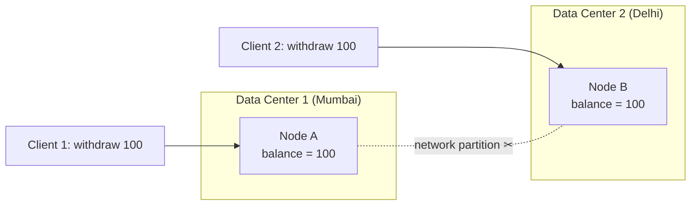
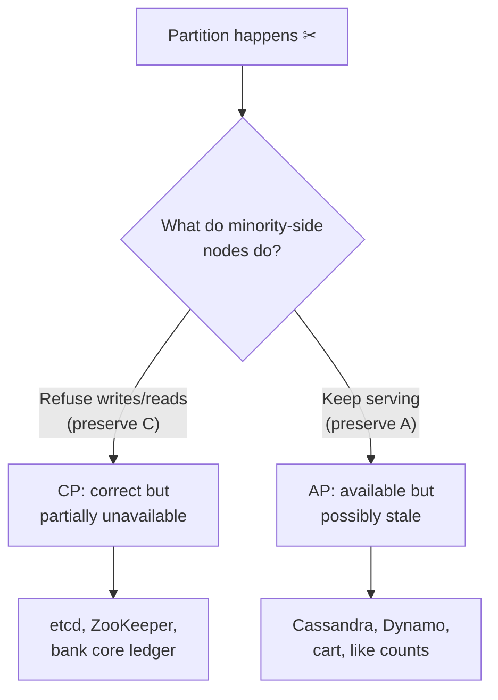
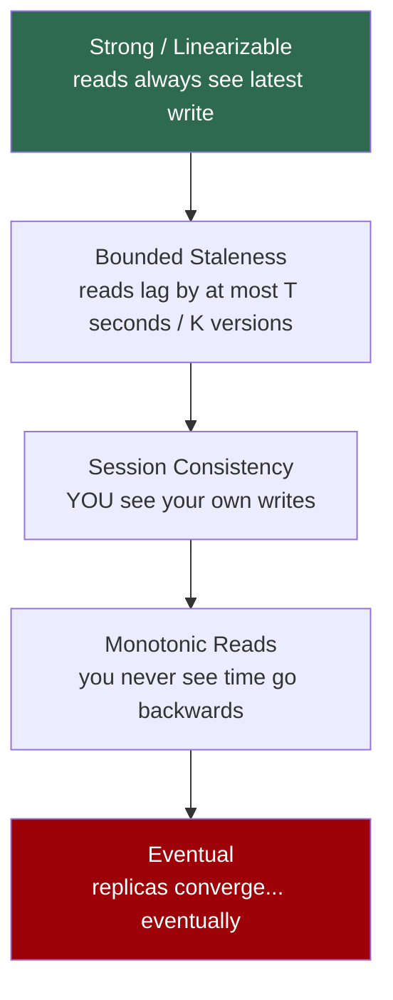
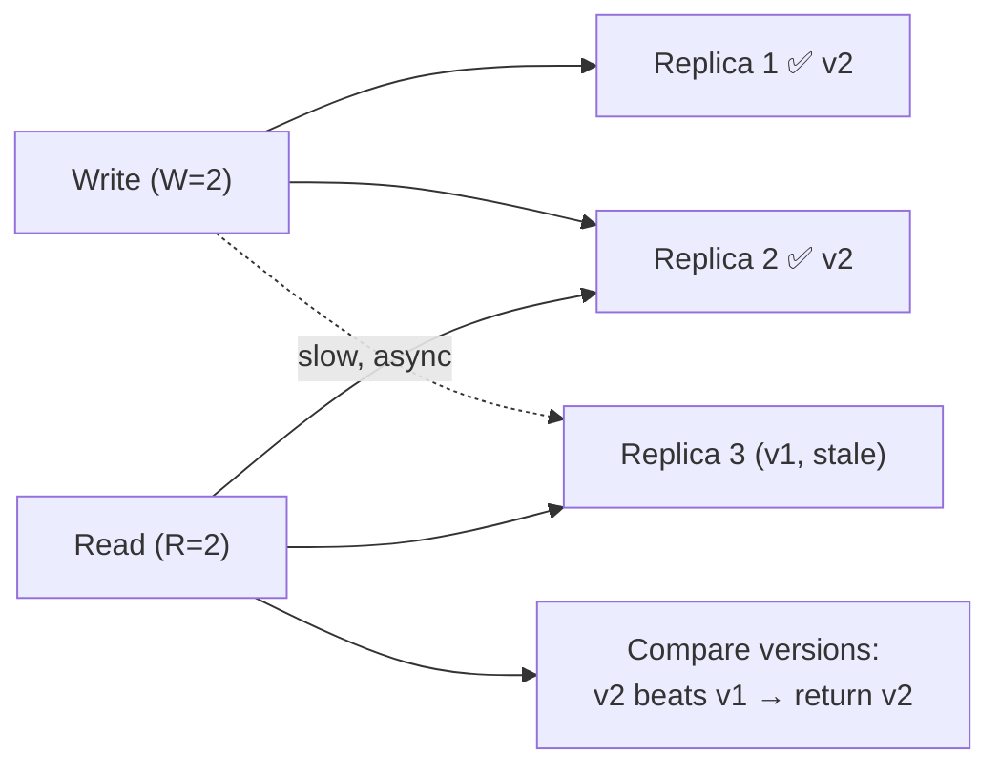
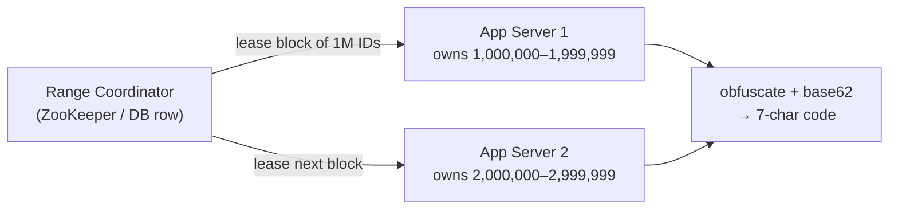
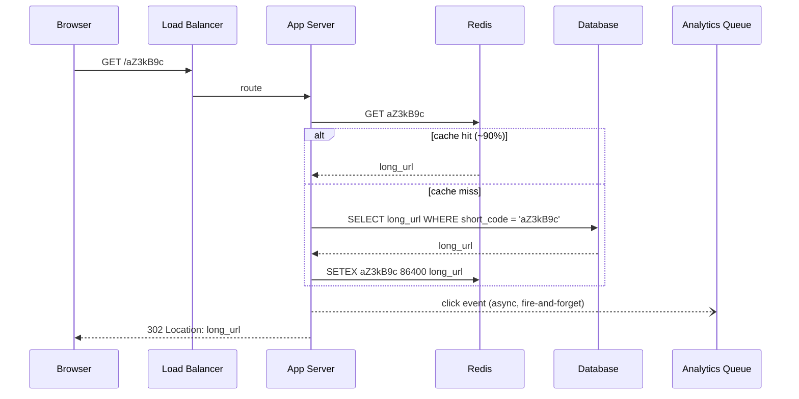

# Day 14 — CAP, Consistency Models + First Full HLD: URL Shortener

> Series: System Design Mastery

## Table of Contents

1. [The CAP Theorem, Precisely](#1-the-cap-theorem-precisely)
2. [What CAP Does NOT Say (Enter PACELC)](#2-what-cap-does-not-say-enter-pacelc)
3. [The Consistency Models Ladder](#3-the-consistency-models-ladder)
4. [Quorum Reads & Writes: The N/R/W Arithmetic](#4-quorum-reads--writes-the-nrw-arithmetic)
5. [Full Worked HLD: URL Shortener](#5-full-worked-hld-url-shortener)
   - 5.1 Requirements
   - 5.2 Back-of-Envelope Estimates
   - 5.3 API Design
   - 5.4 Short-Code Generation (3 Options, Compared Honestly)
   - 5.5 Database Choice & Schema
   - 5.6 Caching Layer
   - 5.7 Redirect Flow
   - 5.8 Full Architecture
   - 5.9 Bottlenecks & Evolution: What Breaks at 10x
   - 5.10 Housekeeping: Expiry, Rate Limiting, Monitoring
6. [The Dark Side: The Over-Engineered URL Shortener](#6-the-dark-side-the-over-engineered-url-shortener)
7. [Self-Check](#7-self-check)
8. [Apply (1 Hour)](#8-apply-1-hour)

---

## 1. The CAP Theorem, Precisely

**In plain words:** Imagine two ATMs for the same bank account that suddenly can't phone each other. Do they keep handing out cash (risking letting you withdraw the same money twice), or do they freeze and say "come back later"? CAP is just the rule that when the phone line between your machines drops, you must pick one of those two behaviours — you can't have both at once. This section makes that trade-off precise.

### Why
Every distributed system you design — Instagram's feed store, Swiggy's order database — runs on multiple machines connected by a network. Networks fail. CAP forces you to decide, *before* the failure happens, what your system does when it can't reach some of its own nodes. If you haven't decided, the failure decides for you, usually at 3 AM.

### What
CAP says: when a **network partition (P)** occurs, a distributed system must choose between:

- **Consistency (C)** — every read receives the most recent write or an error. (This is *linearizability*, not the "C" in ACID.)
- **Availability (A)** — every request to a non-failed node receives a non-error response, without a guarantee that it contains the latest write.

**What a partition really means:** nodes are alive but cannot talk to each other. Node A in Mumbai and Node B in Delhi are both serving traffic, but the link between them is dropped, congested, or a switch died. Neither node knows if the other is dead or just unreachable — and *that ambiguity is the whole problem*.


*During a partition, both nodes may accept conflicting writes — unless one refuses (CP) or both accept and reconcile later (AP).*

**Why "CA" is a myth in distributed systems:** you don't get to *choose* whether partitions happen. On a real network, they will (Google published that even within a single datacenter, a machine can expect dozens of transient network issues per year; cross-region links are far worse). A "CA" system is a single-node system — the moment you have two nodes and a cable, P is mandatory, and the only real menu is **CP vs AP**.

### When
- **Choose CP (refuse requests during partition)** when a wrong answer is worse than no answer.
  - **Bank account**: if the partition hides a withdrawal, serving stale balance lets a user double-spend. Better to show "service temporarily unavailable" than to lose money.
- **Choose AP (serve possibly-stale data)** when *some* answer is better than none.
  - **Shopping cart / Instagram like count**: if two partitioned nodes both accept "add item to cart," you merge carts later. Amazon's Dynamo paper made exactly this choice — a cart that occasionally resurrects a deleted item was judged better than a cart that errors out during checkout season.

| Dimension | CP (bank ledger) | AP (shopping cart) |
|---|---|---|
| During partition | Errors / timeouts on minority side | Everyone gets answers |
| Data risk | None (no stale reads) | Stale reads, conflicting writes |
| Reconciliation | Not needed | Needed (merge, last-write-wins, CRDTs) |
| Example systems | ZooKeeper, etcd, HBase, Spanner-style | Dynamo, Cassandra (tunable), DynamoDB, Riak |
| User-visible failure | "Try again later" | "Huh, my deleted item came back" |

### How
Mechanically, CP systems use consensus (Raft/Paxos): a write commits only when a **majority** of nodes acknowledge it. The minority side of a partition can't form a majority, so it stops serving writes (and often linearizable reads). AP systems accept writes on any reachable replica and use anti-entropy (hinted handoff, read repair, vector clocks) to converge later.


*The CAP decision tree: it only activates during a partition — the rest of the time, it says nothing.*

### Where
- Instagram: like counts and feed fan-out lean AP (a like appearing 2 seconds late is invisible); payments for boosted posts are CP.
- Swiggy: restaurant menu reads are AP (stale menu for 30s is fine); order placement and payment capture are CP (double-charging a customer is a support nightmare).

> **🤔 Wait — CAP says pick 2 of 3, so which one do I just turn off?**
> You don't turn anything off. Partitions (P) aren't a choice — on a real network they *will* happen — so the only real menu is what you do *during* a partition: refuse requests to stay correct (CP) or answer with possibly-stale data (AP). "Giving up C" or "giving up A" just means which one, during a partition, for that data.

**✅ Good scenario (where it saves you):** Swiggy makes payment capture CP (refuse rather than risk a double-charge) and menu reads AP (a 30s-stale menu beats a broken page) — the choice is made *per data type*, exactly where CAP applies.

**❌ Bad scenario (the pain without it / when misused):** A team waves "we chose AP" as blanket permission for sloppiness; their data quietly diverges because nobody wrote the merge logic, and "eventual consistency" becomes "lost writes."

**When NOT to:** Don't invoke CAP for anything that isn't a partition scenario — a missing WHERE clause or a slow query is a bug, not a CAP trade-off; CAP says nothing when the network is healthy.

### The Dark Side
- Engineers wave "CAP" to justify anything ("we chose AP so bugs are fine"). CAP is about *partition behavior only*, not an excuse for missing WHERE clauses.
- Choosing CP everywhere makes your system fall over on every network blip. Choosing AP everywhere means your data quietly diverges and nobody wrote the merge logic. Both are lazy defaults; the real work is choosing *per data type*.
- Real outage flavor: in 2013, a Google App Engine datastore latency incident showed the CP cost — during internal replication trouble, writes stalled globally rather than diverge. Conversely, early Dynamo-style stores at various companies famously "resurrected" deleted items because merge logic preferred add-over-delete.

---

## 2. What CAP Does NOT Say (Enter PACELC)

**In plain words:** CAP only tells you what to do during a disaster (a broken network). But most days nothing is broken, and you *still* face a choice: answer super fast from the nearest copy, or wait a moment to make sure every copy agrees first. PACELC just adds that everyday latency-vs-correctness choice to the picture, so you plan for the normal 99.99% of the time too.

### Why
CAP is silent about the 99.99% of time when there is **no partition**. Yet your biggest daily trade-off — latency vs consistency during *normal* operation — lives exactly there.

### What
**PACELC** (Abadi, 2010): *if Partition, choose A or C; Else (normal operation), choose Latency or Consistency.*

- Synchronous replication to 3 replicas before ack → consistent, but every write pays cross-node (or cross-region: 50–150 ms) round trips.
- Async replication → fast writes, but a read on a replica may lag.

| System | Partition choice | Else (normal) choice | Shorthand |
|---|---|---|---|
| DynamoDB (default) | A | L | PA/EL |
| Cassandra (QUORUM) | tunable | tunable | PA/EL-ish |
| MongoDB (majority) | C | C | PC/EC |
| Google Spanner | C | C (pays latency via TrueTime) | PC/EC |
| MySQL async replica reads | A | L | PA/EL |

### When / How / Where
Use PACELC when someone says "we need strong consistency": ask *"are you willing to pay 2–10x write latency every day for it?"* Instagram pays EL for feeds (async fan-out); Swiggy pays EC for payment state (synchronous commit to the ledger).

> **🤔 Wait — if CAP already covers consistency trade-offs, why do I need PACELC?**
> Because CAP is silent the 99.99% of the time there's *no* partition — and that's where your biggest daily trade-off lives: answer fast from the nearest replica, or wait for replicas to agree. PACELC adds that everyday latency-vs-consistency choice CAP ignores.

**✅ Good scenario (where it saves you):** Instagram picks EL (async fan-out) for feeds — a feed a second stale is invisible, and users get instant loads; the everyday latency win is the whole point.

**❌ Bad scenario (the pain without it / when misused):** A team demands "strong consistency" everywhere without asking the PACELC question; every write now pays cross-region 50–150 ms round trips daily, and someone spends a quarter hunting the "slow database" they designed.

**When NOT to:** Don't cargo-cult a four-letter PACELC label into a design doc — write down the *actual* replication mode and the *actual* staleness bound your product tolerates instead.

### The Dark Side
PACELC is a lens, not a spec. Don't cargo-cult a four-letter label into your design doc; write down the *actual* replication mode and the *actual* staleness bound your product tolerates.

---

## 3. The Consistency Models Ladder

**In plain words:** "Consistency" isn't all-or-nothing — think of it as a staircase. At the top step, every copy of your data agrees the instant you write it (correct, but slow and expensive). At the bottom step, copies just catch up "eventually" (cheap and fast, but you might briefly see stale data). Most features only need to stand a few steps up, and this section helps you find the cheapest step your users can live on.

### Why
"Eventual consistency" and "strong consistency" are the two poles everyone knows, but real systems live on the rungs between. Each rung has a precise, *user-visible* symptom — knowing them lets you pick the cheapest model your UX can tolerate.

### What — the ladder, strongest to weakest


*The consistency ladder: every step down buys latency and availability, and sells a guarantee.*

| Model | Guarantee | Concrete user-visible symptom if you have ONLY this |
|---|---|---|
| **Strong (linearizable)** | Every read sees the latest committed write, globally | None — behaves like one machine. Cost: high latency, lower availability |
| **Bounded staleness** | Reads are at most T seconds (or K versions) behind | Swiggy rider location on the map is "up to 5 seconds old" — acceptable, and it's a *promise*, not a hope |
| **Session (read-your-writes)** | Within one user's session, their own writes are visible | You post a comment on Instagram and it's *there* when the page refreshes — but your friend may not see it for 2s |
| **Monotonic reads** | Once you've seen version N, you never see < N | Without it: refresh Instagram, see 120 likes; refresh again, see 118. Time appears to run backwards |
| **Eventual** | If writes stop, replicas converge | You change your profile photo; your friend sees the old one for a minute; two friends see different photos at the same moment |

### When
Start every feature at *eventual* and climb only as far as the UX complaint forces you. "I posted a comment and it vanished" (needs session). "The like count flickers down" (needs monotonic). "The bank balance is wrong" (needs strong).

### How
- Session consistency: sticky-route the user to the replica that took their write, or pass a "min version" token with requests.
- Monotonic reads: pin a session to one replica, or track the highest version seen client-side.
- Bounded staleness: replication lag SLO + refuse reads from replicas lagging beyond T (Cosmos DB exposes this as a first-class mode).

### Where
Instagram comments = session consistency (Cassandra + careful read routing). Swiggy order status = monotonic at minimum ("PREPARING" must never revert to "PLACED" on the tracking screen).

> **🤔 Wait — isn't consistency just "strong" vs "eventual"? Why five rungs?**
> Because most features need neither pole. Between them sit precise, user-visible guarantees — read-your-writes, monotonic reads, bounded staleness — each cheaper than strong. Picking the lowest rung your UX can tolerate saves real latency and availability.

**✅ Good scenario (where it saves you):** Instagram comments run on session consistency — you always see your own comment on refresh (cheap to guarantee), while your friend may see it a couple seconds later, which nobody notices.

**❌ Bad scenario (the pain without it / when misused):** A team ships plain "eventual" for an order-status screen; "PREPARING" flickers back to "PLACED" on refresh (no monotonic-reads guarantee), and customers think the app is broken.

**When NOT to:** Don't climb to strong/linearizable for data whose staleness nobody can perceive (like counts, feed order) — you'd pay high latency and lower availability for a guarantee the UX doesn't need.

### The Dark Side
Teams claim "eventual consistency" and ship *no* consistency: writes that get lost, not just delayed. Eventual consistency still requires convergence machinery (read repair, anti-entropy). Also: mixing rungs invisibly — API reads from a lagging replica, but the cache reads from the primary — creates flickering UIs nobody can reproduce.

---

## 4. Quorum Reads & Writes: The N/R/W Arithmetic

**In plain words:** Suppose your data lives on 3 copies. If you make every *write* land on at least 2 copies, and every *read* check at least 2 copies, then any read and any write are forced to share at least one copy in common — so a reader can never completely miss the newest value. Quorums are just this "overlap" arithmetic that lets you dial, per operation, how careful (and how slow) you want to be.

### Why
Quorums let you *dial* consistency per operation instead of picking one global mode. This is the mechanism behind Cassandra's and DynamoDB's tunable consistency.

### What
- **N** = number of replicas for each key
- **W** = replicas that must ack a write before success
- **R** = replicas consulted for a read

**The rule:** if **R + W > N**, read and write quorums overlap — every read set intersects every write set in at least one replica that has the latest value → you get (mostly) strong consistency.

### How — worked example with N = 3

| Config | R + W | Consistent? | Write latency | Read latency | Tolerates node loss? |
|---|---|---|---|---|---|
| W=3, R=1 | 4 > 3 ✅ | Yes | Slow (all 3) | Fast | Writes fail if any node down |
| W=2, R=2 | 4 > 3 ✅ | Yes | Medium | Medium | 1 node down: still fine — the sweet spot |
| W=1, R=1 | 2 ≤ 3 ❌ | No (maybe stale) | Fast | Fast | Very robust, eventually consistent |
| W=1, R=3 | 4 > 3 ✅ | Yes | Fast writes | Slow reads | Read-heavy penalty |

Concrete trace with N=3, W=2, R=2: a write lands on replicas {1, 2} (replica 3 was slow). A read consults any 2 of {1, 2, 3} — every possible pair {1,2}, {1,3}, {2,3} contains at least one of {1,2}, so the reader sees the new value and (via versioning) picks the newest.


*R + W > N guarantees overlap: even when the read touches a stale replica, at least one fresh replica is in the set.*

### When / Where
DynamoDB: N=3 internally; "strongly consistent read" ≈ quorum read, "eventually consistent read" = R=1 at half the cost. Cassandra: per-query `QUORUM` vs `ONE`.

> **🤔 Wait — if I want strong consistency, why not just always read and write *all* replicas?**
> Because W=N makes every write fail if a single node is down, and R=N does the same for reads. The quorum insight is you only need *overlap*: R+W>N guarantees every read set shares a replica with every write set, so W=2, R=2 on N=3 gives consistency *and* survives one node loss.

**✅ Good scenario (where it saves you):** N=3, W=2, R=2 is the sweet spot — reads and writes overlap for consistency, yet one node can be down and both still succeed; it's how Cassandra/DynamoDB tune per-query.

**❌ Bad scenario (the pain without it / when misused):** A team sets W=1, R=1 for speed, forgets they did, and files a bug titled "database loses writes" — R+W=2 ≤ 3 means a read can completely miss the newest value.

**When NOT to:** Don't crank W=3, R=3 for "maximum safety" — you gain nothing over a proper quorum and lose all fault tolerance (any node down blocks the operation); overlap, not maximalism, is the goal.

### The Dark Side
Quorum ≠ perfect linearizability (sloppy quorums, hinted handoff, and concurrent writes with clock-based versioning can still bite — see the Kleppmann "please stop calling databases CP or AP" critiques). And R+W>N with N=3 means *every* read hits 2 nodes: you just doubled read amplification. People tune W=1,R=1 for speed, forget they did, and then file a bug titled "database loses writes."

---

## 5. Full Worked HLD: URL Shortener

**In plain words:** A URL shortener takes a giant link and hands back a tiny one like `sho.rt/aZ3kB9c`, then bounces anyone who clicks the tiny one straight to the original. It sounds trivial, but building it well forces you to think about how much traffic you'll get, where to store billions of links, and how to look one up in a few milliseconds — which is exactly why it's the classic first system-design exercise.

Time to assemble two weeks of building blocks into a complete design. The URL shortener is the "hello world" of HLD — small enough to finish, rich enough to touch estimation, storage, caching, and ID generation.

### 5.1 Requirements

**Functional:**
1. Given a long URL, return a short URL (e.g., `https://sho.rt/aZ3kB9c`).
2. Given a short URL, redirect (HTTP 301/302) to the original.
3. Optional: custom aliases, expiry (default 5 years), basic click analytics.

**Non-functional:**
- **Read-heavy**: redirects vastly outnumber shortens — assume **100:1**.
- Redirect latency: **p99 < 50 ms** (it sits in front of every click).
- Availability > consistency for redirects (AP-leaning: a redirect that's 1s stale is invisible; a redirect that errors is a broken link on someone's tweet).
- Short codes must be non-guessable-ish (don't leak sequential business volume) and never collide.

### 5.2 Back-of-Envelope Estimates

Assume 100M new URLs/month (a large public shortener, TinyURL-scale).

- **Writes/sec:** 100,000,000 / (30 × 24 × 3600 ≈ 2.6M s) ≈ **~40 writes/sec** (peak ×3 ≈ 120/s). Tiny.
- **Reads/sec:** 100:1 → **~4,000 redirects/sec**, peak **~12,000/s**. This is the real load.
- **Storage over 5 years:** 100M/month × 60 months = **6 billion rows**. Per row: short code (7 B) + long URL (~500 B avg) + user id + timestamps ≈ **~600 B** → 6B × 600 B ≈ **3.6 TB**. With indexes and replication ×3 ≈ **~11 TB** raw. One beefy machine's worth of data — plan for sharding, don't start with it.
- **Cache size (80/20 rule):** 20% of daily-read URLs get 80% of traffic. Daily reads ≈ 4,000/s × 86,400 ≈ 350M redirects/day, but hitting maybe ~50M *distinct* URLs. Cache the hot 20%: 10M entries × 600 B ≈ **~6 GB** — fits in one Redis node with room to spare; provision 25 GB for headroom.
- **Short code length:** base62 (a–z, A–Z, 0–9). 62⁷ ≈ **3.5 trillion** combinations — 6B needs only a fraction; 7 chars lasts decades. (62⁶ ≈ 57B would work but leaves thin margin.)

### 5.3 API Design

```
POST /api/v1/urls
  body: { "long_url": "https://...", "custom_alias": "diwali-sale" (opt), "expires_at": ... (opt) }
  → 201 { "short_url": "https://sho.rt/aZ3kB9c" }
  → 409 if custom_alias taken
  Auth: API key; rate limit: 10/min per key (writes are where abuse lives)

GET /{short_code}
  → 302 Location: <long_url>     (302, not 301: 301 is cached by browsers forever,
                                   killing analytics and making expiry/deletion impossible)
  → 404 if unknown or expired

GET /api/v1/urls/{short_code}/stats  → { "clicks": 18234, ... }
```

### 5.4 Short-Code Generation: 3 Options, Compared Honestly

**In plain words:** The short code (the `aZ3kB9c` part) is like a cloakroom ticket — every link needs its own unique one, and two links must never accidentally get the same ticket. This section compares three ways to hand out those tickets: guess-and-check (hash the URL), count upward (a running counter), or print a big stack of random tickets in advance and just hand them out (a Key Generation Service).

> **🤔 Wait — why not just hash the URL to make the short code? It's one line.**
> Because truncating a hash to 7 chars *guarantees* eventual collisions (birthday problem), so every insert needs a check-and-retry loop with thorny concurrency. A ranged counter gives zero collisions by construction; the only real problem left is de-sequencing the codes so they don't leak volume.

**✅ Good scenario (where it saves you):** Ranged counters (each app server leases a block of 1M IDs) plus a fixed XOR to de-sequence give collision-free, non-enumerable codes with a fast local increment — the best default at this scale.

**❌ Bad scenario (the pain without it / when misused):** A team hashes URLs and truncates; at billions of rows the rare collisions arrive during peak, the retry loop races under concurrency, and two links briefly fight over one code.

**When NOT to:** Don't reach for a full Key Generation Service (pre-generated keys, extra service, claim concurrency) at small scale — ranged counters are simpler; add a KGS only when non-guessability is a hard requirement or scale is very large.

**Option A — Hash the URL (MD5/SHA-256, take first 7 base62 chars).**
Same URL → same code (dedup for free). But truncating a hash *guarantees* eventual collisions (birthday problem: with 6B entries in a 3.5T space, collisions are rare but nonzero) → every insert needs a check-and-retry loop → extra DB round trip and thorny concurrency under race.

**Option B — Global counter + base62 encode.**
Counter 125,000,000,001 → base62 → `8m0Kx3B`. Zero collisions by construction. But: a single counter is a SPOF and a hotspot, and sequential codes leak volume ("competitor created 2M links this month") and are enumerable. Fixes: ranged counters (each app server leases a block of 1M IDs from ZooKeeper/DB) + XOR/bit-shuffle the counter before encoding to de-sequence it.

**Option C — Key Generation Service (KGS): pre-generate random codes offline.**
A background job fills a `unused_keys` table with random 7-char codes; the write path just *claims* one (move to `used`, or mark taken). No collision check at request time, no sequence leak. Cost: one more service + careful concurrency on the claim (SELECT ... FOR UPDATE SKIP LOCKED, or hand each app server a pre-fetched batch of keys in memory).

| Criterion | A: Hash + collision check | B: Counter + base62 | C: Pre-generated KGS |
|---|---|---|---|
| Collisions | Possible → retry loop | Impossible | Impossible (generated unique) |
| Request-time latency | Extra read (collision check) | Fast (local range) | Fastest (claim from batch) |
| Guessable / leaks volume | No | Yes, unless obfuscated | No |
| Dedup of same long URL | Free | No (need separate index) | No |
| Extra infra | None | Coordinator for ranges | KGS service + key table |
| Failure mode | Rare insert retries | Range coordinator down → new ranges blocked (existing ranges keep working) | KGS down → app servers burn cached batch, then writes fail |
| Verdict | Fine at small scale | **Best default** with ranged counters | Best at very large scale / when non-guessability is hard requirement |

**Chosen: B with ranged counters** — simplest thing with zero collisions; add obfuscation (fixed XOR + shuffle) to avoid enumeration.


*Ranged counters: each server increments locally (fast) and only talks to the coordinator once per million IDs.*

The core encoding, in Java — this is the whole "algorithm" of a URL shortener:

```java
public final class Base62Codec {

    // The alphabet: 0-9, then A-Z, then a-z = 62 characters total
    private static final String BASE62 =
        "0123456789ABCDEFGHIJKLMNOPQRSTUVWXYZabcdefghijklmnopqrstuvwxyz";

    // A fixed constant used to scramble (de-sequence) the visible codes
    private static final long SECRET_XOR = 0x5A3C_9F17_2B4DL;

    // Convenience overload: default the code length to 7 characters
    public static String encode(long counterId) {
        return encode(counterId, 7);
    }

    // Turn a numeric counter id into a short base62 code
    public static String encode(long counterId, int length) {
        long n = counterId ^ SECRET_XOR;      // obfuscate: 1000001 no longer follows 1000000
        StringBuilder code = new StringBuilder();
        while (n > 0) {
            int rem = (int) (n % 62);         // remainder picks the next character
            n = n / 62;                       // shrink the number for the next round
            code.append(BASE62.charAt(rem));
        }
        // We built the code backwards, so reverse it, then left-pad to a fixed length
        String result = code.reverse().toString();
        while (result.length() < length) {
            result = "0" + result;            // left-pad with '0' up to the fixed width
        }
        return result;
    }

    // Reverse the process: turn a code back into its numeric id
    public static long decode(String code) {
        long n = 0;
        // Strip leading padding zeros, then read each character left to right
        for (char ch : code.replaceFirst("^0+", "").toCharArray()) {
            n = n * 62 + BASE62.indexOf(ch);
        }
        return n ^ SECRET_XOR;                // XOR is its own inverse, so this undoes encode()
    }

    public static void main(String[] args) {
        // Quick self-test: encoding then decoding must return the original number
        assert decode(encode(1_250_000_042L)) == 1_250_000_042L;
    }
}
```

Note what is *not* here: no hashing, no collision handling, no distributed lock — the ranged counter already guaranteed uniqueness upstream. (XOR is obfuscation, not security; if enumeration must be cryptographically hard, use option C or a keyed permutation.)

### 5.5 Database Choice & Schema

**In plain words:** Here we just pick where to keep all the links. Because we only ever look them up by their short code — like finding a word in a dictionary — and never do fancy cross-referencing between rows, a simple "give me the value for this key" store is plenty.

Access pattern: key → value lookup by `short_code`, 12K reads/s peak, 11 TB over 5 years, no joins, no transactions across rows. This screams **key-value / wide-column** (DynamoDB, Cassandra) — but honestly, **PostgreSQL with a hash-partitioned table also works for years** at this write volume (40/s!). Choose DynamoDB-style if you want ops-free horizontal scale from day one; choose Postgres if your team knows it. We'll draw DynamoDB.

```sql
-- Logical schema (works in either world)
urls (
  short_code   VARCHAR(10) PRIMARY KEY,   -- partition key
  long_url     TEXT NOT NULL,
  user_id      BIGINT,
  created_at   TIMESTAMP,
  expires_at   TIMESTAMP,
  click_count  BIGINT DEFAULT 0            -- updated async, never in redirect path
)
-- Secondary index on (user_id, created_at) for "my links" pages
```

Partitioning: hash of `short_code` → uniform spread, no hot ranges (codes are effectively random after obfuscation).

### 5.6 Caching Layer

**In plain words:** A cache is a small, super-fast notepad that remembers the answers to the most popular questions, so you don't have to walk to the big filing cabinet (the database) every single time. Since a handful of viral links get clicked far more than all the rest, keeping just those hot links on the notepad handles most of the traffic instantly.

- **Redis, cache-aside** on the redirect path: `GET code` → hit (target ~90%+) → redirect; miss → DB → `SETEX code 86400 long_url`.
- Hot-key note: a viral link (celebrity tweet) is *one key* at 50K RPS — Redis handles ~100K GET/s per node fine, but add a tiny in-process LRU (e.g., 10K entries, 30s TTL) in each app server so a single mega-viral key never even reaches Redis.
- Negative caching: cache 404s for 60s, or a Bloom filter of all codes in front, so bots scanning random codes don't hammer the DB.

### 5.7 Redirect Flow


*The redirect hot path: cache-first, analytics pushed async so a slow analytics pipeline can never slow a redirect.*

### 5.8 Full Architecture

```mermaid
flowchart TD
    U["Users"] --> DNS["DNS + CDN edge<br/>(optional: edge-cache redirects)"]
    DNS --> LB["Load Balancer"]
    LB --> AS1["App Server 1"]
    LB --> AS2["App Server 2"]
    LB --> ASN["App Server N (stateless)"]
    AS1 --> RC["Redis Cluster<br/>(hot URL cache, ~25 GB)"]
    AS2 --> RC
    ASN --> RC
    AS1 --> DB[("URL Store<br/>DynamoDB / partitioned Postgres<br/>~11 TB / 5 yr")]
    AS2 --> DB
    ASN --> DB
    AS1 --> ZK["Range Coordinator<br/>(ID blocks)"]
    AS1 --)MQ["Queue (clicks)"]
    MQ --> AGG["Analytics Consumer"]
    AGG --> AN[("Analytics Store<br/>counts, daily rollups")]
```
*Full HLD: stateless app tier, cache-first reads, ranged-counter writes, analytics fully decoupled via a queue.*

### 5.9 Bottlenecks & Evolution: What Breaks at 10x

At 10x (40K redirects/s peak, 60B rows / ~110 TB over 5 yr):

| Component | Symptom at 10x | Evolution |
|---|---|---|
| Redis single node | Memory + throughput ceiling | Redis Cluster, shard by code; keep in-process LRU for viral keys |
| Database | 110 TB, partitions imbalanced by luck | Already-partitioned KV store shrugs; Postgres path now needs real sharding — this is where DynamoDB choice pays off |
| Analytics writes | 40K events/s of `click_count++` would melt any row | Already async: batch-aggregate in the consumer (flush counts every 10s) |
| Geo latency | 150 ms redirects from Australia | Multi-region read replicas + GeoDNS; URLs are immutable after creation → replication lag is harmless (perfect AP fit) |
| Abuse | Malware/phishing links at scale | URL scanning on create + async re-scan; blocklist check in redirect path (Bloom filter) |

Note what does **not** break: writes. 400/s is still nothing. This asymmetry — reads scale 100x before writes matter — should drive every choice above.

### 5.10 Housekeeping: Expiry, Rate Limiting, Monitoring

The parts every candidate forgets and every operator lives in:

**Expiry & cleanup.** Never delete expired rows in the read path (adds latency, and mass-expiry moments would spike it). Instead: (a) the redirect handler checks `expires_at` and returns 404 for expired codes (correctness now), (b) a nightly janitor deletes rows expired > 30 days, in batches of 10K with sleeps between batches so replication and vacuum keep up (space later), and (c) cache TTLs never exceed time-to-expiry so a purged row can't live on in Redis. Should you *recycle* expired codes? No — old links embedded across the web would silently redirect somewhere new, which is a phishing gift. 62⁷ is big enough to never reuse.

**Rate limiting.** Writes: token bucket per API key (e.g., 10/min free tier) — the primary abuse valve, since every write permanently consumes storage and a code. Reads: per-IP limits only against scanners (say 100 RPS/IP), because legitimate redirect traffic is bursty by nature; negative caching + the Bloom filter (Section 5.6) are the real defense.

**What goes on the dashboard (with rough alert lines):**

| Metric | Healthy | Page when |
|---|---|---|
| Redirect p99 latency | < 50 ms | > 150 ms for 5 min |
| Cache hit ratio | > 90% | < 75% (cache too small, or a purge bug) |
| 404 rate | < 2% of redirects | > 10% (scanner attack or data-loss bug) |
| DB read QPS | ~10% of redirect QPS | Approaching provisioned ceiling |
| Analytics queue lag | < 1 min of events | > 15 min and growing (Day 15's whole lesson) |
| ID range remaining per app server | > 100K | Coordinator unreachable AND range < 10K |

---

## 6. The Dark Side: The Over-Engineered URL Shortener

> **🤔 Wait — it's a distributed system, shouldn't I use Kafka, Cassandra, and microservices to be "scalable"?**
> Not until the numbers say so. This system is 40 writes/sec — a single Postgres does 5,000+. The skill being tested is doing the arithmetic *first* and letting the numbers veto the architecture; 40 writes/sec deletes half the fancy diagram.

**✅ Good scenario (where it saves you):** A stateless app tier + one replicated DB + one Redis + one analytics queue + a ranged counter handles the whole design — ~2,000 lines, one on-call rotation, and it scales reads 100x before writes ever matter.

**❌ Bad scenario (the pain without it / when misused):** A team ships Kafka-for-40-writes, a 12-node Cassandra ring for 3.6 TB that fits on one disk, and five microservices each with its own DB and pager — enormous ops cost for a toy workload, while under-engineering the actual hot path (301 redirects that can never expire).

**When NOT to:** Don't gold-plate the cold path (writes) — but equally, don't under-engineer the hot path; negative caching, 302 (not 301), and a non-locking click counter are where the real load lives.

The interview-famous failure mode is *gold-plating*. The over-engineered version:

- Kafka between the app and the DB "for write scalability" — for **40 writes/sec**. A single Postgres does 5,000+.
- Cassandra ring with 12 nodes on day one — for 3.6 TB that fits on one disk.
- Microservices: `shorten-service`, `redirect-service`, `analytics-service`, `key-service`, each with its own DB and on-call rotation — for what is honestly ~2,000 lines of code.
- Exactly-once event pipelines for click counts that the product displays as "~18.2K".

**What this system actually needs:** a stateless app tier, one boring replicated database, one Redis, one queue for analytics, and a ranged counter. The skill being tested in this HLD isn't stacking components — it's *doing the arithmetic first* (Section 5.2) and letting the numbers veto the architecture. 40 writes/sec is the number that deletes half the fancy diagram.

The inverse dark side exists too: using 301 redirects (browser caches forever → can never expire or fix a link), skipping negative caching (code-scanner bots become a DB DoS), or an unpartitioned `click_count++` on the hot path (row lock contention on viral links). Under-engineering the hot path, over-engineering the cold path — the classic beginner inversion.

---

## 7. Self-Check

1. Define a network partition precisely. Why can't a two-node system simply "detect" one reliably?
2. Why is "CA" not a real option for any multi-node system? What is a CA system in practice?
3. Give one data type at Swiggy that should be CP and one that should be AP, and justify each in one sentence.
4. What does CAP say about behavior when there is *no* partition? What does PACELC add?
5. A user refreshes Instagram and the like count drops from 120 to 118, then back. Which consistency model is missing? Which model fixes "I can't see my own comment"?
6. With N=3, W=1, R=1: is a read guaranteed to see the latest write? What single change gives consistency while tolerating one node failure?
7. Reproduce the URL shortener math: 100M URLs/month → writes/sec, reads/sec at 100:1, and 5-year storage. Which of these numbers kills the "Kafka for writes" idea?
8. Compare counter+base62 vs pre-generated KGS on: collisions, guessability, and failure modes.
9. Why 302 instead of 301 for redirects? What breaks with 301?
10. Name two things that break at 10x scale in this design and two that don't. Why is the asymmetry the important lesson?

---

**Tomorrow:** Day 15 — Message Queues & Async Processing. That little "analytics queue" in today's diagram becomes the star: Kafka vs RabbitMQ, delivery guarantees, why exactly-once is mostly a lie, and the outbox pattern.

## 8. Apply (1 Hour)

1. **(20 min)** Redo the full estimation for a URL shortener at *Bitly scale*: 600M links/month, 200:1 read ratio. Compute writes/s, reads/s, 5-yr storage, cache size. Does anything in the architecture change? Write down what and why.
2. **(20 min)** Implement counter → base62 in Java (encode + decode), then add a simple obfuscation (XOR with a constant) and verify round-trips for 1,000 IDs.
3. **(20 min)** Take your Day-13 (or any) app and classify 5 of its data items on the consistency ladder — write the user-visible symptom you'd accept for each. One sentence per item.
