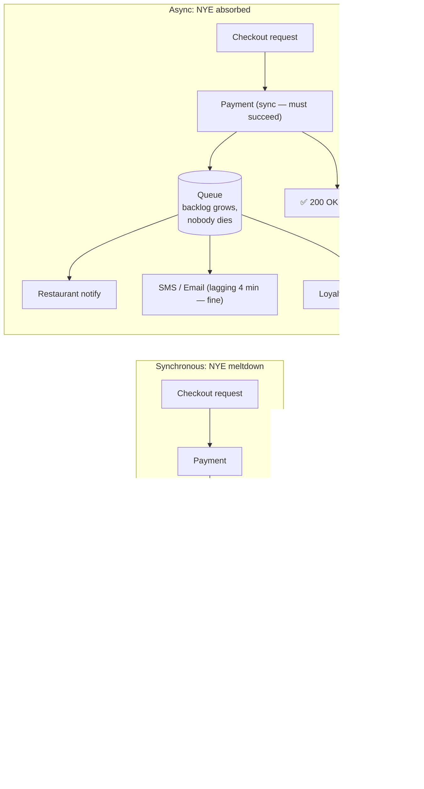
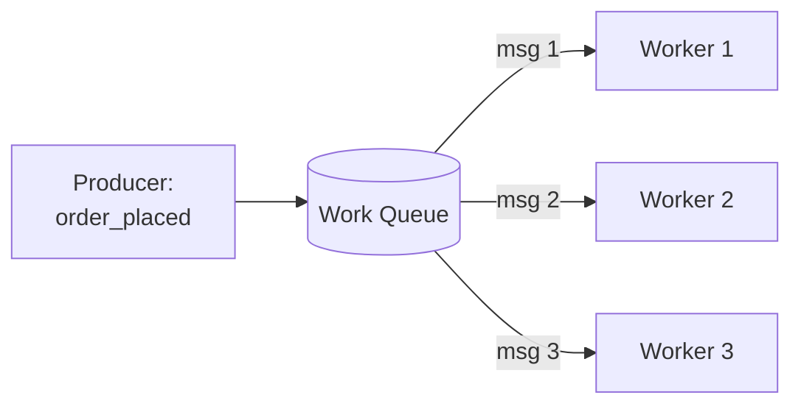
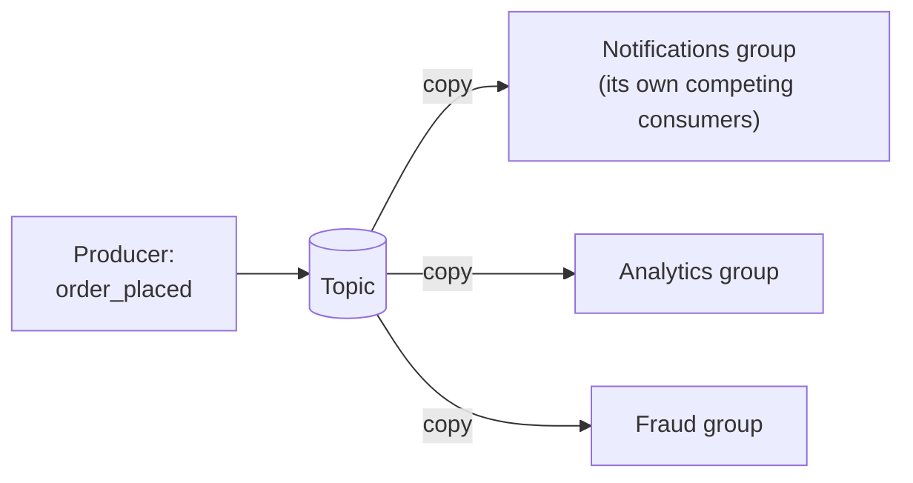
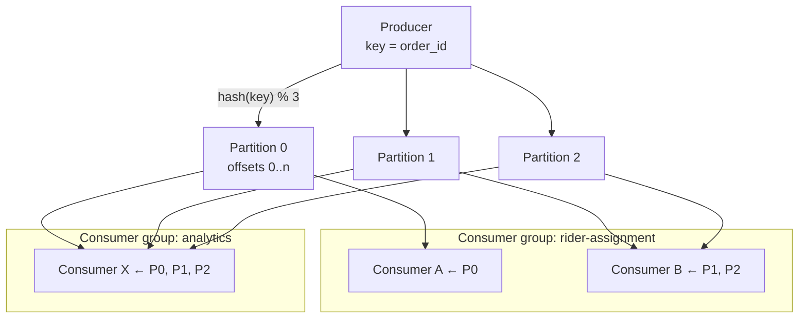
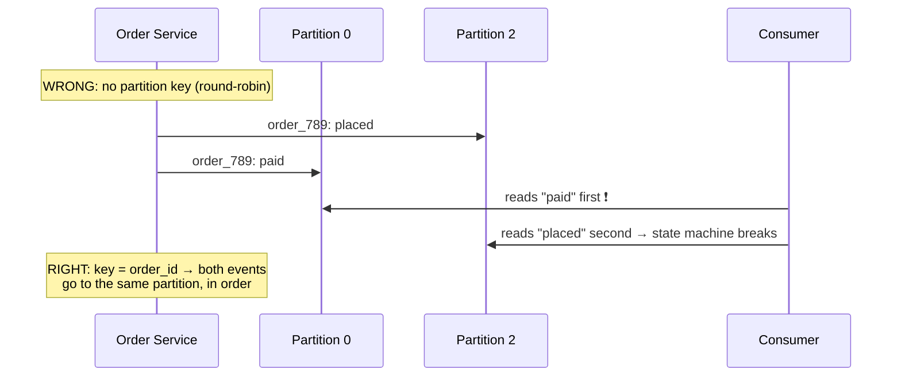
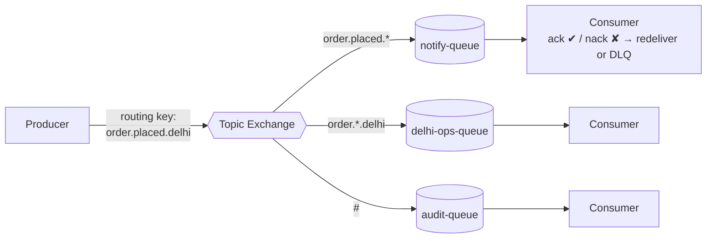
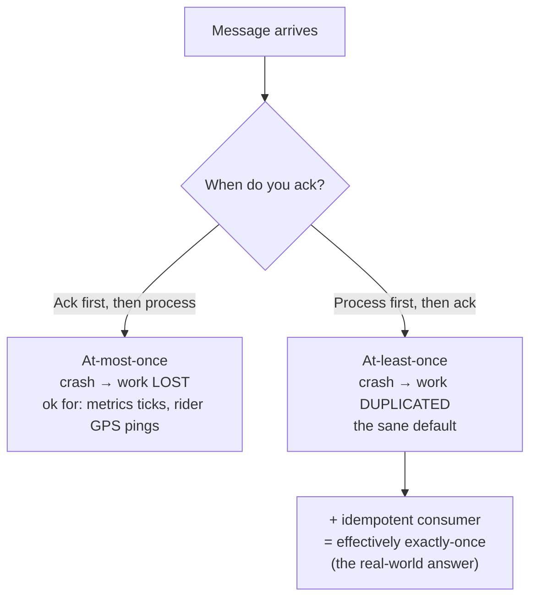
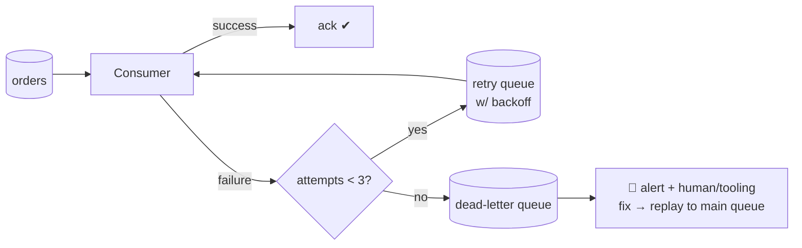
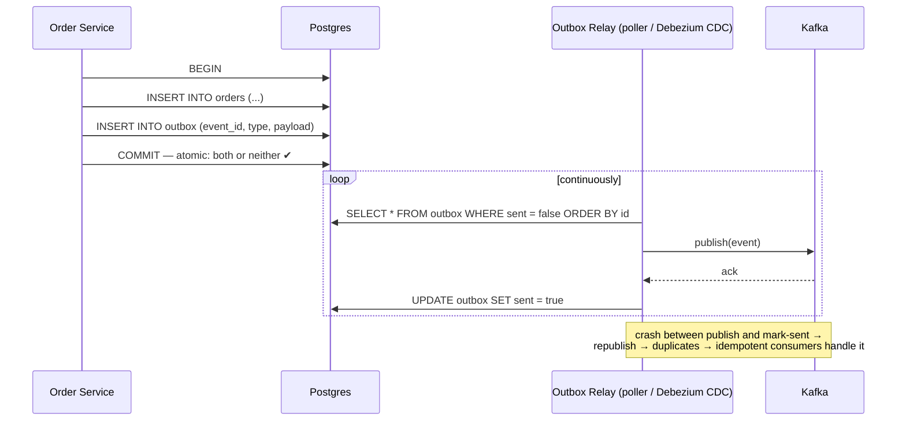
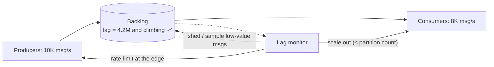

# Day 15 — Message Queues & Async Processing

> Series: System Design Mastery

## Table of Contents

1. [Why Async? The Swiggy Order-Spike Story](#1-why-async-the-swiggy-order-spike-story)
2. [Topologies: Queue vs Pub/Sub](#2-topologies-queue-vs-pubsub)
3. [The Kafka Model, Properly](#3-the-kafka-model-properly)
4. [The RabbitMQ Model](#4-the-rabbitmq-model)
5. [Kafka vs RabbitMQ: The Honest Table](#5-kafka-vs-rabbitmq-the-honest-table)
6. [Delivery Guarantees In Depth](#6-delivery-guarantees-in-depth)
7. [The Idempotent Consumer Pattern (Code)](#7-the-idempotent-consumer-pattern-code)
8. [Poison Messages & Dead Letter Queues](#8-poison-messages--dead-letter-queues)
9. [The Outbox Pattern](#9-the-outbox-pattern)
10. [Backpressure & Consumer Lag](#10-backpressure--consumer-lag)
11. [The Dark Side: When the Queue Was the Mistake](#11-the-dark-side-when-the-queue-was-the-mistake)
12. [Self-Check](#12-self-check)
13. [Apply (1 Hour)](#13-apply-1-hour)

---

## 1. Why Async? The Swiggy Order-Spike Story

**In plain words:** Async processing is like dropping a letter in a mailbox instead of standing at the recipient's door waiting for a reply. You hand off the task, get on with your day, and someone else delivers it when they can. The "mailbox" here is a message queue: your app writes down what needs doing and returns instantly, while background workers do the slow parts on their own schedule.

### Why
It's New Year's Eve, 9:15 PM. Swiggy's order rate jumps from a steady 2,000 orders/min to 12,000 orders/min in twenty minutes. Placing an order triggers: payment capture, restaurant notification, rider assignment, SMS, email, loyalty points, fraud check, analytics. If all of that runs synchronously inside the "Place Order" request:

- The request takes 3–8 seconds (sum of 8 downstream calls).
- The **slowest, least important** dependency (say, the email vendor timing out at 10s) makes checkout fail — users retry — load doubles — cascade.
- Every downstream service must be provisioned for 12,000/min peak, even the ones that could happily catch up an hour later.

### What
Asynchronous processing = the request writes durable *intent* (a message) and returns; consumers process it on their own schedule. The three superpowers:

1. **Decoupling** — the order service doesn't know or care that the loyalty service exists. New consumers attach without touching the producer.
2. **Spike absorption** — the queue is a shock absorber. Producers write at 12,000/min; the rider-assignment consumer drains at its sustainable 8,000/min and catches up after the spike. Users experience full speed; the backlog, not the user, absorbs the burst.
3. **Safe retries** — if the SMS provider is down for 10 minutes, messages wait and are retried. A synchronous call would have to choose between failing the order or blocking it.

> **🤔 Wait — why add a queue when a direct API call already works?**
> A direct call couples your checkout latency to your slowest dependency and forces every downstream service to be sized for peak. The queue doesn't make the work faster — it decouples *when* the work happens from *when the user waits*. If the email vendor stalls for 10s, a sync call fails the order; a queued message just waits and retries.

**✅ Good scenario (where it saves you):** On Swiggy's NYE spike, orders jump 6x in 20 minutes. Checkout writes one durable message and returns in 400ms while loyalty, SMS, and analytics consumers drain the backlog over the next few minutes. The user sees full speed and no downstream service has to be provisioned for the burst.

**❌ Bad scenario (the pain without it / when misused):** All 8 downstream steps run inline, so the flaky email vendor's 10s timeout makes checkout fail. Users hit retry, load doubles, and payment and inventory cascade into a full NYE meltdown — the exact outage async prevents.

**When NOT to bother:** If the caller needs the result to respond — a payment authorization or an inventory check at checkout — a synchronous call with a timeout is simpler and faster than a round-trip through a broker.


*Only the truly transactional step stays synchronous; everything that can be late goes behind the queue.*

### When
Async when: the caller doesn't need the result to respond; work is retryable; load is spiky; consumers scale differently than producers. Sync when: the user needs the answer *now* (payment authorization, inventory check at checkout).

### Where
Instagram: uploading a photo returns immediately; feed fan-out to millions of followers, thumbnail generation, and ML tagging all run async (Instagram famously built early async processing on Gearman, later Celery/RabbitMQ). Swiggy/Uber-class systems put Kafka between order events and everything downstream.

### The Dark Side (preview)
Async trades *latency coupling* for *consistency coupling*: the caller no longer knows when — or whether — the work happened. Every queue you add creates eventual consistency you must design UX and monitoring for. Full treatment in Section 11.

---

## 2. Topologies: Queue vs Pub/Sub

**In plain words:** A work queue is like a deli counter with several servers and one line of customers — each customer (message) is handled by exactly one server, so the line moves faster with more staff. Pub/Sub (publish/subscribe) is like a newspaper subscription — every subscriber gets their own copy of the same edition. One shares out the work; the other shares out the information.

### What
Two fundamental shapes, often confused:

**Work queue (competing consumers):** each message is processed by **exactly one** of N workers. Goal: distribute load.

**Pub/Sub (fan-out):** each message is delivered to **every** subscriber group. Goal: distribute information.

> **🤔 Wait — why pub/sub if a work queue already delivers my messages?**
> They solve opposite problems. A work queue *splits* one job across N workers so it finishes faster — each message handled once. Pub/Sub *copies* one event to every subscriber so independent teams each react — notifications, analytics, and fraud all see it. Use a work queue to scale one job; use pub/sub when many consumers need the same fact.

**✅ Good scenario (where it saves you):** Instagram publishes one `photo_uploaded` event; the feed-fanout, thumbnail, and ML-tagging groups each get their own copy and scale independently. A new content-moderation team subscribes months later without the upload service changing a line.

**❌ Bad scenario (the pain without it / when misused):** A team models fan-out as a single work queue and has each consumer re-publish for the next — event spaghetti where analytics silently steals messages from notifications, and half the users never get their "someone liked your post" push.

**When NOT to bother:** If exactly one service consumes an event and always will, a plain work queue is enough — a topic with one subscriber group is just ceremony.


*Work queue: three workers compete; each message is handled once — this is how you scale one job type.*


*Pub/Sub: every subscriber group gets its own copy; within each group, consumers still compete.*

### How / Where
Modern systems combine both: Kafka consumer *groups* give pub/sub *across* groups and work-queue semantics *within* a group. RabbitMQ does it with exchanges fanning out to multiple queues, each queue having competing consumers.

### The Dark Side
Fan-out multiplies cost invisibly: one `order_placed` event with 9 subscriber groups = 9x processing, 9x failure surface, 9 lag dashboards. Adding a subscriber feels free to the producer team — it isn't free to the platform.

---

## 3. The Kafka Model, Properly

**In plain words:** Kafka is like a shared logbook that only ever gets written at the bottom — nobody erases old entries. Each reader keeps their own bookmark ("I've read up to page 41,234") instead of the book keeping track for them. Because the book is never edited and everyone brings their own bookmark, many readers can read the same story independently, and anyone can flip back to re-read an earlier chapter.

### Why
Kafka won the event-streaming war because of one radical simplification: **the broker is a dumb, append-only log; consumers track their own position.** That design gives sequential disk I/O (hence the absurd throughput), cheap fan-out, and replayability.

### What — the core nouns
- **Topic**: a named stream (`orders`, `rider-locations`).
- **Partition**: a topic is split into N append-only logs. The partition is the unit of parallelism *and* the unit of ordering — order is guaranteed only **within** a partition.
- **Offset**: a message's position in its partition. Consumers just remember "I've read up to offset 41,234."
- **Consumer group**: a set of consumers sharing a group id; Kafka assigns each partition to exactly one consumer in the group. Two different groups each get all the data (pub/sub across groups, work-queue within).
- **Retention**: messages are NOT deleted on consumption — they age out (e.g., 7 days) or compact. This is why you can replay: rewind the offset and re-read.

> **🤔 Wait — why does Kafka keep messages after everyone's read them? Isn't that wasteful storage?**
> That "waste" is the whole point. Because the broker never deletes on consumption and each consumer brings its own offset bookmark, a new team can attach tomorrow and replay last week, and a buggy consumer can rewind and reprocess. A delete-on-ack broker throws that option away forever. Disk is cheap; the ability to replay a bad deploy is priceless.

**✅ Good scenario (where it saves you):** Uber ships a fare-calculation consumer with a rounding bug for six hours. Because Kafka retained the `trip_completed` events, they fix the code, reset the offset, and reprocess — recovering exact fares. No data was lost because consumption never deleted anything.

**❌ Bad scenario (the pain without it / when misused):** A team produces order events with no partition key, so `paid` lands on partition 0 and `placed` on partition 2. The consumer processes `paid` before `placed`, the order state machine hits an impossible transition, and the order wedges — the classic no-key ordering trap.

**When NOT to bother:** For a low-volume email/task queue with priorities and no replay need, Kafka's partitions, rebalances, and offset management are heavy machinery where RabbitMQ or SQS would just work.


*Kafka: partitions assigned within each group; both groups independently read the full topic at their own offsets.*

### Why the partition key matters — the ordering trap

All events for `order_id=789` must be processed in order: `placed → paid → assigned → delivered`. If you produce with **no key** (round-robin across partitions), `paid` may land on partition 0 and `placed` on partition 2, and the analytics consumer processes `paid` *before* `placed`. Cue impossible states.


*Key by the entity whose ordering matters (order_id, user_id) — same key, same partition, guaranteed order.*

Corollary: a hot key (one restaurant doing 30% of orders in a city topic keyed by restaurant_id) = one hot partition = one maxed-out consumer while others idle. Choose keys with cardinality and balance in mind.

### Ballpark numbers (memorize the orders of magnitude)
- A modest 3-broker Kafka cluster: **hundreds of MB/s, ~1M small messages/s** without heroics.
- LinkedIn (Kafka's birthplace) has publicly cited **7+ trillion messages/day** across its clusters; Uber and Netflix run trillions/day scale too.
- Per-partition practical throughput: ~10s of MB/s; you scale by adding partitions, not by tuning one.
- End-to-end latency: single-digit ms achievable, ~10–100 ms typical with batching (batching *is* the throughput trick).

### The Dark Side
Partition count is semi-permanent (you can add, never remove; re-keying shuffles ordering history). Consumer group rebalances pause consumption (seconds of stop-the-world in older clients). And Kafka's "dumb broker" means *you* own dedup, DLQs, and retry logic that RabbitMQ gives you out of the box.

---

## 4. The RabbitMQ Model

**In plain words:** RabbitMQ is like a smart post office. You don't drop a letter directly into someone's mailbox — you hand it to the post office (an "exchange"), which reads the address and routes it to the right mailboxes (queues). Once a letter is picked up and signed for ("acked"), the post office throws away its copy. It's great at fancy routing, but it doesn't keep an archive you can re-read later.

### What
RabbitMQ is a **smart broker, dumb consumer** design implementing AMQP:

- Producers publish to an **exchange** (never directly to a queue).
- The exchange routes to queues by type: **direct** (exact routing key), **topic** (wildcard patterns like `order.*.delhi`), **fanout** (all bound queues).
- Consumers take messages from queues; each message is **acked** individually. Unacked messages are redelivered. Nacked ones can be dead-lettered.
- Messages are **deleted after ack** — no replay, no retention window. The queue is a buffer, not a log.

> **🤔 Wait — why let the broker do all this routing? Can't consumers just read everything and filter?**
> They can, but then every consumer reads every message and throws most away — wasted CPU and network at scale. RabbitMQ's exchanges push the filtering into the broker, so a `delhi-ops` queue only ever receives Delhi messages. The trade-off: that smart broker deletes on ack and keeps no log, so you gain rich routing but lose replay.

**✅ Good scenario (where it saves you):** A payments team routes `payment.failed.*` to a retry queue, `payment.*.highvalue` to a priority queue with higher prefetch, and everything to an audit queue — all via topic-exchange bindings, no consumer-side filtering, each job handled once with per-message acks.

**❌ Bad scenario (the pain without it / when misused):** A consumer acks a batch, then discovers last Tuesday's deploy parsed the amount field wrong. With RabbitMQ the messages are already deleted — the data is gone. There is no rewind; the only recovery is whatever you separately logged.

**When NOT to bother:** If you need to replay a stream, feed many independent subscriber groups, or push six-figure msg/s, RabbitMQ is the wrong tool — that's Kafka's job.


*RabbitMQ: the broker does the routing (exchanges + bindings) and tracks per-message acks — rich semantics, lower ceiling.*

### When / Where
RabbitMQ (and cousins SQS, Celery-on-Rabbit) shines for **task queues**: complex routing, per-message priority, delayed delivery, per-message retry — send-this-email, resize-this-image work. Throughput ceiling is real but generous: **tens of thousands of msg/s per node**, far beyond most companies' task volume.

### The Dark Side
No replay: if a consumer had a bug last Tuesday and acked garbage, that data is *gone* — with Kafka you'd rewind offsets and reprocess. Deep queues also hurt RabbitMQ performance (it's optimized for near-empty queues), the opposite of Kafka, which is indifferent to backlog size.

---

## 5. Kafka vs RabbitMQ: The Honest Table

**In plain words:** Think of Kafka as a permanent journal you can re-read from any point, and RabbitMQ as a to-do list where each item disappears once it's done. If you need a record you can replay or many teams reading the same events, reach for the journal. If you just need a smart to-do list for computers with fancy routing and priorities, reach for the post office.

> **🤔 Wait — Kafka does more, so why not just always pick it?**
> "Does more" is also "costs more": partitions to size, rebalances to survive, retry/DLQ logic to hand-build, and a cluster to operate. Most teams' actual need is a few thousand task-messages a second with priorities — exactly RabbitMQ/SQS's sweet spot. Pick Kafka when you genuinely need the log (replay, many independent readers, six figures/s), not because it's the fancier name.

**✅ Good scenario (where it saves you):** A clickstream that analytics, ML, and fraud all consume independently with 3-day replay is a textbook Kafka job — one log, three offset bookmarks, rewind at will. Choosing Kafka here saves you from triple-writing to three separate queues.

**❌ Bad scenario (the pain without it / when misused):** A team runs a 200 msg/s email queue with priorities on Kafka and spends a quarter hand-building retry topics, DLQ tooling, and priority hacks that RabbitMQ's nack + DLX + priority queues give for free. The fancier tool became a maintenance tax.

**When NOT to bother:** Don't agonize over this table for a throwaway internal job at flat, tiny volume — a database table plus a cron loop may beat standing up any broker at all.

| Dimension | Kafka | RabbitMQ |
|---|---|---|
| Mental model | Durable append-only log | Smart post office (buffer) |
| Message after consumption | Retained until TTL/compaction → **replayable** | Deleted after ack → gone |
| Ordering | Per-partition, by key | Per-queue (single consumer); lost with competing consumers + retries |
| Throughput | ~1M msg/s per modest cluster; trillions/day at LinkedIn/Uber | Tens of thousands/s per node — plenty for tasks |
| Routing intelligence | Dumb broker; consumers filter | Rich: topic/direct/fanout exchanges, headers, priorities, delays |
| Consumer position | Consumer-tracked offsets (cheap fan-out) | Broker-tracked per-message acks |
| Retry/DLQ | Build it yourself (retry topics) | Built-in (nack + DLX) |
| Ops weight | Heavier (cluster, partitions, rebalances) — managed options: MSK, Confluent | Lighter single-node start; mirrors get fiddly |
| Sweet spot | Event streams, analytics pipelines, event sourcing, high fan-out, replay | Task/job queues, RPC-ish work, complex routing, per-message control |
| Wrong tool when | You need 200 msg/s of email jobs with priorities | You need replay, 100K+/s, or many independent subscriber groups |

**Honest guidance:** most teams reaching for Kafka need RabbitMQ/SQS semantics at RabbitMQ scale. Reach for Kafka when you need *the log*: replay, multiple independent consumers of the same stream, or six-figure msg/s. Reach for RabbitMQ/SQS when you need *a to-do list for computers*.

---

## 6. Delivery Guarantees In Depth

**In plain words:** This is about what happens if a worker crashes halfway through a job. "At-most-once" is like mailing a postcard — it might get lost, but you'll never send it twice. "At-least-once" is like a courier who keeps re-delivering until you sign for it — you'll definitely get it, maybe more than once. "Exactly-once" is the dream of getting it precisely one time; in the real world you build that illusion on top of at-least-once plus a way to ignore duplicates.

### Why
Every queue system must answer: if something crashes mid-flight, does the message get processed **zero, one, or more** times? Your consumer code must be written for the answer.

### What

**At-most-once:** ack/commit *before* processing. Crash after commit, before work → message lost. Never duplicated.
**At-least-once:** ack/commit *after* processing. Crash after work, before commit → message redelivered → work happens twice. Never lost.
**Exactly-once:** each message's *effect* happens exactly once. The holy grail — and mostly a lie.

> **🤔 Wait — why do I need idempotency if Kafka advertises exactly-once?**
> Kafka's exactly-once is real only *inside* Kafka — topic → processing → topic via Kafka Streams. The instant your consumer charges a card, writes a Postgres row, or calls an SMS API, the broker can't make that side effect atomic with the offset commit. Crash after the charge but before the commit, and the redelivery charges again. The only fix lives in your consumer: idempotency.

**✅ Good scenario (where it saves you):** A payments consumer runs at-least-once plus a dedup table keyed on `message_id`. During a broker failover it sees the same `capture_payment` message twice, recognizes the duplicate, and skips it — one charge, not two, even though delivery duplicated.

**❌ Bad scenario (the pain without it / when misused):** A team reads "Kafka supports exactly-once" and skips idempotency. Months later the first rebalance under load redelivers in-flight messages and issues duplicate refunds — a silent money-losing bug that only surfaces during the exact incident you can least afford.

**When NOT to bother:** For loss-tolerant telemetry like rider GPS pings — where a lost or duplicated point is corrected by the next one seconds later — at-most-once is fine and idempotency is wasted effort.


*You can only choose which failure you get. 'Exactly-once' is engineered on top of at-least-once + idempotency.*

### Why exactly-once is mostly a lie
Kafka's "exactly-once semantics" (idempotent producer + transactions) is real but **only within the Kafka ecosystem**: exactly-once from topic → processing → topic (Kafka Streams). The moment your consumer touches the outside world — a Postgres row, a Stripe charge, an SMS API — Kafka cannot make that side effect transactional with the offset commit. The classic failure: consumer charges the card, crashes before committing the offset, restarts, reads the same message, charges again. No broker setting fixes this. **The fix lives in your consumer: idempotency.**

### When
- At-most-once: high-volume, loss-tolerant telemetry (a lost GPS ping is replaced by the next one 3s later).
- At-least-once + idempotent consumer: everything with side effects — orders, payments, emails. This is the default posture of production systems.

### The Dark Side
Teams read "Kafka supports exactly-once" in a blog post and skip idempotency. The bug surfaces months later, during the first broker failover or rebalance under load — as duplicate refunds. At-least-once duplicates are not an edge case; rebalances alone guarantee you'll see them routinely.

---

## 7. The Idempotent Consumer Pattern (Code)

**In plain words:** "Idempotent" just means "doing it twice has the same result as doing it once" — like pressing an elevator button that's already lit. Since at-least-once delivery means the same message can arrive more than once, your consumer keeps a little guest book of message IDs it has already handled, and quietly ignores repeats. This turns messy duplicate deliveries into a safe, predictable outcome.

### What
An operation is idempotent if doing it twice equals doing it once. Two techniques:

1. **Natural idempotency:** design the operation as an absolute state-set, not a delta. `UPDATE orders SET status='PAID'` is idempotent; `UPDATE wallet SET balance = balance - 100` is not.
2. **Dedup / idempotency-key table:** record processed message IDs; skip repeats. Crucially, the dedup insert and the business effect must be in **one transaction**.

> **🤔 Wait — if I write my UPDATE as a state-set, why bother with a dedup table at all?**
> Natural idempotency covers state-set operations (`SET status='PAID'` twice is harmless), but many effects are deltas or external calls that *aren't* naturally safe — debiting a wallet, sending an SMS, charging a card. For those, the dedup table is your guest book: it records message IDs already handled so repeats are skipped. And the dedup insert plus the business effect must share one transaction, or you've built a placebo.

**✅ Good scenario (where it saves you):** A wallet-debit consumer inserts the `message_id` and debits the balance in one Postgres transaction. A duplicate delivery hits the primary-key conflict, inserts zero rows, rolls back, and skips — the balance moves exactly once even though the message arrived twice.

**❌ Bad scenario (the pain without it / when misused):** A team puts the dedup table in Redis and the wallet in Postgres — two datastores, no shared transaction. The Redis mark succeeds, the Postgres debit fails, and the retry sees the mark and skips the debit: silent data loss dressed up as idempotency.

**When NOT to bother:** If the operation is already an absolute state-set to a single row (`SET status='DELIVERED'`), a dedup table just adds a table to prune for no safety gain — the natural idempotency is enough.

```java
// At-least-once consumer made effectively exactly-once.
//
// Schema:
//   processed_messages(message_id TEXT PRIMARY KEY, processed_at TIMESTAMP)
//
// Idea for beginners: we keep a little "guest book" table of message IDs we've
// already handled. Before doing the real work, we try to sign the guest book.
// If the ID is already there, we know this is a duplicate delivery and skip it.
// Signing the book + doing the work happen in ONE database transaction, so they
// either both stick or both roll back — there's no way to sign but skip the work.
public void handlePaymentEvent(Connection conn, Message msg) throws SQLException {
    // Parse the raw message bytes into a small event object.
    // event has fields: messageId, orderId, userId, amount
    PaymentEvent event = parse(msg.getValue());

    // Turn OFF auto-commit so BOTH statements below live inside one transaction.
    conn.setAutoCommit(false);
    try {
        // 1. Claim the message id. Duplicate delivery -> primary-key conflict -> 0 rows updated.
        //    "ON CONFLICT DO NOTHING" means: if the id already exists, do nothing (no error).
        int claimed;
        try (PreparedStatement claim = conn.prepareStatement(
                "INSERT INTO processed_messages (message_id, processed_at) " +
                "VALUES (?, now()) " +
                "ON CONFLICT (message_id) DO NOTHING")) {
            claim.setString(1, event.messageId);
            claimed = claim.executeUpdate();   // number of rows actually inserted
        }

        if (claimed == 0) {
            // We inserted nothing, so this id was already processed before.
            conn.rollback();                   // nothing to save; end the transaction cleanly
            return;                            // already processed -- safely skip the duplicate
        }

        // 2. Business effect, SAME transaction: both commit together or neither does.
        try (PreparedStatement debit = conn.prepareStatement(
                "UPDATE wallets SET balance = balance - ? WHERE user_id = ?")) {
            debit.setBigDecimal(1, event.amount);
            debit.setString(2, event.userId);
            debit.executeUpdate();
        }

        conn.commit();                         // guest-book entry + wallet change saved atomically
    } catch (SQLException e) {
        conn.rollback();                       // on any error, undo everything
        throw e;
    } finally {
        conn.setAutoCommit(true);              // restore normal mode for reuse of this connection
    }

    // Commit offset / ack AFTER the transaction succeeds (this is the at-least-once part).
    msg.ack();
}
```

### How — practical notes
- The message needs a stable unique ID (producer-generated UUID, or `topic-partition-offset` in Kafka).
- Garbage-collect `processed_messages` after the max redelivery window (e.g., 7 days), not never — the table grows at your message rate.
- Same idea client-facing: Stripe's `Idempotency-Key` header is this exact pattern at the API layer, so a retried HTTP POST doesn't double-charge.

### The Dark Side
Dedup keyed on the wrong thing: keying on `order_id` instead of `message_id` silently drops *legitimate* second events for the same order (`order_updated` after `order_placed`). Also, if the business effect goes to a *different* datastore than the dedup table, the atomicity breaks and you've built a placebo.

---

## 8. Poison Messages & Dead Letter Queues

**In plain words:** A poison message is like a jammed sheet of paper in a printer — the machine keeps trying to print it, keeps jamming, and nothing else can print until someone pulls it out. The fix is to try a few times, then set the bad item aside in a "dead letter queue" (a lost-and-found bin) so the rest of the work keeps flowing and a human can look at the reject later.

### Why
One malformed message (bad JSON, an enum value your code doesn't know, a null that "can't happen") can wedge a consumer into an infinite crash-redeliver-crash loop — blocking every message behind it. This is a **poison message**, and it has caused real multi-hour processing outages at plenty of companies (a single unparseable record halting an entire partition is a classic Kafka postmortem).

### What / How
- **Bounded retries:** attempt N times (with backoff — often via retry topics/queues: `orders-retry-1m`, `orders-retry-10m`).
- **Dead letter queue (DLQ):** after N failures, move the message to a side queue with error metadata. The main flow proceeds; humans/tools inspect the DLQ.
- **Alert on DLQ depth > 0.** An unmonitored DLQ is a silent data-loss trench.

> **🤔 Wait — why build a DLQ when I can just catch the error and log it?**
> Logging the error still leaves the poison message at the head of the queue, so it's redelivered, crashes the consumer, and blocks every message behind it — a wedged partition, not a logged line. A DLQ *moves* the bad message aside after N tries so the pipeline keeps flowing, and it makes the failure an inspectable artifact instead of a log entry nobody greps. The catch: an unmonitored DLQ is just a slower data-loss trench.

**✅ Good scenario (where it saves you):** One order arrives with an enum value a consumer doesn't know. After 3 backoff retries it lands in the DLQ with error metadata, an alert fires on DLQ depth > 0, and the other 50,000 orders in the partition keep flowing while an engineer inspects and replays the one reject.

**❌ Bad scenario (the pain without it / when misused):** A single unparseable record with no DLQ sends the consumer into an infinite crash-redeliver-crash loop. The whole partition halts for hours, backlog balloons behind the poison message, and it becomes the classic Kafka postmortem — one bad byte stopping the line.

**When NOT to bother:** For a truly loss-tolerant stream where a dropped message costs nothing, you can just skip-and-drop the bad record — a DLQ plus alerting is machinery the data doesn't justify.


*Bounded retries then DLQ: the pipeline keeps flowing; failures become inspectable artifacts instead of blockers.*

### The Dark Side
DLQ + strict ordering conflict: if `order_789: paid` goes to the DLQ but `order_789: delivered` proceeds, you've processed events out of order anyway. For strictly-ordered streams, the honest options are: block the partition (and page someone fast), or park *all subsequent events for that key* too. Most teams discover this conflict in production.

---

## 9. The Outbox Pattern

**In plain words:** The problem is you need to do two things that must both succeed — save the order in your database AND announce it to Kafka — but they live in different systems that can't share a single "save." The outbox pattern solves it by writing the announcement into an "outbox" drawer inside the same database, in the same save. A separate helper (the relay) empties that drawer and sends the announcements out afterward, so the two steps can never disagree.

### Why
The dual-write problem: your service must (a) commit an order to its DB and (b) publish `order_placed` to Kafka. Two systems, no shared transaction. Commit-then-publish: crash between them → DB says ordered, no event → rider never assigned. Publish-then-commit: event without an order → ghost processing. Both orders of operations are wrong.

### What
Write the event **into the same database, in the same transaction** as the business change — into an `outbox` table. A separate relay process reads the outbox and publishes to the broker, marking rows as sent (or uses Change Data Capture, e.g., Debezium tailing the WAL/binlog). The DB transaction is the single source of truth; publishing becomes at-least-once downstream (→ idempotent consumers, Section 7).

> **🤔 Wait — my database already has ACID transactions, so why the whole outbox dance?**
> Your DB transaction only covers *your DB*. The order row lands in Postgres and the `order_placed` event goes to Kafka — two systems, no shared transaction. Commit-then-publish can crash between them (order exists, no event, rider never assigned); publish-then-commit can leave a ghost event with no order. The outbox writes the event *into the same DB transaction* as the order, turning an impossible distributed write into one local ACID commit.

**✅ Good scenario (where it saves you):** Swiggy's order service inserts the order and an `outbox` row in one commit; a Debezium relay tails the WAL and publishes afterward. A crash between commit and publish just means the relay republishes later — the order and its event can never disagree, so no order is silently dropped from the pipeline.

**❌ Bad scenario (the pain without it / when misused):** A service commits the order, then crashes before the separate `producer.send`. The DB says the order exists, but no event ever reaches Kafka, so no rider is assigned and the customer waits for food no one was told to cook — the dual-write silent-loss bug.

**When NOT to bother:** If the state change and the event live in the *same* system — you're only writing to Kafka, or only to the DB — there's no dual write to reconcile, and the outbox's extra table and relay are pure overhead.


*The outbox pattern: one local ACID transaction replaces an impossible distributed one; the relay guarantees at-least-once publication.*

```java
// Write the order AND its event into the same database, in the same transaction.
// Beginner picture: instead of mailing a letter (Kafka) at the same time you
// update your ledger (DB) -- two separate systems that can't share one "save" --
// you just jot the letter into an "outbox" drawer inside the same ledger. One
// save covers both. A separate mail carrier (the relay) empties the drawer later.
public void placeOrder(Connection conn, Order order) throws SQLException {
    conn.setAutoCommit(false);                   // begin a single ACID transaction
    try {
        // Insert the business row (the order itself).
        try (PreparedStatement insOrder = conn.prepareStatement(
                "INSERT INTO orders (id, user_id, total, status) " +
                "VALUES (?, ?, ?, 'PLACED')")) {
            insOrder.setString(1, order.id);
            insOrder.setString(2, order.userId);
            insOrder.setBigDecimal(3, order.total);
            insOrder.executeUpdate();
        }

        // Insert the event into the outbox table in the SAME transaction.
        try (PreparedStatement insOutbox = conn.prepareStatement(
                "INSERT INTO outbox (event_id, aggregate_id, type, payload) " +
                "VALUES (?, ?, 'order_placed', ?)")) {
            insOutbox.setString(1, UUID.randomUUID().toString());
            insOutbox.setString(2, order.id);
            insOutbox.setString(3, order.toJson());
            insOutbox.executeUpdate();
        }

        conn.commit();                           // both rows land together, or neither does
    } catch (SQLException e) {
        conn.rollback();
        throw e;
    } finally {
        conn.setAutoCommit(true);
    }
    // The relay (a separate process) will publish; nothing else to do here.
}

// Runs forever, as a single instance or leader-elected, and drains the outbox.
public void outboxRelay(Connection conn, Producer<String, String> producer) throws SQLException, InterruptedException {
    while (true) {
        conn.setAutoCommit(false);               // each drain cycle is its own transaction
        try {
            List<long[]> ids = new ArrayList<>();          // remember which outbox row ids we sent
            // FOR UPDATE SKIP LOCKED lets a second relay instance grab DIFFERENT rows
            // instead of blocking on the ones we've already locked.
            try (PreparedStatement select = conn.prepareStatement(
                    "SELECT id, event_id, type, payload FROM outbox " +
                    "WHERE sent = false ORDER BY id LIMIT 100 FOR UPDATE SKIP LOCKED")) {
                try (ResultSet rows = select.executeQuery()) {
                    while (rows.next()) {
                        long rowId = rows.getLong("id");
                        String eventId = rows.getString("event_id");
                        String payload = rows.getString("payload");
                        // Publish to Kafka. This MAY duplicate on a crash -- that's fine,
                        // because idempotent consumers (Section 7) absorb duplicates.
                        producer.send(new ProducerRecord<>("orders", eventId, payload));
                        ids.add(new long[]{rowId});
                    }
                }
            }
            producer.flush();                    // make sure the broker actually got them

            // Mark the rows we just published as sent.
            try (PreparedStatement markSent = conn.prepareStatement(
                    "UPDATE outbox SET sent = true WHERE id = ?")) {
                for (long[] id : ids) {
                    markSent.setLong(1, id[0]);
                    markSent.addBatch();         // batch the updates for efficiency
                }
                markSent.executeBatch();
            }

            conn.commit();
        } catch (SQLException e) {
            conn.rollback();
            throw e;
        } finally {
            conn.setAutoCommit(true);
        }
        Thread.sleep(200);                       // poll every 0.2s (like Python's time.sleep(0.2))
    }
}
```

### When / Where
Any time a state change and an event must both happen. This is the backbone of reliable microservice eventing; Debezium-based CDC outboxes are the industry-standard implementation. (Alternative: "listen to yourself" — publish first, consume your own event to update the DB — rarer, changes read-your-writes behavior.)

### The Dark Side
Outbox adds: a table to prune, a relay to run and monitor, publish lag (poll interval), and *guaranteed duplicates* downstream. It's still the cheapest honest solution — the dishonest ones (2PC between DB and Kafka, or just ignoring the problem) cost more.

---

## 10. Backpressure & Consumer Lag

**In plain words:** Imagine a sink where water pours in faster than the drain can clear it — the basin fills up. "Consumer lag" is how full that basin is: how far behind your workers are from the newest message. A queue can handle a short burst, but if input stays faster than processing forever, the backlog grows without limit. Your three ways out are: drain faster (more/faster workers), pour slower (rate-limit producers), or let some water go (drop low-value messages).

### Why
A queue only *defers* the question "can consumers keep up?" If producers write 10K/s and consumers process 8K/s, the backlog grows by 2K/s forever. Queues absorb *spikes*, not *sustained imbalance*.

### What / How
- **Consumer lag** = newest offset − committed offset, per partition. THE health metric of an async system. Kafka: monitor via Burrow, `kafka-consumer-groups`, or your APM.
- Alert on **lag trend and time-to-drain** (lag ÷ consumption rate), not raw numbers: 1M messages of lag draining in 2 minutes is fine; 10K lag growing steadily is an incident.
- **Backpressure options** when consumers can't keep up: scale consumers out (only helps up to partition count in Kafka — then you need more partitions), make handlers faster (batch DB writes), shed load (drop/sample low-value messages), or slow producers (bounded queues, producer-side rate limits, 429s at the API edge).
- RabbitMQ side: `prefetch` caps in-flight messages per consumer; queue length limits + overflow policies provide hard backpressure.

> **🤔 Wait — why obsess over lag monitoring when the queue is always empty in testing?**
> Test traffic is flat and light, so consumers keep up and lag reads zero — which teaches you nothing about production. A queue only *defers* the question "can consumers keep up?"; under a sustained real-world imbalance of 10K in / 8K out, the backlog grows 2K/s forever. Without a lag alert, that growth is invisible until users notice their confirmation email is six hours late.

**✅ Good scenario (where it saves you):** A team alerts on time-to-drain (lag ÷ consumption rate), not raw lag. When a slow downstream pushes drain time past 10 minutes, they get paged early, scale consumers out to the partition count, and clear the backlog before any user notices — the queue absorbed the spike exactly as designed.

**❌ Bad scenario (the pain without it / when misused):** An unbounded queue with no lag alert stays green on every dashboard while a broken consumer falls hours behind. Users get "order confirmed" emails at 3 a.m., and draining the mountain takes all night while fresh messages queue behind stale ones — a delayed outage swept under the rug.

**When NOT to bother:** For a bounded, low-volume queue whose producers physically can't outrun consumers (e.g., a nightly batch of a few hundred rows), elaborate lag dashboards are overkill — a simple "did last night's job finish?" check suffices.


*Sustained lag growth has exactly three exits: consume faster, produce slower, or drop something — pick deliberately.*

### The Dark Side
Unbounded queues turn overload into a *delayed* outage: everything looks green while lag silently grows, then users notice their "confirmation email" is 6 hours late, and draining the mountain takes all night — during which fresh messages queue behind stale ones. A queue with no lag alerting is a rug with an outage swept under it.

---

## 11. The Dark Side: When the Queue Was the Mistake

**In plain words:** Sometimes a queue is the wrong tool. If you're going to stand there waiting for the answer anyway, mailing a letter and waiting by the mailbox is slower and more confusing than just asking the person directly. Queues shine for work you can walk away from; for work whose answer you need right now, a plain function call or API request is simpler, faster, and easier to debug.

The style contract of this series demands honesty, so: **most systems have at least one queue that should have been a function call.**

> **🤔 Wait — if async scales so well, why ever make a plain synchronous call?**
> Because async buys you decoupling only when the caller *doesn't wait for the answer*. If checkout needs the coupon-validation result to proceed, routing it through a broker and polling for the reply adds 50–200ms of hops, turns a one-line stack trace into a three-dashboard archaeology dig, and introduces ordering bugs a boring POST never had. Async trades latency coupling for consistency coupling — a bad trade when you were going to wait anyway.

**✅ Good scenario (where it saves you):** Keeping payment authorization and inventory checks as synchronous calls with timeouts and circuit breakers means checkout fails loudly and immediately in one log line when Stripe is down — no lag to watch, no DLQ to drain, no ghost orders. The queue is reserved for the SMS and loyalty work nobody waits on.

**❌ Bad scenario (the pain without it / when misused):** A team routes `validate_coupon` through a request queue and a response queue, then polls for the result. Two rapid cart edits race through different partitions and apply in reverse, and debugging one failed coupon now needs correlation IDs across three dashboards — machinery bought with zero decoupling gained.

**When NOT to bother:** When the caller needs the result to respond, or volume is a few hundred/s with flat load — a synchronous call with a timeout, or a plain table plus a cron, beats standing up a broker.

### The queue that should have been a synchronous call
Team builds: checkout → `validate_coupon` via queue → response via *another* queue → checkout polls for the result. What they bought:

- **Latency** went from a 5 ms in-process call to 50–200 ms of broker hops — for a call whose *answer the user is waiting on*. If the caller must wait for the result, the queue added machinery without adding decoupling.
- **Debugging pain:** a stack trace became an archaeology dig across producer logs, broker metrics, and consumer logs; "why did this coupon fail" now requires correlation IDs and three dashboards. A synchronous call fails loudly, immediately, and in one log line.
- **Ordering pain:** two rapid edits to the same cart raced through different partitions and applied in reverse. Fixing it required partition keys, then a hot-key fix, then... none of which a boring POST request would have needed.

**Rule of thumb:** if the caller needs the response to proceed, use a synchronous call with a timeout and a circuit breaker. Queues are for work whose *completion* the caller doesn't wait on.

### Queues as failure-hiding rugs
A queue converts a loud failure (500 error, pager goes off) into a quiet one (lag grows, DLQ fills, nobody looks). The downstream service can be broken for *hours* and every upstream dashboard is green. Async systems need *more* observability than sync ones — lag alerts, DLQ alerts, end-to-end "order placed → rider assigned within 2 min" SLOs — precisely because the failures stop announcing themselves.

### Checklist before you add a queue
- Does the caller need the result to respond? → **sync.**
- Is the volume < a few hundred/s with flat load? → a table + cron might beat a broker.
- Can you state the max acceptable lag, and did you create the alert for it? If not, you're not ready to go async.
- Who owns the DLQ? If the answer is "hmm," the answer is nobody.

---

## 12. Self-Check

1. Name the three superpowers of async processing and give the Swiggy NYE example for each.
2. In one sentence each: work queue vs pub/sub — what problem does each solve? How do Kafka consumer groups give you both?
3. What exactly does a Kafka offset represent, and why does consumer-tracked position make fan-out cheap?
4. Why must Swiggy key order events by `order_id`? Draw (mentally) what goes wrong without a key. What's the hot-partition risk of keying by `restaurant_id`?
5. Kafka vs RabbitMQ: which one for (a) an email job queue with priorities at 200 msg/s, (b) a clickstream that analytics, ML, and fraud all consume independently with 3-day replay? Justify.
6. Explain why "exactly-once" breaks the moment your consumer calls Stripe. What two-part recipe gives *effectively* exactly-once?
7. In the idempotent consumer code, why must the dedup INSERT and the wallet UPDATE share one transaction? What breaks if the dedup table lives in Redis instead?
8. A poison message arrives on a strictly-ordered stream. Why do DLQs and ordering fundamentally conflict, and what are your two honest options?
9. Walk through the outbox pattern's failure case: relay crashes after publishing but before marking sent. What happens, and why is it acceptable?
10. Your consumer lag is 2M messages and growing 50K/min. List the three families of fixes and one concrete example of each.

---

**Tomorrow:** Day 16 — Event-Driven Architecture, CQRS & Event Sourcing. Queues were the plumbing; tomorrow is the architecture built on them — events vs commands, choreography vs orchestration for the Swiggy order flow, and why Instagram's feed is CQRS in the wild.

## 13. Apply (1 Hour)

1. **(25 min)** Write a runnable idempotent consumer in Java using SQLite (JDBC): a `process(message)` method with a `processed_messages` table, then deliberately deliver the same message 3 times and prove the balance changes once. Bonus: key the dedup wrongly (by `order_id`) and demonstrate the dropped-legitimate-event bug.
2. **(20 min)** Sketch the outbox schema for Swiggy's `order_placed` (columns, indexes, pruning policy). Then write the relay's SQL including `FOR UPDATE SKIP LOCKED` and explain in two sentences why SKIP LOCKED lets you run two relay instances safely-ish, and what it does to ordering.
3. **(15 min)** Audit any system you know (or the Day-14 URL shortener) for: one place a queue is correctly used, one place a queue would be a mistake, and the lag alert you would define. Three bullet points.
