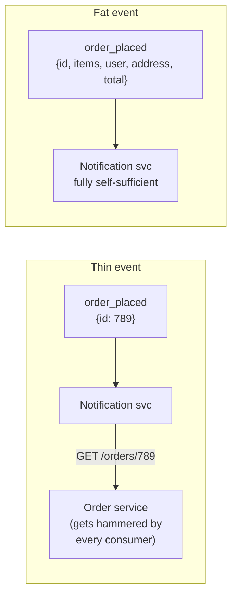
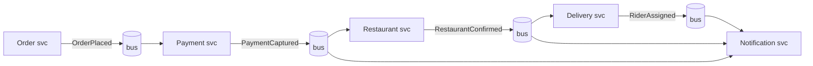
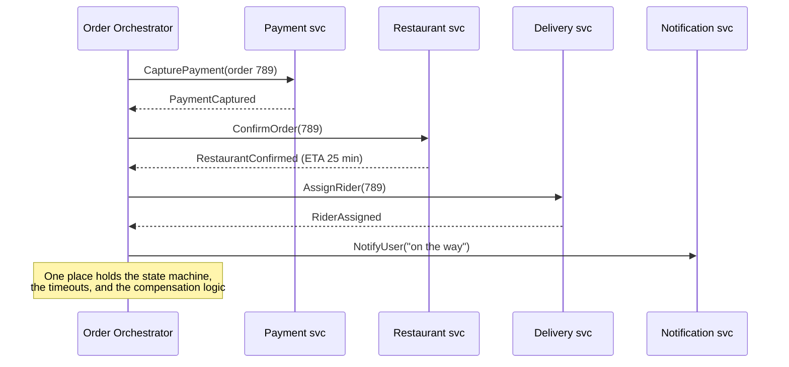
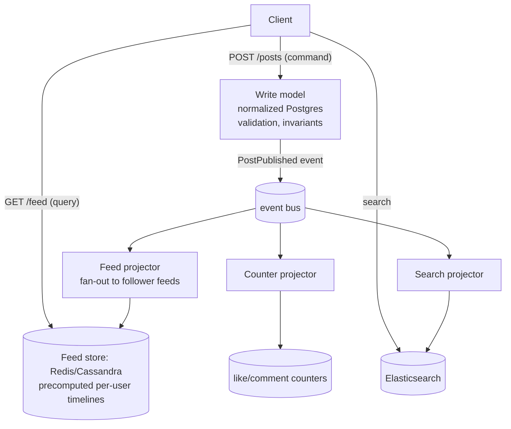
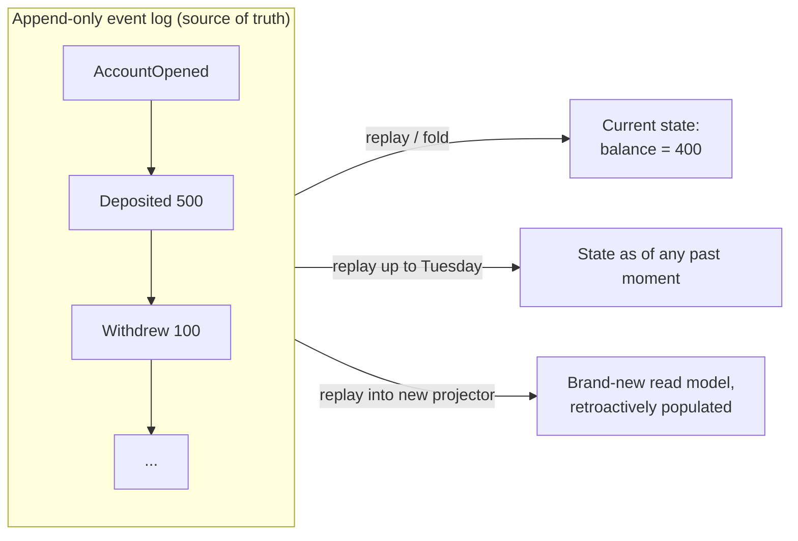
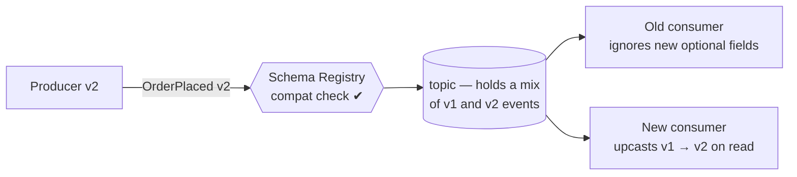
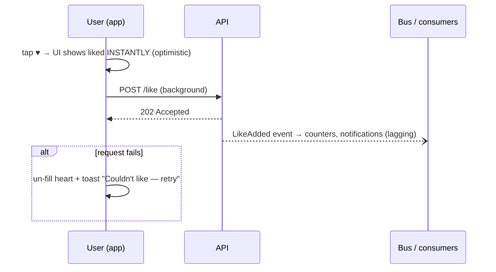
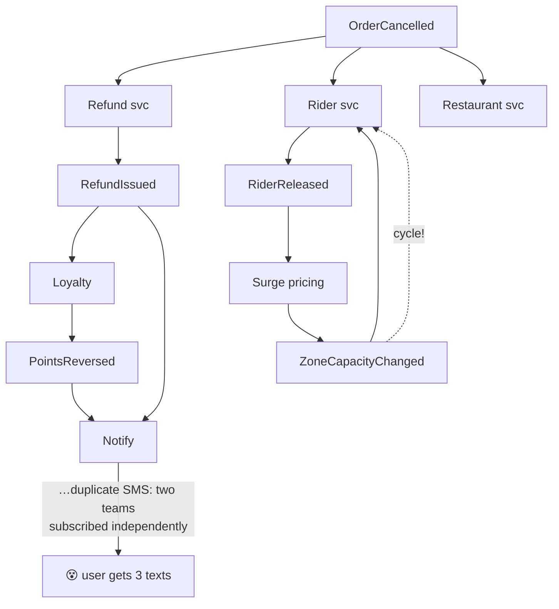

# Day 16 — Event-Driven Architecture, CQRS & Event Sourcing

> Series: System Design Mastery

## Table of Contents

1. [Events vs Commands](#1-events-vs-commands)
2. [Thin Events vs Fat Events](#2-thin-events-vs-fat-events)
3. [Choreography vs Orchestration: Swiggy Drawn Both Ways](#3-choreography-vs-orchestration-swiggy-drawn-both-ways)
4. [CQRS: When Read and Write Models Diverge](#4-cqrs-when-read-and-write-models-diverge)
5. [Event Sourcing: Know the Concept](#5-event-sourcing-know-the-concept)
6. [Schema Evolution for Events](#6-schema-evolution-for-events)
7. [Eventual Consistency UX Patterns](#7-eventual-consistency-ux-patterns)
8. [The Dark Side: Event Spaghetti & The Observability Tax](#8-the-dark-side-event-spaghetti--the-observability-tax)
9. [Self-Check](#9-self-check)
10. [Apply (1 Hour)](#10-apply-1-hour)

---

## 1. Events vs Commands

**In plain words:** A *command* is like handing a waiter your order — "bring me a coffee." You expect one specific person to act on it, and they can say no ("we're out of coffee"). An *event* is like announcing to the whole room "the coffee just finished brewing" — it's a fact that already happened, you're not asking anyone to do anything, and whoever cares can react. Confusing the two is the single most common mistake in event-driven systems.

### Why
Event-driven architecture (EDA) lives or dies on one semantic distinction. Teams that blur it end up with "events" that are secretly remote procedure calls — all the coupling of RPC plus all the debugging pain of async.

> **🤔 Wait — why publish an event if I can just call the service directly?**
> A direct call means *you* now own a list of everyone who cares: add loyalty points, add fraud scoring, add analytics, and checkout's code grows a new call each time. An event flips that — checkout states the fact once (`PaymentCaptured`) and never learns who reacts. Direct call = you push work onto known recipients and wait; event = you announce a fact and walk away. Reach for a call when you *need* an answer back; reach for an event when the fact is done and others merely react.

**✅ Good scenario (where it saves you):** At Swiggy, checkout publishes `PaymentCaptured` and moves on. Loyalty, fraud scoring, invoicing, and the merchant-payout ledger each subscribe independently. When the loyalty team adds "2x points on Fridays," checkout ships zero code and nobody reviews their PR — the event contract already carried everything.

**❌ Bad scenario (the pain without it / when misused):** A payments team wires checkout to synchronously call loyalty, fraud, and notifications in series. Loyalty's GC pause of 800 ms now shows up as checkout latency; a notifications outage rejects payments. One "quick" direct call turned an isolated feature into a shared failure domain that pages the payments on-call at 2 a.m.

**When NOT to bother:** If exactly one service must act and you need the result before continuing (checkout genuinely needs the charge to succeed), that's a command/synchronous call. Don't dress a required, single-recipient request up as an event just to look decoupled.

### What
- A **command** is a *request to do something*, addressed to a specific recipient, which may refuse. Imperative, future tense: `AssignRider(order_789)`, `ChargeCard(user_42, 350)`. The sender knows who handles it and usually cares about the outcome.
- An **event** is a *statement that something happened*. Past tense, immutable fact, addressed to no one: `OrderPlaced`, `PaymentCaptured`, `RiderAssigned`. The publisher does not know or care who listens. You cannot "reject" an event — it already happened.

| | Command | Event |
|---|---|---|
| Tense | Imperative ("do X") | Past ("X happened") |
| Recipients | Exactly one, known | Zero to many, unknown |
| Can be rejected? | Yes (validation, business rules) | No — it's a fact |
| Coupling direction | Sender depends on receiver | Consumers depend on producer's *event schema* only |
| Failure meaning | The action didn't happen | A consumer failed to *react*; the fact stands |
| Swiggy example | `CapturePayment` sent to Payment service | `PaymentCaptured` published for anyone |
| Instagram example | `UploadPhoto` | `PhotoPublished` (feed, notifications, ML all react) |

### How / When
Use commands when you *need* something done and need to know if it was (checkout calling payment). Use events to *broadcast* facts that others may react to (loyalty points, analytics, notifications). A healthy flow often alternates: command → state change → event → consumers issue their own commands.

A well-formed event carries a standard **envelope** around its payload — get this right on day one, because every field here is load-bearing for tracing (Section 8) and evolution (Section 6):

```json
{
  "event_id": "9f2c4e1a-...",          // unique → consumers dedup on this (Day 15)
  "event_type": "order.placed",
  "schema_version": 2,
  "occurred_at": "2026-07-16T21:04:11Z",
  "aggregate_id": "order_789",          // partition key → per-order ordering
  "correlation_id": "req_a41b...",      // stamped at the edge, copied to every downstream event
  "causation_id": "evt_prev...",        // which event/command directly caused this one
  "payload": { "user_id": 42, "total": 350, "items": ["..."] }
}
```

`correlation_id` answers "show me everything this user action triggered"; `causation_id` answers "what chain led here" — together they are the only thing standing between you and Section 8's spaghetti.

### The Dark Side
The "passive-aggressive command": publishing `OrderShouldBeAssignedToRider` as an "event" while secretly requiring exactly one specific service to act on it. It has command semantics (you need it handled, by them) with event guarantees (nobody must handle it). When the intended handler is down, nothing fails — the order just silently never gets a rider. If you *need* it handled, name it a command and send it to someone.

---

## 2. Thin Events vs Fat Events

**In plain words:** Imagine texting a friend either "the package arrived!" (they now have to call you back to ask what's inside — that's a *thin* event) or "the package arrived: it's the blue jacket, size M, delivered to the front porch at 3pm" (they know everything already — that's a *fat* event). Thin events keep one source of truth but make everyone phone home for details; fat events are self-contained but copy data everywhere.

> **🤔 Wait — why send a fat event if a thin one plus a lookup already works?**
> A thin event is cheap to publish, but it quietly hands every consumer a synchronous dependency on your read API: if the order service is down, all "async" consumers stall on their callbacks. A fat event pays more bytes up front to buy real autonomy — consumers keep working when you don't. The trade isn't size, it's *who breaks when the producer is down*.

**✅ Good scenario (where it saves you):** Swiggy's `OrderPlaced` carries items, totals, and delivery address inline. During a spike, the notification, restaurant, and analytics consumers each work straight off the payload — the order service can be mid-deploy and no one notices. At 30k orders/min, that's the difference between one hiccup and a callback stampede knocking the order API over.

**❌ Bad scenario (the pain without it / when misused):** A team ships thin `order_placed` events and six consumers each `GET /orders/{id}` on receipt. A modest order surge turns into 6x read traffic on the order DB; it browns out, callbacks time out, and the "decoupled" pipeline is down because its hidden synchronous dependency failed. Or the opposite misuse: cramming full menu images into fat events and blowing past Kafka's 1 MB limit.

**When NOT to bother:** When the data is large, changes fast, or is sensitive PII (fat events copy it into N stores, and GDPR deletion now spans all of them). For those fields, stay thin and let consumers fetch fresh.

### What
- **Thin event (notification):** `{"type": "order_placed", "order_id": 789}`. Consumers call back to the order service API for details they need.
- **Fat event (event-carried state transfer):** `{"type": "order_placed", "order_id": 789, "user": {...}, "items": [...], "address": {...}, "total": 350}`. Consumers are self-sufficient.


*Thin events keep one source of truth but create a callback stampede; fat events decouple fully but duplicate state.*

| Dimension | Thin (notification) | Fat (state transfer) |
|---|---|---|
| Payload size / broker load | Tiny | Large (Kafka default max ~1 MB — menus with images won't fit) |
| Consumer autonomy | Low — must call back | High — producer can be down, consumers still work |
| Load on producer | Every event × every consumer = read stampede | None after publish |
| Data freshness | Always current (fetched at read time) | Snapshot at event time — may be stale by processing time |
| Schema coupling | Small surface | Large surface — every field is now a contract someone depends on |
| Data duplication / GDPR blast radius | Minimal | User PII copied into N consumer stores — deletion requests get expensive |

### When
Thin when data changes fast, is large, or is sensitive; fat when consumer autonomy and producer-load matter more. Pragmatic middle: carry the fields *most* consumers need (ids, status, amounts), let rare consumers call back for the rest.

### The Dark Side
Fat events fossilize: once 12 consumers parse `event.items[0].restaurant.city`, that accidental structure is an API you can never change (see Section 6). Thin events fossilize differently — the producer's read API becomes a hidden synchronous dependency of your "async" architecture: order service down → every consumer's callback fails → your event-driven system is secretly request-driven.

---

## 3. Choreography vs Orchestration: Swiggy Drawn Both Ways

**In plain words:** Think of a dance. In *choreography* every dancer knows their own moves and reacts to the music and the dancer next to them — there's no one calling steps, the routine just emerges. In *orchestration* there's a conductor who cues each musician in turn and holds the whole score in their head. Neither is "better"; you choreograph simple crowd reactions and orchestrate the complicated multi-step routine where timing and mistakes matter.

### Why
Once `OrderPlaced` needs to trigger payment, restaurant confirmation, rider assignment, and notifications, you must choose *who owns the sequence*. This is the central structural decision of EDA.

> **🤔 Wait — why choreograph anything if orchestration is easier to trace?**
> It's true that an orchestrator gives you one place to ask "where is order 789 stuck?" — that's its whole appeal. But that same central service becomes a magnet for business logic and a single dependency every flow routes through; every trivial "also log this" change now edits the orchestrator. Choreography earns its keep exactly where you *don't* want a coordinator: fan-out reactions that merely observe a fact. The answer is rarely all-or-nothing — you orchestrate the money path and choreograph the bystanders.

**✅ Good scenario (where it saves you):** Swiggy orchestrates the order lifecycle (payment → restaurant → rider) in a Temporal workflow, so on-call answers "stuck where?" with one state query and compensation/timeouts live in one file. Meanwhile loyalty, analytics, and push notifications choreograph off `OrderDelivered` — adding a new "carbon-neutral badge" consumer is a subscription, not an orchestrator change.

**❌ Bad scenario (the pain without it / when misused):** A team choreographs the *entire* checkout across seven services. Two teams independently subscribe `RefundIssued` to notifications, so cancellations send duplicate SMS; a subscription cycle turns one cancel into an event storm. Nobody can draw the flow, and "where did this order stall?" means grepping five services' logs and praying.

**When NOT to bother:** For a 2–3 step flow with no compensation, don't stand up an orchestrator (Temporal/Camunda, an HA service, a state store) — plain choreography or even a single synchronous call is simpler and easier to reason about.

### What — the same Swiggy flow, both ways

**Choreography:** no coordinator. Each service reacts to events and emits its own. The workflow *emerges* from subscriptions.


*Choreography: the order flow is nowhere — it's an emergent property of who subscribes to what.*

**Orchestration:** a coordinator (order orchestrator / saga manager, e.g., built on Temporal or Camunda) owns the sequence, sends commands, and reacts to replies.


*Orchestration: the workflow is explicit, inspectable code in one service — at the cost of a central dependency.*

### The honest comparison

| Dimension | Choreography | Orchestration |
|---|---|---|
| Where is the workflow? | Nowhere / everywhere (implicit) | In the orchestrator (explicit) |
| Coupling | Loosest — services know only events | Orchestrator knows every step |
| Adding a passive step (analytics) | Trivial: subscribe | Touch the orchestrator |
| Changing the *sequence* | Nightmare: edit N services' subscriptions | Edit one state machine |
| Answering "where is order 789 stuck?" | Correlate logs across 5 services | Query the orchestrator's state |
| Timeouts, retries, compensation | Reinvented per service | Centralized, once |
| Single point of failure / bottleneck | None | The orchestrator (make it HA) |
| "God service" risk | None | Real — orchestrator accretes business logic |
| Sweet spot | Short flows (2–3 steps), broadcast-style reactions | Long-lived, multi-step flows with failure handling — like an order lifecycle |

**Honest verdict:** choreograph the periphery (notifications, analytics, loyalty — things that merely *react*), orchestrate the core transaction (the order lifecycle, which has sequence, timeouts, and money). Most real Swiggy-like systems do exactly this hybrid.

### The Dark Side
Pure choreography at scale produces flows no single human can narrate — see Section 8. Pure orchestration reinvents the monolith's god-object with network calls. Both extremes are ideology; the hybrid is engineering.

---

## 4. CQRS: When Read and Write Models Diverge

**In plain words:** Think of a chef's kitchen versus the restaurant's menu photos. Food is *prepared* one careful dish at a time (the write side — accurate, organized, safe). But customers *browse* a glossy menu with pictures, prices, and popularity ratings all pre-arranged for easy reading (the read side). CQRS just means: stop forcing one data layout to serve both jobs. Write in the shape that's safe to write; read from a separate, pre-shaped copy that's fast to read.

### Why
The shape data is *written* in and the shape it's *read* in diverge as systems grow. Instagram writes a post as one row; it reads that post inside a home feed — merged from hundreds of followed accounts, ranked by ML, decorated with like counts and "your friend X commented." No single model serves both a 5 ms ranked-feed read and a normalized, consistent write.

> **🤔 Wait — why split into two models if one has always worked?**
> One model works right up until reads and writes want opposite things: writes want normalized rows and strict invariants, hot reads want a denormalized, pre-joined shape delivered in milliseconds. CQRS stops you from contorting one schema to half-serve both — you write in the safe shape and read from a purpose-built projection. The cost is real (two models, eventual consistency between your *own* write and read), so this is a per-hot-path tool, not a system-wide religion.

**✅ Good scenario (where it saves you):** Instagram writes a post as one normalized row (sharded Postgres) but serves the home feed from precomputed per-follower timelines in Redis/Cassandra. The 5 ms ranked-feed read never touches the write store, and the projection is disposable — a projector bug is fixed by replaying events, not by a risky migration on the source of truth.

**❌ Bad scenario (the pain without it / when misused):** A 4-person startup applies CQRS to all 50 tables of a CRUD admin panel. Now every settings toggle needs a projector, and "I saved it but it's not showing" bugs (projection lag on their own writes) flood support. They spend six months building rebuild tooling and monitoring for reads a single indexed `JOIN` would have served instantly.

**When NOT to bother:** When a `SELECT ... JOIN` with an index already answers your reads fast enough and read/write shapes basically match — boring CRUD with modest scale. Skip CQRS until a specific hot path genuinely diverges.

### What
**CQRS (Command Query Responsibility Segregation):** split the write model (commands, normalized, consistency-focused) from the read model (queries, denormalized, shaped exactly like the UI). Events propagate changes from write side to read side; the read side is a disposable, rebuildable *projection*.


*CQRS in the wild: Instagram-style writes go to one normalized store; purpose-built projections serve each read pattern.*

A projector is just a consumer that maintains a purpose-shaped copy — here is the feed projector in sketch form:

```java
// A projector is just an event consumer. Spring's @EventListener (or @KafkaListener
// if the event arrives over Kafka) wires this method to fire whenever a
// PostPublished event lands on the bus.
@KafkaListener(topics = "post.published")
public void handlePostPublished(PostPublishedEvent event) {
    // Projector: turns the normalized write into denormalized per-user feeds.
    // Runs async off the bus — the feed is a *cache of conclusions*, rebuildable
    // by replaying events if this code ever has a bug.

    Post post = event.getPayload();
    String authorId = post.getAuthorId();

    List<String> followers = followerStore.getFollowers(authorId);   // e.g., 850 people
    if (followers.size() > 1_000_000) {
        // Celebrity: don't fan out 100M writes — mark for fan-out-on-READ instead;
        // the feed query merges "my precomputed feed" + "recent posts by celebs I follow".
        // redisTemplate exposes Redis operations the same way the Python client did.
        redisTemplate.opsForSet().add("celebrity_authors", authorId);
        return;
    }

    String entry = pack(post.getPostId(), post.getCreatedAt(), post.getThumbUrl());
    // executePipelined batches many Redis commands into one round-trip (like redis.pipeline()).
    redisTemplate.executePipelined((RedisCallback<Object>) connection -> {
        for (String f : followers) {                                 // fan-out on write
            String feedKey = "feed:" + f;
            // ZADD: add the entry to this follower's sorted-set feed, scored by timestamp
            connection.zAdd(feedKey.getBytes(), post.getCreatedAtTs(), entry.getBytes());
            // ZREMRANGEBYRANK: keep only the newest 800 entries (trim the rest)
            connection.zRemRange(feedKey.getBytes(), 0, -801);       // cap feeds at 800 entries
        }
        return null;
    });
}
```

Everything characteristic of CQRS is visible in 25 lines: the read store is denormalized and capped, the projection strategy differs per case (normal vs celebrity), and the whole thing is disposable — delete `feed:*` and replay to rebuild.

**Instagram as CQRS in the wild:** posting = command path (Postgres, sharded). The feed = read path: precomputed per-follower timelines in memory-backed stores (fan-out on write for normal users; celebrities with 100M followers are fanned out on *read* instead — a projection strategy choice, exactly the flexibility CQRS buys). The feed is allowed to lag the write by seconds — and does.

### When — and when NOT
Use CQRS when: read/write shapes genuinely diverge; read:write ratio is extreme (Instagram feed ~1000:1); different scaling/storage per side pays for itself; you already have events flowing.

**Do NOT use CQRS when** a `SELECT ... JOIN` with an index serves your reads fine. The complexity cost is concrete: two models to maintain, projectors to run and monitor, eventual consistency between your own write and your own read (a user's own POST must still appear instantly → you need read-your-writes tricks on top), rebuild tooling for when a projector bug corrupts a projection, and double the "why is this data wrong" debugging surface. CQRS on a 50-table CRUD app is how a 4-person startup ships nothing for six months.

### The Dark Side
The subtle failure isn't adopting CQRS — it's adopting it *system-wide as a religion* instead of per-hot-path. Apply it to the feed; leave account settings as boring CRUD. Also: projection lag during incidents (bus backlog → users see hours-old feeds while writes look fine) confuses everyone whose mental model is "one database."

---

## 5. Event Sourcing: Know the Concept

**In plain words:** Most apps keep only the *current* balance in your bank account, like a whiteboard you keep erasing and rewriting. Event sourcing instead keeps the whole *bank statement* — every deposit and withdrawal ever — and recomputes the balance by adding them all up. Your accountant has done this for 500 years: you never erase a ledger entry, you add a correcting one. The full history becomes the source of truth, and "current state" is just a total you can recalculate anytime.

> **Calibration up front: know the concept, rarely fully adopted — don't go deep.** Interviewers expect you to explain it and say where it fits; they get suspicious if you propose it for everything.

> **🤔 Wait — why store the whole history if I can just store the current state?**
> Storing current state is simpler and it's what most systems should do — but a plain `UPDATE` destroys the *why*: you have `balance = 400` and no record of the deposits and withdrawals that produced it. Event sourcing keeps the ledger of facts and recomputes state, so audit, time-travel debugging, and "build a brand-new read model over last year's data" come for free. That power costs you replay machinery, forced CQRS, and immutable-history schema pain — which is exactly why it's reserved for domains where the history genuinely *is* the product.

**✅ Good scenario (where it saves you):** A payments ledger stores `AccountOpened → Deposited → Withdrew` as immutable events and folds them to a balance. When a regulator asks "prove why this account showed ₹400 on Tuesday," it's a replay-to-timestamp, not a forensic diff of overwritten rows. Disputes, reconciliation, and retroactive reports all fall out of the log that was the source of truth anyway.

**❌ Bad scenario (the pain without it / when misused):** A team event-sources a user-profile service to get "free audit logs." Now every profile read needs replay or a projection, every deploy must upcast years of immutable events, and a single GDPR delete becomes a crypto-shredding project because you legally can't erase a log entry. The system gets reverted quietly a year later.

**When NOT to bother:** For CRUD-shaped, low-audit domains (profiles, settings, catalogs), store current state and add a plain `audit_log` table if you need history — 80% of the value at 5% of the cost.

### Why / What
Traditional persistence stores *current state* (`balance = 400`) and destroys history on every UPDATE. **Event sourcing** stores the *sequence of events* as the source of truth in an append-only log; current state is derived by replaying (folding) events:

```
AccountOpened(+0) → Deposited(+500) → Withdrew(-100) → state: balance 400
```


*Event sourcing: state is a cache; the log is the truth — enabling audit, time travel, and retroactive projections.*

What it buys: a perfect audit trail (the history *is* the database, can't drift from it), time-travel debugging, and the ability to build new read models over *past* data. Snapshots (persist state every N events) keep replay fast.

The entire mechanism fits in a fold:

```java
// A small immutable snapshot of the account's current state.
// (A Java 'record' is a concise, immutable data holder — perfect here.)
record AccountState(long balance, String status) {}

// apply() takes the state-so-far plus the next event and returns the NEW state.
// It never mutates in place — it returns a fresh AccountState each time, so the
// fold stays clean and side-effect free.
AccountState apply(AccountState state, Event event) {
    // Java's switch on the event type is the equivalent of Python's match/case.
    switch (event.type()) {
        case "AccountOpened":
            return new AccountState(0, "open");
        case "Deposited":
            // "with balance + amount": build a new state, keep the old status
            return new AccountState(state.balance() + event.amount(), state.status());
        case "Withdrew":
            return new AccountState(state.balance() - event.amount(), state.status());
        case "AccountFrozen":
            return new AccountState(state.balance(), "frozen");
        default:
            return state;                     // unknown (newer) events: ignore, don't crash
    }
}

AccountState loadAccount(EventStore eventStore, String accountId, Instant asOf) {
    List<Event> events = eventStore.read("account-" + accountId, asOf);
    // Stream.reduce is Java's fold: start from an empty state and apply every event.
    // state = fold(apply, history)
    return events.stream().reduce(new AccountState(0, "closed"), this::apply, (a, b) -> b);
}

// Writing = appending, guarded by the CURRENT state's invariants:
void withdraw(EventStore eventStore, String accountId, long amount, long expectedVersion) {
    AccountState state = loadAccount(eventStore, accountId, null);
    if (state.status().equals("frozen") || state.balance() < amount) {
        throw new DomainException("withdrawal refused");     // commands CAN be rejected...
    }
    eventStore.append("account-" + accountId,
                      new Event("Withdrew", amount),
                      expectedVersion);                       // optimistic concurrency
    // ...but once appended, `Withdrew` is a fact forever (events cannot be un-happened)
}
```

`as_of=tuesday` gives you time travel; a new `apply` function over the same log gives you a retroactive read model. That's the whole trick — and also the whole cost, because *every* state question now goes through this machinery or a projection of it.

### Where it genuinely fits
**Audit-heavy, append-natural domains:** banking ledgers (accounting has been event-sourced on paper for 500 years — you never erase a journal entry, you post a correcting one), payments, trading, insurance claims, inventory movements. Kafka-as-log + versioned events is a common industrial approximation.

### Where it doesn't — and why it's rarely fully adopted
For a user-profile service, event sourcing means: every read needs replay or projections (so you're forced into CQRS too), schema evolution applies to *immutable historical* events (upcasters forever), deleting PII from an immutable log is a GDPR research project (crypto-shredding), and every developer must learn a new persistence philosophy. The all-in version is famous for being adopted enthusiastically and reverted quietly. The durable takeaway: keep an **audit/event trail for the domains that need it**; store current state for the rest.

### The Dark Side
Event-sourcing your whole system to get "free audit logs" is buying a submarine to cross a river. An `audit_log` table gets you 80% of the value at 5% of the cost.

---

## 6. Schema Evolution for Events

**In plain words:** An event you publish today might be read by code someone writes next year — and, because event logs are kept around, next year's code might read this year's events. It's like writing a letter that must still make sense to a reader in 2030 who can't ask you what you meant. So you only ever *add* optional sentences; you never rename a word or quietly change what it means, or old and new readers will disagree about reality.

### Why
An event published today will be read by consumer code deployed next year — and, with Kafka retention or event sourcing, *tomorrow's code will read last year's events*. Unlike an API you can version-bump in lockstep, events outlive their producers' deploys.

> **🤔 Wait — why bother with a schema registry if plain JSON events already work?**
> Plain JSON works beautifully for a year — precisely long enough for everyone to forget how fragile it is. Because retained events outlive deploys, one rename or unit change silently makes old and new readers disagree about reality, and no test catches it until three teams' databases are already corrupted. A registry (Avro/Protobuf) machine-checks every publish for compatibility and rejects breaking changes at CI time — turning a quiet multi-week data-corruption incident into a red build.

**✅ Good scenario (where it saves you):** A payments team runs Confluent Schema Registry on their `transaction.settled` topic. An engineer tries to change `amount` from rupees to paise; the backward-compatibility check fails the publish in CI before a single downstream ledger reads a wrong number. What would have been a reconciliation nightmare is a two-line PR comment.

**❌ Bad scenario (the pain without it / when misused):** No registry, JSON everywhere. Someone renames `total` → `amount_paise` and updates their own consumer; tests pass. Three *other* teams' consumers silently read `null`/zero into their stores for two weeks before finance notices the numbers don't reconcile — one of the most expensive EDA incident classes there is.

**When NOT to bother:** For a single team, single consumer, short-retention topic where producer and consumer deploy together, a plain versioned JSON field is fine — the full registry/Avro toolchain is overkill until events are shared across teams or retained long-term.

### What / How — the working rules
1. **Additive changes are safe:** add optional fields with defaults. Old consumers ignore them; new consumers handle their absence in old events.
2. **Never remove or rename a field, never change its type/meaning** while any consumer or retained event uses it. Renaming `amount` → `amount_paise` (and changing units!) is the classic silent-corruption bug.
3. **Version explicitly:** a `schema_version` field, or versioned event types (`OrderPlacedV2`), or — properly — a **schema registry** (Confluent Schema Registry with Avro/Protobuf) that machine-checks every producer publish for backward/forward compatibility and rejects breaking ones at CI/publish time.
4. Breaking change anyway? Publish V2 alongside V1 (dual-write) while consumers migrate; or keep **upcasters** — functions that translate old versions to the current shape at read time (mandatory in event sourcing, where history is immutable).


*Evolution discipline: additive-only changes, machine-enforced compatibility, upcasters for history.*

### The Dark Side
JSON-with-no-registry works great for a year — then someone renames a field, tests pass (their consumer was updated), and three *other* teams' consumers silently start reading `null` into their databases. Schema drift bugs corrupt data quietly for weeks before detection; that's why they rank among the most expensive EDA incidents.

---

## 7. Eventual Consistency UX Patterns

**In plain words:** In an event-driven system there's always a small delay between "I did something" and "everything caught up." It's like sending a group text — you see it instantly, but your friends' phones buzz a moment later. The trick is designing the screen so this delay feels honest and smooth: show the like as filled *immediately*, say "confirming your order…" while it settles, and gracefully undo if it fails — rather than freezing and pretending everything is instant.

### Why
EDA makes lag between "action taken" and "everywhere updated" a permanent fact. The system design isn't finished until the *UI* handles that lag — otherwise users see their own actions vanish and file bug reports about your architecture.

> **🤔 Wait — why design special UX for lag if I can just make the UI wait for consistency?**
> Blocking the UI until every projector, counter, and follower feed catches up turns a 5 ms tap into a multi-second spinner — and one lagging consumer freezes the whole screen. Eventual consistency is a permanent fact of EDA, not a bug to wait out. The move is to make the interface honest about the in-between: commit optimistically, show pending states, and own the rare rollback — so lag feels smooth instead of broken.

**✅ Good scenario (where it saves you):** Instagram fills the heart the instant you tap, fires `LikeAdded` in the background, and un-fills only on the rare failure. The like feels instant even though counters and notifications lag seconds behind, and the feed never blocks on the counter projector. That optimistic path is why likes feel free at a billion-tap scale.

**❌ Bad scenario (the pain without it / when misused):** A team makes "like" wait for the counter service to confirm before the heart fills. Every tap is a 700 ms spinner, and when the counter projector lags during an incident the button appears frozen — users mash it, sending duplicate events. Or the opposite misuse: optimistic UI with no rollback, so failed actions silently look successful and users swear they liked a post that never registered.

**When NOT to bother:** When the write is genuinely synchronous and instantly consistent (a strongly-consistent single-DB update behind the request), don't fake pending states — just show the real result. Optimistic UI is for paths that actually settle asynchronously.

### What / How — the standard toolkit

| Pattern | Mechanic | Example |
|---|---|---|
| **Optimistic UI** | Apply locally, instantly; sync in background; roll back visibly on failure | Instagram like: heart turns red at tap-time, not at server-ack. On failure it un-fills (rare enough to be acceptable) |
| **Pending states** | Make in-between-ness an explicit, honest status | Swiggy: "Confirming your order…" → "Restaurant accepted" — the UI narrates the saga instead of pretending it's instant |
| **Read-your-writes patch** | Route the author's next reads to the fresh source, or merge their write into the response client-side | Your new comment appears immediately *to you* even though followers' feeds get it seconds later |
| **Timestamps over live truth** | "Updated 2 min ago" reframes staleness as information | Rider location, stock tickers |
| **Async completion notification** | Accept, then notify when done | "Payment processing — we'll notify you." UPI apps live on this |


*Optimistic UI: the interface commits before the system does, and owns the (rare) rollback.*

### The Dark Side
Optimistic UI without rollback handling = lying to users. And pending states must be *bounded*: "Confirming your order…" for 10 minutes with no timeout path (auto-cancel + refund + apology) is worse than an honest failure. Every pending state needs a timeout, and every timeout needs a compensation story — that's tomorrow's saga material.

---

## 8. The Dark Side: Event Spaghetti & The Observability Tax

**In plain words:** When dozens of services each quietly react to each other's events, no single person can say what actually happens when a user clicks "cancel." It's like a rumor spreading through a huge office — one comment triggers three reactions, which trigger more, and eventually someone gets told the same thing twice and nobody can trace where it started. The cure is labeling every message with a shared "tracking number" (correlation ID) so you can follow the whole chain later.

> **🤔 Wait — if events create this much observability tax, why not just call services directly?**
> Because at real organizational scale the tax you'd pay *without* events — every team blocking on every other team's deploys, one synchronous chain failing all of checkout — is worse. The spaghetti isn't caused by events; it's caused by adopting them everywhere with no correlation IDs, no catalog, and no orchestration for core flows. Direct calls trade an *observability* tax for a *coupling* tax; the win is choosing per-seam, not swearing off either.

**✅ Good scenario (where it saves you):** A mature Swiggy-scale platform stamps a correlation ID at the edge and propagates it through every hop, so "what happened when user 42 cancelled order 789?" is a single `correlation_id = req_a41b` query across 40 services. OpenTelemetry context in message headers reconstructs the whole event tree in the tracing UI — the tax is paid once in ten lines of middleware.

**❌ Bad scenario (the pain without it / when misused):** Year three: 40 services, 300 event types, no correlation IDs. A cancellation fans out into refunds, loyalty reversals, and a hidden subscription cycle that storms the bus with thousands of messages. Two teams independently subscribed notifications, so users get triple SMS, and the only "documentation" of the flow is the broker's ACL list. On-call spends an afternoon reconstructing one request.

**When NOT to bother:** If you're one team, one database, sequential workflows, and no independent reactors to your state changes, don't take on the tracing/catalog/DLQ machinery at all — a boring CRUD monolith with a transaction beats a saga every time.

### Event spaghetti
Year one: five services, clean events, everyone's proud. Year three: **40 services, 300 event types, and nobody can trace what happens when a user cancels an order.** `OrderCancelled` triggers refunds, which triggers `RefundIssued`, which loyalty listens to, which emits `PointsReversed`, which the notification service reacts to twice because two teams subscribed independently... A new engineer asks "what happens when an order is cancelled?" and the honest answer is *"nobody knows — grep the subscriptions and pray."*


*Event spaghetti: emergent behavior, hidden cycles, duplicate reactions — the workflow exists only as folklore.*

Symptoms: no one can produce a current diagram; behavior changes when a team you've never met adds a subscriber; cycles cause event storms (one cancellation → thousands of messages); the only documentation is the broker's ACL list.

**Mitigations (not cures):** event catalog/registry with owners (who publishes, who subscribes, why); **correlation IDs stamped on every event and propagated through every hop** — non-negotiable from day one; distributed tracing that spans the bus (OpenTelemetry context in message headers); orchestration for core flows so the sequence lives in inspectable code; a rule that new subscriptions to core events require the *producer* team's review.

The propagation discipline is ten lines of middleware — the cost of NOT writing them is unmeasurable debugging time later:

```java
// causedBy may be null (this is the very first event in a chain).
void publish(KafkaProducer<String, Event> producer, String eventType,
             Payload payload, Event causedBy, String correlationId) {
    // Work out the correlation ID: prefer an explicitly passed one; otherwise inherit
    // it from the event that caused us; only mint a brand-new one at the true edge
    // (an incoming HTTP request). This is the Java equivalent of Python's "a or b or c".
    String correlation = correlationId;
    if (correlation == null && causedBy != null) {
        correlation = causedBy.correlationId();
    }
    if (correlation == null) {
        correlation = UUID.randomUUID().toString();
    }

    Event event = new Event();
    event.setEventId(UUID.randomUUID().toString());
    event.setEventType(eventType);
    event.setPayload(payload);
    event.setCorrelationId(correlation);
    // causation_id = which event directly caused this one (null if none)
    event.setCausationId(causedBy != null ? causedBy.getEventId() : null);

    // key = aggregateId → guarantees per-aggregate ordering within a Kafka partition
    producer.send(new ProducerRecord<>(topicFor(eventType), payload.getAggregateId(), event));
}

void consume(ConsumerRecord<String, Event> msg, EventHandler handler) {
    Event event = parse(msg);
    // MDC (Mapped Diagnostic Context) tags EVERY log line in this thread with the
    // correlation ID — the Java logging equivalent of Python's log_context(...).
    // try/finally guarantees we clear it even if the handler throws.
    MDC.put("correlationId", event.getCorrelationId());
    try {
        // any event this handler publishes MUST pass causedBy = event
        handler.handle(event);
    } finally {
        MDC.remove("correlationId");
    }
}
```

With this in place, "what happened when user 42 cancelled order 789?" is one log query: `correlation_id = req_a41b`. Without it, it's an afternoon.

### The debugging/observability tax — itemized
- A request trace becomes an event *tree* across N services; reconstructing "what happened to order 789" requires log aggregation + correlation IDs + broker tooling, not one stack trace.
- Failures are silent-by-default (Day 15's rug): every consumer needs lag/DLQ/staleness alerts. Multiply by 40 services.
- Testing: integration tests now need a broker, event fixtures per version, and answers to "what if events arrive out of order / twice / not at all" — per consumer.
- On-call: "the feed is stale" pages a team that must then determine *which* of six projectors is lagging and whether it's them, the bus, or the producer.

### When a boring CRUD monolith beats EDA
If your domain is: one team, one database, workflows that are naturally sequential, volumes a single Postgres yawns at (thousands of QPS), and no genuinely independent consumers of your state changes — then a transaction beats a saga, a JOIN beats a projection, and a function call beats an event, **every single time**. You get atomicity for free, debugging in one process, and refactoring with a compiler instead of a migration plan. EDA earns its tax when you have *many independent reactors to facts*, *extreme read/write divergence*, or *organizational scale* (Day 17's topic). Adopt it per-seam, when a seam hurts — not as a lifestyle.

| Signal | Boring CRUD wins | EDA earns its tax |
|---|---|---|
| Reactors to a state change | 1–2, all yours | Many, owned by other teams |
| Workflow shape | Sequential, needs atomicity | Naturally parallel reactions to facts |
| Read vs write model | Same shape, JOINs suffice | Wildly divergent (feed vs post) |
| Team count | One | Many, needing autonomy |
| Debuggability budget | "We have two engineers" | Tracing, catalogs, on-call maturity exist |
| Audit/replay requirement | `audit_log` table is enough | Regulatory replay, retroactive models |

Score honestly; the left column describes most systems most of the time. The mark of a senior engineer is not knowing CQRS — it's knowing which four of your forty tables deserve it.

---

## 9. Self-Check

1. `ChargeCard` vs `PaymentCaptured`: classify each, and name two properties that differ. What is a "passive-aggressive command"?
2. Your notification service needs the user's phone number when `OrderPlaced` fires. Argue thin vs fat event for this case — then give the pragmatic middle option.
3. Why does a thin-event architecture secretly re-introduce synchronous coupling? What fails when the producer's API is down?
4. Draw (or narrate) the Swiggy order flow choreographed, then orchestrated. For each: where do you look when order 789 is stuck at "payment done, no rider"?
5. Give two changes that are trivial under choreography but painful under orchestration — and two the other way around. What's the hybrid recommendation?
6. Explain Instagram's feed as CQRS: what's the write model, what are the projections, and where does celebrity fan-out-on-read fit into the picture?
7. Name three concrete costs of CQRS, and describe a system where adopting it would be malpractice.
8. Where does event sourcing genuinely fit and why (one domain, one reason)? Name two reasons full adoption is rare.
9. Which schema changes are safe on a retained event topic? What machinery catches unsafe ones before production, and what's an upcaster?
10. A user taps "cancel order" and the refund takes 30 seconds to process through three services. Design the UX using two patterns from Section 7, including the timeout path.

---

**Tomorrow:** Day 17 — Microservices vs Monolith. Everything this week (queues, events, sagas-in-waiting) exists because services got split. Tomorrow we ask the prior question: *should* they be split — real triggers vs résumé-driven ones, the shared-database anti-pattern, saga compensation for Swiggy checkout, and the Amazon Prime Video team that went back to a monolith and cut costs 90%.

## 10. Apply (1 Hour)

1. **(25 min)** Take Swiggy's *order cancellation* flow (refund, release rider, notify restaurant, reverse loyalty points, notify user). Draw it BOTH ways — choreography (flowchart of events) and orchestration (sequence diagram of commands). Mark on each diagram where you'd look first when "user says refund never arrived."
2. **(20 min)** Design the fat `OrderPlaced` v1 event as JSON (10–15 fields). Then evolve it: add a field safely, and show why renaming `total` → `total_paise` breaks consumers — write the upcaster function in Java (a method that maps the old `OrderPlacedV1` shape to `OrderPlacedV2`) that translates v1 → v2 at read time.
3. **(15 min)** Pick one screen of an app you use (Instagram like, Swiggy order tracking, Gmail send). Identify which eventual-consistency UX pattern it uses, what the rollback/timeout path is, and write two sentences on what would break if the UI waited for full system-wide consistency instead.
