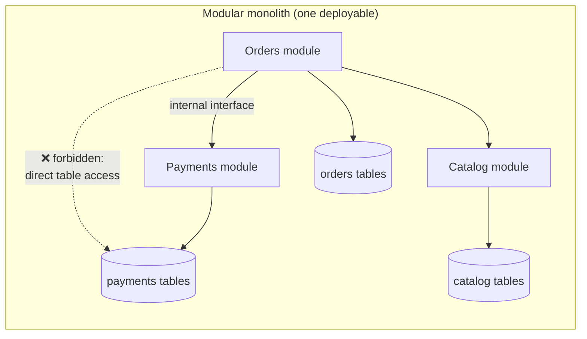
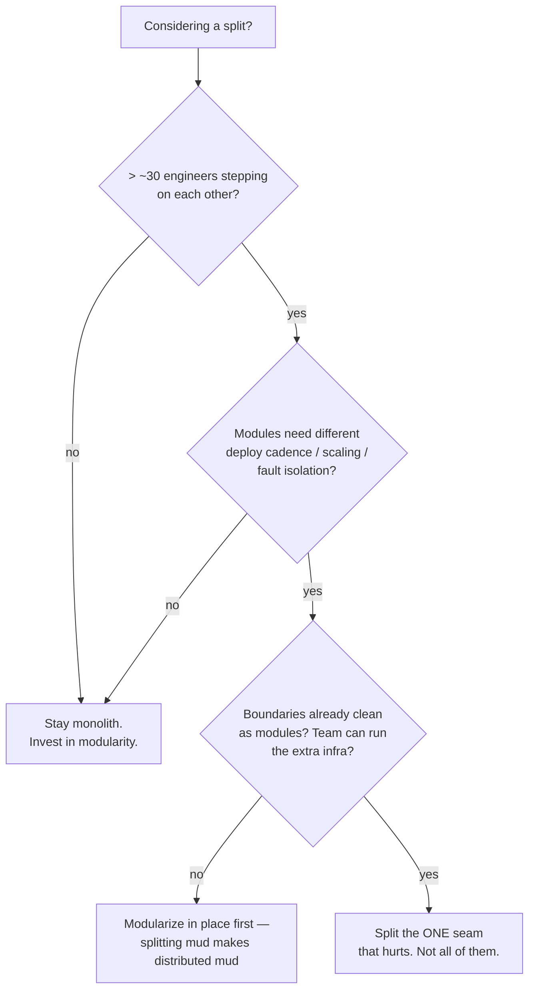
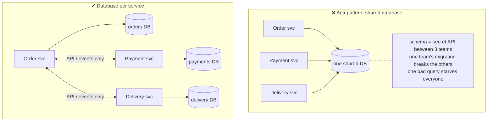
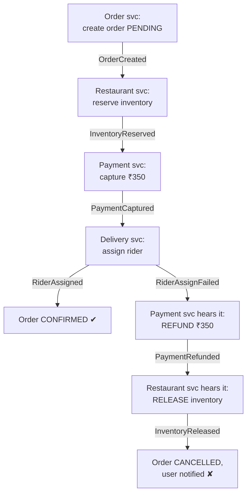
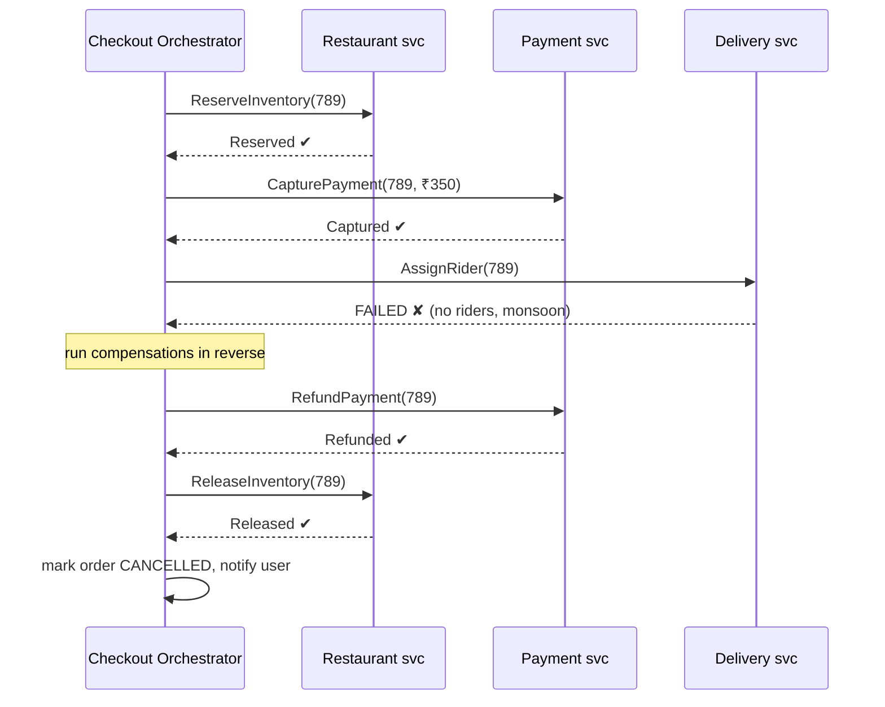
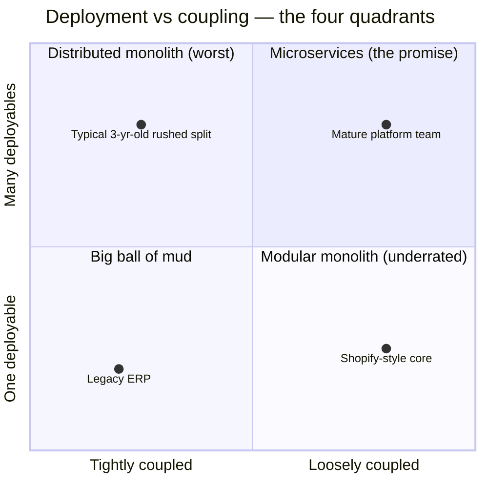
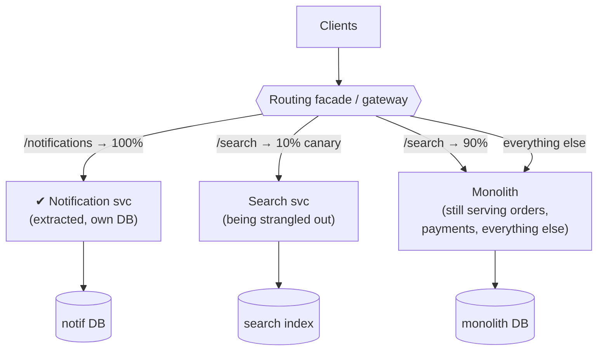

# Day 17 — Microservices vs Monolith

> Series: System Design Mastery

## Table of Contents

1. [The Monolith, Honestly Defined](#1-the-monolith-honestly-defined)
2. [Real Triggers to Split vs Fake Triggers](#2-real-triggers-to-split-vs-fake-triggers)
3. [Drawing Service Boundaries](#3-drawing-service-boundaries)
4. [Sync vs Async Inter-Service Communication](#4-sync-vs-async-inter-service-communication)
5. [Distributed Transactions: 2PC and the Saga Pattern](#5-distributed-transactions-2pc-and-the-saga-pattern)
6. [The Distributed Monolith Anti-Pattern](#6-the-distributed-monolith-anti-pattern)
7. [Migration: The Strangler Fig Pattern](#7-migration-the-strangler-fig-pattern)
8. [The Dark Side: The Microservices Tax, Itemized](#8-the-dark-side-the-microservices-tax-itemized)
9. [Self-Check](#9-self-check)
10. [Apply (1 Hour)](#10-apply-1-hour)

---

## 1. The Monolith, Honestly Defined

**In plain words:** A "monolith" is just an app that ships as one piece — like a Swiss Army knife where every tool folds into a single handle. That is a *packaging* choice, not a quality judgment. What actually makes software good or bad is whether the parts inside are tidily separated. You can have one deployable with neat internal drawers (a modular monolith) or one deployable that is a single junk drawer where everything is tangled (a big ball of mud).

### Why
"Monolith" has become a slur, which ruins the engineering conversation. A monolith is a *deployment* choice — one deployable unit — not a *quality* verdict. The real axis of quality is **internal modularity**, and it's orthogonal to deployment.

### What
- **Monolith:** the application ships as one deployable (one process/container). One codebase, one deploy pipeline, in-process method calls, one database transaction covering any workflow.
- **Modular monolith:** one deployable, but internally organized into modules with explicit boundaries — each module owns its tables, exposes an internal interface, and doesn't reach into others' internals. Shopify runs one of the world's largest commercial systems (peaking at millions of requests/minute on Black Friday) largely as a modular monolith; Stack Overflow served its massive Q&A traffic for years on a famously small monolithic footprint.
- **Big ball of mud:** one deployable where everything touches everything — any code reads any table, no boundaries, change anywhere risks breakage everywhere.

| Dimension | Modular monolith | Big ball of mud |
|---|---|---|
| Module boundaries | Explicit, enforced (packages, ArchUnit rules, internal APIs) | None — imports go everywhere |
| Data ownership | Each module owns its tables; others go through its interface | Every module queries every table |
| Team ownership | Clear per-module owners | "Everyone owns everything" = no one does |
| Refactor cost | Local, compiler-assisted | Global, terrifying |
| Path to microservices | Cut along existing seams — cheap | Must untangle first — the split itself is the hard part |
| Deploy | Single unit (shared cadence — the real limitation) | Single unit (and every deploy is a gamble) |

**The load-bearing insight:** a modular monolith gives you most of microservices' *code* benefits (boundaries, ownership, independent reasoning) with none of the *network* costs. Microservices add exactly one thing modularity can't: **independent deployment and scaling of the pieces**. If you don't need that, you don't need microservices.

> **🤔 Wait — isn't "monolith" just a polite word for legacy spaghetti?**
> No — that conflates two independent things. "Monolith" describes how you *ship* (one deployable); spaghetti describes how the *insides* are organized (no boundaries). Shopify and Stack Overflow ran enormous, clean monoliths for years — and you can build a big ball of mud just as easily out of 40 microservices. The quality axis is internal modularity, not deployable count.

**✅ Good scenario (where it saves you):** At Shopify, keeping core commerce as a modular monolith means a checkout change is one in-process method call away from the tax and inventory modules — no network hop, no version negotiation, no saga. Black Friday scaling is just "run more copies behind the load balancer," and the clean module seams are the cheap launchpad if a service ever *does* need to split out.

**❌ Bad scenario (the pain without it / when misused):** A team calls their app "a monolith" and treats that as license to let every controller query every table directly. Two years later a one-line change to the `orders` table silently breaks billing, search, and the admin panel — because nothing (no ArchUnit rule, no per-module schema grant) ever enforced a boundary, so the split they eventually attempt is a two-year untangling job first.

**When NOT to bother:** Enforcing per-module schemas and ArchUnit rules on a 5-file side project or an internal tool one person holds in their head — the boundary ceremony costs more than the tangle it prevents.


*A modular monolith: microservice-style ownership discipline, method-call prices — and the best launchpad if you ever do split.*

### How — making modularity real (not aspirational)

**In plain words:** A boundary you only wrote on a wiki page is a suggestion, and suggestions rot. To make modularity real you turn each rule into something the build *fails on* — like a smoke alarm that goes off the moment someone crosses a line, instead of a note on the fridge asking people not to.

Modularity is a build failure, not a wiki page. Concretely:

- **Import rules enforced in CI:** Java ArchUnit tests, written as ordinary JUnit rules ("orders may depend on `payments.api`, never `payments.internal`"). A violated boundary fails the build the day it's introduced, not the year it's discovered. (Other ecosystems have equivalents — import-linter contracts, Go internal packages — but on the JVM, ArchUnit is the standard tool.)
- **Schema ownership:** separate schemas/namespaces per module (`payments.*` tables), with DB grants so the orders module's DB user *cannot* read `payments.card_tokens` even if the code tries.
- **Module-level CODEOWNERS:** cross-module PRs require the owning team's review — Conway's law used deliberately.
- **One public interface per module** (`payments/api/PaymentsApi.java`), everything else private by convention *and* by ArchUnit rule.

```java
// ArchUnit: the cheapest microservices you will ever run.
// This is a plain JUnit test. It FAILS THE BUILD the day someone
// reaches into another module's internals -- no human reviewer needed.
@AnalyzeClasses(packages = "com.swiggy")           // scan the whole codebase
class ModuleBoundaryTest {

    // "Payments internals are private": no other module may depend on them.
    @ArchTest
    static final ArchRule paymentsInternalsArePrivate =
        noClasses()
            // these modules are the ones we are policing...
            .that().resideInAnyPackage("..orders..", "..catalog..", "..delivery..")
            // ...and they must NOT reach into payments' private guts.
            .should().dependOnClassesThat()
            .resideInAnyPackage("..payments.internal..", "..payments.model..");
}
```

This handful of test code buys the boundary benefits teams spend two years of Kubernetes migrations chasing.

### The Dark Side
Modularity in a monolith requires *enforcement* (ArchUnit tests, code owners, per-module schemas) because the compiler happily lets module A import module B's internals. Without enforcement, every modular monolith decays toward mud — one deadline at a time. And one honest limit: a modular monolith still shares a runtime — one module's CPU spike or memory leak is still everyone's outage, and the deploy train is still shared. When *those* two pains are the ones you feel, the trigger is real (Section 2).

---

## 2. Real Triggers to Split vs Fake Triggers

**In plain words:** Splitting a monolith into microservices is like a growing family deciding to move from one big house into several smaller ones. Sometimes it genuinely reduces friction, but it is expensive and hard to reverse. This section separates the real reasons to move out (too many people bumping into each other in one kitchen) from the vanity reasons ("the cool neighbours did it").

### Why
Splitting is expensive and semi-irreversible. The decision deserves the same rigor as a database migration, not a conference-talk afterglow.

> **🤔 Wait — why microservices at all, if a monolith ships faster?**
> Because "ships faster" is only true up to a team size. With 8 engineers, one deploy pipeline is a *feature* — everyone moves together. With 200, that same pipeline is a traffic jam: one team's flaky test blocks everyone's release, and "who broke main?" becomes a full-time job. Microservices buy *independent* deploy, scale, and failure — you pay for them when coordination pain exceeds the network-and-ops bill, not before.

**✅ Good scenario (where it saves you):** Swiggy's search-ranking team ships experiments 10×/day while payments ships weekly under PCI review. As separate services, search never waits on payment's audit gate, and payment's slow, regulated cadence never throttles search — the split bought two teams their own clock.

**❌ Bad scenario (the pain without it / when misused):** A Series-A team splits "because Netflix does it," lands a shared database across three services, and a routine index change on the `orders` table takes down payments and delivery at the same time. They now own every network cost and coordinated-deploy meeting with none of the fault isolation — velocity craters exactly when product-market fit demands speed.

**When NOT to bother:** Below ~20–30 engineers with a clean modular monolith — the split solves an org-scaling problem you don't have yet while manufacturing operational ones you definitely will.

### Real triggers

1. **Team scaling / Conway's law.** With 100+ engineers on one codebase, merge conflicts, coordinated deploys, and "who broke main" dominate. Services let teams own, deploy, and page independently. Amazon's "two-pizza teams" logic ran this direction: org structure first, service boundaries to match. *Rule of thumb: below ~20–30 engineers, this trigger is almost never real.*
2. **Independent deploy cadence.** Swiggy's search-ranking team wants to ship 10×/day; the payments team ships weekly under PCI review. In one deployable, the slowest, most regulated module sets everyone's cadence.
3. **Divergent scaling needs.** Instagram's video transcoding wants GPU boxes and scales with uploads; the auth service wants many small instances and scales with logins. In a monolith you replicate *everything* to scale *anything* — 50 copies of the PDF-invoice code because search is hot.
4. **Fault isolation.** A memory leak in the recommendations module OOMs the whole monolith — taking checkout with it. As a service, recommendations dies alone and checkout degrades gracefully (no recs, still sells food).

### Fake triggers
- **"Netflix does it."** Netflix has ~thousands of engineers and planet-scale traffic — and *started* as a monolith, splitting under real pain. Copying their endpoint without their starting point is cargo culting.
- **Résumé-driven development.** "I want Kubernetes on my CV" is a career plan, not an architecture rationale.
- **"The code is a mess."** A mess split over the network is a *distributed* mess (Section 6). Modularize first; splitting doesn't clean code, it freezes its boundaries.
- **"Microservices = scalable."** A monolith behind a load balancer scales horizontally just fine for stateless work; Shopify's Black Friday proves the point yearly. Scale problems are usually *database* problems, which splitting the app tier doesn't touch.


*The split decision tree: most paths lead back to 'stay and modularize' — that's the honest base rate.*

### The Dark Side
The costliest version: a 12-person startup with 40 services. Every feature now touches 4 repos, 4 pipelines, and 3 API contracts; velocity craters exactly when product-market fit demands speed. Microservices solve an *organizational* scaling problem you don't have yet — while creating operational ones you definitely will.

---

## 3. Drawing Service Boundaries

**In plain words:** Drawing service boundaries is like deciding where to put the walls in a house before you build it. Put a wall in the wrong place and you will be walking through the kitchen to reach the bathroom forever. The trick is to cut where the *meaning* of the work naturally changes, and to make sure each room owns its own stuff instead of everyone raiding a shared cupboard.

### Why
A split along the wrong seam is worse than no split: you get two services that must always change and deploy together — the distributed monolith (Section 6). Boundary quality determines everything downstream.

> **🤔 Wait — why give each service its own database, when a JOIN was so easy?**
> Because a shared database silently turns your schema into an API that three teams depend on and nobody can version. The easy JOIN is exactly the coupling you were trying to escape: now Payments can't add an index or rename a column without breaking Delivery's queries, and one team's runaway query starves everyone's connection pool. You trade the convenient JOIN for the thing the split was *for* — schema autonomy.

**✅ Good scenario (where it saves you):** At a payments company, giving the ledger service its own database means it can re-shard and re-index for write throughput on its own schedule. No upstream reporting query can lock its rows, and it changes its schema without a single cross-team meeting — the boundary is real because the data is private.

**❌ Bad scenario (the pain without it / when misused):** Two "services" nominally own separate rooms but share one `orders` table. The delivery team adds a `NOT NULL` column; the order service's inserts start failing in production at 9pm, and nobody ever agreed the schema was a contract. That's not two services — it's one service with a network hop and a shared, unversioned point of failure.

**When NOT to bother:** Two candidate services that always read and write the same handful of tables together — splitting them just adds latency and a saga; keep them as one module until their data genuinely diverges.

### What — bounded contexts, light
Draw boundaries where the *language and invariants* change (DDD's "bounded context," applied pragmatically): "order" means a different thing with different rules to Payments (an amount to capture), Delivery (a package to route), and Restaurant (food to prepare). Each such context = a candidate service that:

- owns its **behavior** (business rules live inside),
- owns its **data** (nobody else touches its tables),
- exposes a **contract** (API/events), hiding its schema.

A good boundary test: can this service change its database schema without telling anyone? Can most user actions be served by 1–2 services rather than a 6-service scavenger hunt?

### The no-shared-DB rule

**In plain words:** If two services read and write the same database, they are not really separate — like two flatmates who "have their own rooms" but share one wardrobe and both rummage through it. Neither can rearrange the wardrobe without upsetting the other. The database schema quietly becomes a contract between them that nobody agreed to and nobody can safely change.

**Two services sharing one database are one service with extra steps.** The schema becomes a hidden, unversioned API between them; neither can migrate a table, change an index, or tune the DB without coordinating; a bad query from service A starves service B's connections. You've kept the coupling and added the network.


*The shared-DB anti-pattern vs database-per-service: the whole point of the split is schema autonomy — sharing the DB forfeits it.*

Consequence to embrace: no cross-service JOINs and no cross-service ACID transactions. Delivery keeps a local copy of the order fields it needs (fed by events — Day 16's event-carried state transfer), and multi-service workflows need sagas (Section 5). This is *the* price of autonomy; if you're not willing to pay it, don't split.

### The Dark Side
Splitting by *technical layer* (a "database service," an "API service," a "frontend service") guarantees every feature touches every service — layers are the one seam along which nothing is independent. Split by *business capability* or don't split. Also beware the nano-service failure mode: 200 services for 20 engineers means everyone owns 10 services they've never read.

---

## 4. Sync vs Async Inter-Service Communication

**In plain words:** Once services live in separate processes, every call between them is a phone call instead of a passing thought — it can be slow, or the other side might not pick up. A synchronous call is like waiting on hold until you get an answer; an asynchronous call is like leaving a voicemail and carrying on with your day. Pick the wrong one and you either make users wait or turn a simple task into a tangle.

> **🤔 Wait — why not just make every service call a normal REST call and move on?**
> Because a REST call isn't a method call wearing a hat — it can be slow, time out, or hang, and if the callee is down your caller is down *now*. Chain five of them on the request path and your 99.9%-each services multiply to ~99.5% composite (hours/month worse). Sync is honest only when the caller genuinely needs the answer to respond; everything that can finish after the response belongs on a queue, where a down callee just grows a backlog instead of failing your user.

**✅ Good scenario (where it saves you):** Swiggy emits one `OrderCreated` event and lets notifications, loyalty, analytics, and settlement consume it asynchronously. The checkout response returns in ~200ms, and a down analytics pipeline never delays a single order — the slow, non-critical work was decoupled from the user's click.

**❌ Bad scenario (the pain without it / when misused):** A team wires checkout → payment → fraud → inventory → pricing as four deep *synchronous* hops with no timeouts or circuit breakers. One slow fraud node holds threads across the whole chain, retries pile on, and a partial outage browns out the entire fleet — the monolith's coupling recreated, now with 10–50ms of network per hop and new failure modes.

**When NOT to bother:** Reaching for a queue where a plain in-process call was fine — async buys you correlation IDs, eventual-consistency UX, and 2 AM cross-hop debugging you don't want between two components that always run together.

### What / How
Once split, every in-process call becomes a decision:

| Dimension | Sync (REST/gRPC) | Async (events/queues — Day 15/16) |
|---|---|---|
| Caller needs the answer to proceed? | Yes → sync is honest | No → async is honest |
| Latency behavior | Adds up per hop; caller blocked | Caller free; work completes later |
| Failure coupling | Callee down → caller degraded *now* (needs timeouts, retries w/ jitter, circuit breakers) | Callee down → backlog grows, caller unaffected |
| Availability math | Chain of 5 services at 99.9% each ≈ 99.5% (~3.6 h/mo worse) | Decoupled — each fails independently |
| Consistency | Read-your-call | Eventual (Day 16 UX patterns required) |
| Debugging | One request trace | Correlation IDs across hops |
| Swiggy examples | Checkout → payment authorize; cart → coupon validation | Order events → notifications, loyalty, analytics, settlement |

**Rules that survive contact with production:** user-facing request paths should touch as few synchronous hops as possible (each hop multiplies failure probability and adds latency); everything that can complete after the response goes async; every sync call gets a timeout, a retry budget, and a circuit breaker or it *will* cause a cascading failure during the next partial outage.

**In plain words (circuit breaker):** A circuit breaker is the fuse box in your house. If a dependency keeps "short-circuiting," the breaker *trips* (goes OPEN) so you stop shoving requests into the fault and making it worse. After a cooldown it lets a single test request through (HALF_OPEN); if that succeeds, normal service resumes (CLOSED).

The minimum survival kit for any sync call, in sketch form:

```java
// CircuitBreaker: CLOSED (normal) -> OPEN (failing fast) -> HALF_OPEN (probing) -> CLOSED
// Sketch for teaching. In real Spring Boot code you would use Resilience4j
// (@CircuitBreaker) rather than hand-rolling this.
public class CircuitBreaker {

    private int failures = 0;               // consecutive failures seen so far
    private final int threshold;            // trip OPEN after this many failures
    private final long cooldownMs;          // how long to stay OPEN before probing
    private Long openedAt = null;           // null = not open; otherwise = when we tripped

    public CircuitBreaker(int failureThreshold, long cooldownMs) {
        this.threshold = failureThreshold;
        this.cooldownMs = cooldownMs;
    }

    public CircuitBreaker() {
        this(5, 30_000L);                   // sensible defaults: 5 failures, 30s cooldown
    }

    // fn = the risky call; fallback = the safe answer to return if we must degrade.
    public <T> T call(Supplier<T> fn, Supplier<T> fallback) {
        if (openedAt != null) {                                         // OPEN: fail fast, don't pile on
            if (System.currentTimeMillis() - openedAt < cooldownMs) {
                return fallback.get();
            }
            openedAt = null;                                            // HALF_OPEN: allow one probe
        }
        try {
            T result = fn.get();
            failures = 0;                                               // probe ok -> back to CLOSED
            return result;
        } catch (RuntimeException e) {                                  // timeout / connection error
            failures++;
            if (failures >= threshold) {
                openedAt = System.currentTimeMillis();                  // trip OPEN
            }
            return fallback.get();
        }
    }
}
```

```java
// One shared breaker instance guards all calls to the recommendations service.
private final CircuitBreaker recsBreaker = new CircuitBreaker();

public List<Item> getRecommendations(String userId) {
    return recsBreaker.call(
        // fn: the real call, with a TIGHT timeout so a hung dependency can't hold threads
        () -> http.get(String.format("http://recs/v1/users/%s", userId),
                       Duration.ofMillis(150)),   // 150 ms -- tight timeout!
        // fallback: graceful degradation -- generic popular items beat a broken page
        () -> POPULAR_ITEMS
    );
}
```

Three details carry the weight: the **tight timeout** (150 ms — a hung dependency must not hold your threads), the **fail-fast open state** (stops retry storms from finishing off a struggling service — the classic cascade amplifier in real outages), and a **fallback that degrades the feature, not the page**. Retries, when added, need jitter and a budget (e.g., max 1 retry, only on idempotent calls).

### The Dark Side
The default failure: making everything sync because it's familiar — recreating the monolith's coupling with 10–50 ms of network per hop and new failure modes. The opposite failure: making everything async because it's fashionable — Day 15's "queue where a method call was fine," now multiplied across the org.

---

## 5. Distributed Transactions: 2PC and the Saga Pattern

**In plain words:** In one database you can do several things as an all-or-nothing bundle — like a bank transfer where the money either fully moves or not at all. Across separate services there is no such magic bundle. So instead you do the steps one at a time and keep an "undo" for each; if step 3 fails, you walk backward undoing step 2, then step 1. That backward-undo dance is called a saga.

### Why
Swiggy checkout must: reserve inventory at the restaurant, capture payment, and assign a rider. In a monolith: `BEGIN … COMMIT`, done. Across three services with three databases, no such transaction exists — yet money must never be captured for an order no restaurant accepted.

> **🤔 Wait — can't I just wrap the three services in one distributed transaction?**
> That's 2PC, and at high traffic it's a trap: every participant holds its locks while waiting for the coordinator's verdict, so if the coordinator dies mid-vote, rows stay locked and throughput dies. Its availability is the *product* of every node plus the coordinator, and most modern brokers and datastores won't even join an XA transaction. Sagas give up isolation (you'll briefly see intermediate states) to keep each service writing locally and never blocking on a global lock.

**✅ Good scenario (where it saves you):** Swiggy checkout runs a saga — reserve inventory, capture payment, assign rider. When no rider is free in a monsoon, the orchestrator refunds and releases inventory in reverse order, so money is never captured for an order that can't ship, and no service ever froze holding a cross-system lock.

**❌ Bad scenario (the pain without it / when misused):** A team wires order and payment DBs into an XA/2PC transaction. A coordinator crash during Friday-night peak leaves thousands of rows locked, payment throughput drops to zero, and on-call spends an hour manually clearing prepared transactions — the exact availability collapse 2PC is famous for.

**When NOT to bother:** A workflow whose steps all live in one service and one database — that's a plain `BEGIN…COMMIT`. Wrapping it in a saga just buys you compensation code and stuck-saga tooling for a problem you don't have.

### Why 2PC is avoided

**In plain words:** Two-phase commit (2PC) is like a wedding officiant asking everyone "do you agree?" and making each person freeze in place, holding their breath, until *everyone* has answered. If the officiant faints mid-ceremony, everybody is stuck frozen, waiting, unable to do anything else. That is why it is too fragile for high-traffic systems.

Two-phase commit (a coordinator asks all participants to *prepare*, then *commit*) technically provides distributed atomicity, but: participants hold **locks while waiting** for the coordinator's verdict — if the coordinator dies between phases, participants are *blocked*, locks held, throughput dead; availability is the *product* of every participant plus the coordinator (one slow node stalls all); and most modern datastores and message brokers don't even offer XA participation. 2PC chooses consistency at the price of availability and latency so aggressively that mainstream microservice practice simply avoids it.

### What — the saga pattern
A **saga** = a sequence of *local* transactions, each atomic in its own service, where every step has a **compensating action** that semantically undoes it. If step 4 fails, run compensations for steps 3→2→1 in reverse. Not ACID — no isolation (other transactions can observe intermediate states) — but atomic-in-effect: the system ends fully-done or fully-undone.

**Swiggy checkout saga:** 1) Reserve inventory (compensation: release), 2) Capture payment (compensation: refund), 3) Assign rider (compensation: release rider). Two ways to run it:

**Choreography saga — events, no coordinator:**


*Choreography saga: the compensation chain is itself a chain of event reactions — elegant until you try to trace it at 2 AM.*

**Orchestration saga — one coordinator commands and compensates:**


*Orchestration saga: one state machine owns steps, timeouts, and the reverse-order compensation walk.*

| Dimension | Choreography saga | Orchestration saga |
|---|---|---|
| Workflow visibility | Emergent — reconstruct from subscriptions | Explicit state machine in one place |
| "Where is order 789 stuck?" | Grep 4 services' logs | Query orchestrator state |
| Coupling | Loose; services know only events | Orchestrator knows all steps |
| Compensation logic | Scattered: each service must know which failures it reacts to | Centralized, tested as one unit |
| Adding a step mid-sequence | Rewire multiple services' subscriptions | Edit one state machine |
| Infra | Just the bus | Orchestrator service (Temporal/Camunda/step functions) — must be HA |
| Sweet spot | 2–3 step sagas | Anything longer, anything with money |

**In plain words (the orchestrator):** The orchestrator is a to-do list that writes itself down *before* doing each item. Because it saves its progress at every step, if it crashes it can pick up exactly where it left off instead of forgetting and leaving a customer charged for nothing.

The orchestrator, stripped to its skeleton, is a persisted state machine — note that *state is saved before every step*, so a crashed orchestrator resumes instead of forgetting:

```java
// Each entry is {stepCommand, compensationCommand}.
// Compensations run in REVERSE order if a later step fails.
private static final List<String[]> SAGA = List.of(
    new String[]{"reserveInventory", "releaseInventory"},
    new String[]{"capturePayment",   "refundPayment"},
    new String[]{"assignRider",      "releaseRider"}
);

public String runCheckoutSaga(SagaStore db, ServiceClient svc, Order order) {
    List<String[]> done = new ArrayList<>();               // steps completed so far
    for (String[] pair : SAGA) {
        String step = pair[0];
        String compensation = pair[1];

        db.saveSagaState(order.getId(), step, done);        // persist FIRST -> a crash here is resumable
        try {
            // idempotencyKey makes a retried step safe (no double charge) -- Day 15
            svc.call(step, order, 90, order.getId() + ":" + step);
        } catch (StepFailedException | TimeoutException e) {
            // Failure: unwind by running each done step's compensation, newest first.
            List<String[]> reversed = new ArrayList<>(done);
            Collections.reverse(reversed);
            for (String[] doneStep : reversed) {
                String comp = doneStep[1];
                // Compensations MUST eventually succeed -- a failed refund pages a human.
                retryUntilSuccess(() ->
                    svc.call(comp, order, 90, order.getId() + ":" + comp));
            }
            db.saveSagaState(order.getId(), "CANCELLED", List.of());
            notifyUser(order, "Order cancelled -- any charge has been refunded.");
            return "CANCELLED";
        }
        done.add(pair);
    }
    db.saveSagaState(order.getId(), "CONFIRMED", done);
    return "CONFIRMED";
}
```

Every hard-won production lesson is visible: idempotency keys on both steps and compensations (they *will* be retried — Day 15), `retryUntilSuccess` on compensations (a refund that fails must page a human, never be dropped), and persisted state so a crash mid-saga produces a resumable record, not an orphaned payment. Real systems use Temporal/AWS Step Functions to get the persistence and retries as a platform instead of hand-rolling this.

**Saga fine print (interviewers probe here):** compensations must themselves be retried until they succeed (and be idempotent — Day 15's pattern); some steps are *not compensatable* (SMS sent, food cooking) so order steps riskiest-first / pivot-last; no isolation means a user can briefly see "payment captured" on an order that then cancels — Day 16's pending-state UX is the companion piece, and Swiggy's "confirming your order…" screen is literally a saga in progress.

### The Dark Side
Every saga is a distributed state machine you now own: timeout policies, stuck-saga detection ("reserved inventory, orchestrator crashed, nothing happened for 40 minutes"), compensation-failed alerts, manual-resolution tooling. In a monolith this entire section is one `ROLLBACK`. Count that cost *before* drawing the service boundaries that force sagas across your hottest transaction.

---

## 6. The Distributed Monolith Anti-Pattern

**In plain words:** A distributed monolith is the worst of both worlds — like roommates who moved into separate apartments but still share one fridge, one bank account, and have to leave the house together every morning. You pay every cost of living apart (rent, commutes, duplicated stuff) while keeping every tangle of living together. This section helps you spot when you have accidentally built one.

> **🤔 Wait — we deployed separate services, so we get the microservices benefits, right?**
> Not automatically. The benefits come from *independence*, not from the number of deployables. If a feature still needs three services deployed together in a fixed order, or they share a database, you've bought every network cost and kept every bit of coupling — the worst quadrant. Deployable-count is not the quality axis; coupling is.

**✅ Good scenario (where it saves you):** A mature platform team ships each service on its own cadence, versions its contracts with deprecation windows, and validates changes with contract tests instead of a full environment. A payments deploy at noon never waits on search — the independence is real, so the network tax actually buys autonomy.

**❌ Bad scenario (the pain without it / when misused):** A "microservices" shop keeps a release-train spreadsheet pinning versions across seven services, shares one database, and every feature is a coordinated multi-repo deploy in order. They pay the full tax — network hops, distributed debugging, per-service infra — and receive none of the autonomy: this is the architecture most microservice horror stories are actually about.

**When NOT to bother (the diagnosis-to-fix twist):** When two services always change and deploy together, don't add contract-versioning ceremony to make the coupling "official" — the honest fix is to *re-merge* them into one (see Prime Video, Section 8).

### What
The worst quadrant: multiple deployables (all the network costs) with none of the independence (all the coupling). You pay the microservices tax and receive nothing.

**Symptoms checklist — two or more means you have one:**
- [ ] A feature routinely requires PRs in 3+ services that must be **deployed together, in order**.
- [ ] Services share a database, or read each other's tables "just for this one report."
- [ ] There's a release-train spreadsheet coordinating "independent" services' versions.
- [ ] You can't test one service without spinning up six others (no contract tests, only full-environment tests).
- [ ] A minor internal API change fans out breakage to N consumers immediately (no versioning, no backward compatibility).
- [ ] Synchronous call chains 4+ deep on the request path; one slow service browns out the fleet.
- [ ] One team must approve every deploy (ownership never actually decentralized).


*Coupling, not deployable count, is the quality axis — moving up without moving right is how you land in the worst quadrant.*

### How you get here
Splitting a big ball of mud *before* fixing its boundaries: the tangles become network calls. Or splitting by layer. Or keeping the shared DB "temporarily."

### The Dark Side
This is the architecture most microservice horror stories are actually about. Diagnosis matters because the fix differs: sometimes finish the decoupling (own data, version contracts, kill deploy ordering) — and sometimes the honest fix is *re-merging* services that always change together (see Prime Video, Section 8).

---

## 7. Migration: The Strangler Fig Pattern

**In plain words:** The strangler fig pattern is how you replace an old system without ever switching it off — like renovating a house room by room while still living in it, rather than demolishing it and sleeping in a tent for two years. You put a "traffic director" in front, peel off one capability at a time into a new service, and can always route back if something breaks.

### Why
Big-bang rewrites of a live monolith fail so often it's a cliché ("second-system effect" + a two-year feature freeze that the business will not survive). You need a path where the system works *every single day* of the migration.

> **🤔 Wait — why creep along seam by seam instead of just rewriting it clean?**
> Because big-bang rewrites of a live system fail so reliably it's a cliché: a two-year feature freeze the business won't survive, plus the second-system effect that reintroduces every edge case the old code quietly handled. The strangler fig keeps the product working *every single day* — you route one capability at a time to a new service behind a facade, and every step is independently reversible. That reversibility, not the plant metaphor, is the whole point.

**✅ Good scenario (where it saves you):** A team peels Notifications off the monolith behind a gateway, canaries it 1% → 10% → 100% with shadow comparison against the old path, and when the new service misbehaves they flip the route back in seconds. Zero downtime, zero heroics — the migration is a dial, not a cliff.

**❌ Bad scenario (the pain without it / when misused):** A team attempts a from-scratch rewrite, freezes features for 18 months, and ships a v2 missing the edge cases the old system silently handled. The business bleeds customers before cutover — or the team stalls in "strangler limbo," every capability half-extracted with both codepaths maintained forever and gateway rules nobody understands.

**When NOT to bother:** A small, well-modularized monolith that isn't hurting — you don't need a routing gateway and a per-seam migration program to extract services nobody is asking to scale or deploy independently.

### What / How
Named for the strangler fig, which grows around a host tree until the host is gone. Steps:

1. Put a **routing facade** (API gateway / reverse proxy) in front of the monolith. Initially it routes 100% to the monolith — zero behavior change.
2. Pick ONE capability (highest pain × cleanest seam — say, Notifications). Build it as a service, **with its own data**, migrating/syncing what it needs.
3. Flip the route for just that path — ideally gradually (1% → 10% → 100%, with shadow traffic first for comparison). Rollback = flip the route back.
4. Delete the dead monolith code. (Actually delete it — zombie paths are how you end up maintaining both forever.)
5. Repeat per seam, extracting only while the extraction earns its keep. **Stopping midway is a valid, common, often optimal end state:** monolith core + a handful of services around it.


*Strangler fig mid-migration: the gateway is the control plane; every extraction is independently shippable and reversible.*

**The data migration, step by step** (always the hard 80%):

1. New service starts with a **read-only replica** of the slice it needs (CDC from the monolith DB — Debezium tailing the binlog, Day 15's machinery).
2. Writes still go to the monolith; the new service serves reads and is validated against the monolith's answers (shadow comparison).
3. Flip write ownership: the new service becomes the writer for its tables; the monolith now gets that data via the new service's API/events (reverse the CDC direction or dual-write briefly with reconciliation jobs).
4. Only after a soak period, drop the monolith's copy and its code paths.

Each numbered step is independently reversible — that reversibility, not the fig metaphor, is the entire value of the pattern.

### The Dark Side
The data is always the hard part: while both old and new paths live, you're syncing or dual-writing state (outbox/CDC from Day 15 is the tool). Teams also stall in "strangler limbo" — every capability half-extracted, both codepaths maintained, gateway rules nobody understands. The pattern only works with the discipline to *finish or revert each seam*.

---

## 8. The Dark Side: The Microservices Tax, Itemized

**In plain words:** Every microservice you run sends you a recurring bill — not just in money, but in extra networking, contracts to maintain, debugging tools, and meetings. This section itemizes that "tax" so you can decide whether the benefits are worth it — and shows even Amazon merging services back when the bill got too high.

> **🤔 Wait — once we've built the platform, isn't one more service basically free?**
> No — each service is a recurring bill, not a one-time build. It carries its own pipeline, database, secrets, alerts, on-call runbook, and versioned contract *forever*, plus a slice of the network-reliability and distributed-debugging tax. Five sync hops at 99.9% each get you ~99.5% composite — you engineer your way *back* to what a method call gave you for free. Amazon's Prime Video team re-merged services and cut cost ~90% precisely because the per-service bill outran the benefit.

**✅ Good scenario (where it saves you):** A large org with real distributed tracing, automated CI/CD, and named on-call per service splits one genuinely hot seam and gets independent scaling. The bill is worth it because *coordination*, not code, was the bottleneck, and every "you must be this tall" box is honestly checked.

**❌ Bad scenario (the pain without it / when misused):** A 15-engineer team runs 30 services with no distributed tracing. A single slow request takes a whole afternoon to diagnose across grep-ing 30 log streams, every refactor is a multi-team contract migration, and the platform team they don't have was supposed to run the platform they can't afford.

**When NOT to bother:** Splitting a seam where you can't honestly check most of the "you must be this tall" boxes — no tracing, manual deploys, no named on-call — means taking the full tax with none of the infrastructure to survive it.

Every service you add bills you on five ledgers:

| Tax line | The bill |
|---|---|
| **Network latency & reliability** | In-process call: ~µs, effectively can't fail. Cross-service: 1–50 ms, can timeout, needs retries + circuit breakers. Five sync hops at 99.9% each ≈ 99.5% composite — you *engineer* your way back to the reliability a method call gave you for free. |
| **Versioned contracts** | Every internal interface is now a public API: versioning, backward compatibility, deprecation windows, contract tests. Refactors that were one IDE rename become multi-team migration projects. |
| **Distributed debugging** | Stack traces become distributed traces; you now *require* correlation IDs, OpenTelemetry, log aggregation, and per-service dashboards just to answer "why was this request slow." |
| **Infra cost** | Per service: CI/CD pipeline, container images, its own DB, secrets, autoscaling config, alerts, on-call runbooks. 30 services ≈ 30 of everything, plus the platform team to run the platform. |
| **Org overhead** | Cross-service features need cross-team negotiation; API review boards; ownership maps; "who owns this?" archaeology. Conway's law collects interest in meetings. |

### The "you must be this tall" checklist
Split (that seam) only if you can honestly check most of these:

- [ ] Enough engineers that team coordination — not code — is the bottleneck (rule of thumb: 20–30+).
- [ ] The seam is already a clean module: own data, own interface, low chatter across it.
- [ ] You run (or buy) real observability: distributed tracing, centralized logs, per-service alerting.
- [ ] CI/CD is automated enough that one more deployable costs minutes, not meetings.
- [ ] You've accepted sagas + eventual consistency across this seam and designed the UX for it.
- [ ] On-call and ownership for the new service have names attached.
- [ ] The trigger is one of Section 2's *real* four — written down, with the metric that's hurting.

### Case study: Amazon Prime Video went BACK — and saved 90%

In 2023, Prime Video's video-quality monitoring team published a widely discussed post: their audio/video defect-analysis pipeline was built as distributed serverless microservices — Step Functions orchestrating Lambdas, with video frames passed between steps via S3. At scale, the *architecture itself* became the cost: orchestration-state transitions billed per step, and every inter-component handoff of frame data went through S3 reads/writes. They merged the components into a single process (deployed on ECS) where the same data moved via in-memory method calls — **infrastructure cost dropped ~90%** and scaling got simpler.

The right lesson (as their own engineers framed it): not "microservices bad," but **process boundaries are expensive, so put them only where you need independent scaling or team autonomy — not between chatty components sharing large data.** The team that built it was strong; the initial architecture was still wrong for the workload's communication pattern. Even Amazon re-merges services when the tax exceeds the benefit — which should fully license you to do the same.

### The week's decisions, on one card

| You want... | Monolith gives you | Microservices give you |
|---|---|---|
| Atomic multi-step workflow | `BEGIN…COMMIT` | Saga + compensations + stuck-saga tooling |
| Cross-entity read | One JOIN | API composition or a projection (Day 16) |
| Refactor a boundary | IDE rename, compiler checks | Cross-team versioned-contract migration |
| Debug a slow request | One stack trace / profiler | Distributed tracing across N services |
| Deploy a fix to module X | Redeploy everything (minutes) | Deploy X alone (the actual win) |
| Scale hot module X | Replicate everything | Scale X alone (the other actual win) |
| Survive module X's memory leak | You don't — whole process dies | X dies alone (the third win) |
| 100 engineers shipping daily | Merge-conflict purgatory | Team autonomy (the fourth win) |

Four real wins on the right, everything else costs extra. The entire decision is whether those four are worth the rest of the column.

### The closing rule
Monolith-first is the boring, correct default (Fowler's "MonolithFirst," DHH's "majestic monolith," and the Prime Video receipt all point the same way). Modularize relentlessly. Split one seam at a time, when a real trigger fires, with the checklist passed. Merge back without shame when the tax exceeds the rent. Architecture is a running cost, not a trophy.

---

## 9. Self-Check

1. Define monolith, modular monolith, and big ball of mud in one sentence each. Which axis (deployment vs modularity) does each sit on?
2. What is the *single* capability microservices add that a well-modularized monolith cannot provide?
3. List the four real split triggers with a one-line Swiggy or Instagram example each. Then name three fake triggers and why each fails.
4. Why is a shared database between two services "one service with extra steps"? Name three concrete failure modes it causes.
5. Your checkout path chains 5 synchronous services at 99.9% availability each. Compute the composite availability and name two mitigations.
6. Why do practitioners avoid 2PC? Two specific reasons involving locks and the coordinator.
7. Walk the Swiggy checkout saga: steps, compensations, and what happens when rider assignment fails after payment capture — in both choreography and orchestration styles. Which would you pick for money flows, and why?
8. Why must compensating actions be idempotent and retried-until-success? Give an example of a non-compensatable step and how step ordering handles it.
9. Recite four symptoms of a distributed monolith. For a system with all of them, what are the two honest remediation directions?
10. Explain the strangler fig steps and why "monolith core + a few services" is a legitimate final state. What was Prime Video's actual lesson (not the meme version)?

---

**Tomorrow:** Day 18 — API Design & Communication Protocols. Now that services talk to each other, we make them talk *well*: REST maturity in practice, gRPC vs REST vs GraphQL with real trade-offs, pagination, versioning without tears, and webhooks.

## 10. Apply (1 Hour)

1. **(25 min)** Take an app you know well (or Day 14's URL shortener grown to 60 engineers). List its bounded contexts, then apply Section 2's real-trigger test and Section 8's tall-enough checklist to each seam. Output: which ONE seam (if any) you'd split first, and the written trigger + metric justifying it.
2. **(20 min)** Design the Swiggy checkout orchestration saga as a state machine table: columns = state, command sent, success transition, failure transition, compensation. Include timeout transitions (e.g., restaurant doesn't respond in 90s). Then mark which compensations are non-trivial (refund latency, non-compensatable SMS).
3. **(15 min)** Write the distributed-monolith audit for any multi-service system you've touched (or a hypothetical bad split of the URL shortener): run the Section 6 checklist, count the hits, and write two sentences on whether the fix is "finish the decoupling" or "merge it back."
