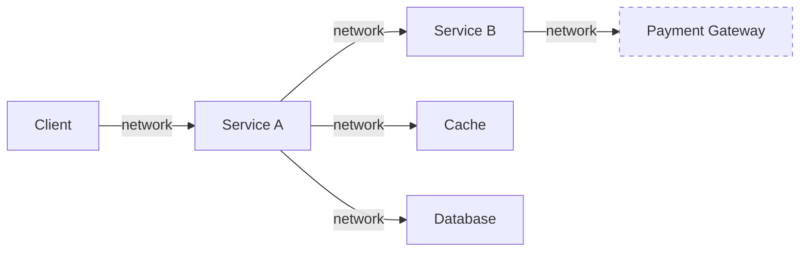
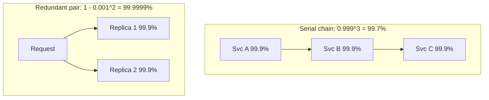
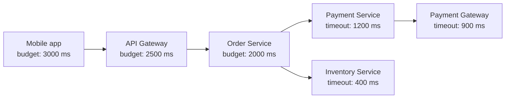
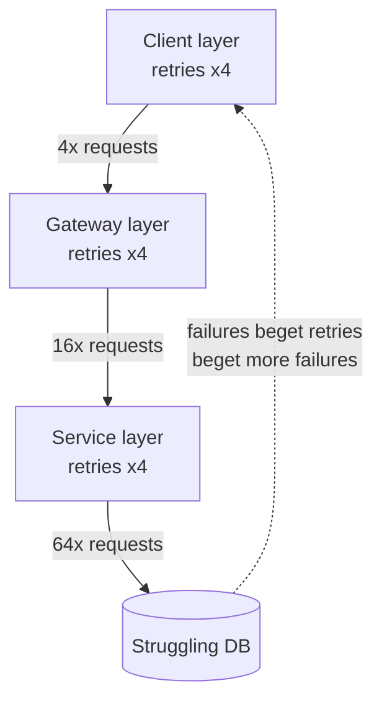
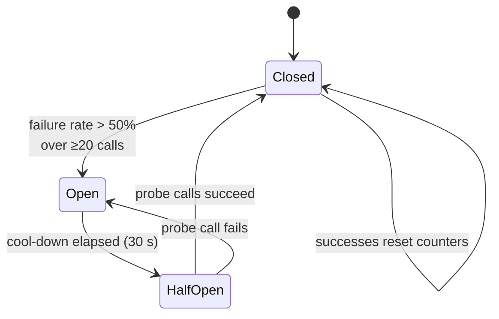
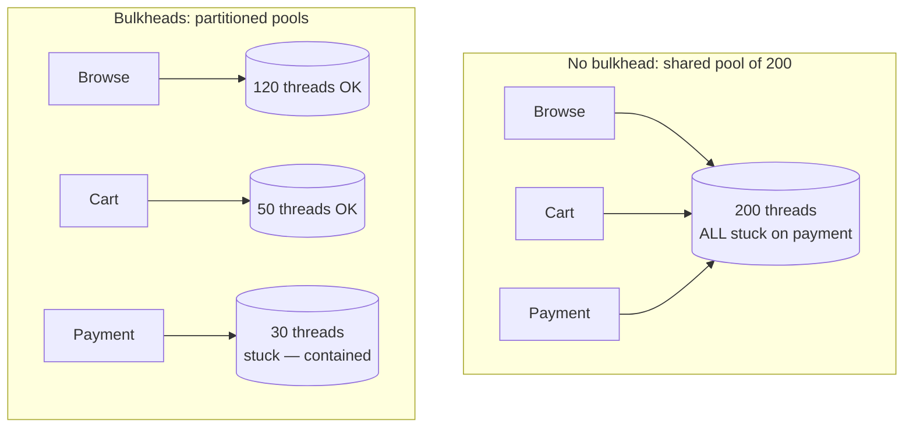
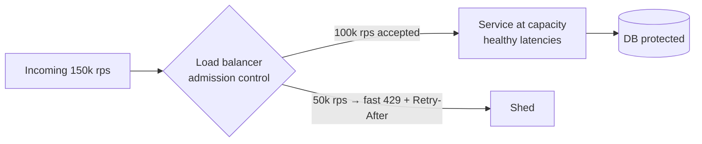
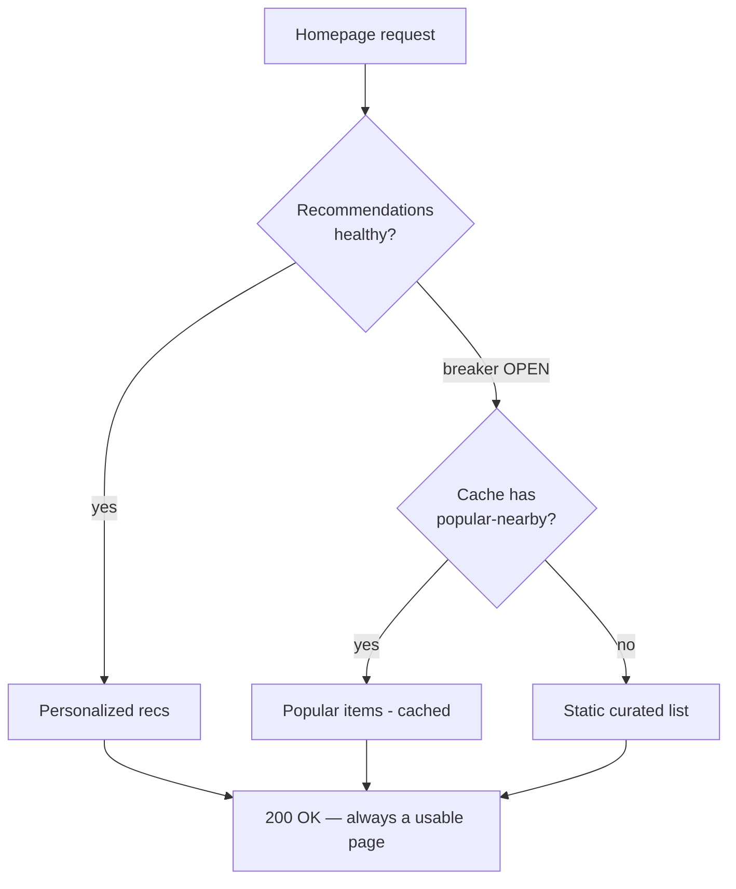
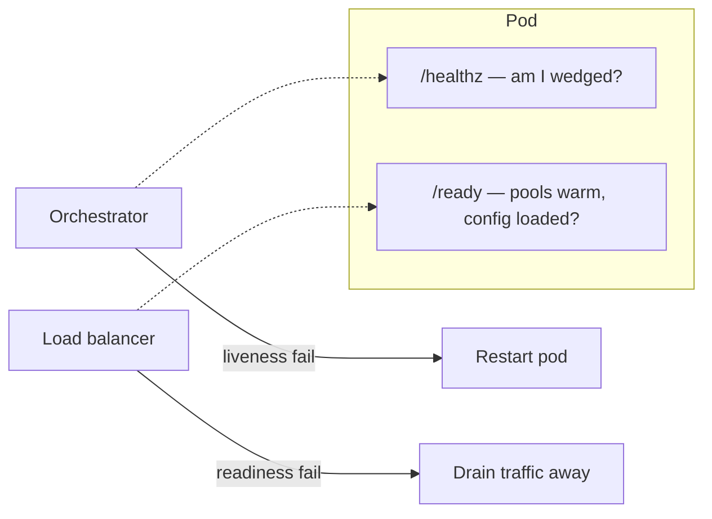
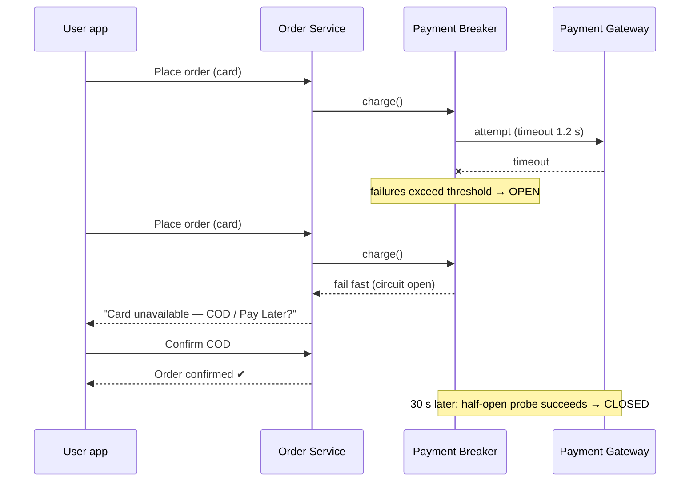

# Day 18 — Fault Tolerance: Designing for Failure

> Series: System Design Mastery

---

## Table of Contents

1. [The Mindset Shift: Everything Fails](#1-the-mindset-shift-everything-fails)
2. [Failure Math: Why Microservices Multiply Pain](#2-failure-math-why-microservices-multiply-pain)
3. [Timeout Discipline](#3-timeout-discipline)
4. [Retries Done Right](#4-retries-done-right)
5. [Circuit Breakers](#5-circuit-breakers)
6. [Bulkheads](#6-bulkheads)
7. [Backpressure & Load Shedding](#7-backpressure--load-shedding)
8. [Graceful Degradation Catalog](#8-graceful-degradation-catalog)
9. [Health Checks: Liveness vs Readiness](#9-health-checks-liveness-vs-readiness)
10. [Chaos Engineering](#10-chaos-engineering)
11. [Full Walkthrough: Swiggy When Payments Die](#11-full-walkthrough-swiggy-when-payments-die)
12. [The Dark Side of Resilience Machinery](#12-the-dark-side-of-resilience-machinery)
13. [Self-Check](#self-check)
14. [Apply (1 hour)](#apply-1-hour)

---

## 1. The Mindset Shift: Everything Fails

**In plain words:** Think of a single server like one lightbulb — it's either on or off, and it rarely blows. A distributed system is more like an entire city's power grid: at any second some street is flickering, some transformer is rebooting, some line is losing power. You can't wait for everything to be perfect at once; instead you plan so that when one block goes dark, the rest of the city keeps its lights on.

**Why.** On a single server, failure is rare and binary: the box is up or it's down. In a distributed system, *partial failure* is the steady state. At any moment in a 1,000-node fleet, something is slow, rebooting, garbage-collecting, or losing packets. Werner Vogels (Amazon CTO) put it bluntly: "Everything fails, all the time."

**What.** Fault tolerance is the discipline of designing so that component failures degrade the system rather than destroy it. The tools: timeouts, retries, circuit breakers, bulkheads, load shedding, fallbacks, health checks.

**When.** From the very first network call your service makes. The moment `Service A` calls `Service B` over a network, you have signed up for latency, packet loss, and partial failure.

**How.** Assume every dependency will: (a) be slow, (b) return errors, (c) return garbage, (d) disappear entirely. Design an explicit answer for each.

**Where.** Every RPC/HTTP client, every DB connection pool, every queue consumer, every cache lookup — in Instagram's feed service calling the media service, in Swiggy's order service calling the payment gateway.

**The Dark Side.** Teams over-rotate: they wrap a monolith's in-process function calls in "resilience" layers, or add retries to calls that were already reliable, adding latency and complexity for nothing. Fault tolerance is a tax — pay it where failure actually hurts.

> **🤔 Wait — if my servers almost never crash, why design for failure at all?**
> Because at scale "almost never" happens constantly. One box crashing once a year sounds rare — but run a 1,000-node fleet and something is crashing, GC-pausing, or dropping packets every few minutes. You're not designing for *your* server failing; you're designing for the near-certainty that *some* dependency in the request path is unhealthy right now.

**✅ Good scenario (where it saves you):** Instagram's feed service treats the media service as "will sometimes be slow." When one media replica GC-pauses for 4 seconds at peak, the feed still renders with a placeholder thumbnail instead of hanging — millions of feed loads survive a blip that a naive design would have turned into spinners.

**❌ Bad scenario (the pain without it):** A payments team assumes the fraud-check service "basically never fails," so they call it with no timeout and no fallback. One afternoon it wedges, every checkout thread blocks on it, and the entire payment flow goes dark for 20 minutes over a dependency that was only advisory.

**When NOT to bother:** A single-process CLI tool or a batch job with no network calls and a human watching it — if there's no partial-failure surface and a retry is just "run it again," resilience machinery is pure overhead.


*Every arrow is a place where slowness, loss, or lies can happen — five arrows, five failure surfaces.*

---

## 2. Failure Math: Why Microservices Multiply Pain

**In plain words:** Imagine a relay race where the baton must pass cleanly through 50 runners, and each runner fumbles just 0.1% of the time. Those tiny chances stack up until the team drops the baton surprisingly often. Chaining services together works the same way — small, individually-fine failure rates multiply into one big failure rate.

**Why.** Intuition says "each service is 99.9% available, so we're fine." The math says otherwise, because availabilities *multiply* along a serial call chain.

**What.** If a request must touch N services in series, each with availability `a`, the end-to-end availability is `a^N`.

**The killer example:**

- 1 service at 99.9% → 99.9%
- 10 services in series: 0.999^10 = **99.0%** (≈ 3.65 days of downtime/year)
- **50 services in series: 0.999^50 = 0.9512 → 95.1%** — roughly **18 days of downtime per year**, from components that each look great on their own dashboard.

**Availability reference table:**

| Availability | Nickname | Downtime / year | Downtime / month | Downtime / day |
|---|---|---|---|---|
| 99% | two nines | 3.65 days | 7.3 hours | 14.4 min |
| 99.9% | three nines | 8.77 hours | 43.8 min | 1.44 min |
| 99.95% | — | 4.38 hours | 21.9 min | 43 s |
| 99.99% | four nines | 52.6 min | 4.38 min | 8.6 s |
| 99.999% | five nines | 5.26 min | 26.3 s | 0.86 s |

**When.** Do this math whenever you design a call graph or promise an SLA. You cannot offer 99.9% to customers if your serial chain of five 99.9% dependencies caps you at 99.5%.

**How to fight the multiplication:**

1. **Shorten chains** — fewer serial hops (parallelize independent calls).
2. **Remove hard dependencies** — make calls optional with fallbacks (a failed recommendation call shouldn't fail the order).
3. **Add redundancy** — two replicas at 99% each, either one sufficient: 1 − (0.01)² = **99.99%**. Redundancy multiplies the *failure* probabilities instead.

> **🤔 Wait — if each service is 99.9% up, isn't the whole system basically 99.9%?**
> No — serial availabilities *multiply*, they don't average. Ten 99.9% services in a chain is 0.999^10 ≈ 99%, and fifty is ~95% — roughly 18 days of downtime a year from parts that each look flawless on their own dashboard. The chain is only as available as the *product* of its links, which is always worse than the weakest one.

**✅ Good scenario (where it saves you):** A Swiggy checkout team maps its serial chain, sees five required 99.9% hops cap them at ~99.5%, and makes the recommendations and loyalty-points calls *optional with fallbacks*. Removing two hard dependencies from the critical path buys back most of the lost availability budget without touching the dependencies themselves.

**❌ Bad scenario (the pain without it):** An org promises customers a 99.9% SLA, then routes the request path through eight required microservices at 99.9% each. Real availability lands near 99.2%, they blow the SLA every month and pay credits — not because any service is bad, but because nobody did the multiplication.

**When NOT to bother:** A two-hop internal admin tool used by ten people — the availability math is real but the stakes are a shrug, so spending weeks parallelizing calls to claw back minutes of yearly downtime is misplaced effort.


*Serial dependencies multiply availabilities down; redundant replicas multiply failure probabilities down.*

**Where.** Instagram: loading one profile page fans out to user, media, follower-count, and story services — each extra *required* call eats the availability budget. Swiggy: an order touches cart, restaurant, inventory, pricing, payment, and notification services.

**The Dark Side.** The formula assumes independent failures. Real failures correlate — one bad deploy, one overloaded shared database, one AZ outage takes out "redundant" replicas together. Your real availability is usually worse than the naive redundancy math and better than the naive serial math; correlated failure is why multi-AZ and multi-region exist.

---

## 3. Timeout Discipline

**In plain words:** A timeout is like telling a friend "if you're not here in 20 minutes, I'm leaving without you." Without that rule you'd wait forever, blocking your whole evening. In software, waiting forever on one slow call ties up a thread, a connection, and a lock until the whole service seizes up — so "slow" is actually more dangerous than "down."

**Why.** A request that fails in 50 ms is annoying. A request that *hangs for 60 seconds* holding a thread, a connection, and a lock is a weapon. Slow is worse than down: down fails fast and frees resources; slow accumulates and cascades.

**What.** A timeout is a promise: "I will not wait longer than X for this call." Every network call needs one — HTTP, gRPC, DB queries, cache gets, DNS, queue publishes. No exceptions. Most default client timeouts are terrible: the old `java.net.HttpURLConnection` has *no* connect or read timeout unless you set one, and even the modern `java.net.http.HttpClient` has no overall request timeout by default (you must call `.timeout(...)` on each request). Always set them explicitly.

**When.** Set timeouts at design time from the callee's observed p99 latency plus headroom — not from vibes. If payment p99 is 800 ms, a 2 s timeout is sane; a 30 s timeout means 30 s of thread hostage-taking per bad call.

> **🤔 Wait — why set a timeout if the service always responds eventually?**
> Because "eventually" is the whole problem. A call that returns in 30 seconds instead of failing at 1 second holds a thread, a connection, and often a lock hostage the entire time — and under load those hostages pile up until the *whole* service seizes. Slow is worse than down: down frees resources instantly, slow starves them silently.

**✅ Good scenario (where it saves you):** Swiggy caps its bank-gateway call at 1.2 s against an observed 700 ms p99. When the bank has a bad night and calls balloon to 30 s, each one dies at 1.2 s, threads recycle fast, and checkout returns a clean "payment pending, we'll notify you" instead of freezing.

**❌ Bad scenario (the pain without it):** A team leaves the default (effectively infinite) read timeout on an HTTP client calling a reporting service. The service degrades to 45 s responses, request threads accumulate on those hangs, the pool exhausts, and endpoints that never touched reporting start returning 503 — thread-pool exhaustion from one un-timed call.

**When NOT to bother:** A pure in-process function call or a local computation with no I/O — there's no thread to strand on a network and no remote party to wait on, so wrapping it in a timeout adds a watchdog thread and complexity for zero benefit.

**How — the timeout budget cascade.** The caller's timeout must be *larger* than the sum of the callees' worst cases, or you time out work that was about to succeed. Budgets shrink as you go deeper:


*Each hop gets a smaller budget than its caller, so the whole tree resolves before the user's patience — and the gateway's timer — runs out.*

Propagate the *remaining* budget downstream (gRPC deadlines do this natively; over HTTP, pass an `X-Deadline` header) so a deep service can refuse work that's already doomed.

**Where.** Swiggy checkout: user waits 3 s max. Gateway 2.5 s → order 2 s → payment 1.2 s → bank gateway 900 ms. If the bank takes 5 s, the payment call dies at 1.2 s and the order service can still return a clean "payment pending, we'll notify you" instead of a gateway 504.

**The Dark Side.** Timeouts convert slowness into errors — and errors trigger retries, so a mis-set (too short) timeout can *create* load. Also, a timed-out request may still be executing on the callee side: the caller doesn't know if the payment happened. Timeouts create ambiguity, which is exactly why Day 19's idempotency matters.

---

## 4. Retries Done Right

**In plain words:** If a phone call drops, redialing once usually works — the glitch was temporary. But if everyone whose call dropped redials at the exact same instant, again and again, they jam the network so nobody gets through. Smart retries wait a random moment, give up after a few tries, and only redial when redialing is actually safe.

**Why.** Many failures are transient — a dropped packet, a node mid-restart, a brief GC pause. A single retry often succeeds. But naive retries are the most common way engineers turn a small outage into a total one.

**What.** Retry = re-issue a failed call. Done right: limited attempts, exponential backoff, jitter, only on retryable errors, only on idempotent operations.

> **🤔 Wait — retries are just re-sending a request, what could go wrong?**
> A retry doubles down on a service that's *already* struggling. If a dependency degrades and starts failing, three layers of well-meaning 3× retries turn one wave of traffic into 64× load — the exact opposite of what a drowning service needs. Retries cure transient blips but are the single most common way engineers turn a small outage into a total one.

**✅ Good scenario (where it saves you):** Instagram's feed fetch (an idempotent GET) retries with exponential backoff and full jitter. A single replica restart drops ~0.5% of reads; the retry quietly recovers almost all of them, so users never see the blip and no page fires.

**❌ Bad scenario (the pain without it):** A dependency blips for 30 seconds; every caller retries 3×, their callers retry too, and the amplified 10–60× load pins the dependency down long enough that it can't recover until traffic is manually shed. This is the AWS-DynamoDB-2015-style retry storm — the retries, not the original fault, become the outage.

**When NOT to bother:** A non-idempotent write with no idempotency key — retrying a "charge the card" POST can double-bill the customer. Also skip retries on 400/401/403/404: the request is wrong, so re-sending it just wastes a round trip.

### Retry storms: the amplification math

Service B degrades and starts failing 100% of calls. Service A retries 3 times. Instant **4× load** (original + 3 retries) on a service that was *already drowning*. If A's caller also retries 3 times, that's 4 × 4 = **16×**. Three layers deep: **64×**. This is a retry storm, and it is a real, recurring outage pattern: the AWS DynamoDB outage of September 2015 was amplified by storage servers retrying metadata requests en masse; countless internal postmortems at every large company read "dependency blipped, retries amplified load 10×, dependency never recovered until we shed traffic."


*Three layers of well-meaning 3-retry policies amplify one failure into 64× load — the retry storm feedback loop.*

**When.** Retry on: connection errors, 503, 429 (after Retry-After), timeouts *on idempotent ops*. Do NOT retry on: 400, 401, 403, 404 (the request is wrong, not the network), or non-idempotent operations without an idempotency key (you might charge the card twice).

**How — exponential backoff + jitter in Java:**

```java
import java.net.ConnectException;
import java.net.SocketTimeoutException;
import java.util.Random;
import java.util.concurrent.Callable;

public class Retryer {

    // One shared random source for jitter. In production prefer
    // ThreadLocalRandom.current() so many threads don't contend on one Random.
    private static final Random RANDOM = new Random();

    /**
     * Exponential backoff with full jitter (AWS-recommended).
     * All delays are in milliseconds. The generic <T> lets this wrap any call
     * that returns a value — an HTTP GET, a DB read, etc.
     *
     * Real-world Java: use the Resilience4j "Retry" module instead of hand-rolling
     * this — it gives you configurable backoff, jitter, and metrics for free.
     */
    public static <T> T callWithRetries(Callable<T> fn,
                                        int maxAttempts,
                                        long baseDelayMs,
                                        long maxDelayMs) throws Exception {
        for (int attempt = 1; attempt <= maxAttempts; attempt++) {
            try {
                return fn.call();                       // try the real call
            } catch (ConnectException | SocketTimeoutException exc) { // only transient errors are retryable
                if (attempt == maxAttempts) {
                    throw exc;                          // budget exhausted — surface the failure
                }
                // exponential ceiling: 100, 200, 400, 800 ... capped at maxDelayMs
                // (1L << (attempt - 1)) is just 2^(attempt-1) using a bit shift
                long ceiling = Math.min(maxDelayMs, baseDelayMs * (1L << (attempt - 1)));
                // FULL JITTER: sleep a random amount in [0, ceiling), which decorrelates clients
                long sleepFor = (long) (RANDOM.nextDouble() * ceiling);
                Thread.sleep(sleepFor);                 // backoff before the next attempt
            }
        }
        // Unreachable: the loop always returns a value or throws above.
        throw new IllegalStateException("retry loop exited unexpectedly");
    }
}
```

Why jitter? Without it, every client that failed at t=0 retries at exactly t=100ms, t=300ms, t=700ms — synchronized waves that hammer the recovering service in pulses (the "thundering herd"). Full jitter spreads the wave into a gentle drizzle. AWS's own analysis showed full jitter finishes contended workloads with far fewer total calls than plain exponential backoff.

**Retry budgets:** cap retries globally, e.g., "retries may be at most 10% of total traffic" (Google SRE practice). When the budget is spent, fail fast instead of amplifying.

**Where.** Instagram feed fetch (GET, idempotent): retry freely with backoff. Swiggy "charge card" (POST, not idempotent): retry *only* with an idempotency key — Day 19 covers the mechanics.

**The Dark Side.** Retries hide flakiness. A dependency failing 5% of calls looks "fine" behind retries until load rises and the retry amplification tips it over. Track and alert on *pre-retry* error rates, or you'll discover the rot only during the storm.

---

## 5. Circuit Breakers

**In plain words:** Just like the electrical breaker in your home flips off to prevent a fire when a circuit overloads, a software circuit breaker stops calling a service that is clearly broken. Instead of waiting on every doomed call (and slowly bleeding threads), it fails instantly and checks back every so often to see whether the dependency has recovered.

**Why.** Retries handle *transient* blips. When a dependency is *down for minutes*, continuing to call it wastes your threads, adds its full timeout to your latency, and pounds a service trying to recover. You need a component that notices "this dependency is broken" and stops calling it — fast local failure instead of slow remote failure.

**What.** A circuit breaker wraps calls to one dependency and tracks failures. Three states:

- **CLOSED** — normal; calls pass through, failures counted.
- **OPEN** — failure threshold exceeded (e.g., >50% errors over 20+ requests in 10 s); all calls fail *immediately* without touching the network. After a cool-down (e.g., 30 s), move to half-open.
- **HALF-OPEN** — allow a few probe calls. Success → CLOSED. Failure → OPEN again.

> **🤔 Wait — why retries AND circuit breakers — isn't one enough?**
> They cover different timescales. Retries handle *transient* failures measured in milliseconds — a dropped packet, a node mid-restart. A circuit breaker handles *sustained* failure measured in seconds-to-minutes — a dependency that's simply down. Retrying a dependency that's been dead for two minutes just wastes threads and pounds a service trying to recover; the breaker stops the bleeding, and retries live *inside* it.

**✅ Good scenario (where it saves you):** Swiggy puts a breaker on the payment gateway. When the vendor times out 90% of calls, the breaker opens within ~15 seconds and every subsequent charge fails in microseconds — no thread waits the full 1.2 s timeout, and checkout instantly pivots to Cash on Delivery.

**❌ Bad scenario (the pain without it):** A team relies on retries alone. The payment gateway goes down for ten minutes; every request still burns its full timeout plus three retries before failing, latency explodes, threads pile up, and the retry volume keeps the gateway from ever catching its breath.

**When NOT to bother:** An in-process call or a call to a rock-solid local sidecar — a breaker on something that never fails over the network is a landmine that can trip on a routine blip and manufacture an outage of a perfectly healthy path.


*The breaker trips open on sustained failure, then cautiously probes recovery via half-open — never slamming a recovering service with full traffic.*

**How — a minimal Java sketch:**

```java
import java.util.concurrent.Callable;
import java.util.concurrent.atomic.AtomicInteger;
import java.util.concurrent.locks.ReentrantLock;
import java.util.function.Supplier;

public class CircuitBreaker {

    // Same three states as the diagram above.
    private enum State { CLOSED, OPEN, HALF_OPEN }

    private final int failureThreshold;   // how many failures before we trip OPEN
    private final long cooldownMs;        // how long to stay OPEN before probing again

    // AtomicInteger = a counter safe to update from many threads at once.
    private final AtomicInteger failures = new AtomicInteger(0);
    // 'volatile' makes sure every thread sees the latest value of these fields.
    private volatile State state = State.CLOSED;
    private volatile long openedAt = 0L;  // when we entered OPEN (System.currentTimeMillis)
    // A lock guards the state transitions so two threads can't corrupt each other's changes.
    private final ReentrantLock lock = new ReentrantLock();

    public CircuitBreaker(int failureThreshold, long cooldownMs) {
        this.failureThreshold = failureThreshold;
        this.cooldownMs = cooldownMs;
    }

    /**
     * Run fn through the breaker. When the breaker is OPEN we fail fast (or use the
     * fallback if one was provided). 'fallback' may be null.
     *
     * Real-world Java: use Resilience4j's CircuitBreaker instead of this sketch —
     * it adds sliding-window failure counting, half-open probe limits, and metrics.
     */
    public <T> T call(Callable<T> fn, Supplier<T> fallback) throws Exception {
        lock.lock();
        try {
            if (state == State.OPEN) {
                if (System.currentTimeMillis() - openedAt >= cooldownMs) {
                    state = State.HALF_OPEN;          // cool-down elapsed → allow one probe
                } else if (fallback != null) {
                    return fallback.get();            // still open → fail fast, locally
                } else {
                    throw new RuntimeException("circuit open");
                }
            }
        } finally {
            lock.unlock();
        }

        try {
            T result = fn.call();                     // attempt the real call
            lock.lock();
            try {
                failures.set(0);                      // success resets the failure count
                state = State.CLOSED;                 // ... and closes the breaker
            } finally {
                lock.unlock();
            }
            return result;
        } catch (Exception exc) {
            lock.lock();
            try {
                int failed = failures.incrementAndGet();
                // A failed probe (HALF_OPEN) or too many failures (CLOSED) trips us OPEN.
                if (state == State.HALF_OPEN || failed >= failureThreshold) {
                    state = State.OPEN;
                    openedAt = System.currentTimeMillis();
                }
            } finally {
                lock.unlock();
            }
            if (fallback != null) {
                return fallback.get();                // degrade gracefully instead of throwing
            }
            throw exc;
        }
    }
}
```

(Production libraries — Resilience4j, Netflix Hystrix (now legacy), Envoy outlier detection — add sliding windows, half-open probe limits, and metrics. Use them.)

**When & Where.** One breaker **per dependency**, not one global breaker — payment being down must not trip the breaker for the restaurant catalog. Instagram: a breaker on the ML ranking service; when it trips, serve chronologically ordered feed. Swiggy: breaker on the payment gateway; when it trips, offer cash-on-delivery and "pay later".

| Aspect | Retry | Circuit breaker |
|---|---|---|
| Failure type | Transient (ms–s) | Sustained (s–min) |
| Behavior | Try again, hope | Stop trying, protect |
| Risk | Amplifies load | Blocks recovered service if misconfigured |
| Scope | Per request | Per dependency |
| Work together? | Yes: retries inside, breaker outside | — |

**The Dark Side.** Breakers are new failure modes: thresholds too sensitive → the breaker trips on a routine blip and *causes* a 30 s outage of a healthy dependency; too lax → it never trips and you get no protection. Half-open probe stampedes (every instance probing at once) can re-kill a recovering service. Breakers need dashboards and tuning, or they're just landmines with good intentions.

---

## 6. Bulkheads

**In plain words:** Ships are built with sealed internal compartments so that if one section floods, water can't spread and sink the whole vessel. Bulkheads in software do the same thing: they wall off pools of threads and connections per dependency, so one slow service can't drown every other part of your app.

**Why.** Ships survive hull breaches because watertight compartments contain the flooding. Without compartments in software, one slow dependency consumes *all* your threads/connections, and suddenly your whole service is down — even the endpoints that never touch the slow dependency.

**What.** Bulkheading = partitioning resources (thread pools, connection pools, semaphores, even whole instance pools) per dependency or per feature, so exhaustion in one compartment cannot spread.

**The Swiggy example (this exact incident pattern is a classic):** The order service has one shared pool of 200 worker threads. The payment gateway goes slow — 30 s per call. Within a minute, all 200 threads are stuck waiting on payment. Now *browsing restaurants* — which never touches payment — returns 503, because there are no threads left to serve it. Payment slowness has killed browsing.

With bulkheads: payment calls get a dedicated pool of 30 threads (or a semaphore of 30 concurrent calls). When payment goes slow, exactly 30 threads are hostage; the 31st payment attempt fails fast ("payment temporarily unavailable, try COD"); the other 170 threads keep serving browsing, cart, and tracking untouched.

> **🤔 Wait — why bulkheads if I already have a circuit breaker?**
> Because a breaker needs *time and failures* to trip — and in that window a slow dependency can already drain your shared thread pool. Between "payment got slow" and "breaker opened 15 s later," 200 threads can all get stuck on payment, and now *browsing* (which never calls payment) returns 503. Bulkheads cap the damage immediately by giving payment its own 30-thread compartment; the breaker then handles the sustained outage. Different jobs.

**✅ Good scenario (where it saves you):** Swiggy gives the payment dependency a dedicated 30-thread pool. When the gateway goes slow, exactly 30 threads are held hostage and the 31st call fails fast; the other 170 threads keep serving restaurant browsing, cart, and order tracking with zero impact.

**❌ Bad scenario (the pain without it):** An order service runs one shared 200-thread pool. The payment gateway slows to 30 s/call, all 200 threads block on payment within a minute, and browsing — which never touches payment — starts returning 503. One slow dependency has taken down features that don't even depend on it: classic resource exhaustion via a shared pool.

**When NOT to bother:** A service with a single dependency, or dependencies that share the same reliability profile — partitioning into many small pools just wastes idle capacity and multiplies the tuning knobs on-call must reason about at 3 a.m.


*One slow dependency drains a shared pool completely; partitioned pools contain the damage to one compartment.*

**How.**
- **Thread-pool isolation** (Hystrix-style): each dependency gets its own `ExecutorService` (e.g., a fixed pool from `Executors.newFixedThreadPool(30)`). Cost: context-switch overhead. In modern Java, Resilience4j's `Bulkhead`/`ThreadPoolBulkhead` implements this for you.
- **Semaphore isolation**: cap concurrent calls per dependency with a `java.util.concurrent.Semaphore(30)` (`tryAcquire()` and reject fast if none free); cheaper, no extra threads.
- **Connection-pool split**: separate DB pools (e.g., two HikariCP `DataSource` instances) for interactive queries vs. batch/report queries, so an analyst's monster query can't starve checkout.
- **Deployment-level**: Instagram serves web, mobile API, and internal tools from separate instance fleets — a bug hammering the internal-tools fleet can't touch user traffic. Some companies bulkhead by customer tier (free vs. enterprise pools).

**When & Where.** Any shared, finite resource in front of dependencies with different reliability profiles. Rule of thumb: size each compartment from that dependency's expected concurrency = throughput × p99 latency (Little's Law).

**The Dark Side.** Partitioning wastes capacity — 30 payment threads sit idle at 3 a.m. while a flash-sale browse pool is starving. Too many small pools become a tuning nightmare (Netflix eventually moved from Hystrix thread pools toward adaptive concurrency limits partly for this reason). Start with a few coarse compartments around your scariest dependencies.

---

## 7. Backpressure & Load Shedding

**In plain words:** When a restaurant kitchen is slammed, a smart host stops seating new tables rather than letting every order come out cold and late. Turning some customers away on purpose keeps the ones already inside happy — because trying to serve everyone at once means serving no one well.

**Why.** Every system has a maximum sustainable throughput. Accept more than that and *everything* gets slower — queues grow, latencies explode, timeouts fire, retries pile on, and you serve nobody. A system at 120% offered load that sheds 20% serves 100% of its capacity successfully. One that "tries its best" serves close to 0% — every response arrives after the client already gave up. That's congestion collapse.

**What.**
- **Backpressure**: signal upstream "slow down" — bounded queues that block/reject producers, TCP flow control, Kafka consumer lag pausing, HTTP 429.
- **Load shedding**: actively drop work you can't finish in time — the earlier and cheaper, the better.

**How.**
1. **Bound every queue.** Unbounded queues don't prevent failure; they delay it, convert it into memory exhaustion, and guarantee that everything in the queue is stale by the time it's served. In Java, prefer a bounded `ArrayBlockingQueue` over an unbounded `LinkedBlockingQueue`, and configure your `ThreadPoolExecutor` with a `RejectedExecutionHandler` (e.g., `AbortPolicy`) so overflow fails fast.
2. **Shed at the front door.** Rejecting at the load balancer costs microseconds; rejecting after the DB query wasted all the work.
3. **Shed by priority.** Swiggy under stress: order placement and payment webhooks are sacred; search autocomplete and review-loading get shed first. Instagram: posting and DMs sacred; "seen-by" counts and like-count refreshes shed first.
4. **Adaptive limits.** Reject when concurrent in-flight requests exceed a limit derived from measured capacity (Little's Law again), or when queue wait time exceeds the request's remaining deadline — if it's been queued 2 s of a 3 s budget, it's cheaper to drop it now.

> **🤔 Wait — why turn users away on purpose — isn't a slow response better than none?**
> Not past capacity. Accept more than you can handle and *everything* slows down at once — queues grow, latencies blow past every client's timeout, and you end up serving responses nobody is still waiting for. Shedding 20% on purpose lets the other 80% succeed; "trying your best" for 100% often means ~0% land in time. That collapse-to-zero is called congestion collapse.

**✅ Good scenario (where it saves you):** On New Year's Eve, Swiggy order rates spike 3–5×. Admission control at the edge sheds low-priority calls (search autocomplete, review loads) with a fast 429 + Retry-After, so order placement and payment webhooks stay fast for everyone who got in.

**❌ Bad scenario (the pain without it):** A service fronts an unbounded queue "so we never drop anything." Under a surge the queue grows to millions of stale entries, memory balloons, every dequeued request is already past its deadline, and the box eventually OOM-kills — the unbounded queue didn't prevent failure, it just delayed and worsened it.

**When NOT to bother:** A low-traffic internal service that never approaches its capacity ceiling — admission control and adaptive limits are pure complexity when offered load is comfortably below what one instance can serve.


*Shedding 50k requests instantly at the edge lets the other 100k succeed — versus 150k all timing out together.*

**When & Where.** Flash events: Swiggy on New Year's Eve (order rates spike 3–5× normal peak), Instagram during a World Cup final. These are precisely when retry storms also loom, so shed + jittered retries + Retry-After work as a set.

**The Dark Side.** Shedding is deliberately failing users, and priority schemes encode business judgments in config that engineers set at 2 a.m. If your 429s don't include Retry-After, clients hammer you anyway. And a shedding threshold set from stale capacity numbers will shed at 40% utilization or refuse to shed at 110% — measure, don't guess.

---

## 8. Graceful Degradation Catalog

**In plain words:** When the fancy espresso machine breaks, a good cafe still hands you a cup of drip coffee instead of locking the doors. Graceful degradation means giving users a simpler-but-still-useful experience when part of the system is down, rather than showing them an error page or an endless spinner.

**Why.** Total success and total failure are not the only options. Users forgive a slightly worse experience; they don't forgive a spinner of death or a 500 page.

**What/How — the catalog:**

| Technique | Mechanism | Instagram example | Swiggy example |
|---|---|---|---|
| **Fallback service** | Secondary, simpler implementation | ML-ranked feed → chronological feed | Smart dispatch → nearest-rider dispatch |
| **Cached/stale response** | Serve last known good value | Stale follower counts | Slightly old restaurant menus |
| **Static default** | Hardcoded safe answer | Default avatar when profile-pic service dies | Default 35-min delivery estimate |
| **Feature flag / kill switch** | Turn heavy features off under stress | Disable autoplaying video previews | Disable live rider-map animation |
| **Partial response** | Return what you have, omit the rest | Feed without like counts | Order status without weather-adjusted ETA |
| **Queue for later** | Accept now, process async | — | Take order, confirm payment async |

**The canonical Swiggy case:** the recommendations service ("because you ordered biryani...") goes down. Wrong answer: homepage 500s or hangs. Right answer: circuit breaker trips, fallback serves the pre-computed "popular near you" list from cache. Users see a slightly less personal homepage; revenue keeps flowing; on-call fixes recommendations without a P1.

> **🤔 Wait — why build a fallback if the real service rarely fails?**
> Because "rarely" still means "sometimes," and *sometimes* is usually during peak load — exactly when an error page costs the most revenue. A fallback isn't insurance against a common failure; it's the difference between a rare failure being a shrug (slightly staler homepage) versus a P1 (homepage 500s during dinner rush). The cost of building it is small; the cost of not having it lands at the worst possible moment.

**✅ Good scenario (where it saves you):** Swiggy's recommendations service dies mid-evening. The breaker trips and the homepage falls back to a cached "popular near you" list. Users get a slightly less personalized page, revenue keeps flowing, and on-call fixes recommendations calmly instead of firefighting a checkout outage.

**❌ Bad scenario (when misused):** Instagram's profile-pic service has a rare hiccup, but the feed treats it as required — so a dead avatar service 500s the *entire feed*. A cosmetic dependency that could have fallen back to a default gray avatar instead takes down the core product because nobody wrote the "if X is down, show Y" sentence.

**When NOT to bother:** Where correctness is sacred — a payments ledger, an inventory count, an auth decision. Serving a stale or made-up fallback answer for "how much money is in this account" is far worse than failing loudly; degrade only where staleness is genuinely acceptable.


*Three tiers of fallback mean the homepage answers with something useful even when personalization and cache both fail.*

**When.** Decide degradation paths at design time, per feature: "if X is down, we show Y." If nobody wrote that sentence, the de facto answer is "we show an error."

**Where.** Attach fallbacks at the circuit-breaker layer (the `fallback` parameter — a `Supplier<T>` — in the sketch above) so failure handling and degradation live in one place.

**The Dark Side.** Fallbacks rot. The chronological-feed path that nobody exercised for a year is itself broken when the breaker finally trips (this is a real recurring postmortem genre: "the fallback failed"). Degraded modes also mask outages — if stale cache silently covers a dead service for six hours, did anyone page? Exercise fallbacks regularly (see chaos engineering) and *alert when degraded*, even while serving users fine.

---

## 9. Health Checks: Liveness vs Readiness

**In plain words:** There are two very different questions about a worker: "are they so sick they should be sent home?" (liveness) and "are they ready to take on a task right this second?" (readiness). Mixing them up is like firing your entire staff the moment the office coffee machine breaks — a small, external problem triggers a catastrophic response.

**Why.** Load balancers and orchestrators need to know whom to send traffic to and whom to restart. Conflating those two questions causes self-inflicted outages.

**What.**
- **Liveness** — "Am I alive, or wedged beyond repair?" Failing → **restart me**. Should check only process-internal health (deadlock, heap exhaustion). Keep it dumb.
- **Readiness** — "Can I usefully serve traffic *right now*?" Failing → **stop routing to me** (but don't kill me). May check warmed caches, config loaded, connection pools established.

| | Liveness | Readiness |
|---|---|---|
| Question | Should I be restarted? | Should I get traffic? |
| On failure | Kill & restart pod | Remove from LB rotation |
| Check depth | Process only | Local serving capability |
| Include dependencies? | **Never** | Rarely — only truly local, hard requirements |

**How & The Dark Side (they're inseparable here).** The classic self-own: a team puts "can I reach the database?" into the **liveness** check. The database blips for 60 seconds → every pod's liveness fails → the orchestrator **restarts the entire fleet simultaneously** → cold caches, connection-storm reconnects, and a 60-second DB blip becomes a 30-minute full outage. Dependency health belongs in circuit breakers and (sparingly) readiness — never liveness. Deep readiness checks have their own trap: if all pods mark unready because one shared dependency is down, you've removed 100% of capacity for a dependency that maybe only 10% of endpoints need.

> **🤔 Wait — a health check is a health check — why split liveness from readiness?**
> Because they trigger opposite actions. Liveness failing means "restart me"; readiness failing means "stop sending me traffic, but leave me running." Collapse them and a transient dependency blip — which should just drain traffic for a few seconds — instead restarts your entire fleet. Same signal, catastrophically different consequence.

**✅ Good scenario (where it saves you):** A Swiggy order-service pod uses a trivial 200 for liveness and checks "config loaded + local queue not saturated" for readiness. When one pod's local queue backs up, the LB drains traffic away from just that pod until it recovers — no restarts, no cold caches, no fleet-wide disruption.

**❌ Bad scenario (the pain without it):** A team puts "can I reach the database?" in the *liveness* probe. The DB blips for 60 seconds, every pod's liveness fails at once, the orchestrator restarts the whole fleet simultaneously, and cold caches plus a connection-reconnect storm turn a 60-second blip into a 30-minute outage.

**When NOT to bother:** A simple stateless service with no warm-up cost and no local readiness concerns — a single trivial health endpoint is fine, and inventing an elaborate readiness check with dependency probes just adds a way to accidentally remove all your capacity at once.


*Two different questions, two different consequences — mixing them turns dependency blips into fleet-wide restart storms.*

**Where.** Swiggy order-service pod: liveness = trivial 200; readiness = config loaded + local queue not saturated. Payment-gateway reachability is the circuit breaker's job. (In a Spring Boot service, Spring Boot Actuator exposes `/actuator/health/liveness` and `/actuator/health/readiness` for exactly this split.)

---

## 10. Chaos Engineering

**In plain words:** Chaos engineering is a fire drill for software — you start small, controlled fires on purpose while you're watching and ready, so you learn whether the alarms and exits actually work before a real fire breaks out at 3 a.m.

**Why → What.** You don't know your fallbacks work until failure happens; chaos engineering makes failure happen on your schedule. Netflix's Chaos Monkey (killing random production instances since 2011) is the famous ancestor; modern practice is controlled *game days* and fault-injection experiments: kill a pod, add 500 ms latency to the payment dependency, blackhole a cache, fail an AZ.

**How.** Start in staging, define a hypothesis ("checkout succeeds via COD fallback when payment is blackholed"), limit blast radius, measure, fix what surprised you. Graduate to production with small percentages.

**When/Where.** Only after you *have* the machinery from this chapter — chaos-testing a system with no timeouts just proves it dies, which you knew.

> **🤔 Wait — why deliberately break production — isn't that just causing outages?**
> The point is controlled failure *while you're watching and ready*, not random destruction. You already have failures — chaos engineering just moves them from 3 a.m. unannounced to 2 p.m. with the team standing by, a hypothesis written down, and a blast-radius limit. You're not adding risk; you're paying down the risk you already have on your own schedule.

**✅ Good scenario (where it saves you):** Netflix's game days blackhole the payment dependency in a small production slice with the hypothesis "checkout still succeeds via the COD fallback." The fallback path — untouched for months — turns out to have a stale-config bug, and they fix it calmly instead of discovering it during a real vendor outage.

**❌ Bad scenario (when misused):** A team runs a "chaos experiment" in production with no blast-radius limit and no rollback plan, kills a critical stateful service, and can't bring it back cleanly. The exercise becomes a genuine customer-facing incident — chaos without guardrails is just an outage with a fancier name.

**When NOT to bother:** Before you actually have the resilience machinery — timeouts, breakers, fallbacks. Chaos-testing a system with no timeouts only proves it dies under load, which you already knew; build the mechanisms first, then verify them.

**The Dark Side.** Chaos without a rollback plan and blast-radius limits is just an outage with a fancy name. Get organizational buy-in first.

---

## 11. Full Walkthrough: Swiggy When Payments Die

**In plain words:** This section is the movie where all the safety gear from the earlier chapters gets used at once during a real emergency. Watch how timeouts, retries, circuit breakers, bulkheads, and fallbacks team up to turn a vendor meltdown into a minor, measured inconvenience instead of a company-wide disaster.

Scene: 8:45 p.m. Friday, peak dinner load (~8,000 orders/min). The third-party payment gateway starts timing out 90% of calls (its p99 goes from 700 ms to 30 s).

> **🤔 Wait — isn't stacking timeouts, retries, breakers, bulkheads, and fallbacks overkill for one vendor having a bad night?**
> Each layer catches what the previous one can't. The timeout frees the thread fast; the bulkhead keeps the damage in one compartment; the breaker stops the pounding once failure is sustained; the fallback keeps revenue flowing. Remove any one and the vendor's bad night becomes *your* company's outage — that's why they're a set, not a menu.

**✅ Good scenario (where it saves you):** With all five layers, the 90%-failing gateway becomes an 18%-COD-conversion blip: browsing and tracking never notice, checkout pivots to Cash on Delivery, on-call gets one page, and card payments quietly return at 9:10 p.m. when the vendor heals — no company-wide incident.

**❌ Bad scenario (the pain without it):** With none of it, order threads pile on 30-second waits, the shared pool exhausts, browsing/cart/tracking all 503, apps auto-retry into a 4× load spike, and the API gateway cascades — a full app outage caused entirely by one vendor's bad night.

**When NOT to bother:** A tiny internal tool calling one dependency where a plain error page is an acceptable outcome — orchestrating five coordinated layers there is more machinery than the failure mode justifies.

**Without the machinery:** order threads pile up on 30 s waits → shared pool exhausts → browsing, cart, and tracking all 503 → apps auto-retry → 4× load → cascade to the API gateway → *full app outage caused by one vendor's bad night*.

**With the machinery, step by step:**

1. **Timeout (1.2 s)** on payment calls fires — threads freed in 1.2 s, not 30 s.
2. **Retry once, jittered** — mostly fails too; the retry budget (10%) caps amplification.
3. **Circuit breaker** on the payment gateway sees >50% failures over 20+ calls and **opens** within ~15 s. All further payment calls fail in microseconds.
4. **Bulkhead** — during those 15 s, at most the payment pool's 30 threads were tied up. Browsing and tracking never noticed.
5. **Graceful degradation** — checkout now offers **Cash on Delivery** and "Pay Later" prominently; card payments show "temporarily unavailable, retry in a few minutes." Some orders queue as "payment pending" for async completion when the gateway heals.
6. **Load shedding** — the gateway sheds low-priority endpoints if the failure raises overall pressure; 429 + Retry-After keeps clients polite.
7. **Health checks unaffected** — liveness never referenced payment, so no restart storm.
8. **Half-open probes** every 30 s test the gateway; when the vendor recovers at 9:10 p.m., probes succeed, breaker closes, card payments quietly return.
9. **Observability** (Day 20): the breaker-open event paged on-call at 8:46; a status banner and the metric `paymentFallbackOrdersTotal` tracked business impact (~18% of orders switched to COD).


*The breaker converts a 30-second vendor timeout into a microsecond local decision, and the order completes via fallback.*

**Net result:** one vendor outage became a partial feature degradation with measured business impact — not a company-wide incident.

---

## 12. The Dark Side of Resilience Machinery

**In plain words:** Every seatbelt and airbag you add to a car is also one more thing that can jam or misfire. The resilience machinery in this file is itself code and config that can fail — so the goal is never "add every pattern," it's "add just enough that you can still reason about the whole thing at 3 a.m. during an incident."

> **🤔 Wait — if resilience patterns cause outages too, why use them at all?**
> Because the alternative — no timeouts, no breakers, no bulkheads — fails *harder* and more often; you just trade loud, well-understood failures for silent, cascading ones. The lesson isn't "avoid the machinery," it's "add only what each failure mode needs, and keep the total small enough to reason about." A misconfigured breaker is a risk; no breaker at all is usually a bigger one.

**✅ Good scenario (where it saves you):** A team keeps resilience deliberately minimal — timeouts everywhere, a breaker on their two scariest dependencies, one coarse bulkhead. During an incident, on-call actually understands every knob in the path and resolves it in minutes because there's nothing exotic to reverse-engineer under pressure.

**❌ Bad scenario (when misused):** A team hand-tunes thousands of Hystrix settings across hundreds of services. A well-meaning "3 failures trips open" config change ships, trips a healthy dependency fleet-wide during the cool-down, and *the config change itself is the incident* — the resilience machinery caused the outage it was meant to prevent.

**When NOT to bother:** Adding a pattern "for completeness." If you can't name the specific failure mode a breaker, bulkhead, or extra retry layer defends against, don't add it — every unused knob is complexity on-call pays for at 3 a.m.

Every mechanism in this file is code and config that can itself fail:

- **Misconfigured breakers cause outages.** A threshold of "3 failures" trips on routine noise and takes a healthy dependency offline fleet-wide for the cool-down period. There are postmortems at major companies where the circuit breaker config change *was* the incident.
- **Retry + timeout interactions** are emergent: shortening a timeout during an incident can double effective load (more timeouts → more retries).
- **Fallback paths rot** and fail exactly when needed (untested code is broken code).
- **Complexity budget:** every knob (thresholds, cool-downs, pool sizes, shed priorities) is something on-call must understand at 3 a.m. Netflix, who invented much of this, later *simplified* away fine-grained Hystrix configuration because thousands of hand-tuned settings were themselves a reliability risk.
- **Sometimes crash-fast-and-alert beats degrade-silently.** For a payments ledger or an inventory system, serving a *wrong* or stale answer is far worse than serving an error. Silent degradation also breeds "gray failures" — the system limps for days, users suffer quietly, and no alert fires because nothing is technically "down." Rule of thumb: degrade gracefully where staleness is acceptable (feeds, menus, ETAs); fail loudly where correctness is sacred (money, stock, auth).

Resilience is not "add all the patterns." It's: know your failure modes, add the cheapest mechanism that handles each, test it regularly, and keep the total machinery small enough to reason about during an incident.

---

## Self-Check

1. Fifty services at 99.9% each in a serial chain — what's the end-to-end availability, and roughly how many days of downtime per year is that?
2. Two replicas at 99% each, either sufficient: what's the combined availability, and what real-world assumption does that calculation dangerously ignore?
3. Why must a caller's timeout be larger than the sum of its callees' timeouts, and what goes wrong if it isn't?
4. Three layers of services each retry 3 times. What's the load amplification on the bottom layer during a full outage, and what two techniques cap it?
5. Explain full jitter in one sentence and why synchronized retries are worse than the same number of randomized ones.
6. Walk through the three circuit-breaker states and what event causes each transition. Why one breaker *per dependency*?
7. Swiggy's payment gateway goes slow. Explain precisely how the absence of bulkheads kills restaurant browsing, including the resource that gets exhausted.
8. Why is putting a database reachability check inside a *liveness* probe a fleet-killing mistake? Where should that check live instead?
9. Give two Swiggy features you'd shed first under overload and two you'd protect at all costs — justify the ordering in business terms.
10. Name a system where degrade-silently is the *wrong* choice and crash-fast-and-alert is right, and explain why.

---

**Tomorrow:** Day 19 — the genuinely hard problems. What happens when a payment times out and you don't know if it went through (idempotency), when three cron replicas all fire at once (distributed locks), why "just order by timestamp" is a lie, and how exactly one Swiggy rider gets assigned an order.

---

## Apply (1 hour)

Build and break a resilient client:

1. **(20 min)** Write a tiny Spring Boot (or plain `com.sun.net.httpserver.HttpServer`) "flaky payment service": responds 200 after 100 ms normally, but for a toggleable window responds after 10 s or with 503, 90% of the time.
2. **(25 min)** Write a client that calls it in a loop at 10 rps using: a 1 s timeout (set `.timeout(Duration.ofSeconds(1))` on your `HttpRequest`, or a read timeout on your HTTP client), `callWithRetries` (max 3, full jitter), and the `CircuitBreaker` sketch with a fallback returning `Map.of("method", "COD")`. Log every state transition.
3. **(15 min)** Run three experiments and record observations: (a) remove the timeout — watch threads hang; (b) remove jitter and run 20 concurrent clients — watch synchronized retry waves in the server logs; (c) set the breaker threshold to 2 with a 60 s cooldown — watch a single blip cause a one-minute self-inflicted outage. Write three sentences: which misconfiguration scared you most, and why?
