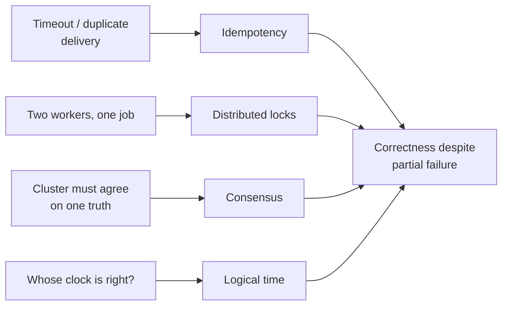
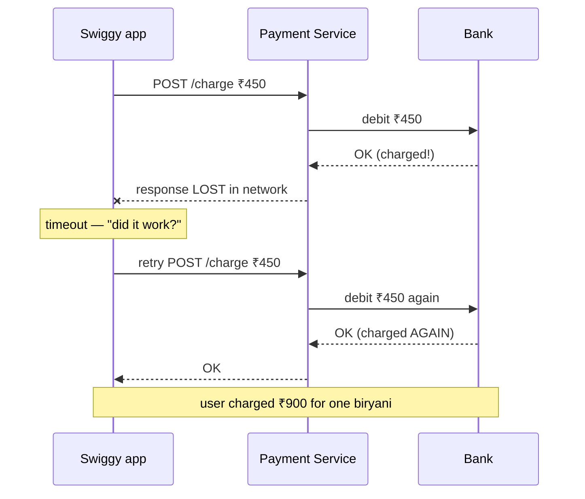
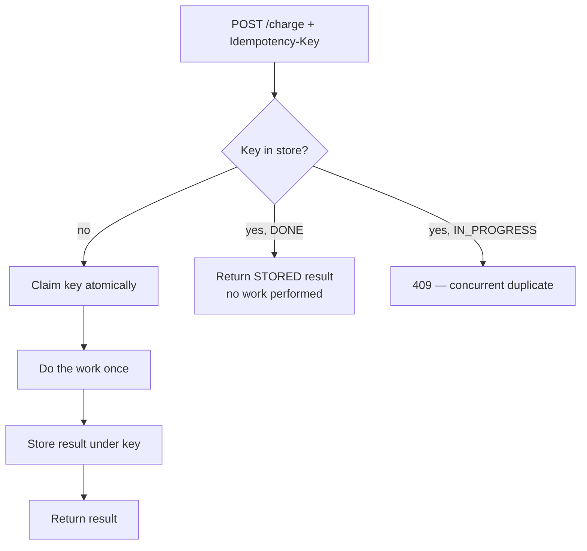
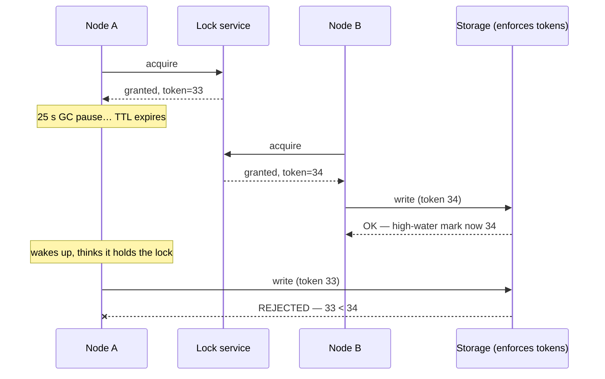
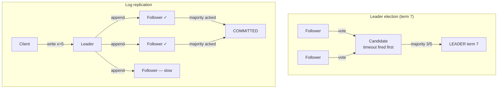
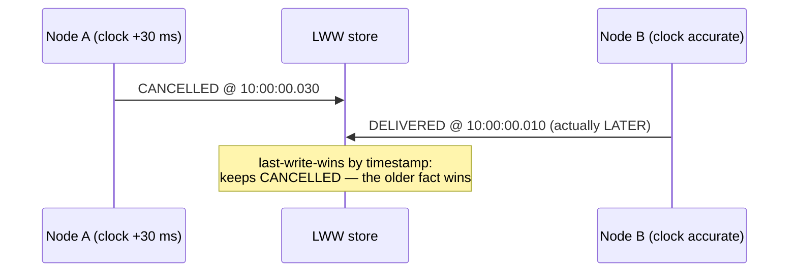
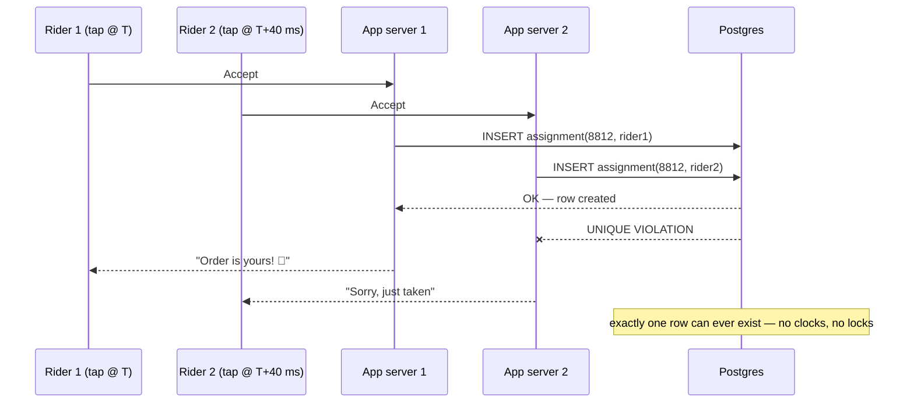

# Day 19 — Hard Problems: Locks, Consensus, Idempotency, Time

> Series: System Design Mastery

---

## Table of Contents

1. [Why These Problems Are Different](#1-why-these-problems-are-different)
2. [Idempotency In Depth](#2-idempotency-in-depth)
3. [Distributed Locks](#3-distributed-locks)
4. [Consensus at Concept Level](#4-consensus-at-concept-level)
5. [Time Is a Lie](#5-time-is-a-lie)
6. [Worked Design: Exactly One Rider Gets the Swiggy Order](#6-worked-design-exactly-one-rider-gets-the-swiggy-order)
7. [The Dark Side: Overkill Machinery](#7-the-dark-side-overkill-machinery)
8. [Self-Check](#self-check)
9. [Apply (1 hour)](#apply-1-hour)

---

## 1. Why These Problems Are Different

**In plain words:** Imagine you and a friend are decorating a shared room, but you're in different buildings with only a walkie-talkie that sometimes drops words. You can't see each other's work, you don't share a wall clock, and a message like "I painted the door" might arrive twice or never. That's a distributed system. Everything in this file is a trick for staying in sync when you can't fully trust the messages, the clocks, or the other person being alive.

Yesterday's tools (timeouts, retries, breakers) manage *failure*. Today's problems are about *correctness under uncertainty*: when a call times out, did it happen or not? When two nodes both think they hold "the" lock, who's right? When two events have timestamps 3 ms apart from two different servers, which came first? Distributed systems give you a brutal trio: **no shared memory, no shared clock, and messages that can be lost, delayed, or duplicated.** Every pattern in this file is a way to buy back a slice of certainty — and every one has a price tag. The recurring theme: prefer the boring tool (a database constraint) over the exciting one (a consensus cluster) whenever the boring tool suffices.

> **🤔 Wait — isn't this just error handling with extra steps? Day 18 already covered retries and timeouts.**
> Day 18's tools decide *whether to give up*; today's decide *what's actually true* after a call whose outcome you never learned. A retry with a 500ms timeout is an availability tactic; but the instant that retry can charge a card twice or assign two riders to one order, you've crossed from "handling failure" into "reasoning about a state two machines disagree on." Same network, different question: not "did it break?" but "given that I can't tell, how do I stay correct anyway?"

**✅ Good scenario (where it saves you):** Swiggy's payment service times out calling the bank on a Friday-dinner spike; without idempotency the automatic retry double-charges, and without a DB-enforced assignment invariant two riders get pinged to the same restaurant. Treating these as *correctness-under-uncertainty* problems (not mere errors) is what keeps the 8pm rush from becoming a refund avalanche.

**❌ Bad scenario (the pain without it):** A team treats every timeout as "just retry harder," bolts on aggressive retry loops, and ships. Under partition their duplicate writes, resurrected stale values, and split-brain leaders all surface at once during peak — an incident class no amount of retry tuning fixes, because the bug was never about failure, it was about disagreement.

**When NOT to bother:** Single-node, single-process work with one database and no fan-out — a monolith writing to one Postgres in one transaction has shared memory and a shared clock, so most of this file is machinery you don't need yet.


*Four flavors of distributed uncertainty, four families of tools — pick the cheapest one that solves your actual problem.*

---

## 2. Idempotency In Depth

**In plain words:** "Idempotent" is a fancy word for "safe to repeat." A light switch that says "turn OFF" is idempotent — flip it ten times, the light is still just off. But "spend ₹450 from my wallet" is not — do it ten times and you're broke. The whole trick in this section is putting a "have I already done this exact thing?" sticky note on operations that aren't naturally safe to repeat, so that pressing the button twice only charges you once.

> **🤔 Wait — my payment DB is ACID and transactional. Doesn't that already stop double charges?**
> A transaction guarantees *one* charge call commits atomically — it says nothing about a *second, separate* charge call arriving from a retry. Each retry is its own valid transaction that dutifully debits again; ACID makes both charges durable, not mutually exclusive. Idempotency is the layer that makes the second request recognize "I already ran the first" — the DB can enforce it (a unique key), but a bare transaction alone will not.

**✅ Good scenario (where it saves you):** A Razorpay-style payment API tags each "user tapped Pay" with an idempotency key; when the client's network drops the response and it retries, the server replays the stored result and the bank is debited exactly once. At festival-sale scale, this is the difference between a clean checkout and a support queue full of "charged twice for one order."

**❌ Bad scenario (the pain without it):** A queue consumer processes an `order_placed` event, then crashes before acking; the broker redelivers (at-least-once), and without dedup the customer gets two confirmation SMS and two loyalty-point credits. The lost-update / double-effect bug quietly inflates ledgers until finance notices the numbers don't reconcile.

**When NOT to bother:** Naturally idempotent operations — a `GET`, or a `PUT` that sets an absolute value (`balance = 500`, `status = SHIPPED`). Wrapping those in key machinery is pure overhead; repeating them already has no extra effect.

### Why: the double-payment problem

**Why.** Day 18 established that timeouts create ambiguity: the caller times out, but the callee may have *finished the work*. Networks also duplicate: a client retry, a load balancer replay, a queue's at-least-once delivery. If the operation is "charge ₹450," ambiguity + retry = the single most infamous bug in commerce: the **double charge**.


*The first charge succeeded; only the response died. The retry — which Day 18 taught us to do — creates the second charge.*

The cruel part: the retry was *correct behavior*. The fix cannot be "don't retry" (then transient failures become user-facing failures). The fix is making the operation safe to repeat.

### What

**Idempotent operation:** performing it N times has the same effect as performing it once. `GET`, `PUT /users/42 {name: "X"}` (absolute set), `DELETE /orders/7` are naturally idempotent. `POST /charge`, `POST /orders`, "append," "increment" are not — they must be *made* idempotent with an **idempotency key**.

| Operation | Naturally idempotent? | Why |
|---|---|---|
| `GET /menu` | Yes | Reads change nothing |
| `PUT balance = 500` | Yes | Absolute assignment |
| `DELETE /cart/item/9` | Yes | Deleting twice = deleted |
| `POST /orders` | **No** | Creates a new row each time |
| `balance += 450` | **No** | Relative change compounds |

### How: idempotency keys end-to-end

**In plain words:** The client tags each real-world action ("user tapped Pay") with a unique ticket number and reuses that same ticket on every retry. The server keeps a guest book of ticket numbers it has already served. First time it sees a ticket, it does the work and writes the answer next to the ticket; every later time it sees the same ticket, it just reads the answer back out of the guest book instead of charging the bank again.

**The protocol (this is exactly how Stripe, Razorpay, and every serious payment API work):**

1. **Client generates** a unique key (UUIDv4) *per logical operation* — one key per "user tapped Pay," reused across all retries of that tap. Sent as a header: `Idempotency-Key: 7f3c9b2e-...`.
2. **Server, before doing work:** atomically claim the key (insert into a store with a unique constraint). Three cases:
   - Key unseen → claim it (status `IN_PROGRESS`), do the work, store the result against the key, return it.
   - Key seen, status `COMPLETED` → **return the stored result verbatim**; do NOT redo the work.
   - Key seen, status `IN_PROGRESS` → a concurrent retry raced in; return `409 Conflict` or wait briefly — never start a second execution.
3. **Replay indistinguishable from original**: the retried client gets the same 200 and same body it would have gotten, and the bank was debited once.

```java
// Spring Boot sketch — idempotency handling for POST /charge.
// Redis (via a Jedis/Lettuce client wrapper) is the shared "guest book" store.

@RestController
public class ChargeController {

    private final RedisClient redis;               // thin wrapper over Jedis/Lettuce
    private final ObjectMapper json = new ObjectMapper();  // Jackson for JSON <-> object
    private static final long TTL_SECONDS = 24 * 3600;     // keys live 24h

    public ChargeController(RedisClient redis) {
        this.redis = redis;
    }

    @PostMapping("/charge")
    public ResponseEntity<String> charge(
            @RequestBody Map<String, Object> payload,
            // @RequestHeader with no default => header is REQUIRED (like FastAPI's Header(...))
            @RequestHeader("Idempotency-Key") String idempotencyKey) throws Exception {

        String slot = String.format("idem:charge:%s", idempotencyKey);

        // Atomic claim: SET key value NX EX ttl — only ONE request per key ever wins this gate.
        // setIfAbsent returns true only when the key did not already exist.
        String inProgress = json.writeValueAsString(Map.of("status", "IN_PROGRESS"));
        boolean claimed = redis.setIfAbsent(slot, inProgress, TTL_SECONDS);

        if (claimed) {
            String result;
            try {
                result = doCharge(payload);        // talk to the bank ONCE
            } catch (Exception e) {
                redis.delete(slot);                // release the claim so a clean retry can happen
                throw e;                           // re-throw (Java's version of Python's bare "raise")
            }
            // Record the final answer next to the key so future retries can replay it.
            String done = json.writeValueAsString(Map.of("status", "DONE", "result", result));
            redis.set(slot, done, TTL_SECONDS);
            return ResponseEntity.ok(result);
        }

        // Key already exists: this is either a replay or a concurrent race.
        Map<String, Object> stored = json.readValue(redis.get(slot), new TypeReference<>() {});
        if ("DONE".equals(stored.get("status"))) {
            return ResponseEntity.ok((String) stored.get("result"));  // replay: hand back stored response
        }
        // Still IN_PROGRESS: a duplicate raced in while the first call is running.
        return ResponseEntity.status(409).body("original request still in progress");
    }
}
```

(Production hardening: store the key in the *same DB transaction* as the business write when possible — Redis + separate DB can desync on crash between the two writes. Also hash and compare the request body: same key + different payload = `422`, a client bug.)


*Every retry funnels through one atomic gate; only the first arrival ever touches the bank.*

### When, Where, TTL and scope

- **When**: any non-idempotent operation that can be retried — payments, order creation, notifications-with-side-effects, queue consumers (at-least-once delivery makes every consumer a retry surface).
- **Scope**: key uniqueness is *per endpoint per client operation*, not global. `idem:charge:{key}` and `idem:refund:{key}` are separate namespaces.
- **TTL**: long enough to cover any realistic retry window (client retries, queue redelivery, user double-tap, support-driven replays) — 24 hours is the common default (Stripe uses 24h). Too short: a delayed retry after expiry re-executes → double charge returns. Too long: unbounded storage; at Swiggy scale (2M orders/day × ~3 payment attempts) that's ~6M keys/day — fine in Redis at ~100 bytes each (~600 MB/day, expiring).
- **Instagram example**: "publish post" with an idempotency key means a flaky-network double-tap uploads one post, not two identical ones.

### Idempotent consumers: the queue-side twin

**In plain words:** A message queue is like a delivery driver who is told "keep re-delivering this parcel until the customer signs for it." If the customer signs but the driver's pen runs out before he records the signature, he comes back tomorrow with the same parcel. So the customer keeps their own list of parcels already received; when a repeat parcel shows up, they just wave it away. That list-plus-wave is an idempotent consumer.

Queues (Kafka, SQS, RabbitMQ) promise **at-least-once** delivery — "exactly-once delivery" over a lossy network is impossible in general (the consumer can crash after processing but before acking, so the broker must redeliver). What *is* achievable is **exactly-once processing**: at-least-once delivery + an idempotent consumer. Same recipe as HTTP: every message carries a stable ID (event ID, or `orderId + eventType`), and the consumer records processed IDs — ideally in the same transaction as its business write:

```java
void handleOrderPlaced(Message msg) {
    // Run the dedup insert and the business write inside ONE database transaction,
    // so a crash leaves either both writes or neither — never half done.
    try (Transaction tx = db.beginTransaction()) {
        try {
            // Unique constraint on processed_events.event_id — Day 19's favorite tool.
            db.execute("INSERT INTO processed_events (event_id) VALUES (?)",
                       msg.eventId());
        } catch (UniqueViolationException e) {
            // We've already processed this event; the delivery is a duplicate.
            tx.rollback();
            ack(msg);              // just acknowledge so the broker stops resending
            return;
        }
        db.execute("INSERT INTO notifications (user_id, kind) VALUES (?, 'order')",
                   msg.userId());
        tx.commit();              // dedup insert + business write commit ATOMICALLY
    }
    ack(msg);
}
```

Because the dedup insert and the business write commit **atomically**, a crash at any point leaves either both or neither — redelivery then either replays cleanly or no-ops. Swiggy's `order_placed` event fans out to notification, loyalty, and analytics consumers; each dedups independently (one consumer's progress must not mask another's redelivery).

| Delivery promise | What it means | Who provides it |
|---|---|---|
| At-most-once | May lose messages, never duplicates | Fire-and-forget (rarely acceptable) |
| At-least-once | Never loses, may duplicate | Default for Kafka/SQS/RabbitMQ |
| Exactly-once *processing* | Duplicates arrive but have no effect | **You** — idempotent consumer + transactional dedup |

**The Dark Side.** Idempotency keys protect the *server-side effect*, not semantics: if the client generates a *new* key for what the user considers the same action (e.g., app restarts and re-submits with a fresh UUID), you double-charge anyway — key generation must survive client restarts (persist it with the draft order). And the `IN_PROGRESS` state needs a recovery story: if the server crashes mid-work, the key is stuck; you need TTL on the claim or a reconciliation job, or that user can *never* complete the payment.

---

## 3. Distributed Locks

**In plain words:** A distributed lock is the single bathroom key shared by an entire office floor. Only the person holding the key can go in; everyone else waits. The twist: your coworkers are in different buildings, so the "key" is really a note on a shared whiteboard saying "Alice has it until 3:05 PM." That timeout on the note is both the safety feature (if Alice vanishes, the key frees up) and, as we'll see, the source of the scariest bug in this section.

> **🤔 Wait — why do I need distributed locks if my DB has transactions?**
> A DB transaction is a lock *inside one database* — it serializes writes to rows that database owns. A distributed lock coordinates work that *isn't* a single DB write: three replicas about to each fire the same cron, two workers about to rebuild the same file, a job that talks to an external API. When the thing you're protecting lives in the database, you almost never need a distributed lock — a row lock or unique constraint is stronger and cheaper. You reach for a distributed lock only when the critical section spans systems the DB can't see.

**✅ Good scenario (where it saves you):** Swiggy runs its 09:00 settlement job on 3 replicas for availability; a single Redis lock (`SET NX PX`) ensures only one replica actually runs it, so vendors aren't paid three times. A rare double-run is absorbed by the job's own idempotency, so best-effort exclusion is exactly the right tool here.

**❌ Bad scenario (the pain without it / when misused):** A team guards ledger writes with a plain Redis lock; one holder hits a 25-second GC pause, its TTL expires, a second node grabs the lock, and the paused node wakes and writes too — a split-brain double-writer corrupting money, because no TTL is longer than an arbitrary pause. That's the fencing-token problem, and a bare lock never solves it.

**When NOT to bother:** When the invariant is "at most one X per Y" and it lives in your database — a `UNIQUE` constraint or `SELECT ... FOR UPDATE` enforces it transactionally, with no Redis dependency and no expiry hole. Don't drag a distributed lock into a correctness path the database already owns.

### Why

You run a "send payment-reminder emails" cron job. For availability, the service runs on **3 replicas**. At 09:00, all three fire — every customer gets **3 reminder emails**. Or: two workers both pick up "regenerate restaurant search index" and clobber each other's output. When work must be done by *at most one* node at a time, you need mutual exclusion — but there's no shared memory to put a mutex in.

### What

A distributed lock: a record in a shared store that says "node X holds the lock until time T." The most common implementation is Redis:

```java
import java.util.UUID;

public class RedisLock {

    private final RedisClient redis;   // thin wrapper over Jedis/Lettuce

    public RedisLock(RedisClient redis) {
        this.redis = redis;
    }

    // Returns a token string on success, or null when someone else holds the lock.
    public String acquire(String lockName, long ttlMillis) {
        String token = UUID.randomUUID().toString();   // identifies THIS holder uniquely
        String key = String.format("lock:%s", lockName);
        // SET key value NX PX ttl — atomic "create only if absent, with an expiry".
        // setIfAbsent returns true only when the key did not already exist.
        if (redis.setIfAbsentPx(key, token, ttlMillis)) {
            return token;
        }
        return null;                                    // someone else holds it
    }

    // Default TTL overload: 30 seconds.
    public String acquire(String lockName) {
        return acquire(lockName, 30_000L);
    }

    public void release(String lockName, String token) {
        String key = String.format("lock:%s", lockName);
        // Only delete if WE still own it — the check-and-delete must be atomic, hence Lua.
        // Running it as one Redis script prevents deleting a lock that expired and was
        // re-acquired by another node between our GET and our DEL.
        String lua =
            "if redis.call('GET', KEYS[1]) == ARGV[1] then " +
            "    return redis.call('DEL', KEYS[1]) " +
            "end " +
            "return 0";
        redis.eval(lua, key, token);   // KEYS[1]=key, ARGV[1]=token
    }
}
```

Key details: `NX` makes acquisition atomic; `PX` (expiry) ensures a crashed holder doesn't lock everyone out forever; the unique token + Lua release prevents node A from deleting node B's lock.

### The safety problem: expiry vs long pauses

**In plain words:** The bathroom note says "Alice until 3:05." But Alice fell into a deep nap (her program froze) and doesn't know time passed. At 3:05 the note auto-expires, Bob grabs the key and walks in. Then Alice wakes up, still clutching her (now-invalid) key, and walks in too. Two people, one bathroom — that's data corruption. No expiry time can fix this, because a nap can always be longer than the note's deadline.

Expiry saves you from crashed holders but creates a nastier bug. Timeline:

1. Node A acquires the lock (TTL 30 s), starts writing the search index.
2. Node A hits a **25-second GC pause** (or VM migration, or network partition). It doesn't know time is passing.
3. TTL expires. Redis deletes the lock.
4. Node B acquires the lock — *legitimately*, per Redis — and starts writing.
5. Node A wakes up, **still believes it holds the lock**, and resumes writing. Two writers. Corruption.

No TTL value fixes this: pauses can exceed any TTL you pick, and a TTL long enough to be "safe" makes crash recovery glacial.

### Fencing tokens: the actual fix

**In plain words:** Instead of trusting whoever *thinks* they hold the key, we number every key handout — Alice got key #33, Bob later got key #34 — and we put a bouncer at the bathroom door who remembers the highest number he's let in. When zombie-Alice shows up waving #33, the bouncer sees he already admitted #34 and turns her away. Safety now depends on the door's memory, not on anyone's sense of time.

**How.** The lock service hands out a **monotonically increasing token** with each grant (A gets 33, B later gets 34). Every write to the protected resource carries the token, and the *resource itself* rejects writes with a token lower than the highest it has seen.


*The pause-blinded old holder is fenced out by the storage layer itself — safety no longer depends on anyone's sense of time.*

The catch: **the storage layer must cooperate** (check tokens). If your protected resource is a third-party API that can't check anything, fencing is unavailable and a Redis lock is only ever *best-effort* — fine for "avoid duplicate emails mostly," unacceptable for "never corrupt the ledger."

### The Redlock controversy (know it exists)

Redis's author proposed **Redlock**: acquire the lock on a majority of 5 independent Redis nodes to survive single-node failure. Martin Kleppmann's 2016 analysis ("How to do distributed locking") argued Redlock is neither fish nor fowl: it still depends on timing assumptions (clock jumps, pauses) for *safety*, so it can't guarantee mutual exclusion, yet it's more complex than a single Redis lock; Salvatore Sanfilippo (antirez) published a rebuttal defending its practical assumptions. The pragmatic takeaway the industry settled on: use a **single Redis lock for efficiency** (avoiding duplicate work, where a rare double-run is tolerable), and use **a consensus-backed system (ZooKeeper/etcd) plus fencing tokens for correctness** (where a double-run corrupts data). You should recognize the debate in interviews; you should almost never implement Redlock.

**When/Where.** Swiggy: "only one instance runs the 09:00 settlement job" — Redis lock is fine (worst case: a rare duplicate run that idempotency should absorb anyway). Instagram: "only one worker compacts this user's timeline shard" — same. Leader election for a stateful cluster — that's consensus territory, next section.

**The Dark Side.** Locks serialize — a distributed lock in the request hot path is a global throughput ceiling and a single point of contention. And most "we need a distributed lock" stories are really uniqueness problems the database already solves (Section 7).

---

## 4. Consensus at Concept Level

**In plain words:** Consensus is how a group of computers votes to agree on one fact — like "who is the boss right now?" — even when some of them crash mid-vote and the network drops ballots. The clever rule is majority voting: any decision needs more than half the votes, and since two different majorities always share at least one member, you can never end up with two "bosses" both claiming they won. It's a heavyweight machine, so you use it only for a few precious facts, not for your everyday data.

> **🤔 Wait — why do I need consensus if I can just configure one node as the leader manually?**
> A statically-configured leader works right up until that node dies or gets partitioned — then you either have *no* leader (writes halt) or a human scrambles at 3 a.m. to promote a new one, and if the old one comes back thinking it's still leader, you have two. Consensus automates that promotion *safely*: majority voting guarantees exactly one leader per term even during a partition, which no hand-edited config or DNS flip can promise. You're not avoiding a leader — you're avoiding a manual, race-prone, split-brain-prone way of choosing one.

**✅ Good scenario (where it saves you):** Kafka's controller election (KRaft/ZooKeeper) uses consensus so that when the broker holding partition leadership dies, a new leader is elected automatically within seconds and no two brokers ever both think they own the same partition. That auto-failover is why a single broker crash at Instagram-scale ingest is a non-event, not a paging incident.

**❌ Bad scenario (the pain without it / when misused):** A team runs a 3-node etcd cluster stretched across regions on a high-latency WAN; a brief network blip drops quorum, and because Kubernetes stores everything in etcd, the whole cluster goes read-only — a consensus stall that paralyzes deploys until the link recovers. Consensus over slow, partition-prone links is a self-inflicted outage machine.

**When NOT to bother:** For agreeing on ordinary application data (orders, posts, payments) — a single primary database with replication already gives you a committed write order. Consensus is for a *few* precious coordination facts (who's primary, which node owns a partition), not your everyday tables; running Paxos over your order table just buys latency.

### Why → What

Some facts must be *singular and agreed* even while machines crash: who is the primary database? What is the committed order of writes? Which node owns partition 7? Getting N unreliable machines to agree on one value despite crashes and partitions is the **consensus problem**, and it's provably impossible to solve with a fixed timeout in a fully asynchronous network (FLP result) — which is why the working algorithms, **Paxos** and **Raft**, use majorities and randomized/leased timing to get there in practice.

Raft (the one you can actually read) in cartoon form:

- **Leader election**: nodes start as followers; if a follower hears no heartbeat for a randomized timeout, it becomes a candidate and requests votes; a candidate with votes from a **majority** (3 of 5) becomes leader for a numbered **term**. Majorities are the trick: two leaders can't both hold majorities in the same term, and any two majorities overlap, so history is never forgotten.
- **Log replication**: clients write to the leader; the leader appends to its log and replicates to followers; once a **majority** acknowledges, the entry is *committed* — durable even if the leader dies the next millisecond.


*A majority elects one leader per term; a majority ack commits each log entry — overlapping majorities make split-brain arithmetic impossible.*

A 5-node cluster tolerates 2 failures (needs 3 for majority); 3 nodes tolerate 1. The price: every commit is a majority round-trip, so consensus systems are for **low-volume, high-value coordination data** — not your order table.

### When / Where — you USE it, you rarely build it

| System | Consensus inside | What it agrees on |
|---|---|---|
| **etcd** (Raft) | Kubernetes' brain | Cluster state, config, leader leases, locks |
| **ZooKeeper** (ZAB) | Kafka (classic), HBase, Hadoop | Broker membership, controller election |
| **Kafka KRaft** (Raft) | Modern Kafka's controller | Partition leadership, metadata |
| **Spanner, CockroachDB** | Per-shard Paxos/Raft | Replicated write ordering |
| **Redis Sentinel / RDS failover** | Quorum-ish election | Who is the primary |

Where it touches *your* designs: "the databases's automatic failover," "Kafka partition leaders," "Kubernetes stores state in etcd," "we do leader election via an etcd lease." In an interview, saying "I'd use an etcd lease for leader election and let Raft handle the hard part" is the senior answer; sketching your own Paxos is the red flag.

**The Dark Side.** Consensus clusters are operationally sharp: they need odd-sized quorums, low-latency links (a WAN-stretched 3-node etcd is a partition-outage machine), and disk fsync performance; losing quorum halts *all* writes (Kubernetes goes read-only when etcd loses majority — this has caused real production paralysis). And consensus guarantees agreement, not correctness of what you agreed on: everyone can agree on a bad config in perfect harmony.

---

## 5. Time Is a Lie

**In plain words:** Every computer has its own wristwatch, and no two agree. One runs a little fast, another gets yanked backward when it syncs with an internet time server. So if you sort events by "what time each machine says it happened," you can easily conclude that a delivery happened before the order that caused it. The fix is to stop asking "what time is it?" and instead track "what happened before what?" using counters — logical time, not wall-clock time.

> **🤔 Wait — all our servers run NTP and sync to the same time source. Why worry about clock skew?**
> NTP keeps clocks *close*, not identical — typically 1–10 ms apart in a good datacenter, and 100 ms+ under load, which is exactly the load you have during an incident. Worse, NTP *corrects* by stepping the clock, sometimes **backward**, so a timestamp taken now can be earlier than one taken a moment ago on the same machine. "Within a few milliseconds" is fatal precisely when real events (two riders tapping Accept, two writes to the same key) happen milliseconds apart.

**✅ Good scenario (where it saves you):** For "which rider tapped Accept first," Swiggy ignores wall-clock timestamps and lets a single sequencer — the database's INSERT order or a Kafka partition offset — assign the winner. Ordering by a single authoritative counter means a 30 ms clock difference between two app servers can never flip the outcome.

**❌ Bad scenario (the pain without it / when misused):** A Cassandra-style last-write-wins store resolves a conflict by timestamp; a node whose clock is 30 ms fast writes `CANCELLED` *after* another node writes `DELIVERED`, but by timestamp the CANCELLED looks newer and silently wins — resurrecting a stale fact. Clock skew turned "last write wins" into "wrong write wins," and nobody gets an error.

**When NOT to bother:** Measuring a duration *on a single machine* (request latency, a timeout) — use a monotonic clock (`System.nanoTime()`) and you never touch this problem. Logical clocks and sequencers are for *ordering across machines*; a single-box stopwatch needs neither.

**Why.** "Just order events by timestamp" assumes all machines share one clock. They don't. Quartz clocks drift (~10–200 ppm — up to several seconds/day uncorrected); **NTP** sync typically holds servers within 1–10 ms in a good datacenter but can be off by 100 ms+ under load, and NTP corrections can make clocks **jump backward**. Leap-second handling has broken real systems (the 2012 leap second took down Reddit, Mozilla, and Qantas' booking system via a Linux kernel bug).

**What breaks.** Node A (clock 30 ms fast) writes `status=CANCELLED` at true time t₁; Node B writes `status=DELIVERED` at true time t₂ > t₁. By timestamps, CANCELLED appears *newer*. Any "last-write-wins by timestamp" store (this is Cassandra's default conflict resolution!) silently resurrects the wrong value. Same story for "which rider tapped Accept first" — 30 ms of skew dwarfs real tap gaps.

**How to cope.**

- **Logical clocks (Lamport, 1978)**: forget wall time; count causality. Every node keeps a counter; increment on each local event; attach it to every message; on receive, set `counter = max(local, received) + 1`. Guarantee: if event A causally precedes B, then `L(A) < L(B)`. (The converse doesn't hold — Lamport can't tell concurrent events apart; vector clocks can, at O(nodes) cost per timestamp.)

```java
import java.util.concurrent.atomic.AtomicLong;

public class LamportClock {

    // AtomicLong gives us thread-safe increments without an explicit lock.
    private final AtomicLong t = new AtomicLong(0);

    // Local event: bump the counter and return the new value.
    public long tick() {
        return t.incrementAndGet();
    }

    // Stamp an outgoing message with the current logical time (same as a local event).
    public long send() {
        return tick();
    }

    // Merge on receipt: our new time is one past the larger of local vs received.
    // updateAndGet applies the function atomically so concurrent receives stay correct.
    public long recv(long msgT) {
        return t.updateAndGet(local -> Math.max(local, msgT) + 1);
    }
}
```

- **TrueTime (Google Spanner)**: the exception that proves the rule. Google put GPS receivers and atomic clocks in datacenters so the clock API returns an *interval* [earliest, latest] (typically <7 ms wide), and Spanner **waits out the uncertainty** before committing, buying globally ordered timestamps with hardware and latency. If you don't own atomic clocks, you don't get this; use logical ordering or a single sequencer instead.
- **Practical rules**: never use wall-clock timestamps for ordering or uniqueness across machines; use a monotonic clock (`System.nanoTime()`) for measuring durations (wall clocks jump — `System.currentTimeMillis()` can move backward on NTP correction); let one place assign order (a single DB sequence, a Kafka partition offset) when you truly need "first."


*Thirty milliseconds of clock skew makes a stale cancellation beat a real delivery — timestamps are opinions, not order.*

**Quick reference — which clock for which job:**

| Need | Right tool | Wrong tool |
|---|---|---|
| Measure a duration on one machine | `System.nanoTime()` | Wall clock (NTP jumps corrupt it) |
| Human-readable event time | Wall clock (`System.currentTimeMillis()`, accept ±ms fuzz) | — |
| Causal ordering across services | Lamport/vector clocks, or a single sequencer | Wall-clock timestamps |
| Global commit ordering | Spanner-style TrueTime (if you're Google) or single-region sequencing | "NTP is probably fine" |
| Conflict resolution in a leaderless store | Explicit versioning / CRDTs | Last-write-wins by timestamp |

**The Dark Side.** Even logical clocks get misused: teams stamp Lamport counters onto events and then *display* them as if they were times, or assume total order where Lamport only gives partial order. And "we run NTP so we're fine" fails exactly during incidents — the overloaded, GC-pausing machine is also the one whose clock is worst.

---

## 6. Worked Design: Exactly One Rider Gets the Swiggy Order

**In plain words:** Five riders get pinged about one order; the first to tap "Accept" should win, and only that one. It's musical chairs with a single chair. The elegant answer isn't a referee with a stopwatch (clocks lie) or a bouncer with a key (locks have the nap bug) — it's a chair that physically fits exactly one person: a database that simply refuses to store a second assignment for the same order.

> **🤔 Wait — can't I just compare the two tap timestamps and give it to whoever tapped first?**
> That's the trap this whole file has been warning about: the two taps are processed by two different app servers whose clocks disagree by more than the 40 ms gap between the taps, so "earliest timestamp" can crown the *later* rider. Ordering isn't the invariant you actually need anyway — "at most one assignment per order" is. Let the database enforce that invariant directly (a primary key) and you never have to decide who was first; you just let exactly one INSERT win.

**✅ Good scenario (where it saves you):** Swiggy assigns riders with an `order_assignments` table keyed on `order_id`; two riders tapping within 40 ms both trigger INSERTs, the database admits exactly one and rejects the other with a unique violation. No clock, no lock, no Redis in the money path — the most battle-tested software you run enforces the business rule for free.

**❌ Bad scenario (the pain without it / when misused):** A team implements the same feature with a Redis lock; under a GC pause the lock expires mid-assignment, a second server assigns a different rider, and now two riders drive to the restaurant for one order — a double-booking that costs a real trip and an angry rider. They imported the Section 3 expiry hole into a path the database could have made airtight.

**When NOT to bother:** If the assignment must also mutate a rich existing row (status, timestamps, other fields), an optimistic version column (Option A) fits better than a bare insert. And if there were genuinely no uniqueness invariant to enforce, none of this machinery would apply — don't manufacture coordination where the data model already prevents the conflict.

**The problem.** Order #8812 is ready. Swiggy pings the 5 nearest riders; whoever taps **Accept** first gets it. Two riders tap within 40 ms of each other; two app servers process the taps concurrently. Requirement: **exactly one** rider is assigned — a double assignment means two riders arrive at the restaurant and one wasted trip (real money, real anger); zero assignments means cold food.

Three candidate mechanisms:

### Option A — Optimistic locking (version column)

**In plain words:** Everyone reads the order's current version number, then tries to write back "version + 1, but only if the version is still what I read." The first writer bumps it and wins; the second writer's condition no longer matches, so its update touches zero rows and it knows it lost — like editing a shared doc and being told "someone changed this since you loaded it."

```sql
-- Both servers read: order 8812, status=SEARCHING, version=4
UPDATE orders
SET rider_id = :rider, status = 'ASSIGNED', version = 5
WHERE id = 8812 AND version = 4;
-- First UPDATE: 1 row affected → winner.
-- Second UPDATE: 0 rows affected (version is now 5) → loser, tell rider "already taken".
```

No locks held across the network, no waiting, conflicts detected exactly at write time. Loser gets a clean, immediate rejection.

### Option B — Redis distributed lock

**In plain words:** Grab the bathroom key for this specific order, check who has it, assign the rider, hand the key back. It works, but you just dragged the whole "napping holder" bug from Section 3 into your money path — and the database was going to serialize the write anyway, so the lock mostly bought you extra risk.

Server acquires `lock:order:8812` (SET NX PX), checks status, assigns, releases. Works — but adds a Redis dependency to the correctness path, inherits the expiry/pause unsafety of Section 3 (a GC-paused server could assign after losing the lock, unless you add fencing), and serializes through a lock when the DB write was going to serialize anyway.

### Option C — DB unique constraint

**In plain words:** Make a table where the order ID is the primary key, so the database itself guarantees at most one assignment row per order. Both servers try to insert; the database lets exactly one in and rejects the other with a uniqueness error. The business rule ("one rider per order") is enforced by the most battle-hardened software you run — no clocks, no locks.

```sql
CREATE TABLE order_assignments (
  order_id BIGINT PRIMARY KEY,   -- at most ONE row per order, enforced by the DB
  rider_id BIGINT NOT NULL,
  assigned_at TIMESTAMPTZ DEFAULT now()
);
INSERT INTO order_assignments (order_id, rider_id) VALUES (8812, :rider);
-- winner: INSERT succeeds; loser: unique-violation error → "already taken"
```

The uniqueness *is* the business rule, enforced by the most battle-tested piece of software you run.

### Compare and pick

| Criterion | A: Version column | B: Redis lock | C: Unique constraint |
|---|---|---|---|
| Correctness guarantee | DB-transactional ✔ | Best-effort (pause/expiry hole) ✘ | DB-enforced, strongest ✔ |
| Extra infrastructure | None | Redis (in correctness path) | None |
| Loser experience | Instant clean reject | Waits for lock, then reject | Instant clean reject |
| Contention behavior | Great (5–10 racers) | Lock queuing | Great |
| Fits when | Updating existing row w/ other fields | Resource can't express uniqueness in a DB | "At most one X per Y" is the invariant |
| Failure modes | Retry-loop bugs if mishandled | Expiry, split-brain, fencing needed | Must handle violation error path |

**Pick: C, with A as the variant when assignment must update a rich existing row.** Both put correctness where the data lives. B is strictly worse here — it adds a component, a failure mode, and a timing assumption to guard an invariant the database enforces for free.


*The primary-key constraint is the referee: whichever INSERT commits first wins, deterministically, regardless of clocks, pauses, or server count.*

Finishing touches: the accept endpoint takes an **idempotency key** (rider's tap can be retried safely); the losing response triggers the dispatcher to stop pinging; a timeout worker reopens orders nobody accepted in 30 s (using the same constraint on re-assignment).

---

## 7. The Dark Side: Overkill Machinery

**In plain words:** The most expensive mistake here isn't a clever race condition — it's using a bulldozer to plant a tulip. Reaching for Redis locks, ZooKeeper, or consensus when a one-line database rule would do adds moving parts that each have their own 3 a.m. failure modes. The rule of thumb: climb the "power ladder" only as high as the problem actually forces you to.

> **🤔 Wait — isn't reaching for heavier, more "robust" machinery always the safer choice?**
> No — every component you add has its *own* availability, and yours is now bounded by it. Rebuild a 99.99% Postgres invariant on top of a 99.9% Redis lock and your guarantee got *worse*, not better, plus you inherited the lock's expiry bugs and one more thing to page you at 3 a.m. "More machinery" trades a simple, well-understood tool for a complex one whose failure modes you haven't met yet — the opposite of safety.

**✅ Good scenario (where it saves you):** "Prevent duplicate signup for the same email" ships as `UNIQUE(email)` — zero new infrastructure, enforced transactionally, observable with plain SQL. When the same team later needs to coordinate which worker processes each menu update, `SELECT ... FOR UPDATE SKIP LOCKED` on a Postgres jobs table handles it without adding a ZooKeeper quorum to keep alive.

**❌ Bad scenario (the pain without it / when misused):** A team builds a Redis lock per email to guard signups; the lock still needs the `UNIQUE` constraint as a backstop (so it bought nothing), and one night Redis blips and the signup path — now depending on it — starts erroring. They added a dependency, an expiry bug, and an outage class to solve a problem the database solved in 1986.

**When NOT to bother:** Anything higher than rung 1–2 of the ladder when a DB constraint or row lock already expresses the invariant. Consensus, ZooKeeper, and distributed locks earn their complexity only for genuine cross-system, correctness-critical coordination — not for single-row problems whose writes already flow through your database.

The most common distributed-systems failure isn't a subtle race — it's **reaching for heavy machinery when a boring tool suffices**, then being crushed by the machinery's own failure modes.

- **Distributed lock where a unique constraint suffices.** "Prevent duplicate signup for the same email" → teams build a Redis lock per email address; `UNIQUE(email)` did it with zero moving parts since 1986. The lock adds: a Redis dependency in the signup path, expiry bugs, and *still* needs the constraint as backstop (so the lock bought nothing but risk).
- **Consensus-grade machinery for a single-row problem.** "We need ZooKeeper for coordinating which worker processes each restaurant's menu update" — or you could `SELECT ... FOR UPDATE SKIP LOCKED` on a Postgres jobs table: transactional, observable with plain SQL, and one fewer 3 a.m. quorum incident. A single Postgres row lock or advisory lock solves an enormous fraction of "coordination" problems for systems whose writes already flow through Postgres.
- **The decision ladder** (climb only as far as forced):
  1. Can a **DB constraint** express the invariant? Done.
  2. Can a **DB transaction / row lock / SKIP LOCKED** serialize the critical section? Done.
  3. Need cross-system best-effort dedup of *work* (not correctness)? **Single Redis lock**, and make the work idempotent so a rare double-run is harmless.
  4. Need correctness-critical exclusion over resources that check tokens? **etcd/ZooKeeper lease + fencing tokens.**
  5. Building a replicated stateful *system* yourself? You are now a database company; reconsider.
- **Idempotency overkill exists too**: wrapping naturally idempotent GETs in key machinery, or building a bespoke idempotency store when the operation could just be a `PUT` with an absolute value.

Every rung up the ladder adds a component whose *own* availability now bounds yours (Day 18 math: your 99.99% Postgres invariant, rebuilt on a 99.9% Redis lock, got worse). Complexity is a liability you pay for in incidents; buy correctness at the lowest rung that sells it.

---

## Self-Check

1. Draw the double-payment sequence from memory: which message is lost, and why is "just don't retry" not an acceptable fix?
2. Walk the idempotency-key protocol: what happens on (a) first arrival, (b) retry after completion, (c) concurrent duplicate while in progress? Why must the key claim be atomic?
3. Why does the idempotency-key TTL matter in both directions — what specific bug appears if it's too short?
4. Three replicas run the same cron. Give the Redis one-liner that ensures one runner, and name the two flags that make it atomic and self-cleaning.
5. Explain the GC-pause lock bug step by step, and explain precisely how a fencing token stops the zombie writer. What must the storage layer do for fencing to work?
6. Summarize the Redlock controversy in two sentences and state the pragmatic efficiency-vs-correctness rule that came out of it.
7. Why does Raft require majorities for both election and commit? How many failures does a 5-node cluster tolerate, and what happens to writes when quorum is lost?
8. A Cassandra-style LWW store receives CANCELLED (from a fast clock) after DELIVERED. What does it keep, and what property of Lamport clocks would have prevented the causal inversion?
9. For "exactly one rider gets the order," rank the three mechanisms and defend why the Redis lock is the *worst* of the three here.
10. Give one real problem from your current work where someone (maybe you) used rung 3–4 machinery that rung 1–2 would have solved.

---

**Tomorrow:** Day 20 — you can't fix what you can't see, and you can't ship what you can't secure. Logs, metrics, and traces (why p99 matters and averages lie), SLOs and alert fatigue, sessions vs JWT with the hype stripped off, OAuth2, and the OWASP hits every backend engineer must know cold.

---

## Apply (1 hour)

1. **(25 min) Break it:** write a tiny Spring Boot `POST /charge` that appends to a `charges` list (e.g. a `CopyOnWriteArrayList`), and a client that calls it with a 2 s timeout and one retry, while the server randomly sleeps 3 s *after* appending. Run 20 iterations; count the double charges you produced.
2. **(20 min) Fix it:** add the idempotency-key handling from Section 2 (a plain `ConcurrentHashMap` works instead of Redis). Re-run; verify zero duplicates and that the replayed response body is byte-identical to the original.
3. **(15 min) Race it:** create the `order_assignments` table (SQLite is fine — PRIMARY KEY enforces it) and fire 5 threads simultaneously (e.g. via an `ExecutorService` and a `CountDownLatch` to release them at once) inserting different `rider_id`s for order 8812. Confirm exactly one succeeds and four get integrity errors. In three sentences: why did you need *no* lock, no Redis, and no clock to get exactly-once here?
