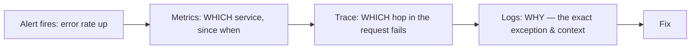
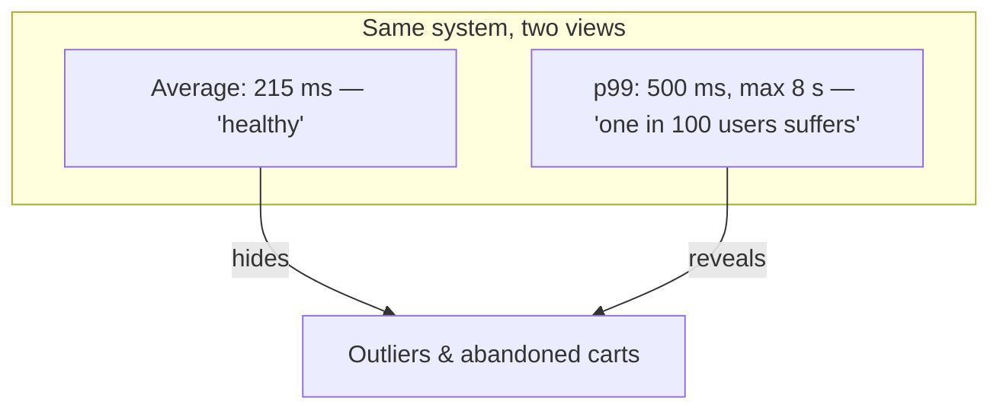
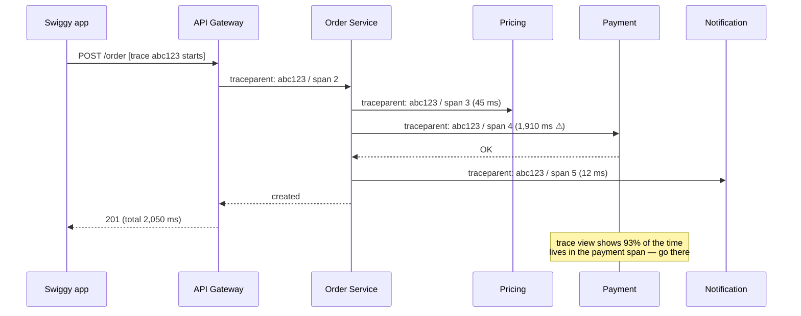
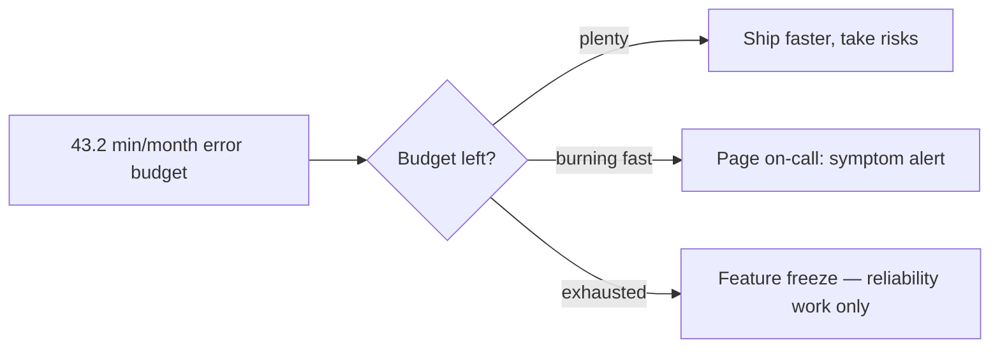
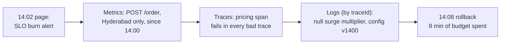
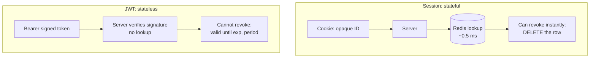
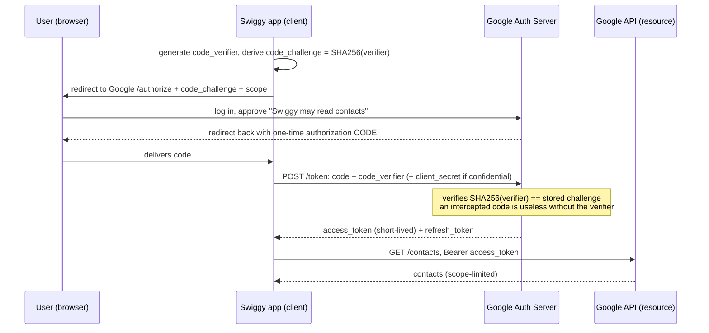
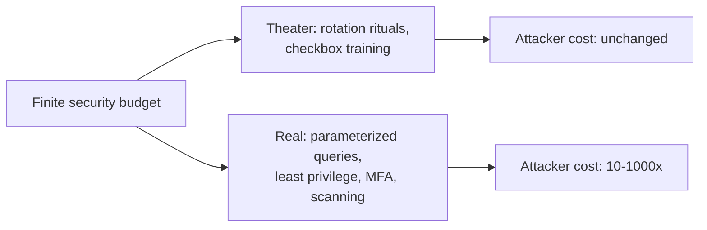

# Day 20 — Observability & Security Essentials

> Series: System Design Mastery

---

## Table of Contents

1. [Why Observability Before Anything Else](#1-why-observability-before-anything-else)
2. [Pillar 1: Logs](#2-pillar-1-logs)
3. [Pillar 2: Metrics](#3-pillar-2-metrics)
4. [Pillar 3: Traces](#4-pillar-3-traces)
5. [Alerting: SLIs, SLOs, Error Budgets](#5-alerting-slis-slos-error-budgets)
6. [Security: AuthN vs AuthZ](#6-security-authn-vs-authz)
7. [Sessions vs JWT — The Honest Comparison](#7-sessions-vs-jwt--the-honest-comparison)
8. [OAuth2, API Keys, RBAC vs ABAC](#8-oauth2-api-keys-rbac-vs-abac)
9. [Encryption & Secrets](#9-encryption--secrets)
10. [OWASP Greatest Hits for Backend Engineers](#10-owasp-greatest-hits-for-backend-engineers)
11. [Rate Limiting as Security](#11-rate-limiting-as-security)
12. [The Dark Side: Security Theater vs Real Wins](#12-the-dark-side-security-theater-vs-real-wins)
13. [Self-Check](#self-check)
14. [Apply (1 hour)](#apply-1-hour)

---

## 1. Why Observability Before Anything Else

**In plain words:** Observability is like the dashboard and warning lights in your car. *Monitoring* is the fuel gauge — it answers a question you already knew to ask ("how much fuel?"). *Observability* is being able to pop the hood and figure out a brand-new problem ("why does it shudder only when turning left in the rain?") without having to build a new sensor first. You want all this wiring installed before the breakdown, not after.

**Why.** Day 18's circuit breakers and Day 19's idempotency keys are invisible without telemetry — a breaker that opens silently is an outage nobody diagnoses. Monitoring answers *known* questions ("is CPU high?"); **observability** means you can ask *new* questions of a running system without shipping new code ("why are Swiggy orders from Hyderabad on Android failing since 14:02?").

> **🤔 Wait — why observability if my code has no bugs?**
> Bug-free code still runs on flaky networks, overloaded databases, a third-party payment gateway having a bad day, and a config push someone made at 14:00. Observability isn't for *your* bugs — it's for the emergent failures no unit test can catch, and for answering "why is *this* cohort slow *right now*" before the customer tweets. The question isn't whether something breaks; it's how many minutes you're blind when it does.

**✅ Good scenario (where it saves you):** Swiggy's checkout error rate ticks up at 14:02; because RED metrics, traces, and trace-linked logs were wired in on day one, on-call narrows it to one region, one service, one null config value in under ten minutes and rolls back before the monthly error budget is dented.

**❌ Bad scenario (the pain without it):** A payments team ships clean code but instruments nothing; when settlement stalls at 2 a.m. they SSH into six boxes grepping unstructured logs, can't correlate a request across services, and burn three hours of a total outage just to locate *which* hop is failing — the diagnosis, not the fix, is what cost them.

**When NOT to bother:** A weekend side project or an internal cron with one user doesn't need traces and SLO dashboards — a single structured log stream and a health check is plenty; full three-pillar telemetry is overhead until you have real traffic, multiple services, or someone paged at 3 a.m.

**What.** Three pillars, three granularities:

| Pillar | Answers | Granularity | Cost profile |
|---|---|---|---|
| **Logs** | "What exactly happened in this one event?" | Per event | High volume, high storage |
| **Metrics** | "How is the system trending?" | Aggregated numbers | Cheap, fixed cardinality |
| **Traces** | "Where did this request spend its time?" | Per request, cross-service | Medium (sampled) |

**When/How/Where.** Instrument from day one — retrofitting telemetry during an outage is archaeology in the dark. Metrics for dashboards and alerts, traces to localize the slow/broken hop, logs to explain it.

**The Dark Side.** Observability bills are legendary (companies pay millions/year to Datadog); logging everything at DEBUG in production is how you get there. Telemetry is also a leak surface — pillar rule #1: never log secrets (Section 2).


*The debugging funnel: metrics detect, traces localize, logs explain — each pillar hands off to the next.*

---

## 2. Pillar 1: Logs

**In plain words:** A log is a diary entry the program writes every time something notable happens. Instead of scribbling free-form sentences (hard to search later), you write each entry as a tidy filled-in form with labelled boxes — "order: 8812, user: 1042, took: 142 ms". Filling in the same boxes every time means you can later ask "show me all forms where order = 8812" and get an instant answer.

**Why.** When order #8812 failed, someone must reconstruct exactly what happened. Metrics say "0.3% of orders fail"; only logs say "order 8812 failed because the pricing service returned a null surge multiplier."

> **🤔 Wait — why structured JSON logs if `grep` already works?**
> `grep` works on your laptop against one file; it dies the moment logs are 120 GB/day across ten services and you need "all events where orderId=8812 AND status=5xx" in under a second. Structured logs are queryable data, not text — the difference between `SELECT` and reading a phonebook page by page. Free-text logs also can't be reliably masked, so they're how card numbers leak.

**✅ Good scenario (where it saves you):** During an Instagram comment-posting incident, an engineer queries the log store for `errorCode="RATELIMIT" AND shard=42` and instantly sees 4,000 events from one abusive client — because every line carried the same labelled fields, the culprit surfaces in one query instead of an afternoon of guesswork.

**❌ Bad scenario (the pain without it):** A team logs free-form prose like `"order failed for user"`; three months later, mid-incident, they can't distinguish which of 40 million lines belong to the broken cohort, and a stray `logger.info(request.getBody())` has been quietly writing full card PANs into a store the whole company can read.

**When NOT to bother:** A CLI tool or a batch job that a human watches run doesn't need JSON logging plumbing — plain human-readable lines to stdout are more useful there; reserve structured logging for services whose logs get shipped, searched, and alerted on long after the run.

**What/How — structured JSON, not prose.** `grep`-ing free text dies at scale; structured logs are queryable data. In Java the standard stack is **SLF4J** (the logging API you code against) plus a backend like **Logback** or **Log4j2** (which actually formats and writes the output). You don't hand-roll a JSON formatter class; you attach per-request context with **MDC** (Mapped Diagnostic Context — a small per-thread key/value bag) and let a JSON encoder serialize it:

```java
import org.slf4j.Logger;
import org.slf4j.LoggerFactory;
import org.slf4j.MDC;   // MDC = a per-thread bag of key/value context
                        // automatically attached to every log line on this thread

public class OrderService {
    // Convention: one logger per class, named after it. The name shows up in output.
    private static final Logger logger = LoggerFactory.getLogger("orders");

    public void placeOrder() {
        // Attach structured context ONCE; every log call below inherits it.
        // This is the Java equivalent of Python's `extra=` — you don't glue
        // fields into the message string, you put them in MDC as data.
        MDC.put("orderId", "8812");
        MDC.put("userId", "1042");
        MDC.put("traceId", "a1b2c3");
        MDC.put("durationMs", "142");
        try {
            // The message stays a short constant; the context rides along in MDC.
            logger.info("order placed");
        } finally {
            // ALWAYS clear — thread pools reuse threads, so stale context would
            // otherwise leak into the next unrelated request's logs.
            MDC.clear();
        }
    }
}
// Emitted (with a JSON encoder configured — see below):
// {"ts":"...","level":"INFO","service":"order-service",
//  "message":"order placed","orderId":"8812","userId":"1042",
//  "traceId":"a1b2c3","durationMs":"142"}
```

The JSON shape above is produced by configuring an encoder in `logback.xml` — typically `net.logstash.logback.encoder.LogstashEncoder` from the *logstash-logback-encoder* library, which serializes the message plus all MDC entries into one JSON object per line:

```xml
<!-- logback.xml: turn every log line into structured JSON, MDC included -->
<configuration>
  <appender name="STDOUT" class="ch.qos.logback.core.ConsoleAppender">
    <!-- LogstashEncoder writes message + MDC + timestamp + level as JSON -->
    <encoder class="net.logstash.logback.encoder.LogstashEncoder">
      <customFields>{"service":"order-service"}</customFields>
    </encoder>
  </appender>
  <root level="INFO">
    <appender-ref ref="STDOUT" />
  </root>
</configuration>
```

**Log-level discipline:**

| Level | Meaning | Production volume |
|---|---|---|
| DEBUG | Developer breadcrumbs | Off in prod (or sampled) |
| INFO | Business events: order placed, payment captured | The bulk |
| WARN | Handled anomaly: retry succeeded, fallback used | Investigate weekly |
| ERROR | Failed operation needing attention | Every one matters |
| CRITICAL | Service can't function | Pages someone |

*(Note: SLF4J/Logback's built-in levels are TRACE, DEBUG, INFO, WARN, ERROR — there is no separate CRITICAL; teams model "service can't function" as ERROR plus a paging rule, or use Log4j2's FATAL.)* If ERROR logs fire constantly and everyone ignores them, they're not errors — reclassify or fix. Log levels are a contract with 3 a.m. you.

**What to NEVER log:** passwords (even failed attempts — users typo their password into the username field, so be careful with usernames too), session tokens, JWTs, API keys, full card numbers/CVV, OTPs, and PII (emails, phones, addresses) beyond what's lawful and necessary — GDPR applies to log files too. Real incidents: both **Facebook (2019: hundreds of millions of plaintext passwords in internal logs)** and **GitHub (2018)** disclosed accidentally logging plaintext passwords. Mask at the encoder/pattern level (Logback pattern replacers or a Logstash `maskField`) so one sleepy `logger.info("{}", request.getBody())` can't leak a card number.

**Where.** Emit to stdout; ship via an agent to a central store (ELK, Loki, CloudWatch); retain hot 7–30 days, archive cold to object storage.

**The Dark Side.** Log volume grows superlinearly with traffic and services — Swiggy at 2M orders/day with 10 services logging 20 lines per order ≈ 400M lines/day; at ~300 bytes each that's ~120 GB/day before infra logs. Tactics when the bill arrives: sample INFO logs on hot paths (keep 1-in-10, always keep WARN+), cut retention before cutting coverage, and log *one* rich structured event per request per service ("canonical log line", Stripe's pattern) instead of twenty breadcrumbs. Unindexed context (no orderId) makes logs write-only. And logs without trace IDs are ten separate stories about one request.

---

## 3. Pillar 2: Metrics

**In plain words:** Metrics are the running scoreboard for your system. Rather than saving a diary entry per event (expensive), you keep a handful of numbers that constantly update — total goals scored, players currently on the field, a tally of how long each play took. The scoreboard costs the same whether 10 or 10 million fans are watching, which is exactly why it's cheap to keep and easy to alert on.

**Why.** You can't graph logs cheaply, and you can't alert on prose. Metrics are pre-aggregated numbers: fixed cost regardless of traffic. In Java the de-facto standard is **Micrometer** (a vendor-neutral metrics facade — think "SLF4J for metrics") which exports to Prometheus, Datadog, CloudWatch, etc. Under the hood, counters and gauges are backed by concurrency-safe primitives like `AtomicLong`/`LongAdder` so many threads can update them without corrupting the count.

> **🤔 Wait — why metrics if my logs already record everything?**
> You can technically count errors by scanning logs, but doing it every 15 seconds across billions of lines is slow and ruinously expensive — and you can't page on a query that takes two minutes to run. Metrics are pre-aggregated numbers whose cost is fixed no matter how much traffic flows, so they answer "is it broken *right now*" in milliseconds. Logs tell you about one event; metrics tell you the shape of a million.

**✅ Good scenario (where it saves you):** Uber's dispatch service exports RED metrics; when p99 latency on `/request-ride` crosses its SLO the alert fires in seconds off a cheap Prometheus query, and a dashboard shows the spike is isolated to one city's surge-pricing pod — no log scan, fixed cost whether it's 100 or 100,000 rides a minute.

**❌ Bad scenario (misused):** A team adds `userId` as a metric label to "slice by customer"; Prometheus spawns one time-series per user, memory balloons past the box, and the monitoring system itself OOMs and dies — now they're blind during the very incident the metrics were supposed to catch.

**When NOT to bother:** Don't build a metric for something you'll look at once — a one-off migration's progress or a debug counter you'll delete next week lives fine in a log line; metrics earn their keep only when you'll graph or alert on the number repeatedly.

**What — three types:**

- **Counter** — only goes up: `orders_placed_total`, `http_requests_total{status="500"}`. Rate of change is the interesting part. (Micrometer: `Counter`, internally an `AtomicLong`/`LongAdder`.)
- **Gauge** — current value, up and down: `active_riders`, `queue_depth`, `memory_bytes`. (Micrometer: `Gauge`, often wired to an `AtomicInteger` or a size() call.)
- **Histogram** — distribution in buckets: `request_duration_seconds` — this is where percentiles come from. (Micrometer: `Timer`/`DistributionSummary`.)

A tiny Micrometer sketch of RED for one endpoint:

```java
import io.micrometer.core.instrument.Counter;
import io.micrometer.core.instrument.MeterRegistry;
import io.micrometer.core.instrument.Timer;

public class CheckoutMetrics {
    private final Counter requests;   // RATE + ERRORS come from a counter with a status tag
    private final Timer duration;     // DURATION distribution -> percentiles

    public CheckoutMetrics(MeterRegistry registry) {
        // A "tag" (label) like status lets you slice one counter many ways
        this.requests = Counter.builder("http_requests_total")
                .tag("endpoint", "/order")
                .register(registry);
        // A Timer records how long each call took; the registry computes p95/p99
        this.duration = Timer.builder("request_duration_seconds")
                .tag("endpoint", "/order")
                .publishPercentiles(0.5, 0.95, 0.99)   // ask for p50/p95/p99
                .register(registry);
    }

    public void record(long nanos) {
        requests.increment();                                  // count this request
        duration.record(java.time.Duration.ofNanos(nanos));    // record its latency
    }
}
```

**How — the RED method** (for every request-serving service):
- **R**ate: requests/second
- **E**rrors: failed requests/second
- **D**uration: latency distribution (percentiles, not averages)

Those three per service ≈ 80% of dashboard value. For *resources* (hosts, DBs, pools), the **USE method**: **U**tilization (busy %), **S**aturation (queue length), **E**rrors.

### Why p99 matters and averages lie

**In plain words:** The average is like saying "the average customer at this restaurant waited 15 minutes" while ignoring that one table has been waiting two hours and just walked out furious. Percentiles (p99 = "the 99th slowest out of 100") describe the unlucky-but-real customers the average quietly erases.

Concrete distribution — 100 requests to Swiggy's checkout:

| Requests | Latency |
|---|---|
| 90 | 100 ms |
| 9 | 500 ms |
| 1 | 8,000 ms |

- **Average** = (90×100 + 9×500 + 1×8000)/100 = **215 ms** — "looks fine!"
- **p50** = 100 ms, **p90** = 100 ms, **p99** = 500 ms, **p99.9 / max** = 8,000 ms.

The average says a healthy system; one user in a hundred waited 8 seconds and abandoned the cart. Worse: percentiles compound across fan-out. If one page issues 10 backend calls and each has p99 = 500 ms, the chance a page hits *at least one* p99-slow call is 1 − 0.99¹⁰ ≈ **9.6%** — the tail becomes the typical experience for your fan-out pages (this is Google's "tail at scale" observation). Heavy users hit more requests, so tails disproportionately punish your *best* customers. Alert and set SLOs on p95/p99, plot averages never (or only as a curiosity).


*The average is a fiction no user experiences; percentiles describe actual humans.*

**Where.** Prometheus/Grafana or vendor equivalents (Micrometer exports to all of them); label metrics with service, endpoint, status — but keep label cardinality bounded (see Dark Side).

**The Dark Side.** **Cardinality explosions**: adding `userId` as a metric tag creates one time-series per user — millions of series, OOM-ing your Prometheus. IDs belong in logs/traces, never metric tags/labels. Also: pre-aggregated histograms can't answer questions about individual requests — that's what traces are for.

---

## 4. Pillar 3: Traces

**In plain words:** A trace is the itinerary stamped into a parcel as it moves through a delivery network. At each hub the parcel gets a timestamped stamp ("arrived sorting centre 14:03, left 14:05"). One tracking number ties every stamp together, so when a package is late you can see *exactly which hub* sat on it — instead of phoning all six hubs and asking "did you have it?".

**Why.** A Swiggy order touches 6 services. Metrics say checkout p99 jumped; *which hop* is slow? Without traces you're grepping six services' logs and guessing.

> **🤔 Wait — why tracing if I already have logs and metrics?**
> Logs tell you what happened *inside one service*; metrics tell you *a service* is slow — but neither tells you *which of six hops* in a single request ate the time. A trace stitches one request's spans across every service into one waterfall, so instead of grepping six log stores and guessing, you see the payment span was 1,910 ms and go straight there. It's the difference between "checkout is slow" and "checkout is slow *because of the pricing call*".

**✅ Good scenario (where it saves you):** A Swiggy order fans out to six services and checkout p99 doubles; one trace's waterfall instantly convicts the payment span of eating 93% of the latency, so the on-call engineer opens *one* service's logs by trace ID instead of correlating timestamps across six.

**❌ Bad scenario (the pain without it):** An engineer chasing a slow request greps each service's logs by timestamp, but clock skew and interleaved requests make it impossible to say which call blocked — three services each look "fine in isolation," the cross-service view never exists, and the real culprit (a queue hop that dropped the context) stays hidden for days.

**When NOT to bother:** A single-service monolith with no downstream calls gets little from distributed tracing — request-scoped logs plus a duration metric already tell the whole story; the trace machinery and sampling budget only pay off once a request crosses process boundaries.

**What.** A **trace** is one request's journey; each hop/operation is a **span** (with start time, duration, service, status, parent span). A **trace ID** is generated at the edge and **propagated** in headers (W3C `traceparent`) through every downstream call; each service attaches the trace ID to its logs (put it in MDC — see Section 2), stitching all three pillars together. **OpenTelemetry (OTel)** is the industry-standard SDK/protocol for emitting all this — instrument once, export to Jaeger/Tempo/Datadog/whatever.


*One trace ID rides every hop; the waterfall view instantly convicts the payment span of eating 93% of the latency.*

**How/Where.** Auto-instrument frameworks with the **OpenTelemetry Java agent** — a `-javaagent` JAR you attach at startup that instruments Spring Boot/Spring MVC, JDBC, gRPC, JDBC connection pools, and common HTTP clients with *zero code changes*. Sample: 100% of traces at low traffic; at Instagram scale, head-sample 1% but **tail-sample** errors and slow requests at 100% (the boring traces are the ones you don't need).

Sampling strategies at a glance:

| Strategy | Decision made | Keeps | Trade-off |
|---|---|---|---|
| Head sampling (e.g., 1%) | At the edge, before the request runs | Random slice | Cheap, but misses most errors |
| Tail sampling | After the trace completes | 100% of errors & slow traces | Needs buffering infra; costlier |
| Always-on (100%) | Never drop | Everything | Only viable at low traffic |

**The Dark Side.** Propagation is all-or-nothing: one service (or queue hop) that drops the header snaps the chain, and you get trace fragments. Sampling means "the trace for *that specific* user complaint" often doesn't exist. Traces also cost real money at volume — sampling policy is a budget decision.

---

## 5. Alerting: SLIs, SLOs, Error Budgets

**In plain words:** An SLO is a promise ("your food arrives hot 99.9% of the time"), and the error budget is the small allowance of broken promises you're permitted before you must stop taking risks. Think of it as a monthly data plan for failure: while you have gigabytes left, ship boldly; when it runs out, you throttle down to reliability work. Alerts should page a human only for a burning building, not for every flickering light bulb.

**Why.** Dashboards are pull; incidents need push. But bad alerting is worse than none — it trains humans to ignore pages.

> **🤔 Wait — why SLOs if we already alert on every error?**
> Alerting on every error is exactly how you get paged forty times a night and start swiping pages away — including the one that mattered. An SLO defines *how much* failure is acceptable, so you alert only when you're burning that budget fast enough to break the promise, not on every transient blip. It also settles the endless "is it reliable enough to ship?" argument with arithmetic instead of opinion.

**✅ Good scenario (where it saves you):** A payments team runs a 99.9% checkout SLO with burn-rate alerts; a slow-burn issue files a ticket for business hours while a fast-burn regression pages instantly — on-call sleeps through the noise and wakes only for the one thing actually eating the 43-minute monthly budget.

**❌ Bad scenario (the pain without it):** A team pages on "CPU > 80%" and "any 5xx"; the pager fires hundreds of times a week, everyone mutes it, and when a real checkout outage starts the warning signs blend into the noise nobody triages — the alert that should have saved them is the one they'd already learned to ignore.

**When NOT to bother:** A brand-new service with no users and no reliability promise doesn't need error budgets and burn-rate math yet — a single "is it up?" alert is enough; SLOs earn their keep once you have real traffic, a paged on-call rotation, and a launch-vs-reliability tension to arbitrate.

**What.**
- **SLI** (indicator): a measured ratio — "% of checkout requests under 800 ms that returned non-5xx."
- **SLO** (objective): the target — "99.9% over 30 days."
- **Error budget**: 100% − SLO = the *allowed* failure: 99.9% over 30 days = **43.2 minutes** of badness. Budget remaining → ship features. Budget burned → freeze launches, fix reliability. This turns "is it reliable enough?" from vibes into arithmetic, and gives dev and ops a shared currency (this is Google SRE's central trick).

**How — alert on symptoms, not causes.** Page on "checkout SLI burning error budget 10× too fast" (user pain, always actionable), not on "CPU > 80%" (a cause that may harm no one — or one of forty causes of real pain, each with its own noisy alert). Cause-level signals belong on dashboards for *diagnosis*, not paging. Burn-rate alerts (fast-burn: page; slow-burn: ticket) are the standard pattern.

| Alert on | Example | Why |
|---|---|---|
| Symptoms (page) | Order success rate < SLO; p99 breach | User pain, actionable |
| Causes (dashboard/ticket) | CPU, GC time, one pod down | Context, not urgency |

**The Dark Side — alert fatigue.** Every non-actionable page erodes trust; on-call learns to swipe-dismiss, and the *real* page gets dismissed too. This is a factor in real major outages — warning signs firing for hours amid noise nobody triaged. Ruthless rule: every page must be *actionable, urgent, and novel*; anything else is a ticket. Review pages weekly; delete or demote anything with a >50% "no action taken" rate. An alert you always ignore is technical debt with a pager attached.


*The error budget converts reliability from a religion into a spendable currency with a policy attached.*

---

### Putting the pillars together: a 14:02 incident, minute by minute

Swiggy, 14:02 — the burn-rate alert pages: "checkout SLI burning budget 12× too fast."

1. **14:02 (metrics)** — dashboard: error rate up only for `POST /order`, only in the Hyderabad region, started 14:00 sharp (deploy? config push?). Rate and duration for other endpoints normal — so not the gateway, not the DB.
2. **14:04 (traces)** — filter traces: region=hyd, status=5xx. Every failing trace dies in the *pricing service* span with a 350 ms error; the payment and inventory spans never even start.
3. **14:06 (logs)** — jump from a failing trace ID straight to pricing-service logs for that trace: `ERROR surgeMultiplier is null for zone=HYD-12 — config version 2024-07-16-1400`. A config push at 14:00 shipped a null for one zone.
4. **14:08** — rollback config; error rate returns to baseline by 14:10. Total: 8 minutes of the 43-minute monthly budget spent; postmortem action: schema-validate config pushes.

Ten minutes, no guessing, no "ssh and grep on six boxes" — because the trace ID linked all three pillars and the alert fired on a symptom. Without the trace-to-log link, step 3 alone is an hour.


*Symptom alert → metrics narrow the where → traces convict the hop → logs name the line — the funnel from Section 1, run in anger.*

---

## 6. Security: AuthN vs AuthZ

**In plain words:** Authentication (AuthN) is the bouncer checking your ID at the door — proving *who you are*. Authorization (AuthZ) is the wristband that says which rooms you're allowed into — deciding *what you may do*. A club can be flawless at checking IDs and still let a guest wander into the staff office because nobody checked the wristband; that second failure is the one that actually gets robbed.

**Why.** The two most-confused words in security, and the confusion causes real bugs (checking "logged in" where you needed "allowed").

> **🤔 Wait — if a user is authenticated, isn't that enough?**
> Proving *who* someone is says nothing about *what they may do*. A logged-in customer is correctly authenticated the moment they change `/orders/8812` to `/orders/8813` and read a stranger's order — the login was fine; the missing per-object permission check is the breach. Authentication is the front door; authorization is every interior lock, and most real breaches walk through an unlocked interior door.

**✅ Good scenario (where it saves you):** Instagram verifies not just that @priya is logged in but that the post she's deleting is *hers*; the ownership check on every ID-addressed resource means a valid session can't be turned into a tool for editing other people's content.

**❌ Bad scenario (the pain without it):** A food-delivery app authenticates restaurant logins flawlessly but its menu-edit handler only checks `if (user != null)`; a partner discovers changing the restaurant ID in the request lets them edit a competitor's menu — a textbook IDOR, and broken access control is #1 on the OWASP Top 10 for exactly this reason.

**When NOT to bother:** A truly single-tenant, single-user tool — say an internal dashboard where every authenticated user is a full admin by design — doesn't need fine-grained AuthZ; the ownership-check discipline matters the instant one user's data must stay invisible to another.

| | Authentication (AuthN) | Authorization (AuthZ) |
|---|---|---|
| Question | **Who are you?** | **What may you do?** |
| Happens | First, at login/token check | On every action, after AuthN |
| Mechanisms | Passwords + MFA, sessions, JWT, OAuth2, API keys | Roles, permissions, RBAC/ABAC, ownership checks |
| Failure code | 401 Unauthorized | 403 Forbidden |
| Instagram example | Log in as @priya | @priya may delete *her* posts only |
| Swiggy example | Restaurant dashboard login | This login may edit *this restaurant's* menu only |
| Classic bug | Weak password policy | IDOR: change `/orders/8812` to `/orders/8813` and read a stranger's order |

**The Dark Side.** Teams pour effort into AuthN (SSO! MFA! biometrics!) while AuthZ is an unaudited `if (user != null)` — but broken authorization (IDOR/Broken Access Control) is **#1 on the OWASP Top 10 (2021)**. Every handler that loads a resource by ID must verify ownership/permission. Every one.

---

## 7. Sessions vs JWT — The Honest Comparison

**In plain words:** A session is a coat-check ticket: the venue keeps your coat and hands you a meaningless numbered stub; to give something back they look up your number. A JWT is a festival wristband printed with your access level and a tamper-proof seal: staff just glance at the seal, no lookup needed — but if you get banned mid-festival, there's no easy way to un-print a wristband already on your arm. That "can't take it back" property is the whole trade-off.

**What — Sessions**: on login, server stores a record (session ID → user, expiry) in Redis/DB; client holds only an opaque cookie. Every request: look up the session. **JWT**: on login, server signs a token containing the claims (`userId`, `role`, `exp`); client sends it; server *verifies the signature* — no lookup, no server-side state.

> **🤔 Wait — isn't JWT the modern choice? Why would I use sessions?**
> "Stateless = webscale" is the cargo-cult that made JWT a reflex default, but for a first-party login flow sessions are usually *better*: instant revocation, tiny cookies, always-fresh claims. JWT's headline feature — no server lookup — quietly costs you the ability to log someone out, and every workaround (short expiry, refresh tokens, blocklists) sneaks the server state right back in. Statelessness is a real win for service-to-service tokens; it's a liability for "log out of all my devices."

**✅ Good scenario (where it saves you):** Instagram uses server-side sessions for the consumer app, so "log out of all devices" after a stolen phone deletes the rows and locks the attacker out in milliseconds — and internally it uses short-lived JWTs for service-to-service calls, where any service can verify the signature with a public key and no shared store.

**❌ Bad scenario (misused):** A startup stores long-lived JWTs in `localStorage` for its web app; an XSS bug exfiltrates them, and because pure JWTs are valid until `exp` with no revocation, the team watches stolen tokens keep working for hours with nothing they can do but wait out the expiry — a session `DELETE` would have ended it instantly.

**When NOT to bother (with JWT):** Don't reach for JWT on a plain first-party web/mobile login — one backend, users who log in and out — sessions plus a Redis GET you were already paying for give you more safety with less footgun; save JWTs for service meshes, OAuth2 access tokens, and short-lived signed grants.


*Sessions trade a fast lookup for instant revocation; JWTs trade revocation for statelessness — the lookup was cheaper than advertised.*

| Criterion | Session + Redis | JWT |
|---|---|---|
| Server state | Yes (session store) | No |
| **Revocation** (logout, ban, stolen token, password change) | **Instant** — delete the row | **The famous hole** — token valid until `exp` no matter what |
| Per-request cost | ~0.5 ms Redis lookup | Signature verify (also not free: RS256 ~0.1–1 ms) |
| Token size | ~32-byte cookie | 300–1,000+ bytes, sent on *every* request |
| Claims freshness | Always current | Frozen at issue time (role change won't apply until refresh) |
| Cross-service verification | Needs shared store or auth service | Any service with the public key ✔ |
| Best fit | First-party web/mobile apps | Service-to-service, third-party API tokens, short-lived credentials |

**The revocation problem, spelled out.** User's Instagram token is stolen; user hits "log out of all devices." With sessions: delete rows, attacker locked out in milliseconds. With pure JWT: nothing you can do until `exp`. Mitigations — short expiry (5–15 min) + refresh tokens (the refresh token is server-side-checked… i.e., stateful), or a revocation blocklist checked per request (…i.e., a session store with extra steps). Every mitigation quietly reintroduces the state JWT promised to remove.

**The Dark Side of JWT hype.** For a typical first-party app — one backend, users who log in and out — **sessions are simply better**: instant revocation, tiny cookies, fresh claims, `HttpOnly; Secure; SameSite` cookie protections for free, and one Redis GET you were going to afford anyway. JWT became a default via cargo-culting ("stateless = webscale"), plus a history of library vulnerabilities (`alg: none` acceptance, HS256/RS256 key-confusion attacks — validate `alg` against an allowlist and never let the token pick it) and developers storing JWTs in `localStorage` where any XSS exfiltrates them. JWTs genuinely shine where statelessness is real value: service-to-service auth, OAuth2 access tokens, short-lived signed grants. Use them there; use sessions for your login flow. Swiggy-style split: customer app login = sessions; internal service mesh identity = short-lived JWTs.

---

## 8. OAuth2, API Keys, RBAC vs ABAC

### OAuth2: delegated authorization

**In plain words:** OAuth2 is the valet key for your data. A valet key starts the car and opens the door but won't open the glovebox or the boot — you hand over *limited, revocable* access without giving up your master key (your password). "Let Swiggy read my Google contacts" should hand Swiggy a valet key to *contacts only*, never your Google password.

**Why.** "Let Swiggy read my Google contacts" must not mean giving Swiggy your Google *password*. OAuth2 lets a user grant an app **scoped, revocable** access to resources on another service — the user's password never touches the third party.

> **🤔 Wait — why the whole OAuth2 dance instead of just asking for the password?**
> Because handing a third party your Google password gives them *everything, forever* — mail, drive, the ability to change your password — when all you wanted was read access to contacts. OAuth2 issues a scoped, revocable token that opens the glovebox but not the trunk, and the user's password never touches the third party. It's more moving parts precisely so that a compromised app leaks a narrow, cancellable grant instead of your master key.

**✅ Good scenario (where it saves you):** "Let this app import my Google contacts" hands the app a token scoped to contacts-read only; when the user later revokes it in their Google account, access dies immediately and their password was never exposed — a breach of that app can't touch their email.

**❌ Bad scenario (the pain without it):** An early integration asks users for their actual account password and stores it to "act on their behalf"; the credential DB is breached, and now the attacker has full, un-scoped, un-revocable access to every linked account — the exact catastrophe OAuth2's scoped tokens exist to prevent.

**When NOT to bother:** Pure server-to-server integration between two backends you control doesn't need the interactive Authorization Code dance — a Client Credentials grant or a well-managed API key with per-key scopes and rotation is simpler; reserve the full user-consent flow for when a *human* is delegating access to *their* data.

**The flow that matters: Authorization Code + PKCE** (the modern default for web, mobile, and SPA):


*The code travels through the browser (interceptable); PKCE's verifier never does — so only the app that started the flow can redeem the code.*

PKCE ("pixie") exists because mobile/SPA clients can't keep a `client_secret`; it binds the token exchange to whoever generated the verifier. Since OAuth 2.1, PKCE is recommended for *all* clients. **Client Credentials flow** is the other one you'll use: no user at all — service A authenticates as *itself* (ID + secret) to get a token for calling service B; this is machine-to-machine (Swiggy's order service calling an internal ML API, or a partner's backend calling Swiggy's partner API).

**API keys**: a long random string identifying a *calling application* — no user, no scopes usually, no expiry usually. Fine for server-to-server integrations with per-key rate limits and revocation; wrong for anything user-facing. Treat them like passwords (hashed at rest, never in git — Section 9).

### RBAC vs ABAC (brief)

**In plain words:** RBAC hands out access by job title — "all cashiers can open the till" — which is simple to audit. ABAC decides case by case using facts about the person, the thing, and the moment — "a cashier may open *this* till, in *their own* store, during *their* shift". ABAC is more precise but far harder to reason about, the way a rulebook with a hundred if-clauses is.

- **RBAC**: permissions attach to **roles** (`support_agent` can view orders, not refunds > ₹1,000); users get roles. Simple, auditable — right default.
- **ABAC**: rules over **attributes** of user/resource/context ("agents may view orders *in their own city* during *business hours*"). Expressive; harder to audit and reason about.
- Pragmatic pattern: RBAC for the coarse grid, a few attribute checks (ownership, tenancy) in code. **Dark Side**: role explosion — 400 roles later, RBAC has become worse than the problem; prune roles like you prune alerts.

---

## 9. Encryption & Secrets

**In plain words:** Encryption in transit is sending mail in a sealed, tamper-evident envelope so nobody reads it en route; encryption at rest is keeping your files in a locked safe so a stolen filing cabinet is useless. Secrets management is about *not taping the safe's combination to the safe* — passwords and keys should live in a dedicated vault that hands them out at runtime, never hard-coded where they'll end up in git history forever.

> **🤔 Wait — why encrypt data that's already behind a firewall?**
> Because "behind the firewall" is one stolen laptop, one leaked cloud snapshot, one compromised internal service away from being fully exposed — the firewall is a single wall, not defense in depth. TLS on service-to-service hops assumes the attacker is *already* on your network (they often are), and at-rest encryption makes a stolen disk or DB backup useless without the keys. Encryption doesn't replace access control; it removes whole categories of "we lost a drive" from becoming "we lost the data."

**✅ Good scenario (where it saves you):** A payments company encrypts card tokens at the application layer and terminates TLS on every internal hop; when a misconfigured backup bucket is later found publicly readable, the exposed files are ciphertext without the KMS keys — an embarrassing config bug instead of a reportable breach of millions of cards.

**❌ Bad scenario (the pain without it):** Uber's 2016 breach began with AWS keys committed to a GitHub repo; attackers used them to reach an unencrypted datastore and walked off with 57 million users' data — plaintext-at-rest plus a leaked secret turned one careless commit into a company-defining incident.

**When NOT to bother:** Don't hand-roll application-level encryption for genuinely public, non-sensitive data — a catalog of restaurant names gains nothing but complexity from being encrypted at the field level; spend the crypto effort on the crown jewels (cards, government IDs, credentials) and let cloud disk encryption cover the rest.

**What.**
- **In transit**: TLS for *every* hop — not just browser→edge but service→service and service→DB. "Internal network is trusted" died with the zero-trust model; assume the attacker is on your network.
- **At rest**: disk/volume/DB encryption (checkbox in every cloud) + application-level encryption for crown jewels (card tokens, government IDs). Protects against stolen disks/snapshots — not against an attacker with app credentials, so it complements, never replaces, access control.

For hashing and cryptography, Java's toolkit is: `java.security.MessageDigest` for one-way hashes (SHA-256 of a file, not for passwords), `javax.crypto.Cipher` (AES-GCM) for symmetric encryption, and a password-hashing library for credentials. **Never** store passwords with plain SHA-256 — use an adaptive hash: **BCrypt** (e.g., Spring Security's `BCryptPasswordEncoder`), **Argon2**, or PBKDF2, which are deliberately slow to resist brute force:

```java
import org.springframework.security.crypto.bcrypt.BCryptPasswordEncoder;

// BCrypt is intentionally slow and salts each hash automatically —
// two users with the same password get different stored hashes.
BCryptPasswordEncoder encoder = new BCryptPasswordEncoder();  // default strength 10

// At signup: store only the hash, NEVER the raw password
String stored = encoder.encode("correct horse battery staple");

// At login: compare in constant time (matches() does the salt handling for you)
boolean ok = encoder.matches("correct horse battery staple", stored);
```

**Secrets management — the maturity ladder:**

| Stage | Method | Problem |
|---|---|---|
| 0 | Secrets in code / git | Forever in history; scanners find them in minutes — **Uber's 2016 breach (57M users) started with AWS keys found in a GitHub repo** |
| 1 | Env vars from untracked files | Better; still leak via `.env` / `application.properties` mis-commits, crash dumps, `ps`, PR diffs |
| 2 | Secrets manager (Vault, AWS Secrets Manager) | Centralized, audited, rotated, injected at runtime |
| 3 | Dynamic short-lived credentials | DB password valid 1 hour, minted per-instance — stolen creds age out on their own |

Never in git — and if a secret ever touches git, **rotation is the only fix**; deleting the commit doesn't unpublish history. Add secret-scanning (gitleaks, GitHub push protection) to CI so stage-0 mistakes bounce at push time.

**The Dark Side.** The secrets manager is itself a tier-0 dependency (Vault down → nothing can boot → see Day 18) and a single juicy target. Cache secrets with TTLs, plan the break-glass path.

---

## 10. OWASP Greatest Hits for Backend Engineers

**In plain words:** OWASP's list is the "top 10 ways houses get burgled" for web apps. Most break-ins aren't clever heists — they're unlocked windows: user input treated as trusted commands, forgotten side doors, credentials left under the mat. The fixes below are the cheap deadbolts that shut whole categories of burglars out at once.

> **🤔 Wait — doesn't my framework handle all this for me?**
> Frameworks parameterize queries, escape templates, and set SameSite by default — right up until someone writes one native SQL query with string concatenation, one `th:utext` on a user bio, or one webhook fetcher with no allowlist. The defaults protect the common path; breaches live in the one handler that opted out. Knowing the categories is how you spot the opt-out in code review before an attacker spots it in production.

**✅ Good scenario (where it saves you):** A reviewer flags a native `@Query` built with string concatenation in a Swiggy search endpoint, rewrites it as a `PreparedStatement`, and closes an injection hole before ship — the framework parameterized everything *else*, but this one hand-written query was the gap that would have been the breach.

**❌ Bad scenario (the pain without it):** Capital One's 2019 breach used SSRF — a server fetching an attacker-chosen URL reached the cloud metadata endpoint and harvested instance credentials, exposing 100 million records; no framework default stops it, because "fetch this user-supplied URL" looks like an ordinary feature until you know the category.

**When NOT to bother:** A static site with no user input, no database, and no server-side URL fetching genuinely doesn't have a SQLi/SSRF/IDOR surface — don't perform theater by "hardening" it; spend the review budget where user input actually reaches a query, a template, or an outbound request.

**SQL Injection** — still alive (it powered breaches from TalkTalk 2015 to the 2023 **MOVEit** mass-exploitation that hit 2,000+ organizations). Cause: gluing user input into query strings. Fix: **parameterized queries, always** — the driver sends the query shape and the data separately; the data can never become syntax:

```java
// VULNERABLE — input becomes SQL syntax
String name = request.getParameter("name");   // e.g. "'; DROP TABLE users; --"
Statement stmt = conn.createStatement();
ResultSet rs = stmt.executeQuery(
    "SELECT * FROM restaurants WHERE name = '" + name + "'");  // NEVER do this

// SAFE — parameterized (PreparedStatement): data stays data
PreparedStatement ps = conn.prepareStatement(
    "SELECT * FROM restaurants WHERE name = ?");   // ? is a placeholder, not a hole
ps.setString(1, name);                             // bound as a value, never parsed as SQL
ResultSet safeRs = ps.executeQuery();
// JPA/Hibernate and jOOQ parameterize by default — until someone writes a
// native query or string-concatenated JPQL/HQL. Ban that in review.
```

**XSS (awareness level)** — user-supplied content rendered as HTML executes in victims' browsers, stealing tokens (especially JWTs in localStorage — see Section 7). Backend duties: escape-by-default templating (Thymeleaf and JSP `<c:out>` HTML-escape by default; never disable it with `th:utext` on untrusted data), a `Content-Security-Policy` header, and treat every stored string (Instagram bios, Swiggy reviews) as hostile.

**CSRF and why SameSite mostly killed it** — attacker's page auto-submits a form to `swiggy.com/transfer`; the browser helpfully attaches the victim's cookie. Classic fix: anti-CSRF tokens (Spring Security enables them by default for cookie-session apps). Modern reality: browsers default cookies to `SameSite=Lax` (Chrome since 2020), so cross-site POSTs don't carry the cookie — the attack class is *mostly* dead by default. "Mostly": still set `SameSite` explicitly, and keep CSRF tokens if you support ancient browsers, cross-site embedding, or use `SameSite=None`. Bearer-token APIs (Authorization header) were never CSRF-able — the browser doesn't auto-attach headers.

**SSRF** — the sleeper. Your server fetches a user-supplied URL (webhook config, image-by-URL, PDF renderer) and the user supplies `http://169.254.169.254/latest/meta-data/iam/...` — the cloud metadata endpoint — harvesting your instance credentials from *inside*. This is how the **Capital One breach (2019, 100M records)** worked. Fixes: allowlist schemes/hosts, resolve-then-verify the IP isn't private/link-local (and pin it — beware DNS rebinding), use IMDSv2, egress-restrict the fetching service.

| Vuln | One-line cause | One-line fix |
|---|---|---|
| SQLi | Input concatenated into queries | Parameterized queries, everywhere, no exceptions |
| XSS | Input rendered as HTML/JS | Autoescaping + CSP; keep tokens out of localStorage |
| CSRF | Browser auto-attaches cookies cross-site | SameSite=Lax/Strict (+ tokens for edge cases) |
| SSRF | Server fetches attacker-chosen URLs | Allowlist + block private ranges + IMDSv2 |
| IDOR | Missing per-object AuthZ | Ownership check on every ID-addressed resource |

---

## 11. Rate Limiting as Security

**In plain words:** Rate limiting is the "one free sample per customer" sign at the shop — it stops one person from emptying the tray. As a security control it's the bouncer who won't let someone try 10,000 keys on the same lock: it blunts password-guessing, stops attackers running up your SMS bill with endless "resend OTP" clicks, and slows down anyone crawling your data one ID at a time.

> **🤔 Wait — isn't rate limiting just about capacity, not security?**
> Same machinery, different policy — and as a security control it's one of the highest-leverage cheap deadbolts you own. Without a per-account cap, an attacker replays billions of leaked passwords against your login endpoint, runs up your SMS bill with endless "resend OTP" clicks, or scrapes your whole catalog one ID at a time. Capacity limits are per-client and generous; security limits are per-identity and aggressive — five login failures an hour, not five thousand.

**✅ Good scenario (where it saves you):** An Indian fintech caps OTP resends per account and login attempts per IP-and-account; a credential-stuffing run against leaked passwords gets throttled and CAPTCHA'd after five tries, and an attacker trying to brute-force OTPs can't out-guess a rate-limited 6-digit code before it expires.

**❌ Bad scenario (the pain without it):** An app leaves "resend OTP" unlimited; an attacker scripts thousands of sends — brute-forcing the short code on one end and running the company's SMS bill into the tens of thousands of rupees on the other — a real, recurring incident pattern that a per-account counter would have stopped for free.

**When NOT to bother:** A purely internal admin endpoint reachable only from a locked-down VPN, called by a handful of trusted operators, doesn't need aggressive per-identity throttling — the abuse surface isn't there; concentrate security rate limits on internet-facing auth, OTP, and enumeration-prone endpoints.

Rate limiting isn't just capacity protection (Day 21 builds the whole system) — it's a security control: it throttles **credential stuffing** (billions of leaked passwords replayed against login endpoints; limit per-IP *and* per-account, add exponential lockback + CAPTCHA), **OTP/SMS abuse** (unlimited "resend OTP" = attacker-funded SMS bill + brute-forceable codes — a real, common Indian-app incident pattern), **scraping** (Instagram profiles, Swiggy menus/pricing), and **enumeration** (probing `/users/{id}` sequentially). Security limits are per-identity and aggressive (5 login failures/hour/account) where capacity limits are per-client and generous — same machinery, different policies. In Java a per-account counter can be a `ConcurrentHashMap<String, AtomicInteger>` (concurrency-safe so parallel requests can't miscount) for a single node, or Redis `INCR` with TTL for a fleet. Details tomorrow.

---

## 12. The Dark Side: Security Theater vs Real Wins

**In plain words:** Security theater is the airport ritual that *looks* protective but stops no real attacker — like confiscating water bottles while the fence has a hole. Real security is the boring deadbolt that quietly makes one specific break-in far more expensive. The test for any control: name the exact attack it makes harder. No answer means it's theater.

> **🤔 Wait — if a control passes the audit, isn't it good security?**
> Audits reward *demonstrating effort* — checklists, memos, a rotation policy — not raising attacker cost, so plenty of theater passes clean. The only honest test is naming the exact attack a control makes more expensive; "30-day password rotation" fails it (users just increment a digit, and NIST has advised against it since 2017), while "secret scanning in CI" names its attack the moment you ask. A control you can't attach to an attack is spending your finite security attention for a green checkmark.

**✅ Good scenario (where it saves you):** A team drops forced password rotation and complexity theater, and instead ships breached-password checks, MFA, and lint-enforced parameterized queries — attacker cost for credential stuffing and SQLi jumps by orders of magnitude, and the audit is *easier* because each control names the attack it kills.

**❌ Bad scenario (misused):** A company mandates 30-day rotation and blocks paste in password fields; users settle on `Monsoon@07!` → `Monsoon@08!`, password managers become unusable so people reuse weak passwords, and the org congratulates itself on "strong password hygiene" while credential stuffing walks right in — theater that actively made things worse.

**When NOT to bother:** Don't spend real engineering hours retrofitting a control onto a threat you don't face — elaborate insider-threat tooling for a three-person startup with no sensitive data is its own kind of theater; match controls to attacks that are actually plausible against you, and skip the rest.

**Security theater**: rituals that look rigorous but stop no attacker.

- **Mandatory 30-day password rotation** — users respond with `Monsoon@07!` → `Monsoon@08!`; NIST (SP 800-63B) has recommended *against* forced periodic rotation since 2017 (rotate on evidence of compromise instead). Yet audits still demand it.
- Complexity rules that produce `P@ssw0rd1` while banning long memorable passphrases; blocking paste in password fields (punishes password managers); security-questions ("mother's maiden name" — public data); banner-and-blame phishing training with no technical backstop.

**Real wins** — boring, measurable, attack-killing:

| Real win | Kills |
|---|---|
| Parameterized queries (lint-enforced) | SQLi, entirely |
| Password manager support + breached-password checks + MFA | Credential stuffing |
| Least privilege (scoped DB users, scoped IAM roles) | Blast radius of any single compromise |
| Short-lived dynamic credentials + secret scanning in CI | Leaked-key breaches (the Uber/Capital One genre) |
| SameSite + HttpOnly + Secure cookie flags | Whole cookie-theft/CSRF classes |
| Dependency scanning + patch cadence | Known-CVE exploitation (Log4Shell, MOVEit genre) |
| Per-account rate limits on auth endpoints | Brute force & OTP abuse |

The tell: theater optimizes for *demonstrating effort* (checklists, memos); real security optimizes for *raising attacker cost*. Ask of any control: "which specific attack does this make more expensive?" If the answer is a shrug, it's theater — and worse than useless, because it spends your finite security-attention budget and trains people to treat security as ritual.


*Every hour spent on theater is an hour not spent on the six boring controls that actually end attack classes.*

---

## Self-Check

1. Metrics, traces, logs: put them in debugging-funnel order for "checkout error rate just spiked" and say what question each answers.
2. Name four things that must never appear in logs, and describe the encoder/pattern-level defense that survives a careless developer.
3. Compute average, p50, p99 for: 90 requests @ 100 ms, 9 @ 500 ms, 1 @ 8 s. Then: with 10-call fan-out per page and per-call p99 = 500 ms, what fraction of pages hit at least one slow call?
4. Define SLI, SLO, error budget; how many minutes of full downtime does a 99.9% 30-day SLO allow, and what *policy decision* does an exhausted budget trigger?
5. "Alert on symptoms, not causes" — give one example of each for Swiggy checkout and explain which one pages a human.
6. AuthN vs AuthZ: which is violated by an IDOR, which HTTP codes map to each, and why is broken AuthZ the more common real-world bug?
7. Walk the stolen-token scenario under sessions vs pure JWT. Name two JWT revocation mitigations and explain why each reintroduces state.
8. In the Authorization Code + PKCE flow, exactly which attack does the code_verifier defeat? When is Client Credentials the right flow instead?
9. Show the vulnerable and parameterized versions of a lookup query (JDBC `Statement` vs `PreparedStatement`), and explain *mechanically* why parameterization is immune (not just "it escapes").
10. Classify: 60-day password rotation, secret scanning in CI, blocking paste in password fields, least-privilege DB users — theater or real win, and why?

---

**Tomorrow:** Day 21 — the capstone. Back-of-envelope estimation (the latency numbers every engineer memorizes, powers of 2, three fully-worked drills), then a complete high-level design of a distributed Rate Limiter: algorithms, the Redis race condition, 429s done right, and the fail-open vs fail-closed dilemma.

---

## Apply (1 hour)

1. **(20 min)** Take any small API you've written and add: SLF4J + Logstash JSON encoder from Section 2 (with a redaction list: `password`, `token`, `card`), a per-request `traceId` filter/interceptor (UUID, put in MDC so it's attached to every log line), and RED metrics (a Micrometer `Counter` with a status tag + a `Timer` for duration — or a plain `ConcurrentHashMap` of counts).
2. **(20 min)** Load it with 200 requests where ~5% sleep 2 s. Compute average, p50, p95, p99 from your Timer/histogram. Write two sentences on what the average hid.
3. **(20 min)** Security sweep of the same code: find every SQL query (`PreparedStatement`, not string concat?), every logged field (secrets?), every cookie/token (HttpOnly? SameSite? Where stored client-side?), every endpoint loading a resource by ID (ownership check?). Write down the three worst findings and fix one.
