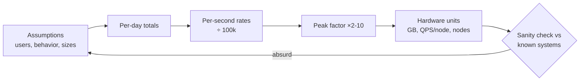
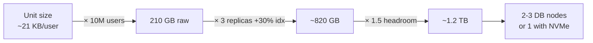
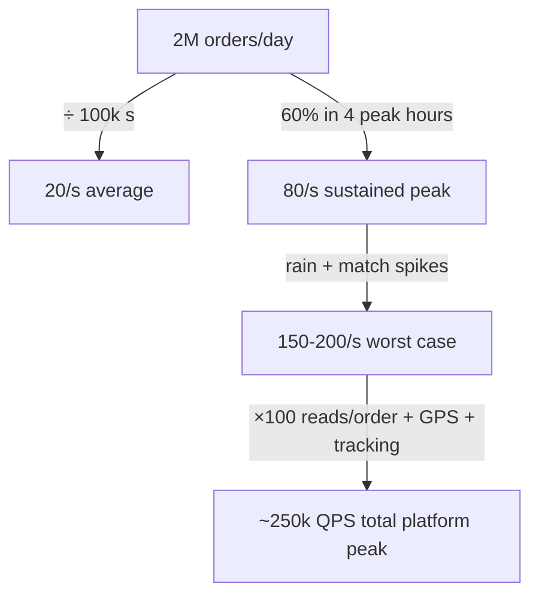
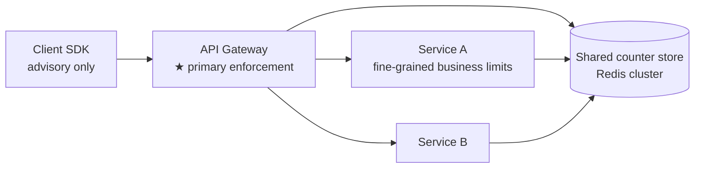
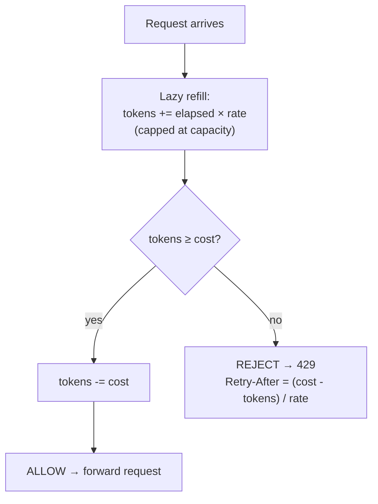
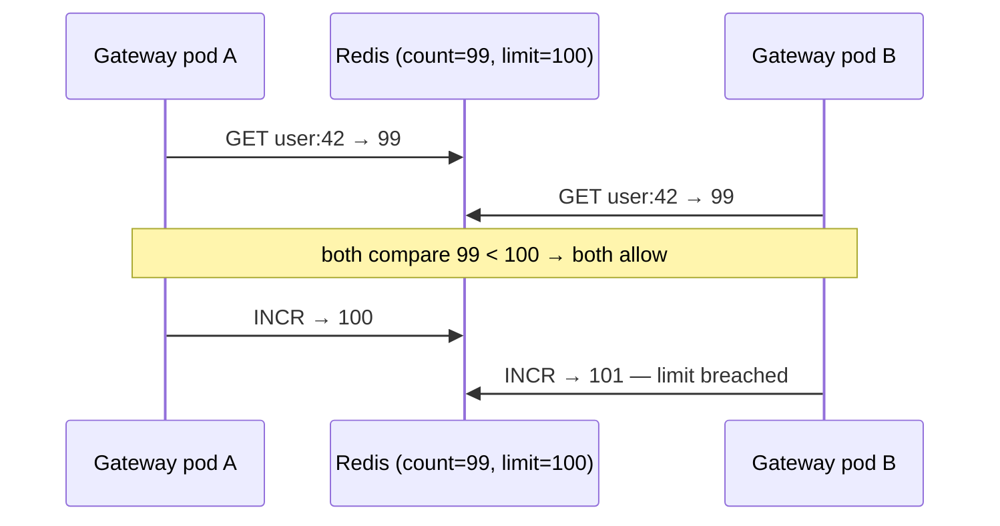
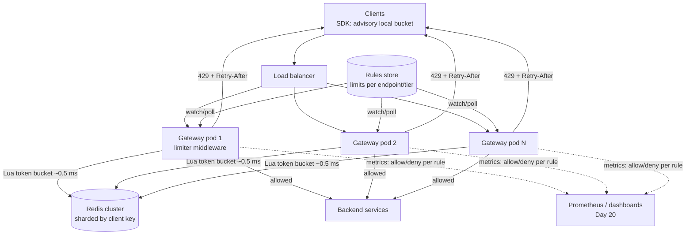

# Day 21 — Back-of-Envelope Estimation + Full HLD: Rate Limiter

> Series: System Design Mastery

---

## Table of Contents

1. [Why Estimation Is a Superpower](#1-why-estimation-is-a-superpower)
2. [The Toolkit: Numbers You Must Own](#2-the-toolkit-numbers-you-must-own)
3. [Drill 1: Instagram Photo Storage per Year](#3-drill-1-instagram-photo-storage-per-year)
4. [Drill 2: Swiggy Orders — Peak vs Average QPS](#4-drill-2-swiggy-orders--peak-vs-average-qps)
5. [Drill 3: WhatsApp Messages per Day — Bandwidth](#5-drill-3-whatsapp-messages-per-day--bandwidth)
6. [Full HLD: Rate Limiter](#6-full-hld-rate-limiter)
7. [Self-Check](#self-check)
8. [Apply (1 hour)](#apply-1-hour)

---

## 1. Why Estimation Is a Superpower

**In plain words:** Before you build a house you don't buy bricks at random — you sketch the size, count the rooms, and estimate how much material you need. Back-of-envelope estimation is that quick sketch for software: a minute of rounding-and-multiplying that tells you whether your idea needs one small server or a fleet of forty. It's cheap insurance against building the wrong thing.

**Why.** Estimation is how you *check designs before building them*. "Can one Redis node handle our rate limiter?" is answerable in 60 seconds with arithmetic — or in 6 weeks with a failed launch. Interviewers use it to see whether you reason or recite; production engineers use it to catch the design that needs 40 TB of RAM before the PO is written.

**What.** Order-of-magnitude arithmetic: round aggressively (86,400 → 100k), track powers of ten, sanity-check the result against a known system. Goal: right within 2–3×, in your head.

**When/How/Where.** At the *start* of every design (capacity plan), during incidents ("is 50k QPS even possible on 4 pods?"), in every interview. State assumptions out loud, compute per second AND per day, convert to hardware units (GB, cores, nodes) at the end.

**The Dark Side.** False precision ("we need 47.3 servers") signals you missed the point — the inputs were guesses, so the output has one significant figure. And estimates anchor: a bad early guess that "storage is negligible" survives unexamined into production. Re-run the math when assumptions change.

> **🤔 Wait — why estimate at all if I can just autoscale?**
> Autoscaling handles *how many* stateless pods you run; it can't undo an architecture that was wrong at design time. If your estimate reveals you need 40 TB of RAM in a single Redis counter or 250k QPS of reads hiding behind 100 writes/s, no autoscaler saves you — you needed a different data model, a cache tier, or sharding *before* the first line of code.
> - Autoscale absorbs *load variance* on a design that already fits.
> - Estimation catches the design that will *never* fit, no matter how many pods you add.

**✅ Good scenario (where it saves you):** Before Swiggy's team builds order tracking, a 60-second estimate shows 1.5M concurrent watchers polling every 10s ≈ 150k QPS of pure tracking reads — dwarfing the 100 orders/s that "feel" like the workload. That number redirects the design to push/CDN-cached tracking *before* launch, avoiding a database that autoscaling could never rescue.

**❌ Bad scenario (the pain without it):** A team sizes a notification service for "average" throughput and ships it. On the first festival-sale push, real traffic is 10× the mean, the queue backs up, retries pile on, and the autoscaler spins up pods that all hammer one un-sharded Postgres counter — turning a missed multiplier into a multi-hour outage. The wrong number was baked into the schema, where no scaling knob reaches.

**When NOT to bother:** A throwaway prototype, an internal tool for 20 employees, or a spike you'll delete next week — precise capacity math there is procrastination dressed as rigor. Rough "it's small, one box is fine" is the whole estimate.


*The estimation pipeline: assumptions → totals → rates → peaks → hardware — and a loop back when the answer smells wrong.*

---

## 2. The Toolkit: Numbers You Must Own

**In plain words:** A carpenter memorizes the length of a standard board so they never re-measure; you memorize a handful of computer numbers so you never stall. Once "a day is about 100,000 seconds" and "RAM is a thousand times faster than SSD" live in your head, estimates fall out in seconds. This section is the small set of facts worth owning cold.

> **🤔 Wait — why memorize numbers I could just look up?**
> Because the value of an estimate is that it's *instant* — mid-interview or mid-incident, "let me Google the latency of an SSD read" kills the reasoning flow and signals you don't have the intuition. You're not memorizing for a trivia quiz; you're building a mental ruler so that "is 50k QPS possible on 4 pods?" resolves in your head while the page is still firing. The dozen numbers here are the ones that recur in *every* design.

**✅ Good scenario (where it saves you):** During a 2 a.m. incident, an on-call engineer at a payments company sees a service doing 8k QPS against Postgres and instantly knows (Postgres ≈ 5k–20k simple QPS/node) they're near the ceiling — not a mystery, a known limit — and adds a read replica in minutes instead of debugging blind. The owned number turned panic into a diagnosis.

**❌ Bad scenario (the pain without it):** An engineer without the RAM:SSD:HDD ratio in their head designs a feed that does a fresh disk seek per item, ships it, and discovers under load that an N+1 pattern is costing ~5,000 memory-references worth of round trips per request — a latency cliff that a 10-second sanity check ("a DC round trip = ~5,000 RAM reads") would have flagged on the whiteboard.

**When NOT to bother:** You don't need Dean's full latency list memorized to write a CRUD endpoint for a hobby app. Own the ÷100k trick and the RAM/SSD/HDD ratio; the rest you can look up until repetition burns them in.

### Powers of 2

| Power | Exact | ≈ | Name |
|---|---|---|---|
| 2¹⁰ | 1,024 | 10³ | KB (thousand) |
| 2²⁰ | 1,048,576 | 10⁶ | MB (million) |
| 2³⁰ | ~1.07 × 10⁹ | 10⁹ | GB (billion) |
| 2⁴⁰ | ~1.1 × 10¹² | 10¹² | TB (trillion) |
| 2⁵⁰ | ~1.13 × 10¹⁵ | 10¹⁵ | PB |

Handy sizes: a UUID/pointer 16 B; a DB row with a few fields 100 B–1 KB; a JSON API payload 1–10 KB; a compressed photo 200 KB–2 MB; a minute of 1080p video ~50–100 MB raw, ~10 MB streamed.

### Latency numbers (Dean's classic list, ~2020s values)

| Operation | Time | Intuition |
|---|---|---|
| L1 cache reference | 0.5 ns | — |
| Branch mispredict | 5 ns | — |
| L2 cache reference | 7 ns | — |
| Mutex lock/unlock | 25 ns | — |
| Main memory reference | 100 ns | RAM = nanoseconds |
| Compress 1 KB (Snappy) | 2 μs | compression is cheap |
| Read 1 MB sequentially from RAM | ~10 μs | — |
| SSD random read | ~100 μs | SSD = 1000× RAM |
| Read 1 MB sequentially from SSD | ~200 μs–1 ms | — |
| Round trip within datacenter | ~500 μs | network ≈ SSD |
| Read 1 MB sequentially from disk (HDD) | ~2–5 ms | — |
| HDD seek | ~4–10 ms | spinning rust = milliseconds |
| Round trip same region (cross-AZ) | ~1 ms | — |
| Round trip India ↔ US East | ~200 ms | geography is physics |

The lessons hiding in the table: **RAM : SSD : HDD ≈ 1 : 1,000 : 100,000** for random access; a datacenter round trip costs as much as ~5,000 memory references (so N+1 query patterns are death); sequential beats random by orders of magnitude everywhere; you cannot cache your way out of intercontinental round trips — replicate instead.

### Rules of thumb

- **86,400 seconds/day ≈ 100k** — the single most useful trick: **X per day ÷ 100k = X per second** (and the ~16% error is noise at this precision).
  - **1M requests/day ≈ 12 req/s** (1M/86,400 = 11.6). Memorize this one.
  - 100M/day ≈ 1,200 QPS. 1B/day ≈ 12k QPS.
- **Peak factor**: consumer traffic peaks at 2–3× average; meal-time/event-driven apps 5–10× (drill 2 shows why Swiggy is special).
- **Storage math conventions**: bytes → bits (×8) for bandwidth; replication ×3 for durability; add 20–30% headroom; 1M records × 1 KB = 1 GB (learn to see this instantly).
- **Per-node capacity anchors**: a tuned Postgres ~5k–20k simple QPS; a Redis node ~100k simple ops/s; one app pod ~1k–5k lightweight req/s; one modern NIC 10–100 Gbps.

### Storage math conventions — a worked micro-example

"Store 10M users with profile + last 100 events each" in four moves:

| Step | Move | Arithmetic |
|---|---|---|
| 1. Row size | Profile ~1 KB; event ~200 B × 100 = 20 KB | ~21 KB/user |
| 2. Raw total | 10M × 21 KB = 10⁷ × 2.1 × 10⁴ B | 2.1 × 10¹¹ = **210 GB** |
| 3. Replication + indexes | ×3 replicas, +30% index overhead | ~820 GB |
| 4. Headroom + growth | ×1.5 for 2 years of growth | **~1.2 TB → 2–3 modest DB nodes** |

The moves are always the same: unit size → multiply by count → multiply by replication/overhead → add headroom → convert to nodes. Say each step out loud in an interview; the *structure* earns more credit than the digits.


*Storage estimation is four multiplications in a trench coat — unit, count, overhead, headroom.*

### Five estimation traps (The Dark Side of the toolkit)

1. **Bits vs bytes** — bandwidth is quoted in bits (Gbps), storage in bytes (GB); forgetting the ×8 is the classic 8× error.
2. **Average blindness** — sizing for mean traffic (drill 2 punishes this with a 10× peak factor).
3. **Forgetting replication and overhead** — the "500 GB" dataset is 2 TB after replicas, indexes, and headroom.
4. **Reads hiding behind writes** — "2M orders/day" sounds like a write problem; it's a 250k-QPS read problem (drill 2 again).
5. **Anchoring on the first number** — sanity-check against a known system (one Redis node = ~100k ops/s; if your design needs 40 nodes for 10k QPS, an exponent slipped somewhere).

---

## 3. Drill 1: Instagram Photo Storage per Year

**In plain words:** Imagine a shoebox where everyone on Earth drops photos every day — how big must the warehouse be after a year? That's this drill. We guess how many photos land daily, how big each one is, multiply, and discover the answer is "many warehouses of disks" while the network pipe to feed them is barely a trickle.

> **🤔 Wait — isn't bandwidth the hard part, not storage?**
> Intuition says "millions of uploads must saturate the network" — but the arithmetic flips it: 60 TB/day of ingest is only ~5 Gbps averaged out, a handful of NICs, while the *accumulated* 22 PB/year is the thing that costs real money and needs tiering. The lesson is that a *flow* (bytes/second) and a *stock* (bytes accumulated) are different beasts, and you must compute both before you know which one bites.

**✅ Good scenario (where it saves you):** Instagram's team runs this before committing an architecture and sees storage — not bandwidth — as the constraint, so they design write-once object storage with hot→warm→cold tiering from day one. Tiering old photos to archival storage saves millions annually, a decision only visible because the stock-vs-flow split was computed up front.

**❌ Bad scenario (the pain without it):** A team over-provisions a fat 100 Gbps ingest pipeline (chasing the "bandwidth" ghost) while treating storage as an afterthought, then watches a single hot SSD tier fill to capacity and start rejecting uploads six months in — an outage caused by budgeting for the trickle and ignoring the flood that never drains.

**When NOT to bother:** For an app storing a few thousand images, skip the PB math entirely — any managed blob store (S3) with default settings absorbs it, and tiering is premature optimization until you're at genuine scale.

**Assumptions (state them!):** 2B monthly actives; 500M daily actives; 10% of DAU posts daily, ~2 photos each → **100M photos/day**. Average stored size after compression: **500 KB** original; Instagram also stores ~3 renditions (thumb 20 KB, medium 100 KB, full 500 KB) → ~**620 KB ≈ 600 KB** per uploaded photo.

**Arithmetic:**

- Per day: 100M × 600 KB = 100 × 10⁶ × 6 × 10⁵ B = 6 × 10¹³ B = **60 TB/day**
- Per year: 60 TB × 365 ≈ 60 × 400 ≈ **~22 PB/year** (round: 21.9 PB)
- With 3× replication: **~65 PB/year** raw capacity
- Ingest bandwidth: 60 TB/day ÷ 100k s = 6 × 10¹³ / 10⁵ = 6 × 10⁸ B/s = 600 MB/s ≈ **~5 Gbps average**, so ~10–15 Gbps at peak — a handful of NICs, trivial; **storage, not bandwidth, is the constraint.**

**Sanity check:** tens of PB/year for one of Earth's biggest photo apps feels right (Meta has publicly discussed exabyte-scale total media). If you'd gotten 22 TB or 22 EB, an exponent slipped — recheck.

| Quantity | Value | Dominant? |
|---|---|---|
| Photos/day | 100M | — |
| Storage/year (raw / replicated) | ~22 PB / ~65 PB | **Yes — the constraint** |
| Metadata/year | ~36 TB | Its own sharding problem |
| Ingest bandwidth | ~5 Gbps avg | No — trivial |

**Design consequences:** photos are immutable → write-once object storage + CDN; metadata (~1 KB/photo × 36.5B photos/year ≈ 36 TB/year) is *itself* a sharded-database problem; old photos go cold → tiered storage (hot SSD → warm HDD → cold archival) saves real millions.

---

## 4. Drill 2: Swiggy Orders — Peak vs Average QPS

**In plain words:** A restaurant that serves 200 meals a day isn't "8 meals an hour" — everyone shows up at lunch and dinner. Averages hide the rush. This drill shows two traps: traffic clumps into peaks (size for the rush, not the average), and the visible orders are a tiny splash on top of a huge wave of browsing, tracking, and GPS traffic.

> **🤔 Wait — if the average is 20 orders/s, why not just build for 20/s?**
> Because nobody orders "on average" — 60% of a day's orders land in the four hours around lunch and dinner, so the rate you must actually survive is 8–10× the mean, spiking higher when it rains or a match ends. Size for the average and you fall over every single dinner, precisely when the business makes its money. Averages are for accountants; capacity is set by peaks.

**✅ Good scenario (where it saves you):** Swiggy's capacity team multiplies the 20/s average by a peak factor *and* a read-fan-out factor and provisions for ~250k QPS at dinner, so an IPL-final traffic spike is a busy night, not an outage. The two stacked multipliers — peak concentration and reads-per-order — are the difference between a graph that dips and a pager that screams.

**❌ Bad scenario (the pain without it):** A food-delivery startup sizes its fleet and database for mean throughput, launches a "50% off" dinner promo, and gets buried under 10× traffic — the order service times out, retries amplify the load, and the one night designed to win customers instead hands them a broken checkout. The missing multiplier became a revenue-day outage.

**When NOT to bother:** A steady, machine-driven workload (a nightly batch job, an internal metrics pipeline) with near-flat traffic doesn't need peak-factor gymnastics — its average *is* its peak, so size for the mean and move on.

**Assumptions:** ~2M orders/day (India food-delivery scale, right order of magnitude).

**Average order-placement rate:** 2M ÷ 100k s = **20 orders/s average**. Tiny!

**But food delivery is brutally peaky.** Orders concentrate in lunch (12–2 pm) and dinner (7–10 pm): assume **60% of daily orders land in ~4 peak hours** (14,400 s ≈ 15k s):
- Peak rate: (0.6 × 2M) ÷ 15k = 1.2M ÷ 15k = **80 orders/s**, with minute-level spikes (rain! IPL final ends!) to **150–200/s** → **peak ≈ 8–10× the average**. Provisioning for the 20/s average = falling over every single dinner.

**Now the real lesson — orders are the tip of the iceberg.** Each order rides on a session of browsing:

| Activity | Ratio per order | Peak QPS |
|---|---|---|
| Order placement | 1 | ~100 |
| Sessions (incl. non-buyers: ~3× more sessions than orders) | 3 | — |
| Menu/restaurant/search views | ~100 reads per order placed | ~10,000 |
| Rider GPS pings (300k active riders × 1 ping/4 s) | — | ~75,000 |
| Order tracking polls (1.5M concurrent watchers ÷ 10 s) | — | ~150,000 |

The "2M orders/day" system is really a **~250k QPS read-heavy platform** at dinner peak, where writes-that-matter are 100/s. That asymmetry (three-plus orders of magnitude) is the entire architecture: cache and CDN the reads, guard the tiny sacred write path with everything from Days 18–19.


*Averages lie twice: peaks are 10× the average, and the orders are 0.1% of the traffic they generate.*

---

## 5. Drill 3: WhatsApp Messages per Day — Bandwidth

**In plain words:** Sending a text is like mailing a postcard — tiny and nearly free even in huge quantities. Sending a photo or video is like mailing a parcel — a few of those weigh more than a mountain of postcards. This drill shows that a small slice of "parcels" (media) dominates the total shipping bill, which forces every chat app to route texts and media down different pipes.

> **🤔 Wait — 140 billion messages/day, surely the text volume is the bandwidth problem?**
> The count is huge but each text is ~200 bytes, so *all* the world's WhatsApp texting is ~2 Gbps — genuinely trivial. The 5% of messages carrying media are ~200 KB each, and that sliver is ~99% of the bytes (~1.4 PB/day). Event count and byte volume are different axes; you have to weight by size before you know where the money and the architecture go.

**✅ Good scenario (where it saves you):** WhatsApp routes text through a lean, low-latency messaging core while media goes to blob storage + CDN with only a *pointer* traveling the message path. That split — forced by the 5%/99% math — keeps the latency-sensitive core cheap and small, and lets media scale independently on infrastructure built for bulk bytes.

**❌ Bad scenario (the pain without it):** A chat startup pipes photos and videos through the same message-fan-out service as text, and the first time users start sharing videos the messaging core's memory and bandwidth explode, dragging text latency down with it — a single un-split path where a 5% feature takes the whole system hostage.

**When NOT to bother:** A pure text/telemetry system with no media (a logging pipeline, a chat bot exchanging short JSON) doesn't need a separate media path — there are no parcels, only postcards, so one pipe is correct.

**Assumptions:** ~140B messages/day (WhatsApp's publicly cited ~100B+ in 2020, grown). Average text message ~100 bytes of payload + ~100 bytes of protocol/metadata overhead ≈ **200 B**. ~5% of messages carry media at ~200 KB average.

**Text bandwidth:**
- Per second: 140B ÷ 100k = 1.4 × 10¹¹ / 10⁵ = **1.4M messages/s** average (peak ~3×: ~4M/s — New Year's Eve has publicly hit similar territory).
- Bytes: 1.4 × 10⁶ × 200 B = 2.8 × 10⁸ B/s = 280 MB/s → ×8 = **~2.2 Gbps average** for *all the world's texting*. Astonishingly small — text is nearly free.

**Media bandwidth (the real bill):**
- 5% × 140B = 7B media/day → 7B × 200 KB = 7 × 10⁹ × 2 × 10⁵ B = 1.4 × 10¹⁵ = **1.4 PB/day**
- Per second: 1.4 × 10¹⁵ ÷ 10⁵ = 1.4 × 10¹⁰ B/s… careful — sanity check: 1.4 PB/day ÷ 100k s = **14 GB/s = ~112 Gbps average**, ~300+ Gbps peak. (Each media byte is served ~1–2× as recipients download — call it ~250 Gbps–0.5 Tbps egress at peak.)

**The punchline ratio:** media is 5% of messages but **~99% of the bytes** (1.4 PB vs ~28 TB of text/day). Design consequence: text goes through the low-latency messaging core; media goes to blob storage + CDN with only a *pointer* traveling through the messaging path. Every chat system ever built converges on this split — the math forces it.

### The three drills on one card

| Drill | Headline number | The lesson it teaches |
|---|---|---|
| Instagram photos | ~22 PB/year (65 PB replicated) | Storage dominates; bandwidth is trivial; tier cold data |
| Swiggy orders | 20/s average → ~250k QPS platform peak | Peaks are 10× averages; reads are 1000× the writes |
| WhatsApp messages | Text ~2 Gbps; media ~1.4 PB/day | 5% of events can be 99% of bytes; split the paths |

Three different systems, three different dominant constraints (storage, read fan-out, media bandwidth) — which is exactly why you estimate *before* designing: the constraint picks the architecture.

---

## 6. Full HLD: Rate Limiter

**In plain words:** A rate limiter is the bouncer at a club door: it lets a steady stream of people in, turns away the crowd when the room is full, and hands rejected guests a "come back in 7 minutes" note instead of slamming the door in silence. In software it stops one client from overwhelming a service — whether that's an abuser hammering your login page or a buggy app retrying 10,000 times a second. This whole section designs that bouncer at real-world scale.

The capstone design — and estimation's first customer: every number below gets sanity-checked with Section 2 tools.

> **🤔 Wait — why rate-limit my *own* users? They're paying me.**
> A rate limiter isn't there to punish good customers; it's there to protect *all* of them from the few (or the bugs) that would starve everyone else. The client eating your capacity is rarely a malicious human — it's a mis-configured retry loop firing 10,000 req/s, a scraper, or a stampede after a push notification, and one such client can degrade the service for the millions behind it.
> - Without a limiter: one bad actor's burst = everyone's outage.
> - With one: that burst gets a polite 429, and the rest of the club keeps dancing.

**✅ Good scenario (where it saves you):** A payments API caps each merchant's key at a sane sustained rate, so when one integration ships a bug that retries a failing charge in a tight loop, the limiter returns 429s to *that* key while every other merchant's traffic flows untouched. The blast radius of one broken client is contained to one client.

**❌ Bad scenario (the pain without it):** An unthrottled login endpoint lets a credential-stuffing bot fire hundreds of thousands of attempts, saturating the auth database and locking out real users — a security *and* availability incident that a 5-attempts/hour rule would have reduced to a rounding error.

**When NOT to bother:** A purely internal service behind a trusted network with a fixed, known set of callers (say, three cron jobs) usually doesn't need a full rate limiter — a connection pool cap or a queue already bounds the load, and the limiter is just moving parts to maintain.

### 6.1 Requirements

**In plain words:** Before building the bouncer, agree on the house rules: who counts as "one guest" (a user? an IP?), how many they may bring per minute, how fast the bouncer must decide (it stands in front of *everyone*, so it can't be slow), and what happens if the bouncer faints. Nail these down first so the rest of the design has something to satisfy.

**Functional:** limit requests per client (user ID, API key, IP) per rule, e.g. "300 req/min per user on `/search`", "5 OTP requests/hour per phone"; return a clear signal when limited; rules configurable per endpoint/tier.

**Non-functional:** added latency ≤ 1–2 ms p99 (it's in front of *everything*); scale: assume a Swiggy-sized platform at ~250k QPS peak (drill 2!); high availability with an explicit answer for "limiter is down"; accuracy: small over/under-admission tolerable for capacity limits, NOT for security limits (OTP).

### 6.2 Placement: where does the limiter live?

**In plain words:** You can post a bouncer at the front gate, at each room's door, or politely ask guests to control themselves — and the answer is "mostly the front gate." The gateway is the one chokepoint every request must pass, so enforcing there protects everything behind it. Client-side limits are just good manners (an attacker ignores them), and per-service limits handle rules only that service understands.


*Client-side limiting is politeness, gateway limiting is the law, service-level limiting handles rules only the service understands.*

| Placement | Pros | Cons | Verdict |
|---|---|---|---|
| **Client SDK** | Saves a network trip; smooths bursts | Trivially bypassed (attacker controls the client) | Nice extra, never the enforcement |
| **API Gateway** | One choke point; protects everything behind it; rules in one place | Gateway must be fast & scaled; coarse identity only | **Primary home** |
| **Per service** | Knows business context ("5 order-cancellations/day") | N implementations drift; duplicated infra | Secondary, for business rules |

### 6.3 Algorithms compared in depth

**In plain words:** There are a few ways to count "too many": stamp requests into fixed one-minute buckets (cheap but leaky at the seams), keep a precise log of every request (perfect but memory-hungry), blend two buckets for a smooth estimate, or hand out refillable tokens like arcade tickets. Each trades memory for accuracy for burst-friendliness. Token bucket wins as the default because it naturally allows short bursts while capping the sustained rate — exactly how real apps behave.

> **🤔 Wait — why not just a simple fixed-window counter? INCR and compare, done.**
> The fixed-window counter is one `INCR` and genuinely tempting — until you notice it lets a client fire the full limit at 12:00:59 *and* the full limit again at 12:01:01, a clean 2× burst straddling the boundary, which is exactly the spike you built the limiter to stop. Token bucket costs two floats instead of one integer and, in exchange, expresses *sustained rate* and *allowed burst* as separate knobs — matching how real traffic looks (a page load fires 10 calls at once; 600/min sustained is abuse).
> - Fixed window: cheap, but 2× leak at every boundary.
> - Token bucket: burst you *chose* to allow, hard cap on the sustained rate.

**✅ Good scenario (where it saves you):** Stripe and AWS use token bucket so a client's legitimate burst — ten parallel API calls on one page render — sails through, while a runaway script that keeps hammering drains the bucket and gets throttled to the drip rate. Bursts your product *wants* are honored; sustained abuse is capped, with one algorithm.

**❌ Bad scenario (the pain without it):** A team ships a fixed-window limiter at 100/min to protect a fragile downstream, and an abuser (or a retry storm) times requests around the minute boundary to push 200 through in two seconds — the downstream tips over under a spike the limiter was specifically bought to prevent. The cheap algorithm leaked exactly where it mattered.

**When NOT to bother:** For a coarse, forgiving internal quota — "no more than ~1000/hour, roughly" — where a boundary burst is harmless, the one-integer fixed window is perfectly fine; reaching for token bucket there is precision nobody will ever use.

**Fixed window counter.** Counter per (client, window): `INCR user:42:12:05`, reject if > limit. Cheap, one key. **The boundary-burst problem, numerically:** limit = 100/min. A client sends **100 requests at 12:00:59** (window 12:00 allows them: counter hits 100 ✓) and **100 more at 12:01:01** (fresh window 12:01: counter 100 ✓). Result: **200 requests in 2 seconds** — double the intended rate, precisely at the boundary. For a limit meant to protect capacity, a 2× spike is exactly what you were preventing.

**Sliding window log.** Store a timestamp per request (Redis ZSET); on each request, drop entries older than 60 s, count the rest. Perfectly accurate — and expensive: 300 req/min limit = up to 300 timestamps × ~20 B ≈ 6 KB *per client per rule*; 10M active clients ≈ 60 GB just for one rule, plus O(log n) ZSET work per request. Use only for small-N, high-stakes limits (login attempts).

**Sliding window counter (the pragmatic hybrid).** Keep fixed counters for current & previous window; estimate: `count = curr + prev × overlapFraction`. At 12:01:20, weight = 40/60 of previous window. Two integers per client, smooths the boundary burst almost entirely (Cloudflare runs this: their analysis showed ~0.003% of requests wrongly judged across 400M sampled). Assumes even distribution within the previous window — a benign approximation.

**Token bucket (the default answer).** Bucket of capacity `B` refills at `r` tokens/s; each request takes a token; empty bucket → reject. Two numbers express both **sustained rate** (r) and **allowed burst** (B) — matching real traffic, which is bursty (a page load fires 10 calls at once; that's fine, 600/min sustained isn't).

**In plain words:** Picture a bucket that a tap slowly drips tokens into, up to the brim. Every request scoops one token out; if the bucket is empty, the request is turned away. Because the bucket can hold a full load of tokens, a sudden burst is fine, but once it's drained you can only go as fast as the tap drips. The clever trick below is "lazy refill": instead of a background timer topping up the bucket, we just calculate how much *would* have dripped in since we last looked — same result, no timer thread.

```java
import java.util.concurrent.locks.ReentrantLock;

/**
 * A single-client token bucket.
 *
 * Beginner notes on thread-safety:
 *  - Multiple request threads may call allow() on the SAME bucket at once.
 *  - The refill-then-spend steps must happen as one indivisible unit,
 *    otherwise two threads could both see "1 token left" and both spend it.
 *  - We guard the critical section with a ReentrantLock (a simple mutex).
 *    'synchronized' on the method would work equally well here; the lock
 *    just makes the protected region explicit.
 */
public class TokenBucket {
    private final double rate;       // tokens added per second (the sustained rate)
    private final double capacity;   // max tokens the bucket can hold (the burst size)
    private double tokens;           // tokens available right now
    private long lastNanos;          // last time we refilled, in nanoseconds

    // The lock that makes allow() safe to call from many threads at once.
    private final ReentrantLock lock = new ReentrantLock();

    public TokenBucket(double rate, double capacity) {
        this.rate = rate;
        this.capacity = capacity;
        this.tokens = capacity;               // start full
        // nanoTime() is a MONOTONIC clock (Day 19: wall clocks can jump
        // backwards on NTP sync). Never use System.currentTimeMillis() for
        // measuring elapsed time.
        this.lastNanos = System.nanoTime();
    }

    // Convenience overload: most callers just spend a single token.
    public boolean allow() {
        return allow(1.0);
    }

    public boolean allow(double cost) {
        lock.lock();                          // only one thread runs the body at a time
        try {
            long now = System.nanoTime();
            // Elapsed seconds since we last refilled (nanos -> seconds).
            double elapsedSeconds = (now - lastNanos) / 1_000_000_000.0;
            // Lazy refill: add what would have dripped in, capped at capacity.
            tokens = Math.min(capacity, tokens + elapsedSeconds * rate);
            lastNanos = now;

            if (tokens >= cost) {
                tokens -= cost;               // spend and admit
                return true;
            }
            return false;                     // empty bucket -> reject
        } finally {
            lock.unlock();                    // ALWAYS unlock, even if body throws
        }
    }
}

// Usage: 5 req/s sustained, bursts of up to 10 are OK.
// TokenBucket b = new TokenBucket(5, 10);
```


*The whole algorithm is two floats and one branch — refill lazily on arrival, spend if you can, and the deficit even tells you the exact Retry-After to return.*

Worked trace (rate = 5/s, capacity = 10, starting full): 12 instant requests → first 10 pass (burst), requests 11–12 rejected (0 tokens). Wait 1 s → refill adds 5 tokens. 4 more requests → all pass, 1 token remains. Burst honored, sustained rate enforced — exactly the shape real client traffic wants.

**Leaky bucket.** Requests enter a fixed-size queue drained at a constant rate — output is perfectly smooth. Great when the *downstream* needs steady flow (calling a fragile third-party bank API at exactly 50/s); as a user-facing limiter it queues (adds latency) instead of fast-rejecting, and bursts overflow the queue.

| Algorithm | Memory/client | Accuracy | Bursts | Best for |
|---|---|---|---|---|
| Fixed window | 1 counter | Poor at boundaries (2× leak) | Boundary bursts allowed | Rough, cheap limits |
| Sliding log | O(limit) timestamps | Perfect | Exact | Login/OTP (small N, high stakes) |
| Sliding counter | 2 counters | ~Perfect | Smoothed | General gateway limiting |
| **Token bucket** | 2 floats | Good | **Explicitly configurable** | **Default: APIs (Stripe, AWS use it)** |
| Leaky bucket | Queue | Good | Absorbed into queue delay | Smoothing calls *to* fragile downstreams |

### 6.4 Distributed rate limiting

**In plain words:** One bouncer with a clicker counter is easy. Now put 50 bouncers on 50 doors of the same club — they'll each let in "the last 100" because none of them can see the others' clickers. The fix is a single shared scoreboard (Redis) that all bouncers read and update. But if two bouncers read the scoreboard at the same instant and both act on the stale number, they over-admit — so the update must be made atomic.

One gateway pod with in-memory buckets is easy; 50 pods behind a load balancer each seeing 1/50th of traffic is the real problem — counters must be **shared** → Redis.

> **🤔 Wait — one server can count requests fine, why drag in a distributed Redis?**
> Because at scale there isn't *one* server — a load balancer sprays traffic across 50 gateway pods, and each pod only sees its own slice. If every pod enforces "100/min" against its local counter, a client hitting all 50 pods gets admitted 50 × 100 = 5,000/min. The limit only means something if all pods count against a *shared* scoreboard, and once it's shared, the read-then-write must be made atomic or racing pods over-admit.
> - In-memory counter: correct on one pod, meaningless across a fleet.
> - Shared atomic counter: one global truth, enforced no matter which pod you land on.

**✅ Good scenario (where it saves you):** A Swiggy-scale gateway runs its token bucket as an atomic Lua script against a sharded Redis cluster, so a "5 OTP/hour per phone" rule holds even when the abuser's requests scatter across dozens of pods — every pod decrements the same key, and the atomic script closes the GET-then-INCR race. The security limit is actually secure.

**❌ Bad scenario (the pain without it):** A team enforces limits in per-pod memory, autoscaling multiplies the pods, and an OTP-abuse rule of "5/hour" silently becomes "5 × pod-count/hour" — an SMS-cost and brute-force hole that widens *as they add capacity*, discovered only on the phone bill. The counter was right locally and catastrophically wrong globally.

**When NOT to bother:** A single-instance internal tool, or a service that genuinely runs on one pod, needs no distributed limiter — an in-memory token bucket is exact there, and a Redis dependency just adds a network hop and a new thing to page you at 3 a.m.

**The race condition with naive Redis:**


*Read-then-write across the network is never atomic: N racing pods can each admit "the last" request.*

Under contention this over-admits by up to (pods − 1) per window per client — harmless at limit=10,000, disastrous at limit=5 OTPs.

**Fix 1 — atomic Lua script.** Redis executes scripts atomically; check-and-decide becomes one indivisible operation server-side. The script itself is written in Lua (Redis's built-in scripting language); from Java we ship that script to Redis once and call it via a client like Jedis or Lettuce:

```java
import redis.clients.jedis.Jedis;
import java.util.List;

public class RedisTokenBucket {

    // This is a Lua script that runs ATOMICALLY inside Redis. Because Redis
    // executes the whole script as one indivisible step, the "read tokens,
    // decide, write tokens back" sequence cannot be interleaved by another
    // pod -- which is exactly what kills the GET-then-INCR race above.
    // (The body is Lua, not Java: KEYS/ARGV are how Redis passes arguments in.)
    private static final String TOKEN_BUCKET_LUA =
        "local key = KEYS[1]\n" +
        "local rate, capacity, now, cost =\n" +
        "      tonumber(ARGV[1]), tonumber(ARGV[2]), tonumber(ARGV[3]), tonumber(ARGV[4])\n" +
        "local state = redis.call('HMGET', key, 'tokens', 'last')\n" +
        "local tokens = tonumber(state[1]) or capacity\n" +
        "local last   = tonumber(state[2]) or now\n" +
        "tokens = math.min(capacity, tokens + (now - last) * rate)\n" +
        "local allowed = 0\n" +
        "if tokens >= cost then tokens = tokens - cost; allowed = 1 end\n" +
        "redis.call('HMSET', key, 'tokens', tokens, 'last', now)\n" +
        "redis.call('EXPIRE', key, math.ceil(capacity / rate) * 2)\n" + // self-cleaning
        "return allowed";

    private final Jedis redis;
    private final double rate;
    private final double capacity;

    public RedisTokenBucket(Jedis redis, double rate, double capacity) {
        this.redis = redis;
        this.rate = rate;
        this.capacity = capacity;
    }

    public boolean allow(String userId, String rule) {
        // One key per (client, rule). key-based sharding keeps this whole key
        // on ONE Redis shard, so the script's atomicity actually holds.
        String key = String.format("rl:%s:%s", userId, rule);

        // Pass the current time in SECONDS as an argument. We deliberately
        // compute time on the caller and hand it to the script so the refill
        // math is consistent; String.format replaces Python's f-strings.
        double nowSeconds = System.currentTimeMillis() / 1000.0;

        Object result = redis.eval(
            TOKEN_BUCKET_LUA,
            List.of(key),                                        // KEYS
            List.of(String.valueOf(rate),                        // ARGV[1] rate
                    String.valueOf(capacity),                    // ARGV[2] capacity
                    String.valueOf(nowSeconds),                  // ARGV[3] now
                    "1")                                         // ARGV[4] cost
        );

        // The Lua script returns 1 (allowed) or 0 (rejected).
        return result instanceof Long && (Long) result == 1L;
    }
}
```

Capacity check (drill discipline): 250k QPS × 1 Lua call ≈ 250k Redis ops/s → 3–5 node Redis cluster, sharded by client key (each key lives whole on one shard, so atomicity holds). Latency: ~0.5 ms in-DC round trip (latency table) — inside the 1–2 ms budget. Memory: 10M active clients × ~2 rules × ~60 B ≈ **1.2 GB** — one node's pocket change.

**Fix 2 — local buckets + async sync.** Each pod keeps in-memory buckets for 1/N of the global rate (or syncs deltas to Redis every ~50–100 ms). Zero added latency, no Redis on the hot path — but accuracy is now eventual: a burst can hit N pods before sync and over-admit. The trade: **Lua/Redis = accurate + 0.5 ms; local + sync = ~0 ms + approximate.** Gateways often layer them: local bucket as a cheap first gate, Redis as the source of truth for strict rules.

**In plain words:** For the local-bucket approach in Java, each pod holds many buckets — one per client — in a `ConcurrentHashMap` (a thread-safe map that many request threads can touch at once without a global lock), and a `ScheduledExecutorService` (a built-in timer-thread pool) pushes the accumulated counts to Redis every ~50 ms in the background:

```java
import java.util.concurrent.ConcurrentHashMap;
import java.util.concurrent.Executors;
import java.util.concurrent.ScheduledExecutorService;
import java.util.concurrent.TimeUnit;

public class LocalBucketLimiter {
    // Thread-safe map: key -> that client's bucket. computeIfAbsent creates a
    // bucket the first time we see a client, atomically (no lost updates even
    // if two threads race to create the same client's bucket).
    private final ConcurrentHashMap<String, TokenBucket> buckets = new ConcurrentHashMap<>();

    // A single background thread that periodically reconciles with Redis.
    private final ScheduledExecutorService syncer = Executors.newSingleThreadScheduledExecutor();

    private final double rate;
    private final double capacity;

    public LocalBucketLimiter(double rate, double capacity) {
        this.rate = rate;
        this.capacity = capacity;
        // Reconcile local counts with the shared Redis scoreboard every 50 ms.
        syncer.scheduleAtFixedRate(this::syncToRedis, 50, 50, TimeUnit.MILLISECONDS);
    }

    public boolean allow(String clientKey) {
        // Zero Redis calls on the hot path -> ~0 ms added latency.
        TokenBucket bucket = buckets.computeIfAbsent(
                clientKey, k -> new TokenBucket(rate, capacity));
        return bucket.allow();
    }

    private void syncToRedis() {
        // Push local deltas up / pull the authoritative count down.
        // Kept as a stub here; the point is that it runs OFF the request path.
    }
}
```

### 6.5 What to return

**In plain words:** A good bouncer doesn't just say "no" and shove the door shut — they say "you're over the limit, try again in 7 seconds, here's how many you had left." Returning a clear **429** with retry instructions turns clients that would otherwise pound the door harder into ones that wait politely. Silence or a 500 error, by contrast, makes clients retry frantically and can turn a small problem into an outage.

**HTTP 429 Too Many Requests**, plus machine-readable guidance — this is what turns angry retry storms (Day 18!) into polite backoff:

```
HTTP/1.1 429 Too Many Requests
Retry-After: 7
X-RateLimit-Limit: 300
X-RateLimit-Remaining: 0
X-RateLimit-Reset: 1760000007
{"error": "rate_limited", "retry_after_s": 7}
```

Send `X-RateLimit-Remaining` on *successful* responses too, so well-behaved clients self-throttle before hitting the wall. Never silently drop (client retries harder) and don't return 5xx (it's the client's fault and 5xx trips *their* retry logic). For security limits (login), consider deliberately vague messaging — don't teach attackers the exact threshold.

### 6.6 Rules, API surface, and observability

**In plain words:** Rather than hard-coding limits into the app (which needs a redeploy to change), you keep them in a config file the gateways watch — like a whiteboard of house rules the bouncers re-read whenever it changes. Each rule also states, up front, what to do if the scoreboard is unreachable, so nobody has to make that call in a panic at 3 a.m. And you emit metrics for every decision so you can spot an attack — or a typo'd limit — early.

Rules live in a config store the gateways watch (hot-reload, no redeploy to change a limit):

```yaml
rules:
  - id: search-per-user
    match: { path: "/v1/search", key: "user_id" }
    algorithm: token_bucket
    rate_per_s: 5          # 300/min sustained
    burst: 20              # a page-load's fan-out is fine
    on_limiter_failure: open
  - id: otp-per-phone
    match: { path: "/v1/otp/send", key: "phone" }
    algorithm: sliding_log      # small N, high stakes — exact
    limit: 5
    window_s: 3600
    on_limiter_failure: closed  # abuse costs more than downtime
```

Notice `on_limiter_failure` is **per rule** — this is Section 6.8's fail-open/fail-closed decision encoded as config, decided calmly at design time instead of heroically mid-incident.

What Instagram- and Swiggy-shaped platforms actually limit:

| Platform | Rule | Why | Failure policy |
|---|---|---|---|
| Instagram | Follows/hour per account (~dozens) | Bot/spam-farm suppression | Closed |
| Instagram | Likes & comments per minute | Engagement-bot suppression | Closed |
| Instagram | Feed fetches per user per min (generous) | Capacity, broken-client protection | Open |
| Swiggy | 5 OTP/hour per phone | SMS-cost abuse + brute force | Closed |
| Swiggy | Search/menu reads per device | Scraper + capacity | Open |
| Swiggy | Order cancellations per user per day | Business-abuse rule (lives in order service, not gateway) | Closed |

Emit per-rule RED metrics (Day 20): `ratelimit_decisions_total{rule, outcome}` and the p99 of limiter overhead. Two alerts matter: deny-rate spike on a capacity rule (attack? or a typo'd limit?), and *any* activation of the local-fallback path (your accuracy just degraded — know it before the abuse team does).

### 6.7 Full architecture

**In plain words:** Put the pieces together: clients hit a load balancer, which spreads them across many gateway pods; each pod checks the shared Redis scoreboard atomically, reads its rules from config, waves allowed traffic through to the backend, and answers rejected traffic with a 429-plus-instructions — all while streaming metrics to a dashboard. It's the bouncer, the scoreboard, the rulebook, and the CCTV, wired together.


*Gateway pods consult a sharded Redis atomically per request, pull rules from config, emit RED metrics — and answer 429s with instructions, not silence.*

### 6.8 Failure mode: limiter down — fail-open vs fail-closed (The Dark Side)

**In plain words:** What should the bouncer do if the scoreboard breaks? "Fail-open" means wave everyone through (the club stays open, but there's no crowd control right when you might be under attack). "Fail-closed" means turn everyone away (safe, but a broken scoreboard just shut your whole club). Neither is universally right — so you decide per rule: keep the doors open for ordinary capacity limits, lock them for security-critical ones like OTP.

Redis cluster becomes unreachable. Every request now poses the question: **admit without checking (fail-open) or reject everything (fail-closed)?**

- **Fail-open**: availability preserved — but the limiter is now decorative exactly when you might be *under the attack it exists to stop*. If the outage was *caused* by overload, you just removed the dam during the flood. Attackers who figure out that hammering your Redis disables your rate limits have a two-step exploit.
- **Fail-closed**: protection preserved — but a Redis blip just took down **100% of your traffic**. The guard became the single point of failure; your availability is now min(yours, Redis's) — Day 18's serial-chain math, self-inflicted.

**The grown-up answer is per-rule policy, not a global switch:**

| Rule type | Example | On limiter failure |
|---|---|---|
| Capacity protection | 300 req/min on /search | **Fail-open** (+ alert loudly) — availability wins |
| Security-critical | 5 OTP/hour, login attempts | **Fail-closed** (or degraded strict local limit) — abuse costs more than downtime |
| Cost-critical | Free-tier API quota | Fail-open briefly; reconcile/bill later |

Plus the mitigations that shrink the question: pods fall back to **local approximate buckets** when Redis is unreachable (degraded accuracy ≫ no limiting — Day 18's graceful degradation, applied to the limiter itself); Redis gets replicas + short timeouts (50 ms) so a slow Redis can't add latency to every request; and the fallback activation fires an alert (degrade *loudly*).

### 6.9 Bottlenecks & evolution

**In plain words:** As the system grows, new pain points appear: one wildly popular client can overload a single Redis shard (a "hot key"), hundreds of rules become their own mess to manage, and going worldwide means you can't ask a server in the US on every Indian request (that's a 200 ms round trip on *every* call). The design evolves to handle each: local-first buckets for hot keys, ownership and defaults for rules, and per-region limiters that reconcile in the background.

- **Hot keys**: one viral client/IP (or one NAT gateway fronting a campus) hammers a single Redis shard → detect hot keys, handle them with local-first buckets.
- **Rule sprawl**: hundreds of per-endpoint rules → rules need ownership, defaults, and testing (a typo'd limit of 3 instead of 300 is a self-inflicted outage — Day 18's misconfigured-breaker lesson repeats).
- **Evolution path**: single Redis → sharded cluster → local+sync hybrid → per-region limiters with global async reconciliation (a truly global synchronous counter would put a 200 ms India↔US round trip in every request — the latency table forbids it).
- **Tiering & product**: limits become product features (free: 100/min, enterprise: 10k/min) — the limiter grows a billing integration and per-tenant dashboards (Day 20's metrics pay off).

### 6.10 The design in ninety seconds (interview recap)

**In plain words:** This is the whole design compressed into a script you could say out loud in an interview — clarify, place, pick, distribute, respond, fail deliberately, evolve. If you can walk these seven beats and drop the numbers along the way, you've demonstrated the entire week's toolkit in a minute and a half.

1. **Clarify**: what are we limiting (user/key/IP), what scale (state a QPS estimate — do the ÷100k trick out loud), how accurate must it be, what latency budget?
2. **Place it** at the API gateway (enforcement) + optional client SDK (politeness) + per-service business rules.
3. **Pick token bucket** as the default; justify with the burst-vs-sustained argument; name fixed-window's boundary-burst flaw numerically and sliding-window-counter as the smoother alternative.
4. **Distribute it**: shared counters in a sharded Redis; call out the GET-then-INCR race unprompted and fix it with an atomic Lua script; mention local-buckets-plus-sync as the latency-optimized variant.
5. **Respond well**: 429 + Retry-After + X-RateLimit-* headers — tie it back to preventing retry storms.
6. **Fail deliberately**: per-rule fail-open (capacity) vs fail-closed (security/OTP), with local approximate fallback and a loud alert.
7. **Evolve**: hot keys, rule sprawl, per-region limiters with async reconciliation — never a synchronous global counter across oceans (the 200 ms table entry forbids it).

Every step leans on a previous day: Day 18 (retry storms, graceful degradation of the limiter itself), Day 19 (atomicity, monotonic clocks), Day 20 (RED metrics, security limits), and today's estimation (Redis node count, memory footprint, latency budget). That's the point of the week — the capstone is just the earlier lessons, composed.

---

## Self-Check

1. From memory: RAM vs SSD vs HDD random access ratio, one in-DC round trip, one cross-continent round trip. Which of these can architecture fix, and which is physics?
2. Convert without paper: 5M requests/day → QPS. 260B messages/day → messages/s. Why is dividing by 100k legitimate?
3. Redo drill 1 with 200M photos/day at 400 KB per photo (single rendition, 3× replicated): PB/year?
4. Swiggy: why is provisioning for average QPS guaranteed failure, and what two multipliers stack between "orders/s" and "platform QPS"?
5. WhatsApp: media is 5% of messages — what fraction of bytes, and what universal chat-architecture decision does that force?
6. Show the fixed-window boundary burst numerically for limit = 100/min, and explain in one sentence how the sliding window counter estimates its way around it.
7. Token bucket with rate = 5/s, capacity = 10, starting full: a client fires 12 instant requests, waits 1 second, fires 4 more. Which requests pass?
8. Draw the naive INCR race with two gateway pods at count 99/100. Why does a Lua script fix it, and what does key-based sharding preserve that cross-key operations would break?
9. A 429 response should carry which headers, and how does each one specifically prevent Day 18's retry storms?
10. Argue both sides of fail-open vs fail-closed for (a) /search capacity limits and (b) OTP limits — then state the per-rule policy and the local-fallback mitigation.

---

**Tomorrow:** Week 4 begins — the big system designs. First up: design a URL shortener end-to-end (the "hello world" of system design, done at a depth that would actually pass review), where every tool from Days 1–21 finally plays together.

---

## Apply (1 hour)

1. **(15 min)** Closed-book: rewrite the latency table and powers-of-2 table from memory; check and mark gaps. Do the three rules-of-thumb conversions (1M/day, 100M/day, 1B/day → QPS) out loud.
2. **(15 min)** Fresh estimation drill, full arithmetic on paper: *Instagram Stories* — 500M DAU, 20% post 2 stories/day, 2 MB each, stored 24 h + 30-day archive for 10% of them. Storage held at steady state? Ingest bandwidth at peak (3× average)?
3. **(30 min)** Build the distributed limiter in miniature: run Redis (Docker), implement the Lua token bucket from 6.4, and hammer it with 20 concurrent Java threads (an `ExecutorService` with 20 workers, or 20 raw `Thread`s) sharing one client key (rate 10/s, capacity 10). Verify admitted ≈ 10/s. Then replace Lua with naive GET-compare-INCR and count the over-admissions under the same load. Two sentences: at what limit size would the naive version's error actually matter?
