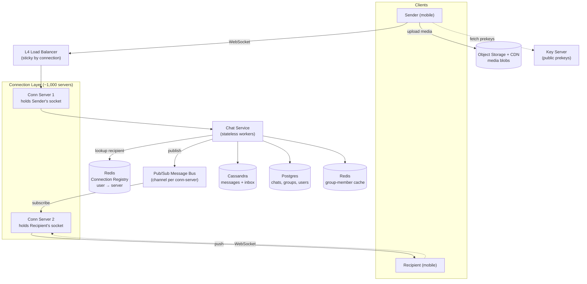
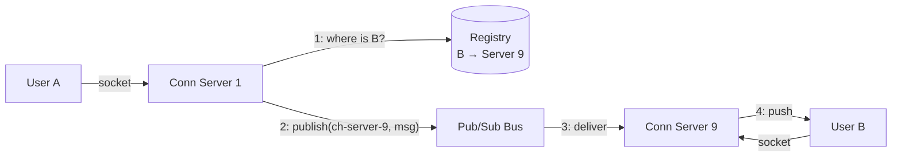
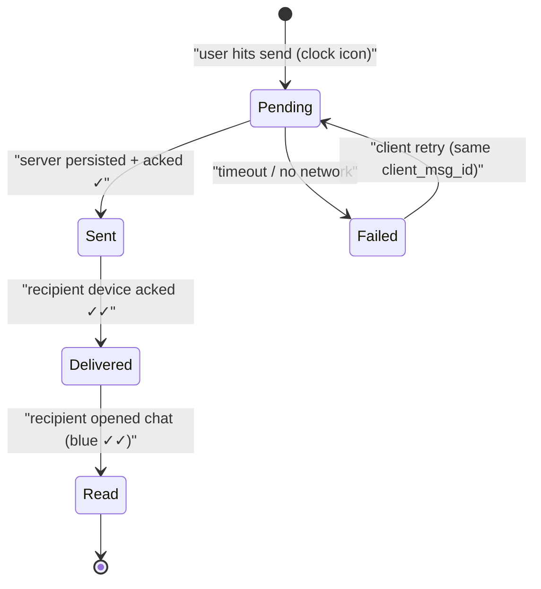
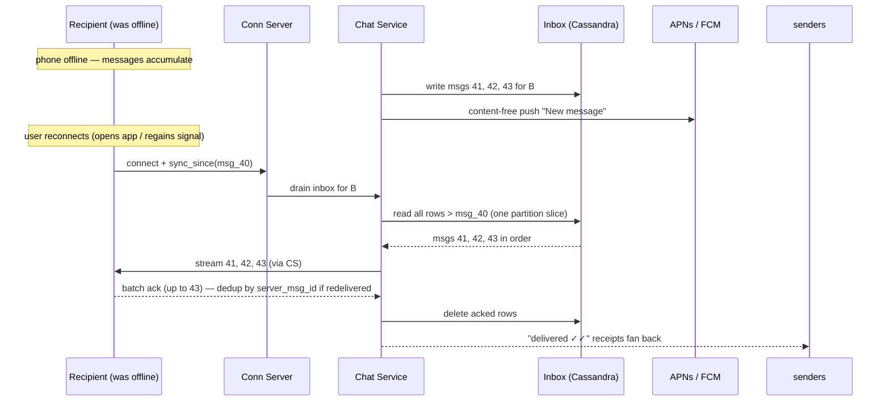
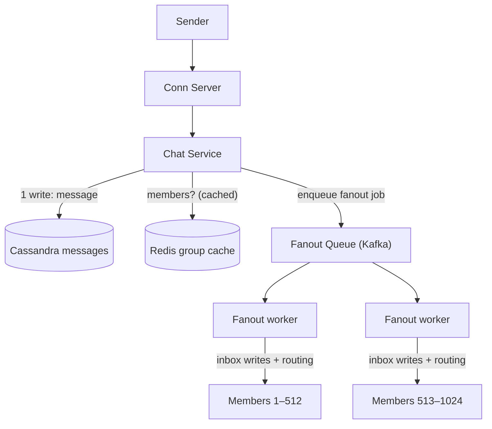
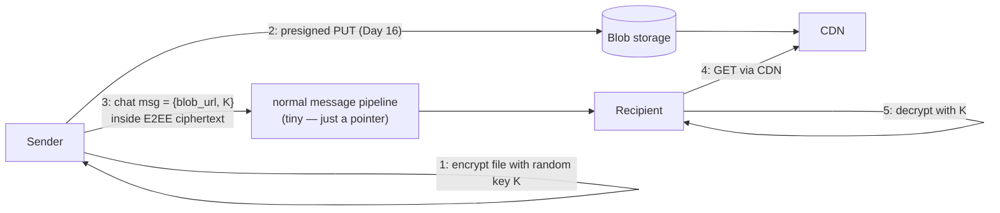
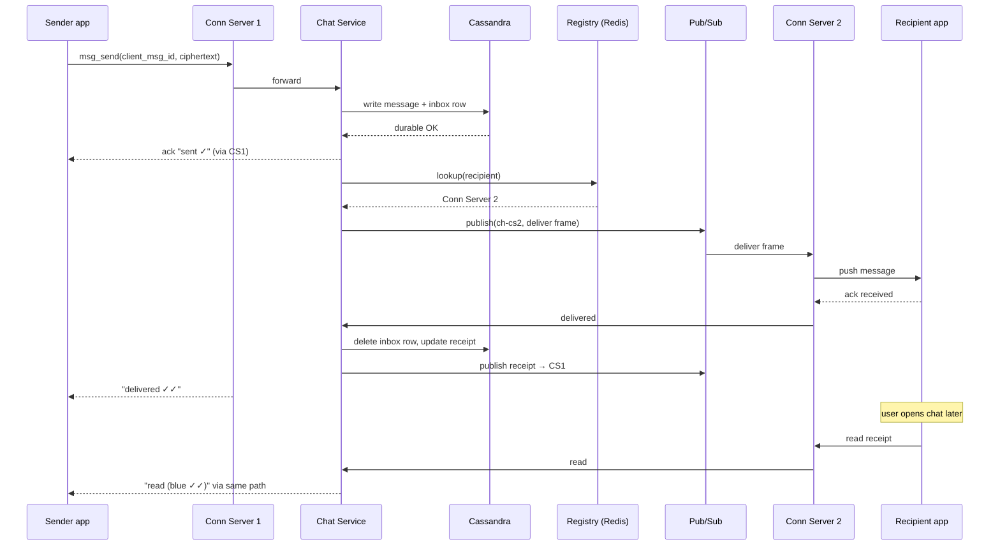

# Day 22 — Design a Chat App (WhatsApp)

> **Week 4: Full Design Practice.** Everything from Weeks 1–3 comes together now. Today we design the most-asked interview question of all time: a 1:1 + group messaging app at WhatsApp scale.

---

## 0) ⏱️ Attempt First

**Stop. Set a 45-minute timer.** Grab a whiteboard or blank doc and design WhatsApp yourself before reading further: requirements → estimates → API → data model → architecture → deep dives. Then come back and compare. The gap between your answer and this one is your study list for the week. Reading a worked solution *feels* like learning; producing one *is* learning.

---

## 1) Requirements Clarification

The first 5 minutes of the interview. Never skip this — scoping is scored.

### Functional — In Scope
- **1:1 messaging** — text messages between two users
- **Group messaging** — up to 1,024 members (WhatsApp's actual current limit)
- **Delivery receipts** — sent (✓), delivered (✓✓), read (blue ✓✓)
- **Online presence** — online now / last seen at HH:MM
- **Offline delivery** — messages sent while recipient is offline arrive when they reconnect
- **Media messages** — images/video (we'll handle via blob storage + URL, not deep-dive)

### Functional — Explicitly Out of Scope (say this out loud)
- Voice/video calls (separate WebRTC design — a whole different interview)
- Stories/status
- Payments
- Multi-device sync (mention it exists; complex — each device is a separate E2EE endpoint)

### Non-Functional Requirements (with targets)
| NFR | Target | Why |
|---|---|---|
| Latency (message delivery, both online) | p50 < 100 ms, p99 < 500 ms | Chat feels "instant" under ~200 ms |
| Availability | 99.99% (≈52 min downtime/year) | Messaging is near-utility infrastructure |
| Consistency | Per-conversation ordering; cross-conversation eventual | Users only notice ordering *within* a chat |
| Durability | No accepted message may ever be lost | Ack ≠ maybe; ack = durable |
| Scale | ~2B users, ~100B messages/day (real WhatsApp ballpark, approx.) | Sets every downstream number |
| Security | End-to-end encrypted — server cannot read content | Product requirement, shapes storage design |

### Concepts from earlier days you'll reuse today
| Earlier concept | Where it shows up in WhatsApp |
|---|---|
| Cache-aside (Day 11) | Group-member lists in Redis in front of the graph DB |
| Consistent hashing (Day 12) | Sharding the connection registry and Cassandra ring |
| Replication & LSM stores (Day 13) | Cassandra for the message firehose, multi-DC inboxes |
| Message queues (Day 14) | Async group fanout; inbox as a per-user durable mailbox |
| Idempotency & outbox (Day 15) | client_msg_id dedup; at-least-once + retry everywhere |
| Presigned uploads (Day 16) | Media goes straight to blob storage, never via chat servers |
| WebSockets (Day 17) | The entire connection layer |
| Backoff & graceful degradation (Day 18) | Reconnect storms; fallback to push-notification path |

---

## 2) Back-of-Envelope Estimates

**In plain words:** Quick napkin math to surface the numbers that drive every later decision — roughly 1.2 million messages per second and 500 million simultaneously open connections. Like sizing a stadium's exits before you draw the seats, these figures decide what technology can even survive the load. Every value here is a rough approximation, and saying so out loud is part of the skill.

Show every step of arithmetic — interviewers score the *process*, not the answer.

### Users & QPS
```
Users:            2B registered, assume 1B DAU (approx. real WhatsApp numbers)
Messages/day:     ~100B  (WhatsApp's publicly cited ballpark)

Average send QPS:
  100e9 msgs / 86,400 s  ≈ 1.16M msgs/sec  → round to ~1.2M writes/sec

Peak QPS (evenings, New Year's Eve spikes):
  peak ≈ 2–3× average    → ~3M msgs/sec design target

Deliveries ≥ sends (group fanout!):
  If avg message reaches 2 recipients (1:1 dominates, groups pull it up),
  delivery QPS ≈ 2 × 1.2M ≈ 2.4M/sec average, ~6M/sec peak
```

### Storage
```
Avg text message: 100 bytes content + ~100 bytes metadata (ids, timestamps,
                  sender, chat_id, status)  ≈ 200 bytes

Per day:   100e9 × 200 B = 20e12 B = 20 TB/day
Per year:  20 TB × 365 ≈ 7.3 PB/year (text alone)

Media: assume 5% of messages carry media at avg 300 KB
  100e9 × 0.05 × 300 KB = 1.5e15 B = 1.5 PB/day  → ~550 PB/year in blob storage
  → media dominates; store in object storage (S3-style), DB holds only URLs
  → WhatsApp historically deletes server-side messages after delivery,
    slashing this — a design decision E2EE makes natural (server is a courier,
    not an archive). We'll keep an inbox with TTL, not a permanent archive.
```

### Connections & Bandwidth
```
Concurrent connections: assume 50% of DAU connected at peak → 500M open sockets
Per connection server (Erlang/epoll-style, mostly idle sockets): ~1–2M conns/box
  (WhatsApp famously hit 2M+ TCP connections on one server, approx.)
  → 500M / 1M ≈ 500 connection servers (plus headroom → ~700–1,000)

Bandwidth (text): 1.2M msg/s × 200 B × 2 (in + out) ≈ 480 MB/s ≈ 3.8 Gbps — trivial
Bandwidth (media): 1.5 PB/day ÷ 86,400 s ≈ 17 GB/s ≈ 140 Gbps — this is why media
  goes through blob storage + CDN, never through chat servers
```

### Cache Sizing (connection registry)
```
Registry: user_id → connection_server_id
  1B entries × (8 B user_id + 8 B server_id + overhead ≈ 50 B) ≈ 50 GB
  → fits in one modest Redis cluster; shard by user_id (consistent hashing, Day 12)
```

---

## 3) API Design

**In plain words:** Ordinary web requests are "ask a question, get one answer," but chat needs an always-open phone line so the server can push a message to you the instant it arrives. This section defines the little messages (frames) that flow both ways over that open line, plus a few normal requests for slower things like login and loading history. Think of the WebSocket as a walkie-talkie left switched on, and REST as texting the front desk when you need something specific.

Chat is **not REST-shaped** — it's a persistent bidirectional connection (WebSockets, Day 17). REST handles the non-realtime edges.

> **🤔 Wait — why WebSockets for chat, why not just poll every second?**
> Polling means every one of a billion devices asks "anything new?" on a timer, and the answer is "no" ~99% of the time — you pay full HTTP request cost for empty responses, drain phone batteries with radio wake-ups, and *still* deliver messages up to a poll-interval late. A WebSocket is one connection held open so the server pushes the instant a message lands: sub-100 ms delivery, near-zero idle cost. The whole reason a "connection layer" exists as a first-class tier is that chat inverts the web's request/response model — the server must initiate.

**✅ Good scenario (where this design choice wins):** At 500M concurrent users, sockets sit idle most of the time and a tuned box holds 1–2M of them on epoll — WhatsApp famously ran 2M+ TCP connections per server. Delivery latency is a push hop, not a poll wait, so p99 stays under 500 ms even at evening peak.

**❌ Bad scenario (when it backfires / the naive alternative):** One-second polling at 1B DAU is ~1B QPS of mostly-empty GETs hammering your LBs and app tier — you burn an order of magnitude more servers to deliver messages *slower*, and mobile radios never sleep, so users notice the battery drain before they notice the lag.

**When NOT to over-do it:** For a low-traffic internal tool or a support widget with a few hundred concurrent users, plain HTTP long-polling or SSE ships in an afternoon and the WebSocket connection-registry machinery is pure over-engineering.

### WebSocket frames (client ↔ connection server)
```jsonc
// client → server: send a message
{
  "type": "msg_send",
  "client_msg_id": "c9f3-…",      // client-generated UUID — the dedup key!
  "chat_id": "chat_8812",
  "to": "user_777",                // or group_id for groups
  "ciphertext": "base64…",         // E2EE: server never sees plaintext
  "media_url": null,
  "sent_at_client": 1768500000123
}

// server → client: ack (message is DURABLE, not just received)
{ "type": "msg_ack", "client_msg_id": "c9f3-…", "server_msg_id": "71bc…", "status": "sent" }

// server → recipient: deliver
{ "type": "msg_deliver", "server_msg_id": "71bc…", "chat_id": "chat_8812",
  "from": "user_123", "ciphertext": "base64…" }

// receipts flowing back
{ "type": "receipt", "server_msg_id": "71bc…", "status": "delivered" }  // or "read"

// presence
{ "type": "heartbeat" }                          // client → server every ~30s
{ "type": "presence", "user": "user_777", "state": "online" }  // server → subscribers
```

### REST endpoints (control plane)
```
POST /v1/auth/verify            { phone, otp } → { jwt }
GET  /v1/chats?cursor=…         → chat list with last message preview
GET  /v1/chats/{id}/messages?before_id=…&limit=50   → history / backfill
POST /v1/groups                 { name, member_ids[] } → { group_id }
POST /v1/media/upload-url       { mime, size } → { presigned_url, media_id }
GET  /v1/keys/{user_id}         → public identity/prekeys (E2EE key server)
```

---

## 4) Data Model

**In plain words:** This maps out where each piece of data lives and why. The firehose of messages pours into Cassandra, which is built to swallow enormous write volumes, while fast-changing lookups like "who's online" and "which server holds this user's socket" live in Redis. Think of Cassandra as the warehouse of record and Redis as the sticky notes you keep refreshing on the wall.

### `messages` — Cassandra-style wide-column store (the big one)
| Field | Type | Notes |
|---|---|---|
| chat_id | uuid | **partition key** — all of one chat lives together |
| message_id | timeuuid | **clustering key, DESC** — time-ordered within partition |
| sender_id | bigint | |
| ciphertext | blob | E2EE payload; server can't read it |
| media_url | text | nullable, points to blob store |
| created_at | timestamp | |

**Why Cassandra (wide-column)?** From Day 13: write-optimized LSM trees soak up 1.2M+ writes/sec; linear horizontal scaling; the access pattern is exactly one query shape — "give me recent messages for chat X" — which is a single-partition slice scan. No joins, no ad-hoc queries, tunable consistency (write LOCAL_QUORUM). A relational DB dies here on write throughput and sharding pain.

> **🤔 Wait — why Cassandra for messages instead of a sharded Postgres cluster?**
> The instinct is "I know SQL, I'll just shard Postgres" — but a B-tree store fights you at 1.2M sustained writes/sec because random-write index maintenance and vacuum can't keep pace, and you'd hand-roll the sharding, rebalancing, and multi-DC replication that Cassandra gives you natively. Chat has exactly one query shape — recent messages for a chat_id — with no joins and no ad-hoc analytics, so the relational feature set is dead weight. Cassandra's LSM design turns writes into sequential appends and scales linearly by adding nodes to the ring.

**✅ Good scenario (where this design choice wins):** The message firehose is append-heavy and read-by-partition — write LOCAL_QUORUM, read one partition slice, add nodes to the ring as volume grows. At WhatsApp's ~100B messages/day this is the difference between an operable cluster and an on-call team fighting Postgres write amplification every single night.

**❌ Bad scenario (when it backfires / the naive alternative):** Sharded Postgres at this write rate means manual resharding as chats grow, cross-shard queries for anything unexpected, and replication lag that corrupts per-conversation ordering — plus you inherit vacuum storms and connection-pool exhaustion under the same 1.2M writes/sec that Cassandra shrugs off.

**When NOT to over-do it:** A team-chat product with a few thousand users and millions of messages *total* fits comfortably in one Postgres instance — reach for Cassandra only once the derived write QPS actually demands linear scale-out, or you've bought operational pain you don't need.

**Hot partition caveat:** a 1,024-member megagroup chat_id can get hot. Mitigate by bucketing: partition key = `(chat_id, day_bucket)`.

### `inbox` — per-user offline queue (Cassandra or Redis Streams)
| Field | Type | Notes |
|---|---|---|
| user_id | bigint | partition key |
| message_id | timeuuid | clustering key |
| payload | blob | full deliverable frame |
| ttl | — | e.g., 30 days, then message expires undelivered |

### `chats`, `group_members` — relational (Postgres) or Cassandra
| Table | Key fields | Why |
|---|---|---|
| chats | chat_id, type (1:1/group), created_at | low write rate, needs integrity |
| group_members | group_id → [user_id, role, joined_at] | read on every group fanout — cache it (cache-aside, Day 11) |

### `connection_registry` — Redis (ephemeral)
```
key:   user:{user_id}:conn   →   value: {server_id, connected_at}
TTL refreshed by heartbeats — self-healing if a connection server dies
```

### `presence` — Redis
```
key: presence:{user_id} → {state: online|offline, last_seen: ts}, TTL ~60s
```

---

## 5) High-Level Architecture

**In plain words:** The big picture: everyone holds an open connection to some server, a registry remembers which server holds whom, and a message bus routes a message from one server to another. It's like a postal system where mailboxes (sockets) sit at the edges, a directory tells you which post office is holding a given person, and trucks (the bus) carry mail between offices. Durability lives in Cassandra so that even if a post office burns down, no mail is lost.


*The spine of the design: sockets at the edge, a registry to find them, a bus to route between them, Cassandra for durability.*

### Main flow walkthrough (follow the diagram)
1. **Connect:** Sender opens a WebSocket through the L4 LB to **Conn Server 1**, which writes `user:sender → CS1` into the **Registry** (TTL-refreshed by heartbeats).
2. **Send:** Sender emits `msg_send` with a client-generated `client_msg_id`. CS1 forwards to a stateless **Chat Service** worker.
3. **Persist first:** Chat Service writes the message to **Cassandra** (messages table + recipient's inbox row) — *then* acks `sent ✓` back to the sender. Durability before ack, always.
4. **Route:** Chat Service asks the **Registry** where the recipient's socket lives → CS2. It publishes the deliver-frame on the **Pub/Sub bus** channel for CS2.
5. **Deliver:** CS2 pushes the frame down the recipient's socket. Recipient's client acks → `delivered ✓✓` receipt flows back along the reverse path; inbox row deleted.
6. **Offline?** Registry lookup misses → message just stays in the inbox; a push notification (APNs/FCM) nudges the device. On reconnect, the client drains its inbox.
7. **Media:** never traverses this path — client uploads to blob storage via presigned URL (Day 16 pattern), sends only the URL + decryption key inside the E2EE payload.

---

## 6) Deep Dives

### 6.1 The connection layer & message routing — *the* hard part

**In plain words:** When millions of people each hold an open line to one of a thousand servers, the puzzle is: when A messages B, which server is holding B's line? We keep a phone-book (the connection registry) mapping each user to their server, look B up, and hand the message to that server through a shared bus. It's exactly like a company switchboard figuring out which desk phone to ring instead of shouting down every hallway.

**Problem:** HTTP is request/response; the server can't push. So every online user holds a **persistent WebSocket** to some connection server. With 500M concurrent sockets across ~1,000 servers, the core question becomes: *when user A messages user B, which server holds B's socket?*

**Answer: the connection registry.** On connect, the server registers itself; on message send, we look it up; delivery hops server-to-server via pub/sub.


*Cross-server routing: registry lookup, then one pub/sub hop — never a full broadcast.*

> **🤔 Wait — why route through a pub/sub bus instead of just RPC-ing the target conn server directly?**
> Direct RPC sounds simpler until you count the connections: 1,000 conn servers each needing a live link to the other 999 is a ~1,000×1,000 mesh that every server must track, health-check, and reconnect. The bus collapses that to one subscription per server (its own channel), and it absorbs fan-in bursts and transient slowness without the sender managing back-pressure. Conn servers stay disposable — when one dies, subscribers just stop reading a dead channel; nobody's RPC client pool has to notice.

**✅ Good scenario (where this design choice wins):** A recipient's server is briefly slow or mid-deploy; the bus buffers the deliver frame instead of blocking the sender's thread on a hung RPC. Adding 200 more conn servers during a growth spike needs zero mesh reconfiguration — they subscribe to their channel and start receiving.

**❌ Bad scenario (when it backfires / the naive alternative):** A full RPC mesh means one flapping server spreads connection-reset storms across all 1,000 peers, and a deploy that cycles servers triggers a thundering herd of reconnect attempts through everyone's client pools — the exact O(N²) coordination problem the bus exists to erase.

**When NOT to over-do it:** With a handful of conn servers in one region, a small direct-connection mesh (or even a shared Redis the servers poll) is fine — the bus tier earns its keep only once server count and cross-server hops make an N² mesh unmanageable.

Design details worth saying in the interview:
- **Why pub/sub and not direct RPC between servers?** Decoupling: senders don't manage a mesh of 1,000×1,000 connections; the bus handles fan-in/fan-out and buffering. Each conn server subscribes to exactly one channel (its own).
- **Registry entries carry a TTL** refreshed by heartbeats. If Conn Server 9 dies, its entries expire, clients reconnect elsewhere (LB spreads them), and re-register. Self-healing, no coordinated cleanup.
- **Connection servers are stateful but disposable** — the only state is the socket itself. All durable state lives in Cassandra. Losing a conn server = a reconnect storm, not data loss. (Handle reconnect storms with jittered exponential backoff on the client, Day 18.)
- **Shard the registry** by user_id with consistent hashing (Day 12) so no single Redis node owns all lookups.

### 6.2 Delivery guarantees & the receipts state machine

**In plain words:** Those little check-marks (sent, delivered, read) are really a status ladder, and each rung is an acknowledgement traveling back to the sender. "Sent" only means the server safely stored the message, not that your friend received it. It's just like package tracking: "we have it," then "out for delivery," then "delivered to the door."

> **🤔 Wait — why persist the message before sending the "sent ✓" ack, instead of acking first for lower latency?**
> Because the ✓ is a *promise of durability*, not "I received your bytes." If you ack first and the chat service crashes before the Cassandra write commits, the user sees a checkmark for a message that no longer exists anywhere — the one bug that destroys trust in a messaging app. The durable write costs ~10 ms, which is invisible next to the human send gesture; a silently-lost "sent" message is not.

**✅ Good scenario (where this design choice wins):** A conn server or chat worker gets OOM-killed one millisecond after the durable write returns — the message is safe in Cassandra, redelivery is automatic, and the user's ✓ told the truth. This is the invariant that lets you page an on-call engineer about latency but never about "vanished messages."

**❌ Bad scenario (when it backfires / the naive alternative):** Ack-then-persist shaves a few ms until a deploy or crash lands in the gap between ack and commit — now a subset of users have checkmarks on messages the recipient never got and support can't explain, an incident class that's invisible in dashboards and corrosive to the product.

**When NOT to over-do it:** For an ephemeral typing indicator or a "user is online" ping, persisting first is pointless — those are fire-and-forget frames where loss is invisible; reserve persist-then-ack for anything whose loss a user would notice.


*Every tick the user sees is an edge in this machine — and every edge is an ack traveling backwards.*

- **Sent ✓** = the *server* durably stored it. Not "recipient got it."
- **Delivered ✓✓** = the recipient's *device* acked receipt.
- **Read** = recipient viewed the chat; receipt sent (unless privacy-disabled).
- Receipts are just tiny messages flowing the reverse direction through the same pipes.
- For groups: per-member delivery states; the UI shows ✓✓ only when **all** members delivered (aggregate in the inbox/receipts table).

### ☠️ The dark side: exactly-once delivery is an illusion
Every network hop can time out *after* succeeding. If the client sends, the server persists, and the ack packet is lost — the client retries, and now the server has it twice. You cannot build exactly-once transport. **The real recipe (Day 15's idempotency lesson): at-least-once delivery + client-side dedup by `client_msg_id`.** The client generates the UUID, retries with the *same* ID, and both server and recipient treat message_id as an idempotency key — duplicates are silently dropped. Same on the delivery side: if the recipient's ack is lost, the server redelivers, and the recipient's client dedups by `server_msg_id`. Anyone who claims "exactly-once" in an interview without saying "effectively-once via idempotent retry" gets a follow-up question they won't enjoy.

### 6.3 Offline delivery — the per-user inbox

**In plain words:** If your friend's phone is off, the message can't be handed over live, so it waits in a personal mailbox until they reconnect and drain it. It's like leaving a voicemail: it sits safely on the server and plays back the moment they're reachable again. Crucially, we store the message *before* even attempting delivery, so nothing is ever lost just because someone was offline.

When the registry lookup misses (recipient offline):
1. Message is already in the recipient's **inbox partition** in Cassandra (we write it *before* the routing attempt — persistence isn't conditional on presence).
2. Fire a **push notification** via APNs/FCM ("New message" — content-free because of E2EE).
3. On reconnect, the client sends `sync_since(last_seen_message_id)`; the server streams the inbox in order; client acks in batches; acked rows are deleted.
4. **TTL on inbox rows** (e.g., 30 days): undelivered messages eventually expire — matching WhatsApp's courier model where the server is a relay, not an archive.


*Reconnect-and-drain: the inbox is one Cassandra partition slice, acked in batches, deleted after — at-least-once with client dedup, as always.*

This is the same *durable queue per consumer* idea as Day 14's message queues — the inbox is a mailbox, drain-on-connect, with at-least-once + dedup semantics.

### 6.4 Group messaging fanout

**In plain words:** One message to a 1,000-person group becomes up to 1,000 separate deliveries. We do that copying in the background behind a queue so the sender gets their checkmark instantly instead of waiting for all thousand to finish. It's like dropping a letter in a mailbox and walking away while the post office handles duplicating and distributing it.

> **🤔 Wait — why push group fanout onto an async queue instead of just delivering to all members inline?**
> If the send path loops over 1,024 members doing inbox writes and registry lookups before acking, the sender's ✓ is hostage to the *slowest* member's write — send latency becomes O(group size). The queue lets you make one durable write, ack immediately, and let a pool of fanout workers do the O(N) copying in the background. Sender latency stays flat whether the group has 3 members or 1,024.

**✅ Good scenario (where this design choice wins):** A 1,024-member group message acks in ~10 ms because the send path does one write and enqueues a job; workers fan out in parallel and lag is a metric you watch, not latency the sender feels. You can scale fanout throughput by adding workers without touching the latency-sensitive send path.

**❌ Bad scenario (when it backfires / the naive alternative):** Inline fanout means a message to a big, active group blocks for seconds while it writes 1,024 inboxes — and one hot member shard or a slow registry lookup stalls the whole send, so the sender stares at a spinner. This is the classic celebrity/megagroup fan-out blowup where write latency scales with audience size.

**When NOT to over-do it:** For 1:1 chats and tiny groups (a handful of members), inline delivery is simpler and the queue is overhead — introduce async fanout at the size where O(members) per message actually threatens your send-latency SLO.


*One send becomes up to 1,024 deliveries — do it async behind a queue, never inline in the send path.*

- Sender's ack returns after **one** durable write; fanout happens asynchronously (the queue decouples send latency from group size — Day 14).
- Group member list is read on *every* group message → classic cache-aside (Day 11) in Redis, invalidated on membership change.
- Why cap groups at ~1,024? Fanout cost is O(members) *per message*. Beyond that you're building broadcast/channels — a different product with pull-based reads (foreshadowing tomorrow's fanout-on-read lesson in Day 23).
- E2EE wrinkle: naive pairwise encryption = encrypt 1,024 times per message. Signal's **sender-keys** scheme fixes this: one symmetric sender key per group member per group, distributed pairwise once, then each message encrypted once.

### 6.5 Presence — online / last seen

**In plain words:** The phone quietly sends a "still here" heartbeat every ~30 seconds; if the beats stop coming, we mark the user offline with their last heartbeat as "last seen." To avoid spamming everyone, we only tell the people currently looking at that person's chat. It's like a "currently online" dot that only your open conversations bother to watch, rather than announcing your status to your entire contact list.

> **🤔 Wait — why not just broadcast a presence update to all of a user's contacts when they come online?**
> On a flaky mobile network a user flaps online/offline every few seconds, and someone with 500 contacts would trigger a 500-way fan-out *per flap* — multiply by a billion users on trains and in elevators and presence alone becomes a bigger firehose than the actual messages. Almost nobody is looking at a given person's status at any moment, so the broadcast is wasted. Instead we publish presence only to users *currently viewing* a chat with that person (subscribe-on-open, unsubscribe-on-close), and debounce flaps with a grace window.

**✅ Good scenario (where this design choice wins):** Presence traffic scales with *open chat windows*, not contact-list size — typically a tiny fraction of contacts — so a train full of flapping phones costs almost nothing, and the 5–10 s debounce hides the flapping entirely.

**❌ Bad scenario (when it backfires / the naive alternative):** Broadcast-to-all-contacts turns one radio reconnect into an O(contacts) fan-out storm; at scale, presence updates drown the message bus, and the very users on the worst networks generate the most flap traffic — a self-inflicted DDoS that has taken real presence systems down.

**When NOT to over-do it:** In a small team app where everyone's roster is a handful of people, broadcasting presence to all contacts is perfectly fine — the subscription-on-open machinery only pays off once contact lists are large and flap-prone at mobile scale.

- Client heartbeats every ~30 s over the existing socket (nearly free).
- `presence:{user_id}` in Redis with a ~60 s TTL. Heartbeat refreshes; missed heartbeats → key expires → user reads as offline with `last_seen` = last heartbeat time.
- **Don't broadcast presence to everyone** — that's an O(contacts) fanout per flap. Publish presence changes only to users *currently viewing* a chat with that person (subscription-on-open, unsubscribe-on-close). Debounce flapping (mobile networks!) with a 5–10 s grace window before flipping to offline.

### 6.6 End-to-end encryption (concept level — 2 minutes max in an interview)

**In plain words:** Messages are locked so that only the sender and recipient hold the keys — the server just ferries sealed envelopes it cannot open. It's like mailing a locked box: the postal service moves it but never has the key. The big consequence is that the server can't read, search, or spam-filter message content, which reshapes how everything downstream is stored.

- Every device generates a keypair; **public prekeys** live on the key server, private keys never leave the device.
- Sender fetches recipient's prekey bundle, runs a Diffie–Hellman-style exchange (Signal protocol: X3DH + Double Ratchet) to derive a shared session key — *without the server ever knowing it*.
- The server routes **ciphertext blobs**. It sees metadata (who, whom, when, size) but never content.
- Design consequences (this is why interviewers ask): server-side search is impossible, server-side spam filtering must use metadata only, backups become a client-side problem, and storing messages long-term server-side buys nothing — hence the courier/TTL model.

### 6.7 Media messages end-to-end

**In plain words:** Photos and videos are far too big to shove through the chat pipe, so the sender uploads them straight to blob storage/CDN and sends only a tiny link (plus a decryption key) through chat. It's like texting a link to a shared photo album instead of the whole album. The file is encrypted before upload, so even the CDN holding it can't peek inside.

Recall §2: media is ~140 Gbps sustained while text is ~4 Gbps — so media must bypass the chat pipeline entirely.


*The chat system carries a 200-byte pointer; the CDN carries the 3 MB photo — and because the blob is encrypted client-side with a key only inside the E2EE envelope, even the CDN can't view it.*

Details worth a sentence each in the interview: the client encrypts the blob with a fresh random key **before** upload, so blob storage/CDN hold ciphertext (E2EE preserved end-to-end); forwarding a viral video re-sends only `{url, K}` — the blob uploads once (WhatsApp really does content-address media to dedupe the 10,000th forward of the same meme); thumbnails travel inline in the message (a few KB) so chats render instantly while full media lazy-loads; and media gets its own TTL/GC lifecycle in blob storage, independent of message rows.

---

## 7) Sequence Diagram — 1:1 Message with Receipts


*The golden path: durability before ack, registry before routing, receipts as reverse-direction messages.*

---

## 8) Bottlenecks & Evolution

**What breaks at 10× (10B DAU-equivalents / 1T msgs/day)?**
- **Registry lookup volume** (~every message) → shard harder; co-locate registry shards with conn-server pods; consider gossip/local caching of hot entries.
- **Pub/sub bus throughput** → partition the bus by conn-server groups; regional buses with a thin inter-region bridge.
- **Cassandra hot partitions** on megagroups → day-bucketed partition keys; dedicated cluster for group traffic.
- **Reconnect storms** after a regional outage: 100M devices reconnecting at once will DDoS you — client-side jittered backoff (Day 18) + LB admission control are mandatory, not optional.

**Single points of failure to call out:**
- The registry: run Redis Cluster with replicas; on total loss, entries rebuild organically from heartbeats within ~60 s (graceful degradation: fall back to inbox + push notification path).
- Cross-region: users connect to the nearest region; the registry is region-local; inter-region messages hop via a global routing tier. Inboxes replicate cross-region (Cassandra multi-DC) for disaster recovery.

**What to instrument (say this — it separates operators from architects):**
- End-to-end delivery latency (send → delivered receipt), p50/p99, per region
- Inbox depth distribution — a growing p99 inbox means delivery is silently failing for someone
- Registry hit rate on lookups (misses = offline sends; a sudden spike = conn-server deaths)
- Concurrent connections per server + reconnect rate (the storm early-warning metric)
- Fanout queue lag — group messages arriving minutes late show up here first

**Next steps if the interview continues:** multi-device sync (each device = separate E2EE session + per-device inbox), typing indicators (fire-and-forget, no persistence), spam/abuse on metadata, message search (client-side only, thanks to E2EE).

---

## 9) Trade-offs Summary

| Decision | Alternative rejected | Why |
|---|---|---|
| WebSockets, persistent conns | HTTP long-polling | Push latency + connection churn at 500M users; polling wastes battery & servers |
| Cassandra for messages | Sharded Postgres | 1.2M+ writes/sec, one query shape, linear scaling; SQL adds cost with no benefit here |
| Persist-then-ack | Ack-then-persist (faster) | An acked-but-lost message destroys trust; +10 ms is invisible |
| At-least-once + client dedup | Chasing exactly-once transport | Exactly-once transport is impossible; idempotency keys are cheap |
| Async queue for group fanout | Inline fanout on send path | Send latency must not depend on group size |
| Server as courier (inbox TTL) | Permanent server archive | E2EE makes server archive low-value; slashes storage ~10× |
| Redis registry w/ heartbeat TTL | Registry in strongly-consistent store (etcd) | Staleness self-heals in seconds; etcd can't take this write rate |
| Sender keys for group E2EE | Pairwise encrypt × N members | O(1) encryptions per message instead of O(N) |

---

## 10) Interview Calibration — Junior vs Senior

**A junior answer** draws client → LB → "chat server" → MySQL, uses REST POST /messages with recipients polling GET /messages every second, stores everything in one relational table, and says "we'll add Redis for speed." When asked how the recipient gets the message instantly, they discover polling; when asked about two servers, they discover the routing problem live. No numbers, no failure modes.

**A senior answer** leads with the estimate that shapes everything (1.2M writes/sec → LSM store; 500M sockets → connection layer as a first-class tier), names the connection-registry problem *before* being asked, states "persist-then-ack" as a principle, volunteers that exactly-once is an illusion and gives the idempotency-key fix, treats group fanout as an async job with a cache in front of the member list, and knows *why* E2EE changes the storage story (courier model). They mention what they cut (calls, multi-device) and what breaks at 10×. The delta isn't vocabulary — it's that every component exists *because a number or a failure mode demanded it*.

**Suggested 45-minute pacing for this problem:**
| Minutes | Spend them on |
|---|---|
| 0–5 | Requirements + explicit out-of-scope (calls, multi-device) |
| 5–10 | Estimates — land the two shaping numbers: 1.2M writes/sec, 500M sockets |
| 10–15 | API frames + data model (Cassandra choice justified by the write number) |
| 15–25 | Architecture diagram + golden-path walkthrough (connect → send → persist → route → deliver) |
| 25–38 | Deep dives, in priority order: connection registry/routing → delivery guarantees + dedup → offline inbox → group fanout |
| 38–43 | Presence + E2EE at concept level (2 min each — don't drown here) |
| 43–45 | Bottlenecks at 10× + what you'd tackle next |

**Common mistakes checklist (all real, all fatal to the round):**
- Polling for message delivery instead of persistent connections
- Ack before persist ("it's faster") — until the interviewer asks about a crash
- One global "chat server" with no answer for which server holds whose socket
- Claiming exactly-once delivery without idempotency keys
- Fanout to 1,024 group members inline in the send path
- Designing message search server-side after declaring E2EE
- No numbers: proposing Cassandra "for scale" without deriving the write QPS that requires it

**Rapid-fire follow-ups to rehearse (30-second answers each):**
- "How would you add typing indicators?" — fire-and-forget frames over the existing sockets, no persistence, throttled to 1/2s; loss is invisible.
- "Message ordering across devices?" — server-assigned timeuuid is the order of record; client timestamps are hints only (clocks lie).
- "How do you migrate a conn server for deploys?" — drain: stop accepting, push a reconnect frame, clients reconnect with backoff; registry entries roll over naturally.
- "What if Redis registry returns a stale server?" — publish lands on a channel nobody's reading for that user; delivery falls back to inbox + push. Staleness costs latency, never loss.
- "Why not Kafka for the pub/sub hop?" — fine choice; you need low-latency fanout more than replayability, so Redis pub/sub / NATS is lighter. Know both answers.

---

## 11) Self-Check Questions

1. Why must the server persist the message *before* sending the "sent ✓" ack? What user-visible bug appears if you flip the order?
2. User B's connection server crashes mid-delivery. Walk through exactly how the message still arrives, naming every component involved.
3. Why is exactly-once delivery impossible, and what two ingredients replace it? Where does the dedup key come from?
4. Why Cassandra partition-by-chat_id rather than partition-by-user_id for the messages table? What query gets slower with your choice?
5. Your 1,024-member group takes 4 seconds before the sender sees ✓. Which component did the designer wire wrong?
6. Presence shows a user flapping online/offline every 10 seconds on a train. What two mechanisms smooth this?
7. Why does E2EE make server-side message search impossible, and where does search live instead?
8. Compute: at 300B messages/day, what's the average write QPS and the peak (2.5×) — and does one Redis registry node survive the lookups?
9. A user forwards a 5 MB video to 20 chats. How many bytes traverse the message pipeline, and how many hit blob storage? What mechanism makes the second number what it is?
10. Sketch the receipts state machine from memory, then answer: in a 500-member group, what has to be true before the sender sees ✓✓?

---

*Previous: Day 21 — Interview Framework Dry Run · Next: Day 23 — Design a News Feed (Twitter/Instagram)*
