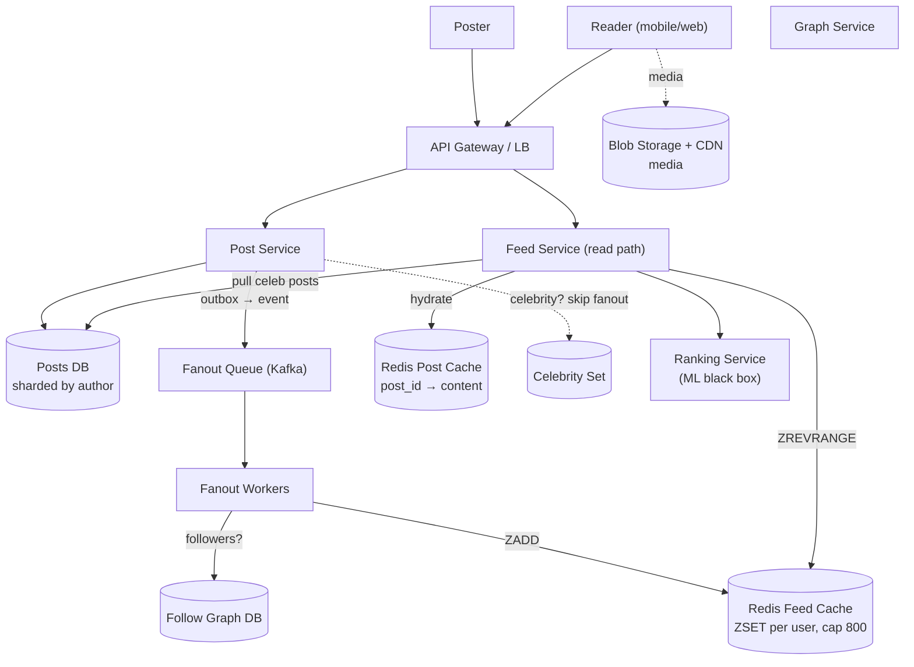
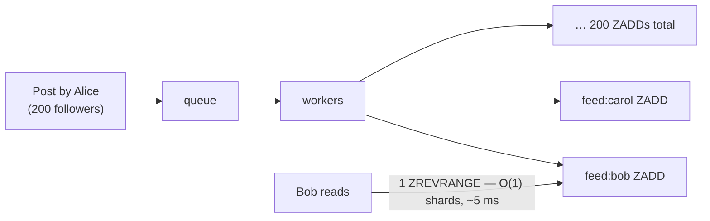
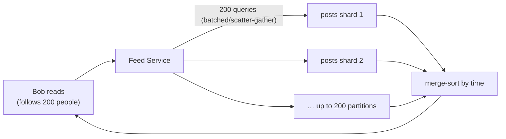
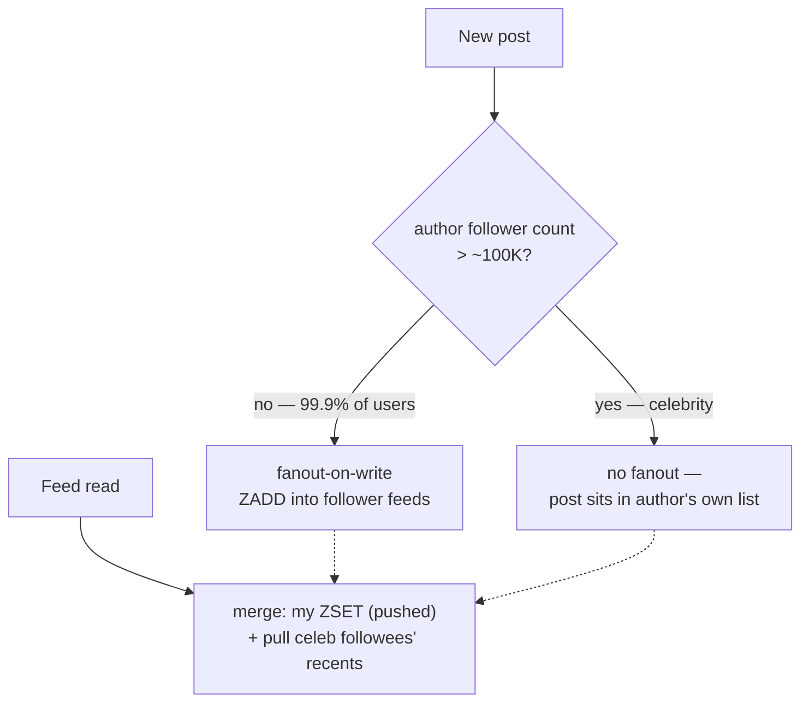
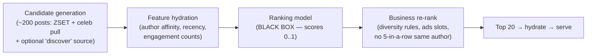
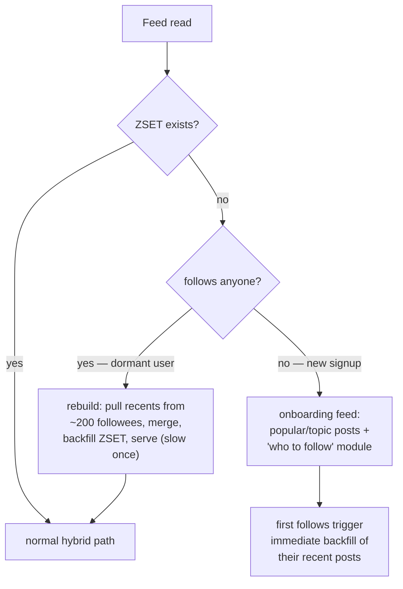
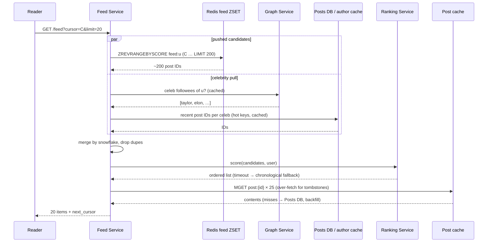

# Day 23 — Design a News Feed (Twitter/Instagram)

> **Week 4: Full Design Practice.** Yesterday's chat app was about *routing one message to one recipient*. Today flips the ratio: one post, potentially 100 million readers. The news feed is the canonical read-heavy, fanout-dominated design — and it contains the single most famous trade-off in system design interviews.

---

## 0) ⏱️ Attempt First

**Stop. 45-minute timer.** Design Twitter's home timeline yourself: requirements → estimates → API → data model → architecture → deep dives. Force yourself to answer one question before reading on: *when Taylor Swift tweets to 100M followers, what exactly happens, and when?* If your answer is "we write it to 100M feeds," or "we query 100M timelines at read," you're about to learn why both are wrong. Come back when the timer rings.

---

## 1) Requirements Clarification

### Functional — In Scope
- **Post** — text ≤ 280 chars, optional media (image/video via blob storage URL)
- **Follow / unfollow** — directed graph, no approval needed
- **Home feed** — a user's timeline of posts from people they follow, paginated, latest-ish first
- **Feed ranking hook** — support ranked ordering later (v1 ships chronological — see the dark side)
- **Likes / reply counts on feed items** — displayed, but the interaction system itself is out of scope

### Functional — Explicitly Out of Scope
- Search & trending (separate inverted-index design)
- DMs (that was Day 22)
- Notifications, ads (mention where they'd slot in)
- The ML ranking model internals (we place the pipeline; the model is a black box)

### Non-Functional Requirements
| NFR | Target | Why |
|---|---|---|
| Feed load latency | p50 < 200 ms, p99 < 800 ms | The feed *is* the product; slow feed = closed app |
| Post visibility delay | seconds acceptable (eventual consistency) | Nobody notices a tweet arriving 5 s "late" |
| Availability | 99.99% for reads; posts may degrade first | Read path is sacred; a stale feed beats no feed |
| Read:write ratio | ~100:1 or worse | Everyone scrolls; few post — this ratio drives the whole design |
| Scale | ~500M DAU, ~200M posts/day (Twitter-ish ballpark, approx.) | |
| Durability | Posts never lost; materialized feeds are rebuildable | Key asymmetry: feeds are a *cache*, posts are *truth* |

### Concepts from earlier days you'll reuse today
| Earlier concept | Where it shows up in the feed |
|---|---|
| Cache-aside + hot keys (Day 11) | Post-content hydration cache; viral-post hot-key replication |
| Consistent hashing (Day 12) | Sharding the Redis feed cluster by user_id |
| Sharding & replication (Day 13) | Posts DB sharded by author; graph tables sharded per access pattern |
| Queues & consumer groups (Day 14) | Fanout workers consuming the post-event stream |
| Outbox & idempotency (Day 15) | Post-created events; ZADD's natural idempotence under redelivery |
| Cursor pagination (Day 16) | Snowflake-ID cursors instead of offsets |
| Graceful degradation (Day 18) | Ranking timeout → chronological fallback; cache loss → rebuild-on-read |

---

## 2) Back-of-Envelope Estimates

**In plain words:** Before designing anything, we do quick napkin math to surface the number that shapes every choice — here, that reads outnumber writes by roughly 250 to 1. It's like planning a restaurant by first estimating how many diners you'll serve versus how many cooks you'll have: the ratio tells you where to spend your effort. Everything below is a rough approximation, and that's fine — the goal is the order of magnitude, not the decimal.

### QPS
```
DAU:              500M
Posts/day:        200M   →  200e6 / 86,400 ≈ 2,300 posts/sec avg
                            peak ≈ 3×      ≈ 7,000 posts/sec

Feed loads:       assume each DAU opens the feed 5×/day
                  500M × 5 = 2.5B feed loads/day
                  2.5e9 / 86,400 ≈ 29,000 feed reads/sec avg
                  peak ≈ 3×     ≈ ~90,000 feed reads/sec

Read:write ratio: 29,000 / 2,300 ≈ 12:1 at the feed level — but each feed READ
                  displays ~20 posts, so post-views/sec ≈ 580,000. The system
                  serves ~250 views for every 1 post written. Optimize for reads.
```

### Storage
```
Post row: 280 chars ≈ 280 B text + ~120 B metadata (ids, ts, counts) ≈ 400 B
Per year: 200e6 posts/day × 400 B × 365 ≈ 29.2 TB/year (text — tiny!)
Media:    30% of posts × 200 KB avg = 200e6 × 0.3 × 200 KB = 12 TB/day
          → ~4.4 PB/year in object storage + CDN. Media dwarfs text (again).
Follow graph: 500M users × avg 200 follows × 16 B/edge ≈ 1.6 TB — fits a
          sharded store easily; hot in cache.
```

### Feed Cache Sizing (this math impresses interviewers)
```
Materialized feed per user: cap at 800 post IDs (Twitter's real historical cap)
Entry: 8 B post_id + 8 B score/timestamp = 16 B
Per user: 800 × 16 B = 12.8 KB
Active users cached (DAU only): 500M × 12.8 KB = 6.4 TB
→ Redis cluster: ~30–50 nodes at 128–256 GB each. Feasible. This number is WHY
  fanout-on-write is affordable — because we cap feed length and cache only IDs,
  hydrating post content separately.
```

### Fanout Write Volume
```
Avg followers per user: ~200 (median is far lower; mean dragged up by celebs)
Fanout writes/sec = 2,300 posts/sec × 200 followers = 460,000 feed-writes/sec avg,
                    ~1.4M/sec peak — Redis can take this, but a single celebrity
                    post is 100M writes for ONE tweet. Hold that thought (§6.1).
```

---

## 3) API Design

**In plain words:** This is the menu of requests a client can make — create a post, load your feed, follow someone. The one detail to notice is that loading the feed uses a "cursor" (a bookmark that says "give me posts older than this one") instead of page numbers, because the feed is constantly gaining new items at the top. Page numbers would be like bookmarking a book while someone keeps inserting pages at the front.

```jsonc
// Create a post
POST /v1/posts
{ "text": "hello world", "media_ids": ["m_123"], "client_token": "uuid-…" }  // idempotency key (Day 15)
→ 201 { "post_id": "1746329841234567890", "created_at": "…" }               // snowflake ID — see §6.4

// Home feed — cursor paginated, never offset paginated
GET /v1/feed?cursor=1746329841234567890&limit=20
→ 200 {
    "items": [ { "post_id": "…", "author": {…}, "text": "…",
                 "media_url": "…", "like_count": 4213, "created_at": "…" } ],
    "next_cursor": "1746300012345678901"    // opaque to clients
  }

// Graph
POST   /v1/users/{id}/follow
DELETE /v1/users/{id}/follow
GET    /v1/users/{id}/followers?cursor=…      // paginated — can be 100M long!

// A user's own posts (profile page — also the celebrity pull source)
GET /v1/users/{id}/posts?cursor=…&limit=20
```

Notes: feed reads are cursor-based because offset pagination breaks when new items are prepended (Day 16). Post creation carries a client idempotency token so a double-tap doesn't double-post.

---

## 4) Data Model

**In plain words:** This is where each kind of data lives and why. Posts are the permanent truth, kept safely in a database, while feeds are just fast-access copies kept in Redis that we can throw away and rebuild anytime. Think of posts as the original documents locked in a vault and feeds as the sticky notes on your desk — lose a sticky note and you just re-copy it from the vault.

### `posts` — source of truth (sharded MySQL/Postgres *or* Cassandra)
| Field | Type | Notes |
|---|---|---|
| post_id | bigint (snowflake) | time-sortable — doubles as cursor |
| author_id | bigint | shard key (all of a user's posts together → profile reads are one shard) |
| text | varchar(280) | |
| media_url | text | blob storage pointer |
| like_count, reply_count | int | denormalized, updated async |
| created_at | timestamp | |

**Why sharded SQL is fine here:** 2,300 writes/sec is modest; posts are immutable-ish; sharding by author_id makes profile pages single-shard. Twitter really did run timelines off sharded MySQL for years. Cassandra also works — the point is the *shape*, not the brand.

### `follows` — the graph
| Field | Notes |
|---|---|
| follower_id, followee_id, created_at | Two access patterns → **two tables/indexes**: `following(follower_id → followees)` for feed pulls, `followers(followee_id → followers)` for fanout. Shard each by its first column so each query is single-shard. |

### `feeds` — materialized timelines (Redis, not a database!)
```
key:   feed:{user_id}
type:  ZSET (sorted set) — member: post_id, score: snowflake/timestamp
cap:   ZREMRANGEBYRANK feed:u 0 -801   → keep newest 800
TTL:   ~30 days idle → evict; rebuild on demand from the graph (it's a cache!)
```
**Why Redis ZSET and why it's disposable:** feeds are derivable from posts + graph, so losing one is a slow read, not data loss. That's what lets us use a cache as the primary serving store.

### `celebrities` — a set
```
Redis SET of user_ids with follower_count > threshold (e.g., 100K).
Checked on every post write to pick push vs pull. Updated by a nightly job.
```

---

## 5) High-Level Architecture

**In plain words:** Here's the whole machine sketched out: a write side that spreads each new post into follower feeds, and a read side that assembles your feed on demand. Like a kitchen with a separate prep line and serving line, the two halves are designed independently because they carry very different loads — few writes, tons of reads.


*Write path on the left feeds the cache; read path on the right merges cache + celebrity pull, hydrates, ranks, returns.*

### Walkthrough — write path (normal user posts)
1. Poster hits **Post Service** → durable insert into **Posts DB**, and an event is emitted via the **outbox pattern from Day 15** (never "write DB then maybe publish" — the outbox makes DB-write and event atomic).
2. **Fanout workers** consume the event, fetch the follower list from the **Graph Service** (in pages of ~10K), and `ZADD` the post_id into each follower's **Redis feed ZSET**, trimming to 800.
3. If the author is in the **Celebrity Set**, workers *skip fanout entirely* — readers will pull instead (§6.1).

### Walkthrough — read path
1. Reader hits **Feed Service** → `ZREVRANGEBYSCORE feed:{user}` gets ~200 candidate post IDs from cache.
2. Feed Service asks the Graph Service "which celebrities does this user follow?" (cached), pulls each one's recent post IDs from the **Posts DB / author cache**, and **merges** the two lists by snowflake ID.
3. Candidates go to the **Ranking Service** (black box) → ordered list → **hydrate** post content from the post cache (cache-aside, Day 11; misses fall through to Posts DB) → return page + `next_cursor`.
4. Cache miss on the whole feed (new/dormant user)? Rebuild on the fly: pull recent posts from the ~200 followees, merge, backfill the ZSET, serve. Slow once, fast after.

---

## 6) Deep Dives

### 6.1 Fanout-on-write vs fanout-on-read — THE lesson of the day

**In plain words:** Imagine a newsletter. You can either stuff a copy into every subscriber's mailbox the moment you write it (push, a.k.a. fanout-on-write), or keep one master copy and let each reader collect the latest when they show up (pull, a.k.a. fanout-on-read). Pushing makes reading instant but is wasteful for a celebrity with 100M subscribers who mostly won't look; pulling is free to write but makes every reader do a lot of gathering. The whole lesson is that you mix both — push for ordinary users, pull for celebrities, and stitch them together at read time.

> **🤔 Wait — why fan-out-on-write instead of just querying at read time?**
> Because you read the feed ~250× for every post written, so paying the cost once at write time and reusing it beats recomputing it on every scroll. Read-time assembly means a 200-way `WHERE author_id IN (...)` scatter-gather across shards on *every* feed open; push turns that into a single `ZREVRANGE` cache hit. The asymmetry — cheap-and-rare writes, expensive-and-constant reads — is the entire reason materialization exists here.

**✅ Good scenario (where this design choice wins):** A normal user with 200 followers posts a few times a day; 200 cheap `ZADD`s at write time convert every one of their followers' feed loads into a ~5 ms single-key read. At 90K feed-reads/sec, that's the difference between one Redis op and a multi-shard fan-in — the read path stays flat no matter how hard people scroll.

**❌ Bad scenario (when it backfires / the naive alternative):** Query-at-read-time looks clean in a whiteboard `SELECT`, but at 90K reads/sec each spraying 200 partition queries you get ~18M shard queries/sec, tail latency explodes past the p99 < 800 ms budget, and one popular followee becomes a hot partition every reader hammers simultaneously — the classic read-time-assembly meltdown that "works" in the demo and dies in week one.

**When NOT to over-do it:** If you're building an internal tool or a startup with a few thousand users each following a handful of accounts, skip fanout entirely — a `SELECT ... WHERE author_id IN (...) ORDER BY created_at LIMIT 20` on an indexed table ships today and won't strain anything.

**Fanout-on-write (push):** when a user posts, write the post_id into *every follower's* materialized feed immediately.


*Push: pay 200 cheap writes at post time; reads become a single cache hit.*

**Fanout-on-read (pull):** store nothing per-reader. At read time, fetch the reader's followee list, query each followee's recent posts, merge-sort, return.


*Pull: writes are free; every read is a scatter-gather across up to 200 partitions.*

**The cost math — run both for two archetypes:**

```
NORMAL USER (200 followers, posts 1×/day, followers read 5×/day):
  Push: 200 feed-writes per post = 200 writes/day.
        Reads: each follower read = 1 Redis op.               → CHEAP
  Pull: 0 extra writes. Reads: 200 followers × 5 reads ×
        (200-way scatter-gather each) = 200,000 partition
        queries/day caused by this one user's readership.     → EXPENSIVE

CELEBRITY (100M followers, posts 5×/day):
  Push: 100e6 × 5 = 500M feed-writes/day for ONE account.
        At 10 µs/write that's 5,000 worker-seconds per post —
        ~83 worker-minutes; with 1,000 workers, ~5 min of lag,
        and it doubles your global fanout write volume.        → EXPENSIVE
        Worse: most of those 100M feeds belong to users who
        won't open the app today. Wasted work.
  Pull: reader adds ONE extra query ("Taylor's latest posts"),
        which is one ultra-hot, trivially cacheable key.       → CHEAP
```

**Conclusion — the hybrid (what Twitter actually does, approx.):**


*Push for the many, pull for the mighty, merge at read time — say this sentence in the interview.*

> **🤔 Wait — why a hybrid instead of just picking push or pull for everyone?**
> Because the two archetypes have opposite cost curves and no single policy is cheap for both. Pure push dies on celebrities (one Taylor Swift tweet = 100M writes, mostly to users who won't log in today); pure pull dies on the read path (every feed load scatter-gathers across followees). The hybrid pushes for the 99.9% of accounts where write cost is tiny and pulls for the handful of mega-accounts where a single ultra-hot cacheable key is far cheaper than 100M inbox writes.

**✅ Good scenario (where this design choice wins):** Twitter/X and Instagram both run split strategies precisely because the follower distribution is a power law — the vast majority of writes are to small-follower accounts (push is trivial) while a few thousand celebrities generate the fanout blowups (pull is trivial). Reserving pull for accounts over ~100K followers means the merge at read time adds one hot-key lookup per celebrity a reader follows, not a full scatter-gather.

**❌ Bad scenario (when it backfires / the naive alternative):** Commit to pure push and the first celebrity post enqueues 500M feed-writes/day for one account, doubling global fanout volume and injecting minutes of queue lag for everyone; commit to pure pull and a user who follows 1,000 people turns every scroll into a 1,000-way fan-in. Picking one side is how you end up paging on-call during a celebrity news moment.

**When NOT to over-do it:** If no account in your product will ever cross ~10K followers (a niche community, a company-internal feed), the celebrity branch is dead code — ship pure push and add the pull/merge seam only when a power-law tail actually emerges.

Edge cases worth naming: a user crossing the celebrity threshold (flip the flag; old pushed entries age out of the 800-cap naturally); a user who follows 5,000 celebrities (cap the pull set, or demote to pure-pull for that reader); inactive users (don't push to feeds idle > 30 days — rebuild on return instead; this alone cuts fanout work massively).

### 6.2 Ranking pipeline placement — keep the ML in a box

**In plain words:** Think of a news editor who first grabs a small stack of maybe-interesting stories (candidate generation), then sorts that stack by what you'll probably care about (the ML model). You never ask the editor to read every article ever written — just the small stack of ~200. Keeping the smart-but-slow ranking step in its own box means the ML team can swap it, tune it, or skip it entirely without breaking the rest of the feed.

> **🤔 Wait — why precompute a bounded candidate set instead of ranking every post the user could see?**
> Because ranking is expensive per item and the corpus is effectively infinite, so you must shrink the input *before* the model ever runs. Candidate generation caps the problem at ~200 posts (pushed feed + celebrity pull + a discovery source); the ranker scores those 200, never the millions of posts in the followee set. Score-everything is not a scale problem you optimize later — it's one that never fits a p99 < 800 ms budget at all.

**✅ Good scenario (where this design choice wins):** With candidates bounded to ~200, the model does a fixed amount of work per request regardless of whether the user follows 50 accounts or 5,000, so the ranking service has a predictable latency envelope and the ML team can swap models freely behind a stable seam. Features are precomputed/cached, so scoring is arithmetic, not a fan of database queries.

**❌ Bad scenario (when it backfires / the naive alternative):** Rank-on-every-read without a candidate cap means a power user who follows thousands drags millions of posts through feature hydration on every scroll — feature queries alone blow the latency budget, the ranking service becomes the system's slowest hop, and one heavy user's feed open can starve the shared model tier for everyone else.

**When NOT to over-do it:** For v1 with real users but no engagement data yet, don't build the candidate-plus-ranker pipeline at all — `ZREVRANGE` chronological is a proven product (Instagram and Twitter shipped it for years) and it generates the very logs you'd need to train a ranker.


*Your job is the plumbing: get ~200 good candidates to the model fast; never rank the whole corpus.*

Architectural points (the interviewer wants these, not the model): candidate generation bounds the problem — the model scores 200 items, never 200M; features must be *precomputed or cached* (a p99 < 800 ms budget leaves no room for feature queries at rank time); ranking is a separate stateless service so ML teams deploy independently; and if the ranker times out, **fall back to chronological** — a degraded feed beats an error page (graceful degradation, Day 18).

### ☠️ The dark side: over-engineering ranking
Candidates love to spend 15 interview minutes on embeddings and two-tower models. Meanwhile: Instagram was chronological until 2016, Twitter until ~2016, and both were world-scale products. **Chronological ships v1** — it's a `ZREVRANGE`, it's debuggable, users understand it, and it generates the engagement logs you'd need to train a ranker anyway. The senior move is explicitly sequencing: *"v1 chronological; the architecture leaves a ranking-service seam right here; we fill it when we have data and a metric to move."* Building the ranker before the feed works is résumé-driven development.

### 6.3 Feed storage in Redis — sorted sets, done right

**In plain words:** A Redis sorted set (ZSET) is like a leaderboard that automatically keeps entries ordered by a score — here the score is the post's timestamp, so the newest post floats to the top. We store only the post IDs (like a list of coat-check ticket numbers), not the full posts, so each user's feed stays tiny. When someone actually reads, we swap each ID for its real content, the way you exchange a ticket for your coat.

> **🤔 Wait — why cache the feed in Redis instead of just hitting the posts DB each scroll?**
> Because at ~90K feed-reads/sec the DB read path is the bottleneck, and a ZSET range-read is orders of magnitude cheaper than a multi-shard query on every scroll. The feed cache is what makes push affordable: we materialize the answer once and serve it from RAM. Crucially it's a *disposable* cache — feeds are derivable from posts + graph, so a lost shard is a slow rebuild, not data loss, which is exactly what lets us use a cache as the primary serving store.

**✅ Good scenario (where this design choice wins):** Storing only 800 post IDs (12.8 KB/user, 6.4 TB total for all DAU) keeps every active user's feed resident in a ~30–50 node Redis cluster, so a scroll is a sub-millisecond `ZREVRANGEBYSCORE`. Because entries are IDs not bodies, an edited post automatically serves its latest content at hydration and deletes are handled by filtering, never by rewriting millions of feeds.

**❌ Bad scenario (when it backfires / the naive alternative):** Inline full post bodies + author blobs into the ZSET and the cache balloons ~40× (6.4 TB → an impossible ~250 TB), no longer fits RAM, and every edit or delete becomes its own reverse-fanout across millions of copies. Skip the cache entirely and serve scrolls from the DB, and viral-post reads concentrate on one shard — a thundering herd that saturates a single node the moment a tweet goes viral.

**When NOT to over-do it:** If your read volume is modest (thousands of QPS) and feeds fit in a covering index, a well-indexed SQL query with a small read-through cache is plenty — a dedicated per-user materialized ZSET cluster is operational weight you don't need until reads actually outrun the database.

```
ZADD  feed:42  1746329841234567890  "1746329841234567890"   # score = snowflake
ZREVRANGEBYSCORE feed:42 (cursor -inf LIMIT 0 20            # page read
ZREMRANGEBYRANK  feed:42 0 -801                             # trim to 800
```
- **Store IDs, not content.** 12.8 KB/user vs ~500 KB if you inline post bodies + author blobs — a 40× difference that decides whether the cache fits in RAM (recall §2: 6.4 TB vs an impossible 250 TB).
- **Why cap at 800?** Nobody scrolls 800 posts; beyond the cap, fall through to pull-and-merge from the graph. The cap converts unbounded memory into bounded memory — the same "bound your state" instinct as Day 22's inbox TTL.
- Shard the Redis cluster by user_id via consistent hashing (Day 12). A feed shard dying = slow rebuilds for those users, not an outage — because feeds are caches over the posts DB.
- Hydration is classic **cache-aside (Day 11)**: `post:{id} → serialized content`, ~1 hr TTL; hot posts (viral tweets) hit >99% and shield the DB.

### 6.4 Cursor pagination & snowflake IDs

**In plain words:** Paging by "page 3" breaks when new posts keep arriving at the top — it's like bookmarking a book while pages get inserted at the front, so you re-read or skip content. A cursor instead says "give me the posts older than this exact one," which never drifts. A snowflake ID is a clever number with the creation time baked into it, so a single value works as the ID, the sort order, and the bookmark all at once.

Offset pagination (`?page=3`) breaks on feeds: new posts prepend while the user scrolls, so page 3 shows duplicates or skips. Cursors fix it: *"give me 20 items with ID < 1746329841234567890."*

**Snowflake IDs** (Twitter's real invention) make one value serve as both primary key and cursor:
```
64 bits:  [ 41 bits: ms since epoch ][ 10 bits: worker id ][ 12 bits: sequence ]
→ time-sortable (sorting by ID = sorting by time)
→ generated locally, no coordination, 4,096 ids/ms/worker
→ k-sortable across workers (ordering within the same ms is approximate — fine)
```
```java
// Combine time, worker id, and sequence into one 64-bit ID
long snowflake(long tsMs, long workerId, long seq) {
    final long EPOCH = 1288834974657L;        // Twitter's custom epoch
    // Shift the timestamp into the high bits, then pack worker id and sequence below it
    return ((tsMs - EPOCH) << 22) | (workerId << 12) | seq;
}
```
The ZSET score, the pagination cursor, and the merge key for push+pull are all *the same number*. That's why this detail matters.

### 6.5 Deletes & edits in materialized feeds — the price of denormalization

**In plain words:** Once you've copied a post ID into millions of feeds, hunting down every copy to delete it is a nightmare. Instead we leave the copies alone and just check "is this still alive?" at the moment we show it — like crossing out cancelled entries on a printed list rather than reprinting the whole thing for everyone. Because feeds hold only IDs, an edited post automatically shows its newest version the next time it's looked up.

> **🤔 Wait — why filter deletes at read time instead of just removing the post from every feed?**
> Because removing it everywhere is a reverse-fanout — the same O(followers) cost as the original push, but now on the read-critical path and racy against in-flight fanout. Filtering at hydration turns an O(followers) purge into an O(page) check: dead IDs resolve to tombstones and get silently dropped from the 20 you return. You pay a tiny per-read tax instead of a giant per-delete storm.

**✅ Good scenario (where this design choice wins):** A celebrity deletes a post that was pulled (not pushed) into millions of readers' merges; with tombstone-and-filter you evict one `post:{id}` cache entry and every subsequent hydration drops it for free — no work proportional to follower count, no race with fanout workers still writing that ID. Over-fetch 25 to reliably return 20 and the user never sees a gap.

**❌ Bad scenario (when it backfires / the naive alternative):** Chase the delete through every feed and one takedown on a 100M-follower account spawns 100M `ZREM`s competing with normal fanout for the same Redis cluster — a self-inflicted write storm on the read-serving tier, and if a fanout worker writes the ID *after* your purge pass, the deleted post reappears anyway.

**When NOT to over-do it:** If posts are rarely deleted and feeds are small, a synchronous `ZREM` on delete is perfectly fine — the tombstone-and-filter machinery earns its keep only when a single delete could touch millions of feeds.

You copied a post_id into 200 (or 2M) feeds. Now the author deletes it. Chasing every copy is a reverse-fanout — expensive and racy. The standard answer: **don't chase; filter at read.**
1. Delete = tombstone the row in Posts DB + evict `post:{id}` from the post cache.
2. At hydration time, IDs that resolve to tombstones are silently dropped from the page (fetch 25 to reliably return 20).
3. A lazy janitor `ZREM`s dead IDs from feeds it happens to touch; the 800-cap ages out the rest.
Edits are easier: feeds store only IDs, so hydration naturally serves the latest content — one more argument for §6.3's IDs-not-content rule. This is the general lesson of materialized views: **denormalize the pointer, not the data, and make reads tolerate dangling pointers.**

### 6.6 Fanout worker (pseudocode)

**In plain words:** This is the little background worker that actually does the pushing: it wakes up when a post is created, grabs the author's followers in batches, and drops the post ID into each follower's feed. It skips celebrities (they're pull-side) and inactive users to avoid wasted work. Because adding the same post twice does nothing, it's completely safe to retry if the queue redelivers the event.

```java
// A post event carries the author, the new post id, and its snowflake score
record PostEvent(long authorId, long postId, long snowflake) {}

// Consumed from Kafka (Day 14) — pushes one new post into every follower's feed
void handlePostEvent(PostEvent event) {
    // Celebrities use the pull path, so skip fanout entirely
    if (redis.sismember("celebrities", event.authorId())) {
        return;                                  // pull path — no fanout
    }
    // Walk the follower list in pages of 10,000 to keep memory bounded
    for (List<Long> page : graph.followers(event.authorId(), 10_000)) {
        Pipeline pipe = redis.pipelined();       // batch many commands into one round-trip
        for (long followerId : page) {
            if (!isDormant(followerId)) {        // skip idle >30d users
                String key = String.format("feed:%d", followerId);
                // ZADD the post id with its snowflake as the score
                pipe.zadd(key, event.snowflake(), String.valueOf(event.postId()));
                pipe.zremrangeByRank(key, 0, -801);   // trim to newest 800
            }
        }
        pipe.sync();                             // execute batch; retry-safe: ZADD is idempotent
    }
}
```
Note the free lunch: `ZADD` of the same member+score is idempotent, so at-least-once delivery from Kafka needs no dedup here — compare with Day 22, where we had to build dedup by message_id explicitly.

### 6.7 Cold start — the empty-feed problem

**In plain words:** What do you show someone whose feed is empty — either a brand-new user who follows nobody, or a returning user whose cached feed expired? For the returning user we rebuild their feed from the people they follow (slow the first time, fast afterward). For the newcomer we show popular posts and "who to follow" suggestions, because the real goal there is to help them build a follow list in the first place.

Two users have no ZSET: brand-new signups (follow nobody) and dormant users whose feed was evicted. Each needs a different answer.


*A missing feed is a fork, not an error: dormant users get a rebuild, new users get an onboarding surface that exists to create their graph.*

Two operational notes: rebuilds must be **concurrency-capped** (a marketing push reactivating 10M dormant users at once is a self-inflicted scatter-gather storm — queue the rebuilds, serve popular-posts filler meanwhile); and when a user follows someone new, backfill that author's recent posts into the ZSET immediately — "I followed her and her posts didn't appear" is the most-reported feed bug in real systems.

---

## 7) Sequence Diagram — Feed Read (Hybrid Merge)


*One cache range-read, one bounded pull, one merge, one rank, one hydrate — every step has a latency budget.*

---

## 8) Bottlenecks & Evolution

**What breaks at 10× (5B DAU-equivalents / 2B posts/day)?**
- **Fanout write volume** (14M feed-writes/sec peak) → raise the celebrity threshold (more accounts go pull-side), skip dormant users more aggressively, batch ZADDs per shard.
- **Feed cache RAM** (64 TB) → shrink the cap (800 → 400), tier dormant feeds to disk (Redis-on-flash / RocksDB), or accept rebuild-on-return for the long tail.
- **Thundering herd on viral posts** → the `post:{id}` hot key saturates one Redis node; replicate hot keys (client-side key fanning: `post:{id}:{1..8}`) or add an in-process L1 cache in Feed Service (Day 11's multi-level caching).
- **Graph queries for 100M-follower lists** during fanout → already paginated; move to a streaming iterator over a follower index sorted by activity, most-active first (best UX per unit of work).

**Single points of failure:** Kafka down → posts still persist (outbox retains events); feeds go stale, then catch up — degradation, not outage. Redis feed cluster partial loss → affected users get slow rebuilt-on-read feeds. Ranking service down → chronological fallback. The design's superpower is that *every derived store is rebuildable from posts + graph*.

**Degradation ladder (rehearse this order — it's what "the feed never goes down" actually means):**
1. Ranking slow/down → serve chronological (users barely notice)
2. Celebrity pull slow → serve pushed-only feed, banner-free (missing celebs for a few minutes)
3. Feed ZSET missing → rebuild-on-read, capped concurrency, popular-posts filler while queued
4. Post cache cold → hydrate from Posts DB with request coalescing (Day 11's herd defense)
5. Posts DB read replicas straining → serve slightly stale hydrations from cache, shed rebuilds first
6. Absolute last resort → cached "top posts" page for everyone; never a spinner, never a 500

**What to instrument:**
- Fanout lag (post created → present in follower feeds), p50/p99 — the system's freshness SLO
- Feed cache hit rate + rebuild rate (rising rebuilds = eviction pressure or shard loss)
- Hydration tombstone rate (deleted posts filtered per page — a spike means a purge backlog)
- Ranking-service timeout/fallback rate — how often users silently got chronological
- Per-shard ZADD throughput vs celebrity-threshold effectiveness (is push volume behaving?)

**Next steps if pressed:** notifications (a second, smaller fanout), counters at scale (preview of Day 24's view counting), multi-region (feeds built region-locally; posts replicated async), and "following" tab vs "for you" tab as two candidate sources into the same ranking pipeline.

---

## 9) Trade-offs Summary

| Decision | Alternative rejected | Why |
|---|---|---|
| Hybrid push/pull | Pure push | One celebrity post = 100M writes, mostly for users who won't log in |
| Hybrid push/pull | Pure pull | Every feed read = 200-way scatter-gather; p99 dies at 90K reads/sec |
| Feed = Redis ZSET of IDs | Store full post content in feed | 40× memory; edits/deletes become fanout problems |
| Cap feeds at 800 | Unbounded feeds | Bounded RAM; nobody scrolls that far; overflow falls back to pull |
| Cursor + snowflake IDs | Offset pagination | Prepends make offsets skip/duplicate; snowflakes give free time-ordering |
| Tombstone + filter-at-read for deletes | Reverse fanout to purge feeds | Purge is O(followers) and racy; filtering is O(page) |
| Chronological v1, ranking seam later | Ship ML ranking day one | No training data yet, huge complexity, chronological is a proven product |
| Outbox for post events (Day 15) | Dual-write DB + Kafka | Dual writes drop events on partial failure → feeds silently miss posts |
| Skip dormant users in fanout | Push to all followers | 30-day-idle users are a majority of edges; rebuild-on-return is cheap |

---

## 10) Interview Calibration — Junior vs Senior

**A junior answer** stores posts in one table and builds every feed at read time with `SELECT … WHERE author_id IN (follows) ORDER BY created_at LIMIT 20` — correct, and dead at 90K reads/sec across shards. Or the opposite: pushes every post to every follower and doesn't blink at the celebrity case until asked, then improvises. Pagination is `?page=2`. Ranking is either ignored or becomes a 10-minute ML tangent. No numbers.

**A senior answer** opens with the read:write ratio (~250 views per write) and lets it drive everything; presents push vs pull *with cost arithmetic for both a 200-follower user and a 100M-follower celebrity* before landing the hybrid; sizes the feed cache (6.4 TB — feasible *because* IDs-only and capped at 800); uses snowflakes so cursor = key = sort order; handles deletes by tombstone-and-filter rather than reverse fanout; wires post events through an outbox; and explicitly ships chronological v1 with a labeled seam for ranking. The tell of seniority here is *naming the celebrity problem before the interviewer does* — it shows you've seen the failure, not just the pattern.

**Suggested 45-minute pacing for this problem:**
| Minutes | Spend them on |
|---|---|
| 0–5 | Requirements; declare chronological v1 with a ranking seam |
| 5–10 | Estimates — land the read:write ratio and the feed-cache sizing math |
| 10–15 | API (cursor pagination!) + data model (posts truth, feeds cache) |
| 15–25 | Architecture + both walkthroughs (write→fanout, read→merge) |
| 25–36 | THE deep dive: push vs pull with cost math for both archetypes → hybrid. Do not rush this — it's the round |
| 36–41 | Redis ZSET mechanics, snowflake cursors, deletes-by-tombstone |
| 41–45 | Ranking placement (black box, fallback) + 10× bottlenecks |

**Common mistakes checklist:**
- Computing feeds at read time with a giant IN-clause join — the design that "works" until minute 20
- Pure push with no celebrity answer, or pure pull with no latency answer
- Storing full post content in 500M materialized feeds
- Offset pagination on a live-prepending list
- Chasing deletes through every follower's feed instead of filtering at hydration
- Spending 15 minutes on the ML ranker while the feed itself has no architecture
- Treating feed loss as data loss — forgetting feeds are rebuildable caches

**Rapid-fire follow-ups to rehearse (30-second answers each):**
- "User follows someone new — when do their posts appear?" — immediate backfill of that author's recents into the ZSET on the follow write.
- "How do private accounts work?" — visibility check at *hydration* time (like tombstones), plus don't fanout to non-approved followers.
- "Retweets/reposts?" — a post row referencing the original; fanout as normal; hydrate resolves the pointer — same IDs-not-content principle.
- "Feed on a brand-new device, no cache?" — nothing device-specific: feeds are server-side; the ZSET doesn't care which client reads it.
- "Why Kafka between post service and fanout, not direct RPC?" — burst absorption (celebrity news moments), retries with offsets, and multiple independent consumers (fanout, search indexer, notifications) off one event.

---

## 11) Self-Check Questions

1. Reconstruct the cost math: why is pure push wrong for a 100M-follower account, and why is pure pull wrong for 90K feed-reads/sec? Numbers required.
2. What exactly merges at read time in the hybrid, and what single value makes the merge trivial?
3. Your feed Redis cluster loses a shard. What do affected users experience, and why is this not data loss?
4. Why do materialized feeds store post IDs instead of post content? Give both the memory argument and the edit/delete argument.
5. A post is deleted but still appears in a follower's feed ZSET. Walk through why the user never sees it.
6. Why does `?page=3` pagination break on a live feed, and how does a snowflake cursor fix it?
7. Where precisely does the ranking model sit in the read path, what bounds its input to ~200 items, and what happens when it times out?
8. Compute: 500M DAU, feeds capped at 400 IDs, 16 B/entry — new cache size? What did halving the cap cost you in behavior?
9. Which Day 15 pattern prevents "post saved but never appeared in any feed," and what's the failure mode without it?
10. A dormant user returns after 90 days and their ZSET is gone. Trace their first feed request end to end, and name the guardrail that stops 10M such returns from melting the posts DB.

---

### Key numbers to walk in with (all approximations — say so)
| Number | Value | What it buys you |
|---|---|---|
| Read:write | ~250 post-views per post written | The ratio that justifies materialization at all |
| Feed cache | 800 IDs × 16 B = 12.8 KB/user → 6.4 TB total | Proof the push model is affordable |
| Fanout volume | ~460K feed-writes/sec avg | The background cost of push, pre-celebrity |
| Celebrity threshold | ~100K followers (tunable) | The dial between push cost and pull cost |
| Candidate set | ~200 posts into ranking | Bounds the ML problem to a per-request budget |
| Snowflake layout | 41b time + 10b worker + 12b seq | Cursor = key = sort order, no coordination |

---

*Previous: Day 22 — Design a Chat App (WhatsApp) · Next: Day 24 — Design a Video Platform (YouTube)*
