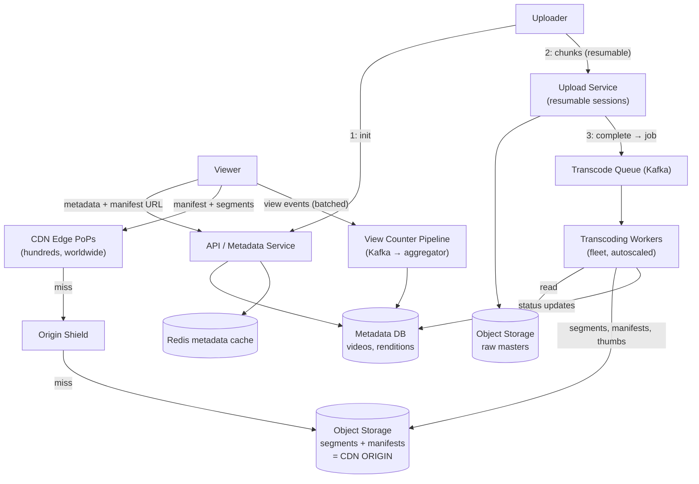
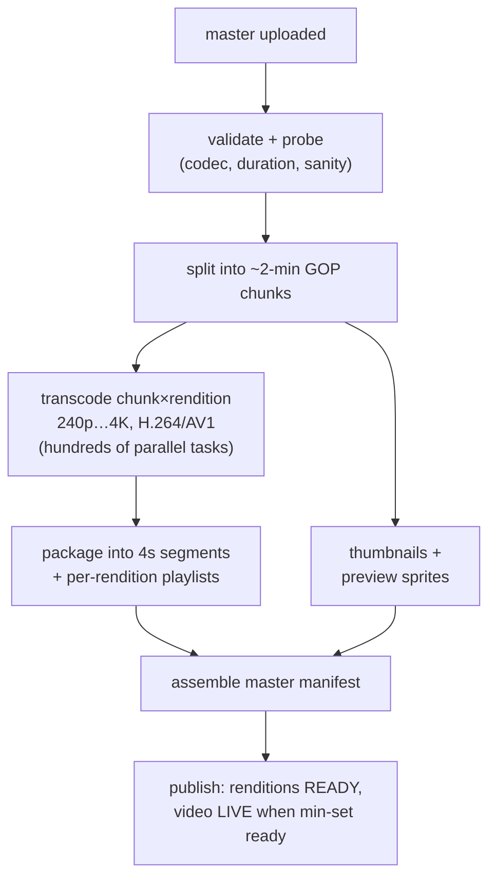
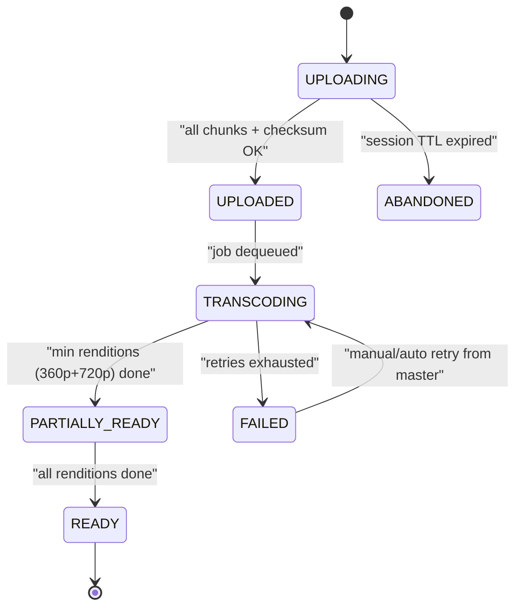
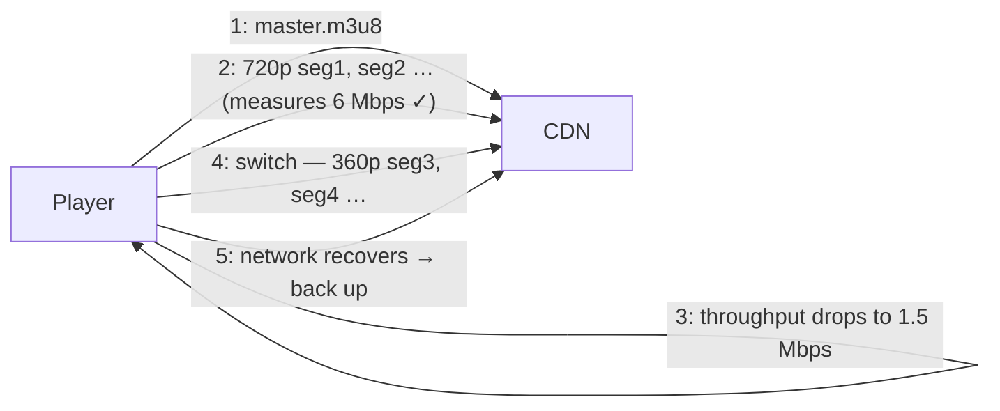
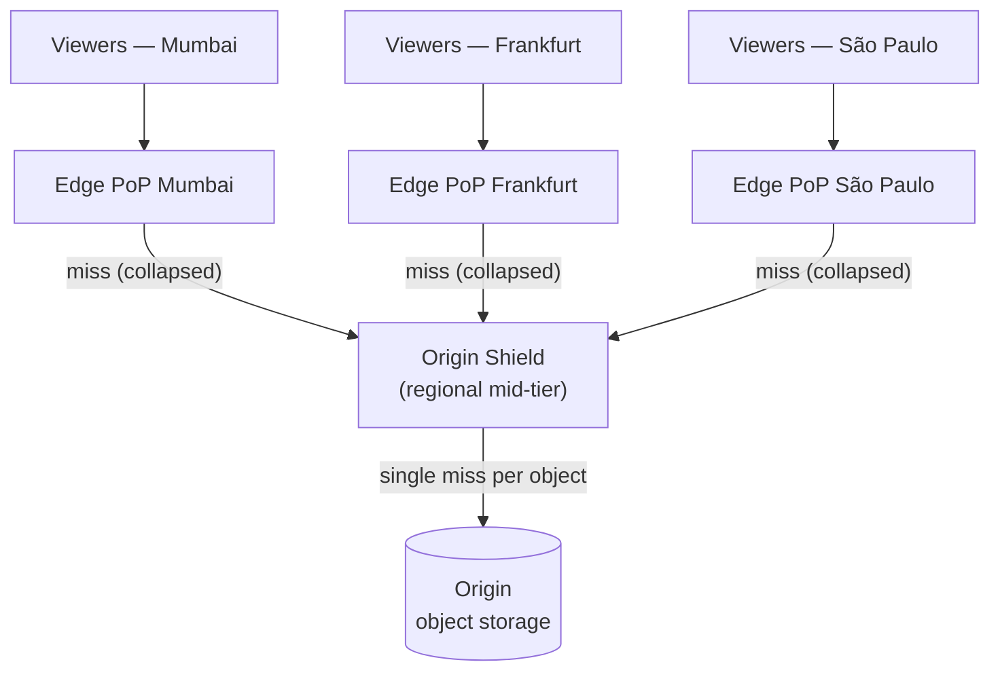
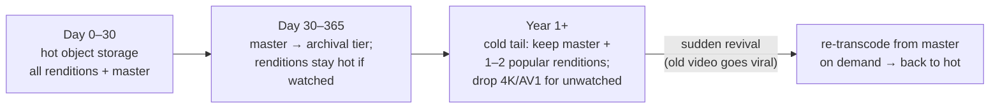
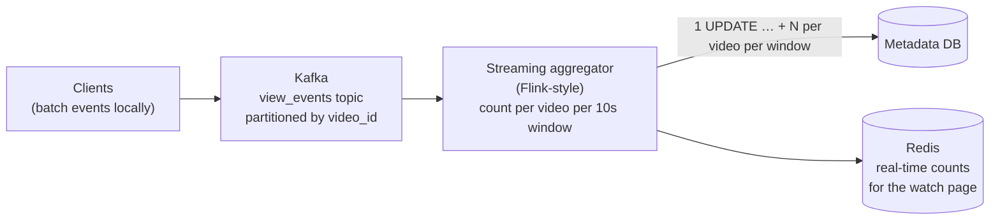
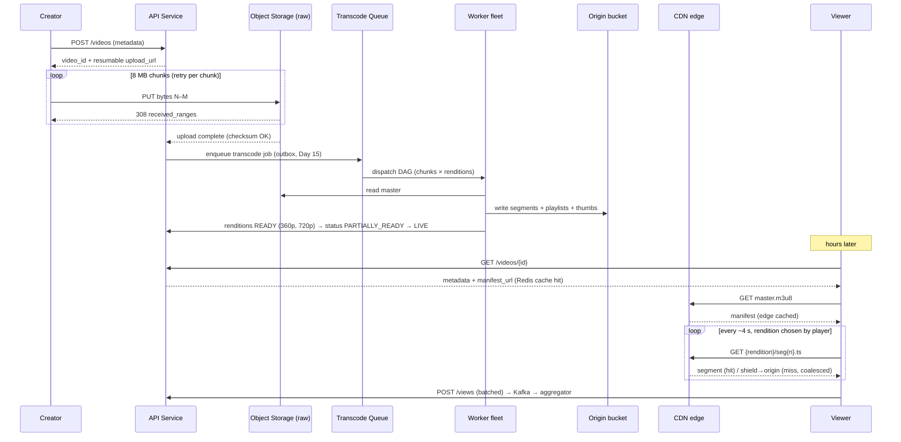

# Day 24 — Design a Video Platform (YouTube)

> **Week 4: Full Design Practice.** Chat moved kilobytes between people; feeds moved pointers to kilobytes. Video moves *petabytes* — and the design center of gravity shifts from databases to pipelines and CDNs. Today's system is 95% about bytes in motion.

---

## 0) ⏱️ Attempt First

**Stop. 45-minute timer.** Design YouTube: requirements → estimates → API → data model → architecture → deep dives. Before you read on, answer two questions honestly: *(1) What happens between "upload finished" and "video watchable," step by step? (2) Why doesn't your phone just download the MP4?* If your architecture has clients streaming video **through your application servers**, or a `views = views + 1` UPDATE per watch, today will pay for itself.

---

## 1) Requirements Clarification

### Functional — In Scope
- **Upload** — videos up to ~10 GB, resumable over flaky connections
- **Process** — transcode into multiple resolutions/codecs; generate thumbnails
- **Watch** — adaptive-bitrate streaming that adjusts to network conditions, seekable
- **Metadata** — title, description, channel, duration; watch page
- **View counting** — at YouTube scale (this is a deep dive, not a footnote)
- **Search** — mention only: metadata → inverted index (Elasticsearch); not deep-dived

### Functional — Explicitly Out of Scope
- Recommendations (Day 23's ranking-pipeline seam applies identically — say so and move on)
- Live streaming (different pipeline: real-time transcode, low-latency HLS)
- Comments/likes (standard CRUD + Day 23-style counters)
- Monetization/ads, copyright matching (Content ID)

### Non-Functional Requirements
| NFR | Target | Why |
|---|---|---|
| Playback start (time-to-first-frame) | < 1–2 s | Startup delay is the #1 abandonment driver |
| Rebuffer rate | < 0.5% of watch time | Buffering wheel = closed tab |
| Availability (watch path) | 99.99% — watch path degrades last | Uploads can queue; playback cannot |
| Upload → watchable | minutes OK (async); notify when ready | Nobody expects instant processing of 10 GB |
| Durability | Original masters never lost (11 nines, S3-style) | Re-transcoding possible only if the master survives |
| Consistency | Eventual everywhere (views, even availability of new videos) | A view count off by 1,000 harms no one |
| Scale | ~500 h of video uploaded/min (YouTube's real public ballpark, approx.); ~1B+ watch-hours/day | |

### Concepts from earlier days you'll reuse today
| Earlier concept | Where it shows up in YouTube |
|---|---|
| Cache-aside (Day 11) | Metadata cache in front of the videos DB; thumbnail caching |
| Thundering-herd defense (Day 11) | Request coalescing at CDN edges during premieres |
| Replication & failover (Day 13) | Metadata DB replicas; multi-region origin buckets |
| Queues, DLQs, autoscaling on depth (Day 14) | The entire transcoding DAG |
| Idempotency & outbox (Day 15) | Chunk retries; upload-complete → transcode-job event |
| Presigned uploads & CDNs (Day 16) | Both rivers: resumable upload in, segment delivery out |
| Graceful degradation (Day 18) | Watch path degrades last; stale-from-cache metadata during failover |
| Stream aggregation (new today, reused Day 25) | View counting → surge pricing use the identical shape |

---

## 2) Back-of-Envelope Estimates

### Upload ingest
```
Uploads: 500 hours/min = 30,000 hours of video per hour of wall time
Raw upload size: assume avg source ≈ 3 GB/hour (mixed 1080p, approx.)
  Ingest: 500 h/min × 3 GB/h = 1,500 GB/min = 25 GB/s sustained ≈ 200 Gbps
  → uploads must go DIRECTLY to object storage (presigned URLs, Day 16),
    never through app servers.

Storage/year (masters): 25 GB/s × 86,400 × 365 ≈ 788 PB/year raw
Transcoded renditions (240p…4K, ~2 codecs): ~1.5× the master ≈ +1.2 EB/year total
  → ~2 EB/year. Exabyte scale. Tiered storage is mandatory:
    hot (new/popular) on fast object storage; cold tail on archival tiers.
```

### Watch traffic — where the real money burns
```
Watch: 1B hours/day at avg 5 Mbps effective bitrate
  1e9 h × 3600 s × 5 Mb/s = 1.8e13 Mb/day = 2.25e12 MB/day ≈ 2.25 EB/day (!)
  Sustained egress: 2.25 EB / 86,400 s ≈ 26 TB/s ≈ 208 Tbps
  → NO origin serves this. ~95%+ must come off CDN edges (deep dive §6.3).
  Origin egress at 95% CDN hit rate: ~10 Tbps → still huge → origin shield + regional origins.
```

### Metadata QPS
```
Watch page loads: assume 5B/day → 5e9/86,400 ≈ 58K QPS avg, ~150K peak
  → metadata is a read-heavy small-row workload: cache-aside Redis (Day 11)
    in front of the metadata DB; video metadata row ≈ 2 KB
  → hot set: 50M popular videos × 2 KB = 100 GB — trivially cacheable.
Uploads/day: 500 h/min ÷ ~10 min avg video ≈ 3,000 videos/min ≈ 4.3M videos/day
  → metadata writes ~50/sec. Nothing. The DB is never the hard part here.
```

### View-count write pressure (motivates §6.5)
```
Avg video ~10 min → 1B watch-hours/day ≈ 6B views/day ≈ 70K view-events/sec avg,
~200K/sec peak. As row UPDATEs: 200K random-write transactions/sec, with viral
videos concentrating millions of increments on ONE row. → buffered counting.
```

---

## 3) API Design

```jsonc
// 1. Initiate upload — returns resumable session
POST /v1/videos
{ "title": "…", "description": "…", "size_bytes": 4200000000, "mime": "video/mp4" }
→ 201 { "video_id": "dQw4w9WgXcQ", "upload_url": "https://upload…/sess_abc",
        "chunk_size": 8388608 }                       // 8 MB chunks

// 2. Upload chunks — resumable (Content-Range), direct to storage tier
PUT {upload_url}
Headers: Content-Range: bytes 0-8388607/4200000000
→ 308 Resume Incomplete { "received_ranges": ["0-8388607"] }   // or 201 when done

// 3. Poll processing status (or receive webhook/push)
GET /v1/videos/{id}/status
→ 200 { "state": "TRANSCODING", "renditions_ready": ["360p","720p"], "progress": 0.6 }

// 4. Watch page — metadata + manifest pointer
GET /v1/videos/{id}
→ 200 { "title": "…", "duration_s": 212, "view_count": 1400000000,
        "manifest_url": "https://cdn…/dQw4/master.m3u8", "thumbnails": [ … ] }

// 5. The player then talks to the CDN, not to us:
GET https://cdn…/dQw4/master.m3u8          // master manifest (all renditions)
GET https://cdn…/dQw4/720p/seg00042.ts     // 4-second media segments

// 6. View event (batched by client)
POST /v1/views  { "events": [ { "video_id": "…", "watched_s": 34, "ts": … } ] }
```

Note the shape: our API serves *metadata and coordination*; the **CDN serves every heavy byte** in both directions (upload via presigned/resumable URL to storage, playback via manifest+segments).

---

## 4) Data Model

**The defining split: metadata in a database, binary in object storage — never mix them.** Databases are terrible blob stores (replication amplification, backup bloat, cache pollution); object stores are terrible at queries. Each side does what it's for; the join key is `video_id`.

### `videos` — metadata (MySQL/Postgres, sharded by video_id; or a document DB)
| Field | Type | Notes |
|---|---|---|
| video_id | char(11) | random short ID (not sequential — don't leak upload volume, spread shards) |
| channel_id | bigint | secondary index for channel pages |
| title, description | text | fed to search indexer via CDC (Day 15) |
| duration_s, status | int, enum | status: see state machine §6.1 |
| master_manifest_url | text | pointer into CDN/object storage |
| view_count | bigint | **denormalized, updated in batches** (§6.5), never per-view |
| created_at, published_at | timestamp | |

### `renditions` — one row per transcoded output
| Field | Notes |
|---|---|
| video_id, rendition ("720p_h264"), status, segment_count, storage_prefix, bitrate_kbps | Lets the watch page publish as soon as *some* renditions are ready |

### `upload_sessions` — resumable-upload bookkeeping
| Field | Notes |
|---|---|
| session_id, video_id, received_ranges, expires_at | Server-side memory of which chunks arrived; enables resume-after-crash |

### Object storage layout (S3-style)
```
masters/{video_id}/source.mp4                    ← original, archival tier after 30d
video/{video_id}/{rendition}/seg{n}.ts           ← streamable segments (CDN origin)
video/{video_id}/master.m3u8                     ← manifest
thumbs/{video_id}/{size}_{n}.jpg
```

### `view_events` — append-only stream (Kafka → aggregation), *not* a table you UPDATE

---

## 5) High-Level Architecture


*Two one-way rivers: an upload river flowing into object storage through transcoding, and a playback river flowing out through the CDN. The database is a small island of coordination between them.*

### Walkthrough — upload flow
1. Uploader calls **API** → metadata row created with `status=UPLOADING`, resumable session issued.
2. Client streams 8 MB chunks to the **Upload Service** (or presigned multipart URLs straight to storage); each chunk is individually retryable; the session tracks received ranges.
3. On final chunk + checksum verification, Upload Service marks `UPLOADED` and drops a job onto the **Transcode Queue** (via outbox, Day 15 — a stored master with no transcode job is a stuck video).
4. **Transcoding workers** fan the job out into a DAG of per-rendition tasks (§6.1); outputs (segments + manifests + thumbnails) land in the **origin bucket**; renditions flip to `READY` one by one; the video publishes when a minimum set (e.g., 360p + 720p) is ready.

### Walkthrough — watch flow
1. Viewer loads the watch page → **API** returns metadata + `manifest_url` (Redis cache-aside; 100 GB hot set from §2).
2. The player fetches the **master manifest from the CDN**, picks a starting rendition, and begins pulling 4-second segments — edge-cached; misses funnel through the **origin shield** to the origin bucket (§6.3).
3. The player adapts quality per segment based on measured throughput (§6.2). Our servers see none of this traffic.
4. The client batches **view events**; an aggregation pipeline turns billions of events into periodic counter flushes (§6.5).

---

## 6) Deep Dives

### 6.1 The upload → transcode pipeline

**In plain words:** Think of a restaurant kitchen. A customer drops off a giant raw ingredient (your uploaded file), and before anyone can be served, the kitchen chops it up and cooks it into many ready-to-eat dishes (different resolutions and codecs). Uploading in small chunks is like carrying groceries in bags instead of one impossible armful — if you drop one bag, you only re-fetch that bag. The cooking happens in the background on many stations at once, so a huge order finishes in minutes.

**Why resumable chunked upload:** a 4 GB upload on mobile *will* be interrupted. Chunking (8 MB) means a failure costs one chunk, not four gigabytes; ranges make retries idempotent (same range, same bytes — Day 15's idempotency again); parallel chunk upload uses fat pipes fully.

> **🤔 Wait — why chunked/resumable upload instead of one big `POST` of the file?**
> A single multi-gigabyte `POST` is one atomic bet against the network: drop the TCP connection at 99% and the whole thing restarts from byte zero. Chunking turns one fragile 4 GB transfer into 500 independent 8 MB transfers, each retryable in isolation and each acknowledged by a resumable session that remembers what already arrived. The takeaway: you're not making upload faster, you're making failure *cheap* — which at mobile-network reliability is the same thing as making it possible at all.

**✅ Good scenario (where this design choice wins):** A creator uploads a 6 GB 4K master over spotty hotel Wi-Fi that drops every few minutes. With 8 MB chunks and `Content-Range` resume, each drop costs one re-sent chunk and the session picks up exactly where it left off, so the upload eventually completes over an hour of flaky connectivity that would never survive a single stream.

**❌ Bad scenario (when it backfires / the naive alternative):** A phone app does one big `PUT` of the whole file. Users on cellular hit the classic "uploaded 92%, connection blipped, start over" loop; support fills with rage, and the ones who retry three times triple your ingest bandwidth for zero completed uploads. At scale this is a self-inflicted ingest amplification incident driven entirely by failed retries.

**When NOT to over-do it:** If you're accepting small files — profile photos, 5 MB clips, short voice notes — a plain single `POST` with a retry is fine; resumable-session bookkeeping is pure overhead below roughly the 50–100 MB range.

**Why transcode at all:** the source is one resolution and codec; viewers are on everything from 3G phones to 4K TVs. So each video becomes a **matrix of renditions**: {240p, 360p, 480p, 720p, 1080p, 4K} × {H.264 (universal), VP9/AV1 (better compression, saves YouTube-scale egress money)}. This is embarrassingly parallel — a **DAG of queue jobs** (Day 14):


*Chunk-level parallelism is the trick: a 2-hour movie transcodes in ~minutes because 60 chunks × 12 renditions run as ~720 independent tasks.*

> **🤔 Wait — why transcode into a dozen resolutions up front instead of on demand at first request?**
> Because the alternative pushes latency onto the viewer at exactly the wrong moment. Transcoding a rendition takes seconds-to-minutes of compute; do it lazily and the *first* person to request 1080p waits for an encode instead of watching. Pre-transcoding the common ladder (up to ~1080p) means the head of the catalog is instantly playable at every quality; you can still lazily generate the *expensive tail* (4K, AV1) for videos nobody watches at that quality. It's a bet: pay compute now so the watch path is pure cache-friendly reads later.

**✅ Good scenario (where this design choice wins):** A music video premiere draws 10M viewers in the first hour across every device from 3G phones to 4K TVs. Because 240p through 1080p were transcoded and packaged before publish, every viewer starts instantly from CDN-cached segments — no viewer ever waits on an encoder, and the transcode fleet's work was done once, offline, hours earlier.

**❌ Bad scenario (when it backfires / the naive alternative):** You transcode purely on demand to save storage. The premiere hits and the first request for each rendition triggers a synchronous encode; the transcode fleet becomes a latency-critical dependency of playback, a backlog forms, time-to-first-frame balloons to tens of seconds, and viewers abandon while your on-call watches queue depth climb. You've turned an offline batch problem into a real-time one under peak load.

**When NOT to over-do it:** Don't pre-render 4K and AV1 for a corporate training portal where everyone streams 720p on a laptop — encode the two or three renditions you'll actually serve, and lazily make the rest only if analytics prove demand.

**Job status state machine** (persisted per video; drives the status API and retries):


*Publish at PARTIALLY_READY — creators see their video live in minutes while 4K/AV1 finishes in the background.*

Worker-fleet notes: tasks are idempotent (output keyed by `{video_id, chunk, rendition}` — re-running overwrites identically), so at-least-once queue delivery is safe; workers are stateless and autoscale on queue depth; poison-pill inputs (corrupt files) go to a dead-letter queue (Day 14) after N retries instead of wedging the fleet; priority queues let a big creator's upload jump the line.

### 6.2 Adaptive bitrate streaming (HLS/DASH)

**In plain words:** Instead of mailing you a whole movie in one box, we cut it into hundreds of tiny numbered flip-book pages and let you grab them one at a time. Your player is like a smart shopper watching its wallet (your bandwidth): if the connection is fast it grabs the crisp high-quality pages, and the moment the network slows it quietly switches to smaller pages so the video keeps playing without freezing. The server just hands out pages; all the cleverness lives on your device.

The insight that makes internet video work: **don't stream a file — serve a folder of tiny files over plain HTTP.**

- Each rendition is cut into **~4-second segments** (`seg00042.ts`).
- A **media playlist** per rendition lists its segments; a **master manifest** lists all renditions with their bandwidth requirements:
```
#EXTM3U
#EXT-X-STREAM-INF:BANDWIDTH=800000,RESOLUTION=640x360
360p/playlist.m3u8
#EXT-X-STREAM-INF:BANDWIDTH=2800000,RESOLUTION=1280x720
720p/playlist.m3u8
#EXT-X-STREAM-INF:BANDWIDTH=5000000,RESOLUTION=1920x1080
1080p/playlist.m3u8
```
- The **player** (all logic client-side!) measures actual download throughput per segment and its buffer level, and picks the rendition for the *next* segment accordingly. Quality switching = requesting a different folder — no server smarts, no session state.


*ABR in five arrows: the server is dumb, the player is smart, and every request is a cacheable HTTP GET.*

Why this shape wins (worth reciting): plain HTTP GETs traverse every firewall and — crucially — are **CDN-cacheable** (a custom video protocol would forfeit the entire CDN layer); seeking = jump to segment ⌊t/4s⌋; live streaming reuses the same machinery (manifest keeps appending); DASH is the ISO-standard sibling of Apple's HLS — same segments, different manifest XML/M3U8.

> **🤔 Wait — why adaptive bitrate at all? Why not just serve one good-quality file and let the browser buffer?**
> Because "one file" means one bitrate, and there is no single bitrate that works for both a 3G phone in a tunnel and a fiber-connected 4K TV. Pick high and the phone stalls forever; pick low and the TV shows mush. ABR sidesteps the choice: cut every quality into aligned 4-second segments and let the *player* pick the next segment's quality from its measured throughput and buffer level. The server stays dumb and stateless — quality switching is just requesting a different folder — which is exactly what keeps every request a cacheable GET.

**✅ Good scenario (where this design choice wins):** A commuter watches on a train that swings between 5G and dead zones. The player streams 1080p while the signal is strong, silently drops to 360p as throughput collapses entering a tunnel, and climbs back up on the far side — all without a single rebuffer and without the server ever knowing the network changed.

**❌ Bad scenario (when it backfires / the naive alternative):** You serve one 1080p MP4 via progressive download. Half your audience on mediocre connections sits watching the buffering spinner, abandons, and your rebuffer rate blows past the 0.5% SLO. Worse, a custom "smart streaming" protocol to fix it would be un-cacheable, so every byte funnels back to origin — you'd have traded a playback problem for a 208 Tbps origin bill.

**When NOT to over-do it:** For short autoplay clips or GIF-like loops a few seconds long on a controlled network, a single small MP4 is simpler and the ABR machinery (multiple encodes, manifests, segment packaging) is overkill — nobody adapts bitrate on a 3-second loop.

### 6.3 CDN strategy — where 95% of the system actually lives

**In plain words:** A CDN is like a chain of neighborhood corner stores that stock the popular snacks everyone wants, so you don't drive to the faraway factory every time. Because a handful of videos are watched by almost everyone, these local stores (edge servers) can satisfy the vast majority of requests from just down the street — fast for you and cheap for us. The rare, obscure video is the one item nobody stocks, so that single request travels back to the factory (the origin), which is fine because almost no one asks for it.

Recall §2: **208 Tbps egress.** The origin cannot serve this; economically and physically, the CDN *is* the serving system.

> **🤔 Wait — object storage already serves HTTP and scales. Why not just point players straight at the origin bucket?**
> Two reasons, and both are fatal on their own. Physics: 208 Tbps of egress from a handful of origin regions is a wall no single serving tier crosses, and even the ~5% that misses the CDN is ~10 Tbps. Money and latency: a viewer in São Paulo pulling segments from a us-east bucket eats a full round-the-planet RTT per segment *and* your inter-region egress bill on every byte. The CDN's hundreds of edge PoPs put bytes physically near viewers and, because video popularity is a steep power law, absorb 90–95%+ of requests before they ever reach you.

**✅ Good scenario (where this design choice wins):** A video goes viral and 10M people watch the same segments the same afternoon. Edge caches serve those hot segments from memory in the viewer's own city; the origin sees a trickle of first-fetches per PoP instead of 10M requests, and your egress cost and time-to-first-frame both stay flat as traffic 100×'s.

**❌ Bad scenario (when it backfires / the naive alternative):** You serve segments directly from the origin bucket "because it's cheaper." A premiere lands and thousands of simultaneous edge-less requests per second hammer the bucket — an origin meltdown that's effectively a self-inflicted DDoS, with request rate limits tripping, latency spiking, and playback failing for everyone at once. The bytes you "saved" cost you an outage.

**When NOT to over-do it:** An internal tool streaming a handful of onboarding videos to a few hundred employees in one region doesn't need a multi-tier CDN with origin shield — object storage with a single CDN distribution (or even just the bucket) serves that load fine.


*The shield collapses thousands of simultaneous edge misses into one origin fetch — without it, a viral premiere is a self-inflicted DDoS on your own origin.*

- **Why caching works at all — the 80/20 rule (and it's steeper than 80/20):** video popularity is a power law; a tiny fraction of videos generate the vast majority of watch time. Edge caches holding just the head of the distribution absorb 90–95%+ of bytes. The long tail misses to origin — and that's fine, because the tail is by definition low-traffic.
- **What's cached where:** hot segments at edges (LRU does most of the work — recently watched ⇒ soon watched again); the warm middle at the shield; everything at origin. Manifests get short TTLs (they change for live), segments are immutable → cache forever with content-addressed URLs.
- **Request coalescing:** when 10,000 viewers in one city start a premiere simultaneously, the edge makes *one* upstream request per segment and fans the response out — the thundering-herd defense from Day 11, now at CDN scale.
- **Pre-warming:** for a scheduled hot release (new music video, season finale), push the first N segments of the top renditions to major PoPs *before* the premiere. YouTube-scale operators also run **appliance caches inside ISP networks** (Google Global Cache is the famous real example) — the ultimate edge.

### 6.4 Thumbnails — small objects, huge counts

**In plain words:** Thumbnails are the little preview pictures on each video, like the cover photo on a book. There are a staggering number of them (millions of tiny images a day), but each one is featherweight and rarely changes, so they cache beautifully. The trick is to only load the ones actually on screen — like not printing every book cover in the library when you can only see one shelf at a time.

4.3M videos/day × ~5 sizes × preview sprites ≈ 25M+ small images/day. Generated in the transcode DAG, stored in object storage, served via CDN with long TTLs, **lazy-loaded** by clients (a feed page renders 50 thumbs; don't fetch below the fold). The interview point: thumbnails are a *different workload* (millions of tiny cache-friendly objects vs thousands of huge ones) that happens to share the CDN — mention it, size it, move on.

### 6.4b Storage lifecycle — surviving exabyte economics

**In plain words:** Storing every video forever at top quality is like keeping every item you own on your kitchen counter — you'd drown in stuff. So fresh, popular videos sit within arm's reach (fast storage), older ones move to the basement (cheap archival storage), and truly forgotten ones get their extra copies thrown out. We only guard the original master copy like a precious negative, because any version can be re-created from it on demand if an old video suddenly goes viral again.

At ~2 EB/year (§2), *where* bytes sit matters as much as *that* they sit. Access follows a steep decay curve: most videos get most of their lifetime views in the first weeks.


*Storage classes as a state machine driven by watch analytics — the master is sacred, everything else is regenerable and therefore deletable.*

Rules of thumb worth saying: the **master is the only irreplaceable object** (11-nines durability, cross-region), because every rendition is a pure function of it; lazily re-transcoding a revived old video costs minutes of compute vs years of storing renditions nobody watched; and content-hash dedup at ingest catches identical re-uploads before they cost anything. This is tiering (Day 13's storage-hierarchy instinct) applied at exabyte stakes.

### 6.5 View counting at scale — never UPDATE a row per view

**In plain words:** Imagine a stadium turnstile where every single person forces the whole crowd to stop while a clerk carefully writes "+1" in a ledger — chaos. Instead, we let a counter click quietly in the corner and only write the total to the ledger once every few seconds, like a cashier tallying the till at the end of a shift rather than after every coin. A million views in ten seconds becomes one tidy "+1,000,000," and nobody minds if the displayed number lags a little.

The naive `UPDATE videos SET view_count = view_count + 1` at 200K/sec peak means 200K row-lock transactions/sec — and a viral video focuses *millions* of increments on **one row** (a hot-row lock convoy no amount of sharding fixes, because it's a single key).

> **🤔 Wait — `UPDATE count = count + 1` is atomic in SQL. Why isn't that just correct and done?**
> It's atomic, but atomic means *serialized*: every increment must take an exclusive lock on that one row, so concurrent writers queue behind each other. For a boring video that's invisible; for a video getting a million views a minute it's a lock convoy on a single key, and sharding can't help because you can't split one row across shards. It's not that the SQL is wrong — it's that "correct per operation" collides with "one physical row, millions of writers." The fix is to stop treating each view as a transaction: buffer them into a stream and flush aggregates.

**✅ Good scenario (where this design choice wins):** A video hits the trending page and takes 2M views in ten minutes. Clients batch view events, Kafka partitions them by `video_id`, and a windowed aggregator turns that entire burst into a handful of `+N` updates per 10-second window — the DB write rate scales with *distinct videos being watched*, not with total views, so a viral spike is a rounding error on the database.

**❌ Bad scenario (when it backfires / the naive alternative):** You keep the per-view `UPDATE`. Under concurrency the row-lock convoy serializes writers, latency on that row climbs into seconds, and lost updates from failed/retried transactions make the displayed count visibly *drop* — the "why did my view count go backwards?" bug class. Meanwhile the write amplification starves the metadata DB of connections and drags down unrelated watch-page reads.

**When NOT to over-do it:** For a low-traffic app — a course platform where the busiest lesson sees a few views a minute — a plain atomic `UPDATE` (or a Redis `INCR` flushed periodically) is completely fine; standing up Kafka and a Flink aggregator for counts that never contend is textbook over-engineering.

**The pattern: turn writes into a stream, aggregate, flush periodically.**


*A million views in 10 seconds becomes one `+1,000,000` — the DB write rate now scales with distinct-videos-per-window, not with views.*

- The watch page shows `db_count + redis_delta` — fresh-looking numbers without DB pressure. Exactness is not required (counts are eventually consistent by product design; YouTube's own counts visibly lag/freeze around milestones).
- Dedup/fraud (replayed events, bots) happens in the aggregation layer — approximate structures like HyperLogLog work for unique-viewer counts where 2% error is irrelevant.
- This is the universal high-frequency counter recipe: likes, ad impressions, metrics — same shape every time. Compare Day 23: feed fanout turned one write into many; counting turns many writes into one. **Buffering and batching are how you survive write storms.**

### ☠️ The dark side: build vs buy
Mux, Cloudflare Stream, AWS MediaConvert, and Bunny Stream all sell the entire §6.1–6.3 pipeline as an API: upload in, HLS out, CDN included, per-minute pricing. If your product is *not* a video platform — you're adding video lessons to an ed-tech app, clips to a marketplace — **building your own transcoding fleet is résumé-driven development**: you'll spend two quarters reinventing FFmpeg orchestration to save money you don't spend yet. Build when video *is* the product, when egress scale makes vendor margins material, or when you need codec-level control (YouTube builds because AV1 adoption saves them egress money measured in data centers). The senior interview move is to say this trade-off *exists* and then continue designing — the interviewer asked you to design it, and knowing what you'd buy is part of the design.

---

## 7) Sequence Diagram — Upload to First Playback


*End to end: chunks in, DAG in the middle, segments out — and the app servers never touch a video byte.*

---

## 8) Bottlenecks & Evolution

**What breaks at 10× (5,000 h/min uploaded, 10B watch-hours/day)?**
- **Transcode compute cost** explodes → smarter ladders: per-title encoding (analyze content, pick minimal bitrates — Netflix's real technique), transcode long-tail renditions *lazily on first request*, hardware encoders (ASICs — YouTube built its own, Argos) for the head.
- **Storage** (20 EB/year) → aggressive tiering: masters to archival storage after 30 days; delete rarely-watched high renditions and re-transcode from master on demand; dedupe identical re-uploads by content hash.
- **Origin egress** even at 95% CDN hit → deeper ISP-embedded caches, region-sharded origins (segments for APAC viewers originate in APAC), raise edge retention for the head of the distribution.
- **Metadata DB** — still fine (writes are tiny); the caches and counters carry the read/write storms by design.

**Single points of failure:** transcode queue down → uploads accumulate safely in raw storage; jobs drain on recovery (this is *why* the pipeline is async). One CDN region down → DNS/anycast shifts viewers to neighbors (higher latency, no outage). Metadata DB primary fails → replicas promote (Day 13); watch pages serve stale-from-cache meanwhile. The watch path is deliberately the most redundant thing in the system.

**Degradation ladder (the watch path degrades last — here's the order):**
1. Transcode fleet degraded → uploads queue safely; creators see "processing" longer; watching unaffected
2. View-count pipeline lagging → counts go stale; playback unaffected (eventual by design)
3. Metadata DB straining → serve stale-from-Redis watch pages; block only new uploads
4. One CDN region down → anycast/DNS shifts to neighbor PoPs; higher latency, no outage
5. Origin shield down → edges fall back to direct origin with coalescing; hit rate absorbs most of it
6. Origin bucket regional outage → replicated origin region serves; the head of the catalog never leaves edge caches anyway
Only a simultaneous multi-region CDN + origin failure stops playback — which is the design goal stated as a failure mode.

**What to instrument:**
- Time-to-first-frame and rebuffer ratio, per region/ISP — the two numbers viewers feel
- CDN hit rate by tier (edge / shield / origin) — a falling edge rate is a cost incident before it's an outage
- Upload success rate + median chunks-retried — mobile-network health of the ingest path
- Transcode queue depth and p95 upload→LIVE latency — creator-facing SLO
- View-event pipeline lag — counts drifting stale signals aggregator backpressure

**Next steps if pressed:** search indexing via CDC into Elasticsearch, recommendations (reuse Day 23's candidate-generation → ranking pipeline verbatim), live streaming (same segments, rolling manifest, real-time encoder), Content ID (fingerprint matching in the transcode DAG), DRM (encrypted segments + license server).

---

## 9) Trade-offs Summary

| Decision | Alternative rejected | Why |
|---|---|---|
| Direct-to-storage resumable chunked upload | Upload through app servers | 200 Gbps ingest through app tier is absurd; chunks make retries cheap + idempotent |
| Async transcode DAG behind a queue | Synchronous processing on upload | 10 GB transcodes take minutes–hours; queue absorbs bursts, retries, autoscaling |
| Publish at PARTIALLY_READY | Wait for all renditions | Creators see video live in minutes; 4K stragglers finish in background |
| HLS/DASH segments over HTTP | Custom streaming protocol / raw MP4 download | HTTP = CDN-cacheable + firewall-proof; segments = seeking + mid-stream quality switching |
| Client-side ABR logic | Server-side quality selection | Server-side needs per-viewer session state and kills cacheability |
| CDN + origin shield serves ~all bytes | Scale the origin | 208 Tbps; power-law popularity makes edges absorb 95%+; shield collapses herds |
| Metadata DB ⟂ blob storage split | Blobs in the database | DBs make terrible blob stores; each system does what it's built for |
| Buffered/windowed view counting | UPDATE per view | 200K TPS + hot-row convoys on viral videos; aggregation scales with distinct videos |
| Immutable content-addressed segment URLs | Mutable URLs + invalidation | Cache-forever semantics; invalidation is the hardest problem — avoid needing it |
| (Context-dependent) build the pipeline | Buy Mux/Cloudflare Stream | Build only when video is *the* product or egress scale justifies it |

---

## 10) Interview Calibration — Junior vs Senior

**A junior answer** POSTs the video file to an app server, saves it "in the database or S3," transcodes synchronously ("we convert it to MP4"), and serves playback as a file download or a vague "the video streams." View counts are an UPDATE. The CDN appears, if at all, as a box labeled "CDN" with no statement of *what it caches or why it works*. No egress math — which is the tell, because egress math is what reveals that the CDN is the system.

**A senior answer** leads with two numbers — 200 Gbps in, 208 Tbps out — and lets them dictate the architecture: bytes never touch app servers in either direction. Upload is resumable chunks with idempotent retries; processing is an async DAG with a state machine, chunk-level parallelism, DLQs, and publish-at-partial; playback is segments + manifests with *client-side* ABR, and they can explain why plain HTTP segments are the whole reason CDNs apply; the CDN section includes the power-law argument, origin shield, request coalescing, and pre-warming; view counting is a stream-aggregation pipeline with an explicit "exactness doesn't matter here" consistency call. And they volunteer the build-vs-buy reality check before designing anyway. The delta: juniors design a video *website*; seniors design a video *delivery system* and bolt a website onto it.

**Suggested 45-minute pacing for this problem:**
| Minutes | Spend them on |
|---|---|
| 0–5 | Requirements; separate the two rivers (upload vs watch) in your head out loud |
| 5–11 | Estimates — derive 200 Gbps in and 208 Tbps out; state their consequences immediately |
| 11–16 | API + the metadata/blob split |
| 16–25 | Architecture + both walkthroughs (upload→transcode→publish, watch→CDN→segments) |
| 25–33 | Deep dive 1: transcode DAG + state machine (chunk parallelism, DLQ, partial publish) |
| 33–39 | Deep dive 2: ABR streaming + why HTTP segments unlock the CDN |
| 39–43 | Deep dive 3: CDN strategy (power law, shield, coalescing) + view counting in one breath |
| 43–45 | 10× evolution + the build-vs-buy sentence |

**Common mistakes checklist:**
- Uploading or streaming video **through app servers** — the instant disqualifier
- Synchronous transcoding in the upload request
- One rendition ("we'll compress it") — no answer for a 3G phone or a 4K TV
- Server-side quality switching with per-viewer session state
- "Add a CDN" with no statement of hit rate, shield, or why popularity makes it work
- `UPDATE view_count = view_count + 1` — hot-row convoy on every viral video
- No egress math — the omission that hides all of the above

**Rapid-fire follow-ups to rehearse (30-second answers each):**
- "How does seeking to 31:07 work?" — player computes segment ⌊1867/4⌋ = 466, fetches `seg00466.ts` directly; no server involvement.
- "Time-to-first-frame optimizations?" — start on a low rendition and switch up; shorter first segments; preconnect to CDN; manifest inlined in the watch-page response.
- "How would live streaming differ?" — same segments/manifest machinery, but the encoder appends in real time and the manifest is a rolling window; latency budget shrinks to seconds.
- "Private/unlisted videos on a CDN?" — signed URLs / signed cookies with short expiry on manifest and segments; the CDN validates signatures at the edge.
- "What if a transcode worker dies mid-chunk?" — queue redelivers; the task is idempotent (output keyed by video/chunk/rendition), so the re-run overwrites identically.
- "Why 4-second segments and not 1 or 30?" — shorter = faster quality switches and startup but more requests/manifest overhead; longer = better compression but sluggish ABR. ~2–6 s is the industry sweet spot; pick 4 and say why.
- "Where would Content ID (copyright matching) plug in?" — as another node in the transcode DAG: fingerprint the audio/video chunks and match against a reference index before publish.

---

## 11) Self-Check Questions

1. Recompute the two headline numbers: ingest bandwidth at 500 h/min (3 GB/h source) and egress at 1B watch-hours/day (5 Mbps). What does each number *force* architecturally?
2. Your 4 GB upload dies at 97% on a train. Trace exactly what the client re-sends and why the server doesn't end up with duplicate bytes.
3. Why must transcoding be split into chunk×rendition tasks rather than one job per video? Name the queue properties (Day 14) the DAG relies on.
4. A viewer's bandwidth drops from 6 Mbps to 1 Mbps mid-video. Walk through what the player does, at what granularity, and why the server neither knows nor cares.
5. Explain why video segments are cache-forever while manifests get short TTLs. What URL-design choice makes "cache forever" safe?
6. What is an origin shield, and what exact failure does it prevent during a 10M-viewer premiere?
7. Why does `UPDATE views = views + 1` fail *even with perfect sharding* for a viral video? What does the fix scale with instead of view volume?
8. When is building your own transcoding pipeline justified over Mux/Cloudflare Stream? Give one economic and one technical trigger.
9. Which parts of this design did you already build on Day 23, and where exactly would recommendations plug in?
10. Defend "the master is the only irreplaceable object." What does that sentence let you *delete*, and what compute bet does deleting it place?
11. A private video must stream through the CDN. What breaks in the naive cache-everything model, and what mechanism (validated *at the edge*) fixes it without giving up caching?
12. Walk the degradation ladder: which failure stops uploads but not playback, and which stops neither — only freshness?

---

### Key numbers to walk in with (all approximations — say so)
| Number | Value | What it buys you |
|---|---|---|
| Upload rate | ~500 h/min (YouTube, public) | Motivates direct-to-storage + async pipeline |
| Ingest bandwidth | ~200 Gbps | "Bytes never touch app servers" — inbound |
| Watch egress | ~208 Tbps at 1B watch-hrs/day @ 5 Mbps | "The CDN is the system" — outbound |
| Storage growth | ~2 EB/year with renditions | Tiering + master-only-is-sacred lifecycle |
| Segment length | ~4 s | Seeking granularity + ABR switch granularity |
| Metadata hot set | ~100 GB | Whole watch-page working set fits in one cache tier |
| View events | ~70K/sec avg, 200K peak | Why counting is a stream, not an UPDATE |

---

*Previous: Day 23 — Design a News Feed (Twitter/Instagram) · Next: Day 25 — Design Ride-Hailing (Uber)*
