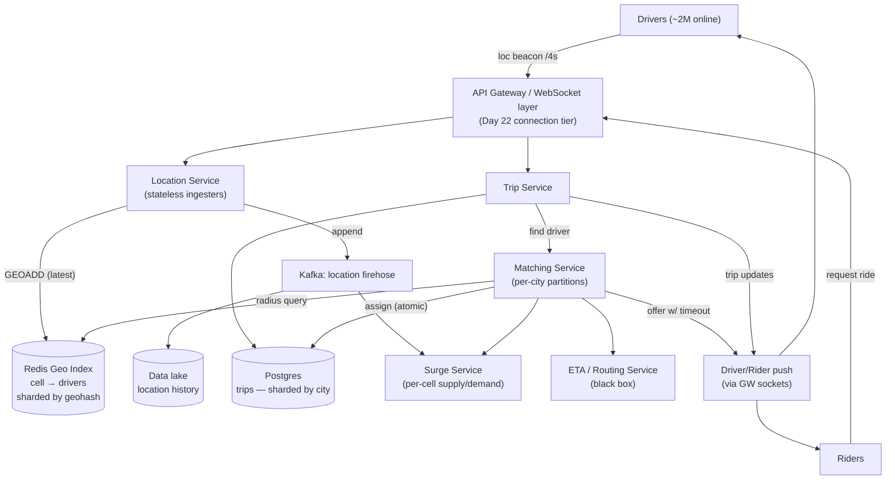
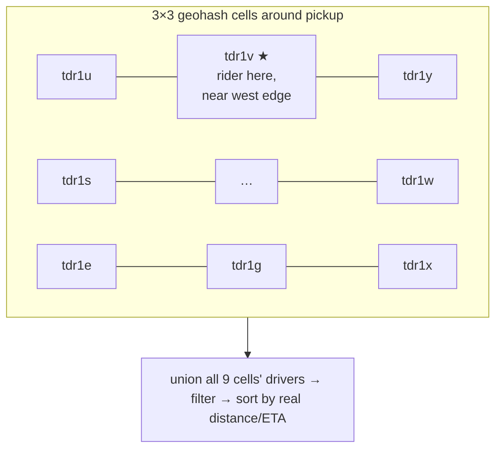
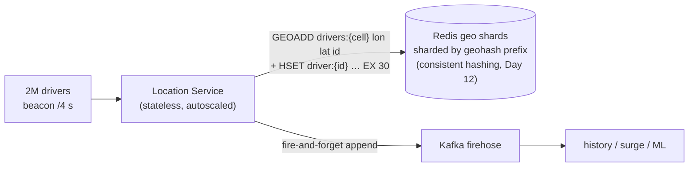
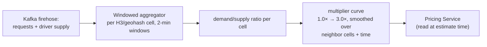
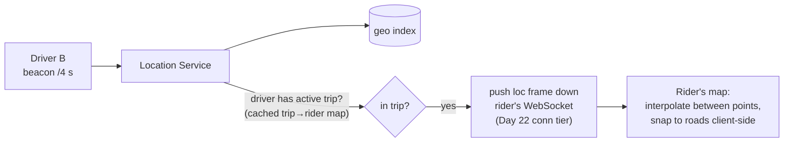
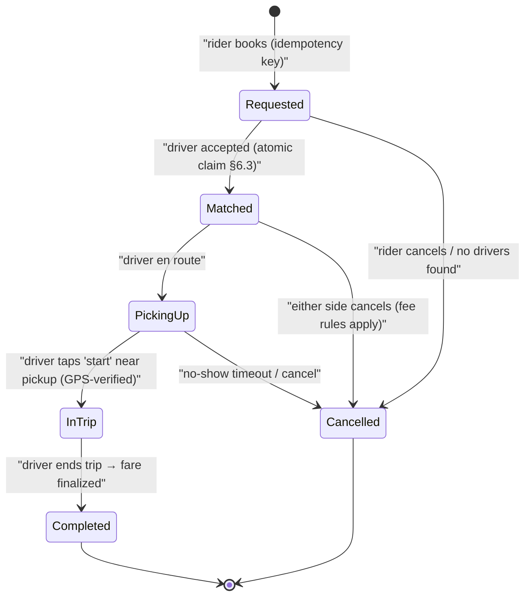
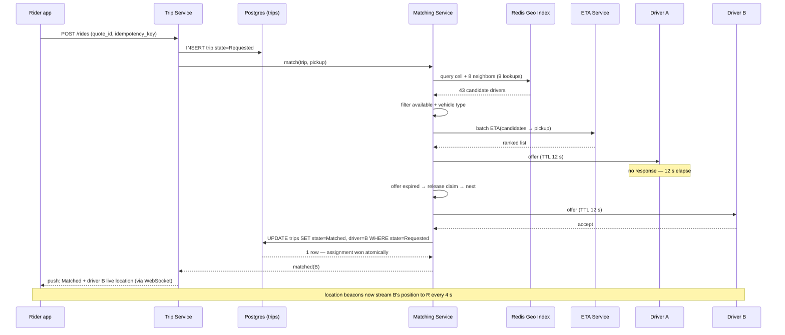

# Day 25 — Design Ride-Hailing (Uber)

> **Week 4: Full Design Practice.** Chat routed messages, feeds routed posts, video routed bytes. Today we route *physical objects moving through space* — and meet the one class of query none of our previous tools can answer: **"what's near me, right now?"** Geo-indexing is today's core lesson, the way fanout was Day 23's.

---

## 0) ⏱️ Attempt First

**Stop. 45-minute timer.** Design Uber: requirements → estimates → API → data model → architecture → deep dives. Before reading on, try to answer the trap question this design hinges on: *you have 1M driver locations in Postgres with a B-tree index on latitude and one on longitude — why is "find the 10 nearest drivers" still slow?* If your answer is "it isn't," today's §6.1 is your most valuable half hour this week.

---

## 1) Requirements Clarification

### Functional — In Scope
- **Rider requests a ride** — pickup + destination, sees ETA and price estimate
- **Matching** — find nearby available drivers, offer the trip, exactly one driver gets it
- **Live driver locations** — drivers stream GPS updates; rider watches car approach on map
- **Trip lifecycle** — request → match → pickup → in-trip → complete (state machine)
- **Surge pricing** — concept level: price responds to local supply/demand
- **ETA display** — treat routing/ETA computation as an external black-box service (like Day 23's ranking model)

### Functional — Explicitly Out of Scope
- Payments (mention: idempotency keys from Day 15 are life-or-death for charges; separate design)
- Ratings, pooled rides, food delivery, safety features
- The map/routing engine internals (road-graph shortest path — its own specialty)

### Non-Functional Requirements
| NFR | Target | Why |
|---|---|---|
| Match time (request → driver assigned) | < 15–30 s end-to-end; candidate search < 1 s | Riders abandon slow matches |
| Location update ingestion | Every ~4 s per active driver, sustained | Map smoothness + ETA accuracy |
| Location freshness | ≤ 4–10 s stale is FINE (see dark side) | Cars move ~50 m in 4 s; matching tolerates it |
| Consistency | **Strong** for trip assignment (one driver!) · **eventual** for locations | The core split of this whole design |
| Availability | 99.99% for request/match path | Downtime = stranded humans, not stale feeds |
| Scale | ~150M MAU, ~25M trips/day, ~5–6M drivers (Uber-ish public ballpark, approx.) | |

### Concepts from earlier days you'll reuse today
| Earlier concept | Where it shows up in Uber |
|---|---|
| Cache-aside (Day 11) | Driver/rider profiles; hot-cell candidate caching |
| Consistent hashing (Day 12) | Sharding the Redis geo index by cell prefix |
| Replication & failover (Day 13) | Trips Postgres replicas; regional isolation |
| Queues & partition rebalancing (Day 14) | Kafka location firehose; matcher zone reassignment |
| Idempotency keys & outbox (Day 15) | Ride booking double-tap; trip-transition events |
| WebSockets & push (Days 17, 22) | Driver beacons in, offers and live-map updates out |
| Distributed locks / atomic CAS (Day 19) | Exactly-one-driver assignment |
| Stream aggregation (Day 24) | View counting yesterday = surge computation today |

---

## 2) Back-of-Envelope Estimates

### Location ingestion — the big write number
```
Concurrent online drivers (peak): ~2M globally (approx.; of ~6M registered)
Update interval: every 4 s
  Location write QPS = 2,000,000 / 4 = 500,000 writes/sec sustained
  (The prompt's stress case — 30M drivers × 1 update/4 s = 7.5M writes/sec —
   is the 10× headroom target. Design for 500K, know the path to 7.5M.)

Payload: driver_id 8 B + lat/lon 16 B + heading/speed/ts ~16 B ≈ 40 B
  Ingest bandwidth: 500K × 40 B = 20 MB/s — bandwidth trivial, WRITE RATE is the problem.
  → 500K random-write TPS instantly disqualifies a relational DB (§6.2).
```

### Matching & trips
```
Trips/day: 25M → 25e6 / 86,400 ≈ 290 requests/sec avg, ~1,000/sec peak (rush hours)
Each match: 1 geo-query + rank ~50 candidates + up to ~5 sequential offers
  → matching QPS is tiny next to location ingestion. Ingestion is the whale;
    matching is the brain. Different stores for each.
```

### Storage
```
Trips: 25M/day × ~2 KB (route summary, states, fare) = 50 GB/day ≈ 18 TB/year
  → sharded SQL handles this comfortably; trips need transactions (money!).
Location HISTORY (for analytics/disputes): 500K/s × 40 B = 20 MB/s
  ≈ 1.7 TB/day ≈ 630 TB/year → append to Kafka → data lake (cold), NOT the hot path.
LIVE locations: only latest per driver: 2M × ~100 B ≈ 200 MB (!)
  → the entire live location state of planet-scale Uber fits in ONE Redis
    instance's RAM. Sharded for throughput and blast radius, not for size.
```

### Map-watching reads
```
Riders watching an assigned car: ~1M concurrent × 1 read/4 s = 250K reads/sec —
  but each read is a single-key GET of that one driver → cache-friendly, or
  better: PUSH updates over the rider's WebSocket (Day 22's connection layer,
  reused verbatim).
```

---

## 3) API Design

```jsonc
// Driver side — high-frequency location beacon (WebSocket or UDP-ish HTTP/2)
{ "type": "loc", "driver_id": 88112, "lat": 12.9716, "lon": 77.5946,
  "heading": 214, "speed_kmh": 32, "ts": 1768545600123 }

// Driver availability + offer responses
POST /v1/drivers/{id}/status      { "state": "AVAILABLE" }        // or OFFLINE
{ "type": "offer_response", "offer_id": "of_991", "accept": true } // via socket

// Rider side
POST /v1/rides/estimate   { "pickup": {lat, lon}, "dest": {lat, lon} }
→ 200 { "eta_s": 240, "price": 187.50, "surge_multiplier": 1.4, "quote_id": "q_x1" }

POST /v1/rides            { "quote_id": "q_x1", "idempotency_key": "uuid-…" }
→ 201 { "trip_id": "t_5561", "state": "REQUESTED" }
// idempotency_key (Day 15): a double-tap must not summon two cars / two charges

GET  /v1/trips/{id}       → { "state": "MATCHED", "driver": {…},
                              "driver_location": {lat, lon}, "eta_s": 180 }
POST /v1/trips/{id}/cancel

// Server → rider pushes over WebSocket (Day 22 machinery):
{ "type": "trip_update", "trip_id": "t_5561", "state": "PICKING_UP",
  "driver_location": { "lat": …, "lon": … }, "eta_s": 170 }
```

---

## 4) Data Model

### Live driver locations — Redis (geo sets), the hot store
```
Per geo-cell sorted sets (see §6.1/6.2):
  key:    drivers:{geohash5}                 e.g. drivers:tdr1v
  value:  GEOADD drivers:tdr1v 77.5946 12.9716 "88112"
  plus:   driver:88112 → {state, vehicle_type, current_cell, ts}   (hash, TTL 30 s)
TTL on freshness: a driver whose beacon stops goes stale in seconds — self-cleaning.
```
**Why:** 500K writes/sec of overwrite-latest-value, ~200 MB total, tolerates loss (next beacon in 4 s restores it). This is the textbook profile of an in-memory store, and the anti-profile of a durable B-tree DB (§6.2).

### `trips` — sharded Postgres, the correctness store
| Field | Type | Notes |
|---|---|---|
| trip_id | uuid | |
| rider_id, driver_id | bigint | driver_id NULL until matched |
| state | enum | the §6.5 state machine; transitions guarded in DB |
| pickup_lat/lon, dest_lat/lon | double | |
| quoted_price, surge_multiplier, final_fare | numeric | money → SQL + transactions, no debate |
| requested_at, matched_at, completed_at | timestamp | |

**Why Postgres:** ~1K writes/sec peak (trivial), but transitions like "assign exactly one driver" need **transactions and row locks / atomic compare-and-set** — the Day 19 concurrency toolkit. Shard by city/region (trips never span regions).

### `drivers`, `riders` — profiles, documents, vehicle info: standard relational, heavily cached (cache-aside, Day 11)

### `offers` — short-lived matching state (Redis, TTL = offer timeout)
```
offer:of_991 → {trip_id, driver_id, expires_at}   TTL 12 s
```

### Location history — Kafka topic → data lake (Parquet). Never queried on the hot path; feeds surge, ETA training, fraud, disputes.

---

## 5) High-Level Architecture


*Left river: a 500K-writes/sec location firehose into Redis + Kafka. Right river: low-QPS, high-stakes matching and trip state in Postgres. Never let the rivers merge.*

### Walkthrough — the two flows
**Location flow (continuous):** driver's app beacons every 4 s over its socket → **Location Service** overwrites the driver's entry in the **Redis geo index** (keyed by geohash cell; if the driver crossed a cell boundary, remove from old cell, add to new) and appends to **Kafka** for history/surge. No database in the hot path.

**Match flow (per request):** rider requests → **Trip Service** creates the trip row (`REQUESTED`, idempotency-keyed) → **Matching Service** queries the geo index for the pickup cell **plus its 8 neighbors** (§6.1's edge problem), gets ~50 candidates → filters (available, right vehicle) → ranks by **ETA service** estimates → offers to driver #1 with a 10–12 s TTL → accept ⇒ **atomic assignment** in Postgres (§6.3) ⇒ rider notified; decline/timeout ⇒ cascade to driver #2. **Surge** reads supply/demand per cell from the Kafka stream and adjusts the quoted multiplier (§6.4).

---

## 6) Deep Dives

### 6.1 Geo-indexing — THE core lesson

**In plain words:** "Find the nearest drivers" is like asking "who's close to me at a huge festival?" A phone book sorted by first name (a normal index) is useless for that — closeness on the ground isn't closeness in the list. The trick is to divide the map into labeled grid squares (like seat sections at a stadium), so "near me" becomes "same section as me" — a simple label match. Because someone standing at the edge of a section may have neighbors in the next section over, we always peek at our square plus the 8 squares around it.

**Why naive lat/lon indexes fail.** A B-tree gives you fast *one-dimensional* ranges. "Nearby" is *two-dimensional*:
```sql
SELECT * FROM drivers
WHERE lat BETWEEN 12.96 AND 12.99   -- index on lat: selects a horizontal STRIPE
  AND lon BETWEEN 77.58 AND 77.61;  -- index on lon: selects a vertical STRIPE
```
The planner uses **one** index, fetching every driver in a stripe spanning the whole city's width (thousands of rows), then filters the other dimension row by row. A composite (lat, lon) index doesn't help: it sorts by lat *then* lon, so points adjacent on the ground are scattered across the index. **The fix, in every scheme below, is the same idea: flatten 2D space into 1D keys such that spatial closeness ≈ key closeness — then B-trees/hashes work again.**

> **🤔 Wait — why geohash instead of just `WHERE lat BETWEEN … AND lon BETWEEN …` with an index on each column?**
> Because that query applies 1D thinking to a 2D problem. A B-tree on `lat` narrows only one axis; the planner picks one index, pulls every driver in a city-wide *stripe*, then filters the other axis row by row. Geohash flattens 2D proximity into a single 1D prefix, so "nearby" becomes "shares my key prefix" and the index does real work again. Takeaway: you don't index two coordinates, you index one space-filling key.

**✅ Good scenario (where this design choice wins):** A dense downtown cell holds a few hundred drivers; a rider's pickup maps to one geohash-6 prefix, and a single Redis GEO lookup (plus its 8 neighbors) returns a rankable candidate set in under a millisecond — no matter how many millions of drivers exist globally. Locality is baked into the key, so scale never touches the query cost.

**❌ Bad scenario (when it backfires / the naive alternative):** Rush hour across a metro: the `lat BETWEEN … AND lon BETWEEN …` query selects a horizontal stripe spanning the whole city — tens of thousands of drivers — then filters longitude in memory. Every one of ~1K matches/sec does this; the Postgres primary's CPU pins at 100% and match latency blows past the 1 s budget. This is the textbook "our proximity search melted the DB" incident.

**When NOT to over-do it:** If you're matching within a single small campus or a 200-vehicle depot, a flat lat/lon scan in memory is fine — geohash sharding is machinery you don't need until candidate sets stop fitting in one cheap query.

**Geohash — the interview workhorse.** Interleave the bits of binary-search on longitude and latitude, then base32-encode. Worked example for Bangalore (12.9716 N, 77.5946 E):
```
lon 77.5946 in (-180,180): halves → right(1), left(0), right(1), left(0), right(1)… → 10101…
lat 12.9716 in (-90,90):   halves → right(1), left(0), right(1), right(1), left(0)… → 10110…
interleave lon,lat:  1 1  0 0  1 1  0 1  1 0 …  → group into 5-bit chunks
base32:              "tdr1v…"  → precision by prefix length:
                     4 chars ≈ 39 km cell · 5 ≈ 4.9 km · 6 ≈ 1.2 km · 7 ≈ 153 m
```
```java
// Encodes a latitude/longitude into a geohash string of the given precision.
static String geohash(double lat, double lon, int precision) {
    String base32 = "0123456789bcdefghjkmnpqrstuvwxyz";
    double[] latRange = {-90, 90};   // current search window for latitude
    double[] lonRange = {-180, 180}; // current search window for longitude
    boolean even = true;             // alternate: even bits = longitude, odd = latitude
    int bit = 0, ch = 0;             // bit counter (0-4) and the 5-bit chunk being built
    StringBuilder out = new StringBuilder();

    while (out.length() < precision) {
        double[] range = even ? lonRange : latRange; // pick the axis for this bit
        double val = even ? lon : lat;
        double mid = (range[0] + range[1]) / 2;
        // shift left and set the low bit to 1 if the value is in the upper half
        ch = (ch << 1) | (val > mid ? 1 : 0);
        if (val > mid) {
            range[0] = mid;   // took the upper half
        } else {
            range[1] = mid;   // took the lower half
        }
        even = !even;
        bit++;
        if (bit == 5) {       // every 5 bits map to one base32 character
            out.append(base32.charAt(ch));
            bit = 0;
            ch = 0;
        }
    }
    return out.toString();    // geohash(12.9716, 77.5946, 6) -> "tdr1vt"
}
```
**Magic property:** shared prefix ⇒ same neighborhood — so "drivers near me" ≈ "keys with my prefix," a plain string-prefix/equality lookup.

**The neighbor-cell edge problem** (the follow-up interviewers always ask): a rider standing 10 m from a cell boundary has their nearest drivers in the *adjacent* cell with a *different* prefix. And geohash cells at some boundaries (the equator/meridian folds) have wildly different prefixes despite touching. **Fix: always query the cell + its 8 neighbors** (neighbor computation is standard library math), union, then distance-sort:


*Query 9 cells, not 1 — nearest-neighbor correctness at cell boundaries costs 9 cheap lookups instead of 1.*

**The alternatives — comparison table (memorize this):**

| Scheme | Idea | Strengths | Weaknesses | Who uses it |
|---|---|---|---|---|
| **Geohash** | Bit-interleave → base32 prefix | Simple, DB-friendly string keys, Redis GEO uses it internally | Rectangular cells distort with latitude; boundary discontinuities → 9-cell trick | Redis GEO, Elasticsearch, MongoDB |
| **Quadtree** | Recursively split busy squares in 4 | **Adaptive density** — deep cells downtown, shallow in deserts | In-memory tree to maintain/rebalance; harder to distribute across shards | Yext/early location services; conceptual ancestor everywhere |
| **H3 (Uber's own)** | Hexagonal hierarchical grid | Hexes: all 6 neighbors equidistant (great for ETA rings & surge smoothing), uniform-ish area | More complex library; indexes aren't prefix-ordered strings | **Uber** (surge, supply positioning, analytics) |
| **S2 (Google)** | Sphere → 6 cube faces → Hilbert-curve cells | Excellent locality (Hilbert), true spherical geometry, exact region covering | Steeper learning curve | Google Maps, MongoDB (2dsphere), Tinder |

**Picking the precision level** — a practical detail that shows real understanding:
| Use | Precision | Cell size | Why |
|---|---|---|---|
| Live matching index keys | geohash-5/6 | ~5 km / ~1.2 km | ~tens–hundreds of drivers per cell — one lookup returns a rankable set |
| Surge cells | geohash-6 / H3 res-8 | ~1 km | Fine enough for neighborhoods, coarse enough for stable ratios |
| "Driver arrived" geofence | geohash-8 | ~38 m | Pickup-point proximity check |
Too coarse ⇒ each query scans thousands of drivers; too fine ⇒ every query needs dozens of cells and drivers hop cells every beacon (index churn). Pick the level where one cell ≈ one dispatch neighborhood.

Interview guidance: **lead with geohash** (you can derive it live), name the 9-cell fix unprompted, then say "at Uber's real scale I'd reach for H3 — hexagons make neighbor math and surge smoothing cleaner." That sentence is the whole senior signal.

### 6.2 Location ingestion — why not Postgres

**In plain words:** Millions of cars shout their GPS position every 4 seconds, and each new shout instantly makes the last one worthless — like a whiteboard you keep erasing and rewriting. A traditional database is a permanent ledger with fireproof records; using it here is like carving each throwaway note into stone. Instead we scribble on a fast in-memory whiteboard (Redis) that auto-erases old notes, and if it gets wiped we lose nothing — the next shout, 4 seconds away, restores everything.

500K writes/sec of "overwrite driver's last point" against Postgres means: WAL-logging every update, B-tree page churn and index bloat on values that are *obsolete 4 seconds later*, VACUUM permanently behind, and durability machinery paid for data you'd happily lose. It's not that Postgres "can't scale" — it's that **every property you pay for (durability, MVCC, transactions) is worthless for this data**, and the store that skips them is 50× cheaper.

> **🤔 Wait — why make every driver stream GPS every 4 s instead of just asking a driver's phone for its position when a rider actually needs it?**
> On-demand pull can't answer the query that matters. "Which drivers are near this pickup?" requires knowing where *all* candidates are *before* you know which one you'll pick — you can't call phones you haven't chosen yet. So positions must already be indexed spatially the instant a request arrives; the 4 s beacon keeps that index warm. Pull works for one known car (the rider's assigned driver); push-and-index is the only thing that answers *discovery*.

**✅ Good scenario (where this design choice wins):** 2M drivers overwrite their latest point in Redis every 4 s; the whole live state is ~200 MB and any matching query reads a pre-built cell straight from RAM. Losing a shard costs nothing — the next beacon wave, ≤4 s away, repopulates it. The durability you'd pay for in Postgres is pure waste on data that's obsolete before it's even flushed.

**❌ Bad scenario (when it backfires / the naive alternative):** You store each beacon as an `UPDATE` in Postgres "so it's queryable." At 500K writes/sec of obsolete-in-4-s values, WAL and B-tree page churn bury the box, VACUUM falls permanently behind, and index bloat makes the very proximity reads you wanted slower every hour — a storage design that rots under exactly the load it was built for.

**When NOT to over-do it:** A 50-car regional taxi service updating every 10 s generates a handful of writes/sec — just keep the latest point in a normal table (or one Redis hash) and skip the Kafka firehose entirely; the streaming pipeline earns its keep only in the hundreds-of-thousands-of-writes/sec regime.


*Hot path touches only RAM; durability happens off to the side in Kafka where latency doesn't matter.*

- **Shard by cell prefix**, not driver_id — matching queries read a cell, so cell-sharding makes reads single-shard. Hot-city cells can split to finer prefixes (the consistent-hashing rebalancing story from Day 12).
- **TTL = liveness detection for free:** beacon stops → key expires in 30 s → driver vanishes from matching. No cleanup jobs, no tombstone sweeps.
- Redis loss scenario: a geo shard dies → that area's drivers invisible for ≤ 4 s until the next beacon wave repopulates a replacement. **Self-healing by design** — this is why volatile storage is *correct* here, not a compromise.
- Path to 7.5M writes/sec (the 10× case): more shards (linear), regional Redis clusters (a Mumbai driver never writes to a US shard), and client-side smoothing (send updates only on meaningful movement — a parked driver needs no beacon every 4 s).

### 6.3 Matching — candidates, ranking, offers, and exactly one driver

**In plain words:** Matching is like a maitre d' seating guests: find the nearby waiters, pick the best one, and offer them the table with a short deadline to say yes. The critical danger is handing the same waiter to two guests at once, so we use a rule like grabbing the last concert ticket — exactly one person's click wins, everyone else instantly sees "sold out" and moves to the next option. If the chosen driver ignores the offer, the timer runs out and we automatically ask the next-best driver.

The flow: **candidates → rank → offer with timeout → cascade**, with one hard correctness requirement in the middle.

The dangerous moment: two riders request simultaneously; both matchers rank the *same* driver first (he's closest to both). Without coordination, both assign him. **This is Day 19's distributed-locking / atomic-check-and-set territory:**
```sql
-- Optimistic atomic claim — the whole correctness story in one statement:
UPDATE drivers SET state = 'ASSIGNED', trip_id = 't_5561'
WHERE driver_id = 88112 AND state = 'AVAILABLE';
-- 1 row updated → we won. 0 rows → someone beat us; cascade to next candidate.
```
Equivalently: `SET driver_lock:88112 t_5561 NX EX 15` in Redis (Day 19's lock with TTL), or partition matching so **one matcher instance owns each city zone** and races can't occur at all (serialize instead of lock — often the cleanest answer; say it). Offers carry a TTL: driver gets 10–12 s to accept; timeout releases the claim and the cascade continues. Every step is idempotent — a retried accept for an expired offer gets a clean "offer expired," not a double assignment.

> **🤔 Wait — why route dispatch through offers-with-timeouts and an atomic claim instead of just assigning the single nearest driver and telling the rider "done"?**
> Because "nearest" is a guess, not a commitment — the chosen driver might be asleep, driving away, or already being offered to someone else. A read-then-write assign has a race: two matchers both see the same driver "available" and both write him. The atomic CAS makes exactly one win and everyone else instantly fail-and-cascade; the offer TTL turns a non-responsive driver into an automatic move to the next candidate. Takeaway: dispatch is a lease competition, not a lookup.

**✅ Good scenario (where this design choice wins):** Two riders a block apart both rank Driver 88112 first. Both matchers fire `UPDATE … WHERE state='AVAILABLE'`; one gets "1 row," the other "0 rows" and cascades to its second-best driver in the same breath. No human ever sees a double-booking, and a driver who ignores the offer is quietly skipped after 12 s.

**❌ Bad scenario (when it backfires / the naive alternative):** The rider service reads "nearest available driver," then writes the assignment. Under a stadium letout, dozens of concurrent requests read the same handful of drivers as available and all write — one driver gets four simultaneous trips, three riders get a car that never comes, and support lights up with "my driver accepted then vanished." That's the two-riders-one-driver race as a live incident.

**When NOT to over-do it:** For a tiny fleet where a human dispatcher hands out rides one at a time, there's no concurrency to lose to — serialize through a single dispatcher (or one matcher owning the whole city) and you get exactly-one for free, no distributed locks required.

### 6.4 Surge pricing — concept level

**In plain words:** Surge pricing is basic supply and demand, like umbrella sellers raising prices in a sudden downpour. For each neighborhood we constantly compare how many people want rides against how many drivers are free; when riders far outnumber drivers, the price nudges up. That higher price does two useful things at once — it gently discourages some riders from booking right now, and it lures more drivers to that area — so the shortage closes from both ends.


*Surge is just Day 24's streaming-aggregation pattern pointed at a different question: not "how many views" but "how thirsty is this cell."*

Per cell, per window: `open_requests / available_drivers` → a multiplier curve, **smoothed across neighboring cells and time** (hexagons shine here — H3's equidistant neighbors make smoothing uniform) so prices don't teleport when a rider walks a block. The multiplier is stamped into the quote (`quote_id`) so the price at booking equals the price shown — quote-then-book, never price-at-completion. Economics in one line: surge is a *signal*, not just a fee — it simultaneously suppresses marginal demand and pulls drivers toward the hot cell, closing the gap from both sides.

> **🤔 Wait — why compute surge per neighborhood cell instead of one city-wide (or global) multiplier?**
> Because supply and demand are intensely local: it can be pouring downtown while the suburbs sit idle. A single city multiplier would tax riders in balanced areas to "solve" a shortage three miles away, and it would fail to pull drivers *toward* the actual hot spot. Per-cell ratios put the price signal exactly where the imbalance is, so surge both suppresses marginal demand and steers supply to the right blocks.

**✅ Good scenario (where this design choice wins):** A concert lets out and demand spikes in ~4 cells. Per-cell surge lifts price only there, nudging nearby free drivers to converge while gently thinning demand — the shortage closes in minutes, and riders two neighborhoods over still pay 1.0×. Smoothing across H3 neighbor cells keeps the price from jumping when a rider walks half a block.

**❌ Bad scenario (when it backfires / the naive alternative):** One global multiplier during a citywide rush: riders in already-balanced cells get charged 2.5× for no reason (revenue that reads as gouging), while the genuinely starved downtown cell gets no *targeted* supply pull because every area shows the same number. You've taxed everyone and fixed the shortage nowhere — a trust-destroying pricing bug.

**When NOT to over-do it:** A small city with one demand center and a few hundred drivers doesn't need an H3 grid — a couple of coarse zones (or even a single busy/not-busy flag) captures the signal; per-cell windowed aggregation is worth it only when demand genuinely varies block to block.

### 6.4b The rider's live map — closing the loop

**In plain words:** After matching, you watch the little car icon crawl toward you on the map. The naive idea — having a million riders constantly ask "where's my car now?" — is like everyone phoning the driver every few seconds. Instead, the driver's location updates are already flowing in, so we simply forward each one straight to the one rider who cares, over a connection that's already open. The app then smoothly animates the car between updates, which is why a position that's a few seconds old still feels perfectly live.

Once matched, the rider watches the car crawl toward them. This read path deserves 60 seconds in the interview because the obvious design (poll the geo index) is wrong at 1M concurrent watchers.


*Don't make 1M riders poll — the beacon is already arriving; tee it to the one rider who cares, over the socket that already exists.*

Details: the Location Service consults a small `driver→(trip, rider)` map (Redis, populated at match time) and forwards the beacon as a push frame — zero extra reads against the geo index; the client **interpolates** between 4-second points and snaps to the road geometry so the car glides instead of teleporting (this client trick is why 4-second staleness *feels* real-time — the dark side's argument, made visible); and ETA shown to the rider refreshes from the ETA service every ~30 s, not every beacon, because ETA computation is the expensive part.

> **🤔 Wait — why push each location frame to the rider instead of letting the app poll "where's my car now?" every few seconds?**
> The beacon is *already arriving* at the Location Service every 4 s — polling would re-query the geo index to fetch a point we just received. With ~1M riders watching cars, that's 250K pointless reads/sec against the very index matching depends on. Tee-ing the beacon down the socket that's already open for offers costs one small map lookup and zero extra geo reads.

**✅ Good scenario (where this design choice wins):** A matched driver's beacon lands, the Location Service checks a small `driver→(trip, rider)` map, and forwards the frame straight down the rider's existing WebSocket. The client interpolates between 4-s points and snaps to roads, so the car glides — real-time feel with zero incremental load on the geo index.

**❌ Bad scenario (when it backfires / the naive alternative):** 1M riders poll `GET /trips/{id}` every 4 s, each triggering a geo-index read for the assigned driver. Those 250K reads/sec land on the same shards serving live matching; a downtown surge now has map-polling and dispatch fighting for the same Redis, and match latency spikes *because* riders are watching cars. Read amplification takes out the write path.

**When NOT to over-do it:** If only a few thousand riders ever watch at once (a regional app), a 5 s poll against a cached single-key GET is perfectly fine — standing up the push-tee and connection fan-out matters only when pollers would number in the hundreds of thousands.

### 6.5 Trip state machine — the single source of truth

**In plain words:** A trip moves through fixed stages — requested, matched, picking up, in trip, completed — like a package that goes "ordered → shipped → out for delivery → delivered" and can't skip steps. Each move is only allowed from the correct previous stage, so a glitch or a double-tap can't teleport a trip into a nonsense state. Every legal step also fires off a little announcement that receipts, notifications, and earnings systems listen for, keeping everyone in sync.


*Every arrow is a guarded, transactional transition in Postgres — and every arrow triggers pushes to both phones.*

Rules that make this production-grade: transitions are **compare-and-set on the current state** (`UPDATE trips SET state='InTrip' WHERE trip_id=? AND state='PickingUp'` — an illegal jump updates 0 rows and is rejected), which also makes retried requests harmless; every transition emits an event (**outbox, Day 15**) consumed by notifications, receipts, analytics, and driver-earnings pipelines; `Cancelled` is reachable from three states with different fee consequences, so the *edge taken* matters, not just the terminal state — log transitions, not snapshots.

### ☠️ The dark side: consistency needs are lower than people think
Candidates instinctively demand strong consistency everywhere — "locations must be accurate!" No. A car at 40 km/h moves ~45 m between beacons; the map pin is *always* wrong by a few seconds, and the product is great anyway. Location data is **eventually consistent by design**: Redis with TTLs, no WAL, no quorums, loss repaired by the next beacon. Matching tolerates it too — a candidate who drove away just declines or times out, and the cascade absorbs it. The skill being tested is **consistency budgeting**: spend strong consistency *only* where an anomaly is unacceptable — trip assignment (one driver), state transitions, and money — and buy everything else at eventual-consistency prices. One sentence in the interview: *"strong for the match and the money, eventual for everything that moves."*

---

## 7) Sequence Diagram — Request to Match (with cascade)


*The cascade in action: offers are leases with TTLs, and the database CAS is the single moment of truth.*

---

## 8) Bottlenecks & Evolution

**What breaks at 10× (30M concurrent drivers → 7.5M loc writes/sec, 250M trips/day)?**
- **Geo index write volume** → more shards by finer cell prefixes; regional clusters (locality is natural — drivers never teleport continents); adaptive beacon rates (parked/idle drivers beacon at 30 s, moving at 4 s) can cut write volume ~40%.
- **Hot cells** (stadium lets out: 5K requests + 2K drivers in ~4 cells) → matching partitions per zone with queueing; batch-matching mode (collect requests for 2 s, solve a small assignment problem — better global outcome than greedy first-come-first-served; this is what Uber actually moved toward).
- **Matching service** per-city partitioning already isolates load; the cascade's sequential offers become the latency ceiling → parallel offers with first-accept-wins (still resolved by the same atomic CAS — the correctness story doesn't change, which is why we built it that way).
- **Postgres trips** → shard by city; cross-city reads are analytics, served from the lake.

**Single points of failure:** a geo shard → area self-heals in one beacon interval (≤ 4 s). Matching instance for a zone → supervisor reassigns the zone partition (Kafka-consumer-group style rebalance, Day 14); in-flight offers expire harmlessly via TTL. Postgres primary → replica promotion (Day 13); trip transitions pause seconds, location/map continues untouched — riders see the car moving even mid-failover, which is exactly the degradation order you want.

**Degradation ladder (what fails soft, in order):**
1. ETA service slow → rank candidates by straight-line distance (worse matches, still matches)
2. Surge aggregation lagging → freeze last-known multipliers per cell, decay toward 1.0×
3. A geo shard lost → that area's drivers reappear within one beacon interval (≤ 4 s) — self-healing
4. Matching zone owner dies → zone reassigned; in-flight offers expire via TTL; riders see "finding driver" a few seconds longer
5. Postgres failover → trip *transitions* pause seconds; live maps and beacons continue uninterrupted
6. Absolute floor → accept requests into a durable queue, match when components return; never lose a booked intent

**What to instrument:**
- Match latency (request → Matched) and match rate (% requests that find a driver), per city
- Offer acceptance rate + cascade depth (deep cascades = ranking or pricing is off)
- Location beacon gap p99 per driver (network health) and geo-shard write throughput
- Assignment CAS conflict rate — how often two matchers actually raced (validates the design)
- Surge multiplier distribution vs completed-trip rate — is the price signal working or just taxing?

**Next steps if pressed:** payments (idempotent charge on `Completed`, saga pattern for refunds — Day 15), fraud (GPS-spoof detection on the Kafka stream), pool matching (multi-rider assignment problem), driver positioning nudges (predictive supply from history), and the ETA service itself (contraction hierarchies over road graphs — decline politely to design it live).

---

## 9) Trade-offs Summary

| Decision | Alternative rejected | Why |
|---|---|---|
| Geohash cells (+ 9-cell query) for live index | Lat/lon B-tree range query | 2D "nearby" degenerates to stripe-scan-and-filter; prefix keys restore index usability |
| Geohash for the design, H3 named for real scale | Quadtree in-memory | Quadtree is adaptive but hard to shard; geohash keys shard trivially; H3's hexes win for surge smoothing |
| Redis (volatile, TTL) for live locations | Postgres / durable store | 500K writes/sec of 4-s-lifetime data; durability is pure waste; TTL gives free liveness detection |
| Kafka → lake for location history | Same store as live data | History is append-heavy analytics; mixing it into the hot path poisons both workloads |
| Atomic CAS / zone-owned matching for assignment | Optimistic assign + apologize | Two cars for one rider (or one driver, two trips) is a product catastrophe, not an anomaly |
| Offers as TTL leases + sequential cascade | Broadcast to all nearby drivers | Broadcast causes accept-races and driver spam; leases give order + automatic recovery |
| Strong consistency ONLY for trips + money | Strong consistency everywhere | Location staleness ≤ 4 s is invisible; paying quorum costs on 500K writes/sec is ruinous |
| Quote-then-book pricing (surge frozen in quote) | Price computed at completion | Riders must consent to the multiplier before booking; trust > revenue optimization |
| Rider map via WebSocket push (Day 22 tier) | Rider polls driver location | 1M pollers × /4 s is pointless load; the socket layer already exists for offers |

---

## 10) Interview Calibration — Junior vs Senior

**A junior answer** stores driver locations in Postgres with lat/lon columns ("we'll index them"), finds nearby drivers with a `WHERE lat BETWEEN … AND lon BETWEEN …` query, assigns the nearest driver with a read-then-write (race unexamined), and treats the trip as a status column updated freely. Surge is "we multiply the price when busy." No write-rate math — which is the tell, because 500K writes/sec is the number that disqualifies their whole storage plan.

**A senior answer** opens with two numbers — 500K location writes/sec vs ~1K trip writes/sec — and immediately splits the system into a volatile geo path and a transactional trip path. They *derive* why lat/lon B-trees fail before proposing geohash, volunteer the neighbor-cell edge case and its 9-cell fix, and drop the comparison line about H3 hexagons. Matching is offers-as-leases with a TTL cascade and a one-line atomic CAS for exactly-one-assignment (naming Day 19). The trip is a guarded state machine emitting outbox events. And they spend consistency like money: strong for the match and the fare, eventual for everything that moves. The delta is *placement* — juniors apply one consistency level and one database everywhere; seniors match guarantees to the actual cost of each anomaly.

**Suggested 45-minute pacing for this problem:**
| Minutes | Spend them on |
|---|---|
| 0–5 | Requirements; declare the consistency split (strong: match+money, eventual: location) |
| 5–10 | Estimates — land 500K location writes/sec vs ~1K trip writes/sec; two stores follow |
| 10–15 | API + data model (Redis geo for live, Postgres for trips) |
| 15–24 | Architecture + the two rivers walkthrough (beacon flow, match flow) |
| 24–34 | THE deep dive: why lat/lon B-trees fail → geohash worked example → 9-cell fix → comparison table with the H3 sentence |
| 34–40 | Matching: offers as TTL leases, cascade, atomic CAS for exactly-one |
| 40–43 | Trip state machine + surge in one breath |
| 43–45 | 10× (7.5M writes/sec path) + failure modes |

**Common mistakes checklist:**
- Live driver locations in Postgres — no write-rate math means no realization it's wrong
- `WHERE lat BETWEEN … AND lon BETWEEN …` as the proximity query
- Querying one geohash cell and missing the boundary case
- Read-then-write driver assignment — the two-riders-one-driver race, unexamined
- Broadcasting offers to every nearby driver at once
- Demanding strong consistency for locations "because accuracy matters"
- Trip state as a freely-writable column instead of a guarded state machine

**Rapid-fire follow-ups to rehearse (30-second answers each):**
- "Driver crosses a geohash cell boundary — what happens?" — ingester compares new cell to `current_cell`, does GEOADD-new + ZREM-old atomically (pipeline/Lua); the 9-cell query masks any brief inconsistency.
- "How do you stop GPS spoofing?" — plausibility checks on the Kafka stream (speed between beacons, teleports), not on the hot path.
- "Rider and driver both cancel simultaneously?" — both issue CAS transitions to `Cancelled`; one wins, the other's CAS matches 0 rows and reads back the final state — the state machine absorbs the race.
- "Why quote-then-book instead of metering surge live?" — informed consent and dispute prevention; the multiplier is frozen in the quote_id the rider accepted.
- "Airport with 400 queued drivers?" — cell-based proximity breaks down (everyone's equidistant); switch to an explicit FIFO virtual queue per airport zone — a special-case matcher, and a great example of geo-index limits.

---

## 11) Self-Check Questions

1. Derive it from scratch: why does a B-tree index on lat plus one on lon still scan thousands of rows for "10 nearest drivers"? Why doesn't a composite (lat, lon) index fix it?
2. Encode roughly: which direction do the first three geohash bits of (12.97, 77.59) come from, and why does a shared prefix imply proximity? When does proximity *not* imply a shared prefix, and what's the fix?
3. Geohash vs quadtree vs H3: give one scenario where each is the right choice.
4. Justify Redis-with-TTL over Postgres for live locations using three properties of the *data* (not of the databases).
5. Two riders, one nearest driver, two matcher instances. Show the exact SQL (or Redis command) that guarantees exactly one assignment, and what the loser does next.
6. A driver's phone dies mid-`PickingUp`. Walk the system's behavior: geo index, offer/trip state, rider experience, and which timeouts fire in what order.
7. Where exactly does surge read its inputs from, and why is it computed per-cell-per-window instead of per-request?
8. Compute the 10× case: 30M drivers at 1 update/4 s — write QPS? Name three levers that get you there and which one requires *no* new hardware.
9. List every place in this design where a Day 15 idempotency key or outbox appears, and the user-visible bug each one prevents.
10. "Strong for the match and the money, eventual for everything that moves." Defend this sentence — and name one anomaly on each side of the line that your budget accepts or forbids.

---

### Key numbers to walk in with (all approximations — say so)
| Number | Value | What it buys you |
|---|---|---|
| Location writes | ~500K/sec (2M drivers ÷ 4 s) | Disqualifies durable DBs; justifies Redis + Kafka split |
| Trip requests | ~1K/sec peak | Shows matching is the brain, not the whale |
| Live location state | ~200 MB total | The shock number: planet-scale fits in RAM |
| Geohash cell sizes | 5 chars ≈ 5 km, 6 ≈ 1.2 km, 7 ≈ 150 m | Precision picking + the 9-cell neighbor query |
| Offer TTL | 10–12 s | Leases, cascade timing, exactly-one assignment |
| Acceptable staleness | ~4 s (≈45 m at city speed) | The consistency-budget argument in one number |

---

*Previous: Day 24 — Design a Video Platform (YouTube) · Week 4 continues: mock-interview drills using Days 22–25 as your question bank.*
