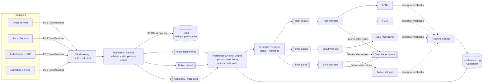
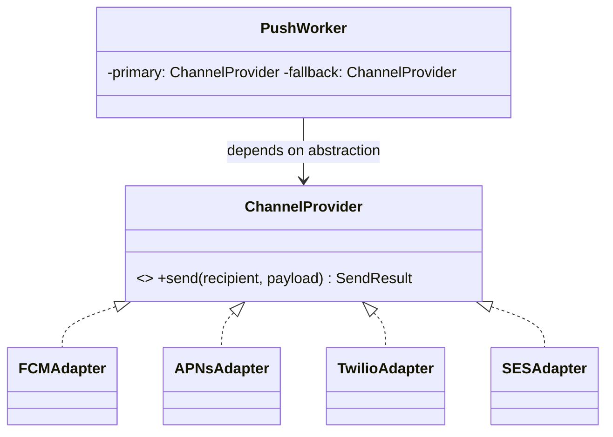
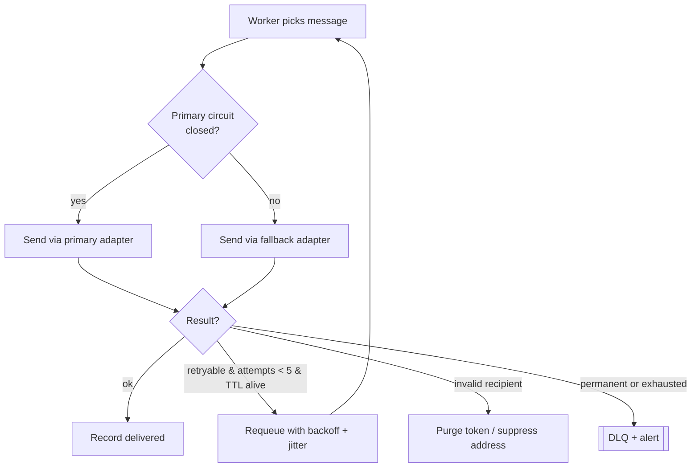
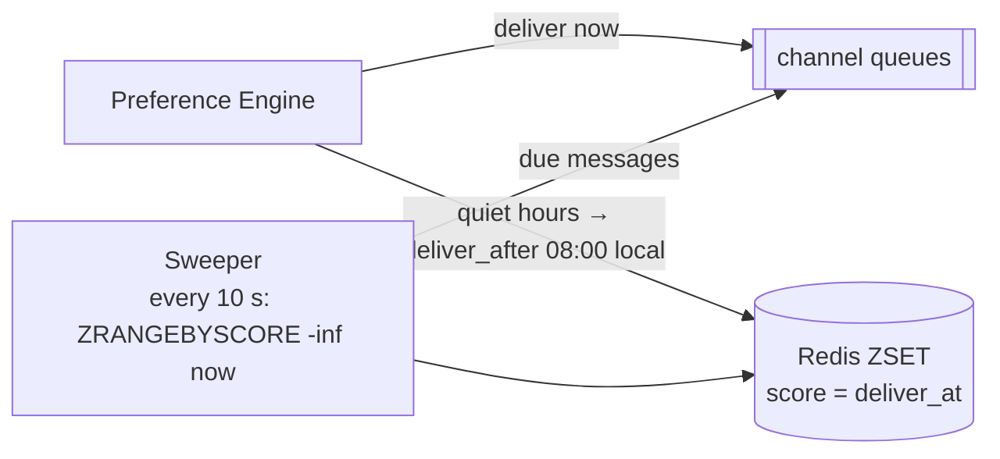
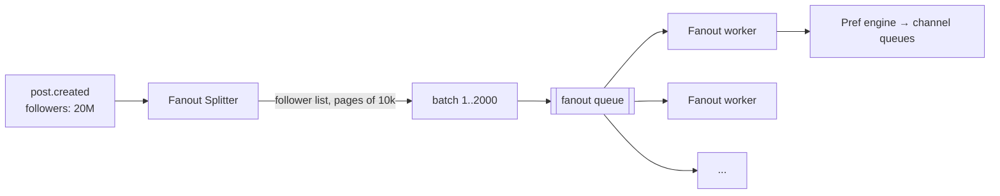
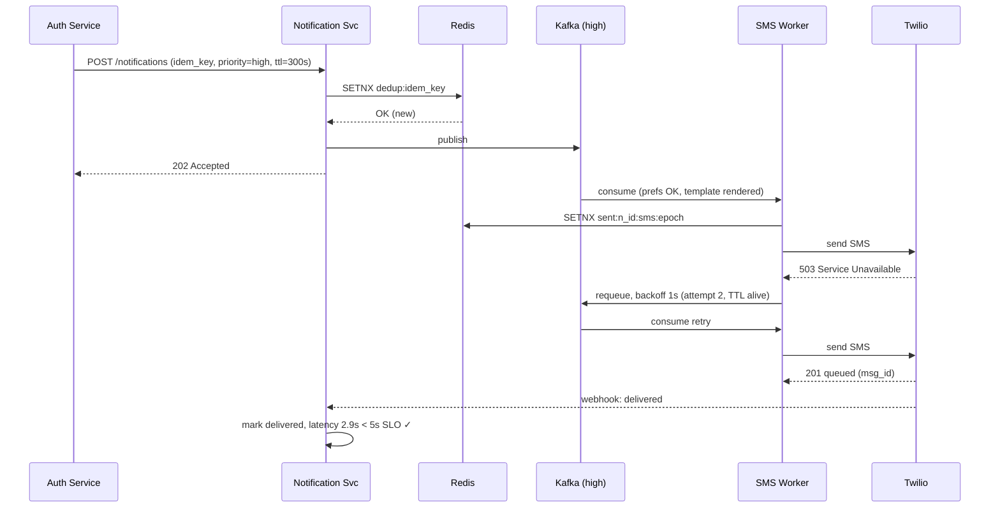

# Day 26 — Design a Notification System

> **Week 4, Day 26.** This is one of the most frequently asked HLD questions because it touches *everything*: queues, fanout, idempotency, rate limiting, third-party integration, and graceful degradation. If you can nail this, you can nail most infrastructure-flavored designs.

---

## 0) ⏱️ Attempt First

**Before reading a single line below this box:** set a 45-minute timer, grab a whiteboard or blank paper, and design this yourself.

> *"Design a notification system that sends push notifications, SMS, and email to users. It must support 100M users, respect user preferences, never send duplicates, and keep OTPs fast even when a celebrity's post triggers 5M pushes."*

Work through: requirements → estimates → API → data model → architecture → 2 deep dives. Then come back and diff your answer against this one. The gaps you find are your study list.

---

## 1) Requirements

### Functional — in scope
- **Multi-channel delivery:** mobile push (APNs for iOS, FCM for Android), SMS, email. In-app notification feed as a bonus.
- **Triggering:** other services (orders, social, marketing, auth) emit events; the notification system decides who gets what, on which channel.
- **User preferences:** per-channel opt-in/opt-out, per-category opt-out (e.g., "no marketing push"), quiet hours.
- **Templates:** content is rendered from templates + variables, localized.
- **Reliability:** at-least-once delivery to the provider, with dedup so the *user* experiences at-most-once.
- **Priority:** OTP/security notifications must not queue behind marketing blasts.
- **Tracking:** delivered / opened / clicked receipts feed back into the system.

### Functional — explicitly out of scope (say this out loud in the interview)
- Building our own SMTP servers or SMS gateways — we integrate providers (SES/SendGrid, Twilio, APNs/FCM).
- Web push and voice calls (mention they slot into the same channel abstraction).
- The recommendation logic for *what* to notify — upstream services own that.

### Non-functional targets
| NFR | Target | Note |
|---|---|---|
| Scale | 100M users, ~1B notifications/day | ~mix: 80% push, 15% email, 5% SMS |
| Latency (OTP) | p99 < 5 s end-to-end | security-critical lane |
| Latency (marketing) | minutes is fine | soft real-time |
| Durability | no accepted notification silently lost | at-least-once + DLQ |
| Duplicate rate to user | ~0 | dedup layer, see deep dive |
| Availability | 99.9% for the ingest API | providers will fail; we must not |

---

## 2) Estimates (all arithmetic shown)

**Volume.**
- 1B notifications/day ÷ 86,400 s/day ≈ **11,600/s average**.
- Peak factor ×5 (morning digests, big events) → **~58,000/s peak**. Round to **60k/s** design target.

**Per-channel peak** (using the 80/15/5 mix):
- Push: 0.8 × 60k = **48k/s**
- Email: 0.15 × 60k = **9k/s**
- SMS: 0.05 × 60k = **3k/s**

**Storage.**
- One notification record ≈ 1 KB (ids, user, channel, template id, rendered-body hash, status, timestamps).
- 1B/day × 1 KB = **1 TB/day** ≈ 30 TB/month. Keep 90 days hot ≈ **90 TB** → partitioned store + TTL/archival to cold object storage.

**Queue throughput.**
- 60k msgs/s × ~1 KB = **60 MB/s** — trivially within Kafka territory (a modest cluster does GB/s; numbers approximate).

**Device tokens.**
- 100M users × ~2 devices × ~150 B/token record = **~30 GB** — fits comfortably in a single replicated DB, cache the hot set.

**Dedup keyspace.**
- 1B keys/day × ~80 B (key + Redis overhead) with a 24 h TTL = **~80 GB resident** — this is why the dedup tier is a *cluster*, not one node, from day one; at 72 h retention it's ~240 GB.

**Bandwidth to providers.**
- Push: 48k/s × ~2 KB (payload + headers) ≈ **~96 MB/s** egress at peak — one NIC's worth; never the bottleneck, but showing you checked is the point.

**Worker count sanity check (push):** if one worker sustains ~500 provider calls/s (HTTP/2 multiplexed to FCM/APNs, approximate), then 48k/s ÷ 500 = **~96 workers**, so provision ~150 for headroom. Showing this math is exactly what separates a senior answer from hand-waving.

---

## 3) API Design

Internal ingest API (called by other services, not end users):

```
POST /v1/notifications
{
  "idempotency_key": "order-svc:order-9127:shipped",   // Day 19 pattern
  "event_type": "order.shipped",
  "recipient": { "user_id": "u_42" },
  "priority": "high" | "default" | "low",
  "template_id": "order_shipped_v3",
  "variables": { "order_id": "9127", "eta": "Friday" },
  "channels_hint": ["push", "email"],     // optional; prefs can override
  "ttl_seconds": 3600                     // don't deliver a stale OTP
}
→ 202 Accepted { "notification_id": "n_abc123" }
```

```
GET  /v1/notifications/{id}/status        → per-channel delivery states
PUT  /v1/users/{id}/preferences           → channel & category opt-outs, quiet hours
POST /v1/providers/webhooks/{provider}    → delivery receipts (Twilio, SES, FCM)
GET  /v1/users/{id}/feed?cursor=...       → in-app notification feed (bonus)
```

Design notes:
- **202, not 200** — the API accepts and enqueues; delivery is async. Synchronous delivery would couple our availability to Twilio's.
- **`idempotency_key` is mandatory.** Caller retries must not double-notify (deep dive 2).
- **`ttl_seconds`** lets us drop stale messages: a 10-minute-old OTP is worse than none.

---

## 4) Data Model

**In plain words:** Different data has different personalities, so we store each kind where it is happiest. The endless stream of "we sent this" records is like a firehose diary — you want somewhere cheap that swallows writes fast. But a user's "please never SMS me marketing" choice is a promise you must never get wrong (it can be a legal issue), so that lives in a careful, consistent database. Using the right tool for each is called polyglot persistence.

| Table | Key fields | Store & why |
|---|---|---|
| `notifications` | id, idempotency_key (unique), user_id, event_type, priority, status, created_at | **Cassandra/DynamoDB** — write-heavy append log, partition by user_id + time bucket; no cross-row transactions needed |
| `delivery_attempts` | notification_id, channel, provider, attempt_no, status, provider_msg_id | same store, wide rows per notification |
| `user_preferences` | user_id, channel→bool map, category opt-outs, quiet_hours, timezone | **PostgreSQL** — low write volume, strong consistency wanted for opt-outs (legal!), cached in Redis |
| `device_tokens` | user_id, platform (ios/android), token, last_seen | PostgreSQL + Redis cache; tokens invalidated on provider feedback |
| `templates` | template_id, version, locale, channel, body | PostgreSQL + in-memory cache in renderers; versioned, immutable rows |
| `dedup_keys` | dedup_key, sent_at (TTL 24–72 h) | **Redis** — SETNX with TTL, microsecond checks at 60k/s |

**Why the split?** The notification log is a firehose (1 TB/day) — that's an LSM-tree/wide-column workload. Preferences and tokens are small, relational, and correctness-critical (sending marketing SMS to an opted-out user can be a legal violation, not just a bug) — that's Postgres. Same polyglot-persistence reasoning we used on Day 24.

> **🤔 Wait — why enforce preferences and quiet hours as a server-side check instead of just filtering on the client?**
> Because the message has already cost you money and reputation by the time it reaches the client. Client-side filtering still sends the SMS (you pay Twilio), still wakes the phone, and — for a marketing message to someone who legally opted out — is a compliance violation regardless of whether the app hides it. Opt-outs are a promise you must keep *before* the send, which is why they live in a consistent store and gate the pipeline, not the UI.

**✅ Good scenario (where this design choice wins):** A user opts out of marketing SMS. The preference engine drops that channel before the message ever reaches Twilio — no cost, no 3am buzz, and an auditable record that you honored the opt-out, which is exactly what a regulator or a TCPA complaint will ask for.

**❌ Bad scenario (when it backfires / the naive alternative):** Preferences checked only in the app: you still send (and pay for) millions of unwanted messages, quiet-hours are ignored for anyone on an old app version, and one opted-out user who still gets a marketing text becomes a legal claim — a per-message fine, not a bug ticket.

**When NOT to over-do it:** For a single opt-in transactional channel with no marketing and no quiet-hours product requirement, a simple boolean check inline is enough — you don't need a first-class policy engine until channels, categories, and compliance rules multiply.

---

## 5) High-Level Architecture

**In plain words:** Think of the whole system as a mailroom assembly line. Requests come in the front door and get a quick "got it, we'll handle it" receipt (accept and dedup). Then each item moves down the belt: someone checks whether this person even wants this message and picks the right words in their language (preferences and template rendering), and finally specialized packers hand it to the right courier — push, email, or SMS — and watch for delivery confirmations. Splitting it into stages means one slow courier never jams the whole line.


*One pipeline, three phases: accept & dedup → decide & render → per-channel delivery with feedback loops.*

### Step-by-step flow walkthrough
1. **Producer** posts an event with an idempotency key. Gateway authenticates the *service* (mTLS/service token) and applies a coarse per-service rate limit — the **token bucket from Day 21**.
2. **Notification Service** validates the payload, runs `SETNX dedup:{idempotency_key}` in Redis. Duplicate → return the original `notification_id`, done. New → persist the record, publish to the Kafka topic matching `priority`.
3. **Preference & Policy Engine** consumes: loads user prefs (Redis cache, Postgres fallback), drops opted-out channels, defers messages in quiet hours (except `high` priority), enforces per-user daily caps, possibly folds the message into a **digest** (deep dive 3).
4. **Template Renderer** picks the template version + user locale, substitutes variables, produces channel-specific payloads (push ≤ ~4 KB APNs limit — approximate; email HTML; SMS ≤ 160 chars per segment).
5. **Channel workers** pull from per-channel queues, call the provider through an **adapter** (deep dive 1), record the attempt, retry with backoff on transient failures, park permanent failures in the **DLQ**.
6. **Tracking Service** ingests provider webhooks/receipts, updates delivery status, and feeds back signal: invalid device tokens get purged, bounce rates trigger alerts.

> **🤔 Wait — why put a message queue between the app and the senders instead of just calling APNs/FCM directly?**
> Because a direct call chains your availability to Twilio's worst day. If a provider is slow or down and you call it synchronously, the producer's thread blocks, backpressure climbs the stack, and an order-service checkout starts timing out because email is having a bad afternoon. A durable queue lets you accept in milliseconds (202), absorb provider outages as backlog instead of errors, and retry on your own schedule.

**✅ Good scenario (where this design choice wins):** At 60k/s across four providers that each fail independently, the queue is the shock absorber — when SES has a 20-minute wobble, messages pile up and drain later instead of surfacing as 5xx to every producer. OTPs keep flowing on their own lane the whole time.

**❌ Bad scenario (when it backfires / the naive alternative):** Synchronous sends turn one provider's 3am incident into a cascading outage: worker threads pin waiting on APNs, the ingest API's connection pool exhausts, and now checkout, login, and notifications are all down together — a single-vendor blip amplified into a company-wide SEV.

**When NOT to over-do it:** If you send 10k transactional emails a day from one service, a synchronous SES call with a retry is fine — the queue is overkill until you have multiple providers, real-time SLOs, or producers you can't afford to block.

---

## 6) Deep Dives (where the interview is won)

### Deep dive 1 — Multi-channel abstraction: the Adapter pattern, industrial-strength

**In plain words:** Push, SMS, and email providers each speak their own "language" — different URLs, error codes, and quirks. An adapter is like a universal travel plug: your laptop (the worker) plugs into one shape, and each country's socket (FCM, Twilio, SES) gets its own little converter. The worker never learns the local wiring; it just trusts the plug to translate.

This is the **Adapter pattern from Day 5**, promoted from a class-diagram exercise to a production necessity. Every provider has a different API shape, auth scheme, rate limit, and failure vocabulary. The system must speak one internal language.

```java
// A small immutable value object describing the outcome of one send.
// Providers must translate their many error shapes into these few fields.
class SendResult {
    final boolean ok;
    final String providerMsgId;        // null when the send did not succeed
    final boolean retryable;           // normalize provider errors!
    final boolean invalidRecipient;    // e.g., dead device token

    SendResult(boolean ok, String providerMsgId, boolean retryable, boolean invalidRecipient) {
        this.ok = ok;
        this.providerMsgId = providerMsgId;
        this.retryable = retryable;
        this.invalidRecipient = invalidRecipient;
    }
}

// The single internal language every provider must speak.
interface ChannelProvider {
    SendResult send(String recipient, Map<String, Object> payload);
}

// One adapter per provider — this one wraps Firebase Cloud Messaging.
class FCMAdapter implements ChannelProvider {
    @Override
    public SendResult send(String token, Map<String, Object> payload) {
        HttpResponse resp = client.post(FCM_URL, toFcm(payload));
        if (resp.statusCode() == 200) {
            // success: hand back the provider's message id for tracking
            return new SendResult(true, resp.json().get("name").toString(), false, false);
        }
        if (resp.statusCode() == 429 || resp.statusCode() == 500 || resp.statusCode() == 503) {
            return new SendResult(false, null, true, false);   // back off & retry
        }
        if (resp.statusCode() == 404) {                        // UNREGISTERED
            return new SendResult(false, null, false, true);   // purge token
        }
        return new SendResult(false, null, false, false);      // DLQ
    }
}

class TwilioAdapter implements ChannelProvider { /* same contract */ }
class SESAdapter implements ChannelProvider { /* same contract */ }
```

Key insight to say out loud: **the adapter's real job is normalizing *errors*, not requests.** A worker should never contain `if provider == "twilio"`. The retry loop, DLQ logic, and token cleanup are written once against `SendResult`.

> **🤔 Wait — why hide every channel behind one interface instead of an if/else per provider in the worker?**
> Because the branching doesn't stay small. The moment you write `if provider == "twilio"` you'll also special-case its retryable error codes, its dead-recipient signal, its auth refresh — and repeat all of it for FCM, APNs, and SES until the retry loop is an unreadable tangle nobody dares touch. One interface means the retry/DLQ/token-purge logic is written once against `SendResult`, and adding Vonage is a new class, not a new branch in ten places.

**✅ Good scenario (where this design choice wins):** You run four providers today and swap vendors under contract pressure or mid-outage. Failover from SES to SendGrid is a config change because both speak the same `SendResult` contract; the worker never learns either vendor's wire format.

**❌ Bad scenario (when it backfires / the naive alternative):** Provider quirks leak into the worker: someone maps Twilio's 429 as permanent, so a transient rate-limit becomes a DLQ dump of real OTPs; meanwhile an APNs 410 gets retried forever because the dead-token branch only existed in the FCM if-block. Error-handling bugs multiply once per provider.

**When NOT to over-do it:** If you'll only ever have one channel and one vendor — say, in-app feed only — the interface is ceremony; a direct call ships and you extract the abstraction when the second provider actually arrives.


*Workers depend on the interface; providers are swappable — Day 5's Adapter and DIP in the wild.*

What the adapters are actually papering over — know a few concrete differences so the abstraction feels earned (all approximate):

| Concern | APNs (iOS) | FCM (Android) | Twilio (SMS) | SES (email) |
|---|---|---|---|---|
| Payload limit | ~4 KB | ~4 KB | 160 chars/segment (concat billed per segment) | ~10 MB |
| Auth | JWT (p8 key) over HTTP/2 | OAuth2 service account | API key + basic auth | SigV4 |
| "Recipient gone" signal | 410 + timestamp | 404 UNREGISTERED | carrier error codes | hard bounce via SNS |
| Delivery receipt | none (fire-and-forget-ish) | delivery data via BigQuery export | status webhooks | bounce/complaint webhooks |
| Cost shape | free | free | per message (dominates channel cost) | ~fractions of a cent |

That cost row explains a product rule you should volunteer: **SMS is the channel of last resort** — OTPs and nothing else, everything marketing goes push/email. A design that lets the marketing team send 100M SMS is a design that lets them spend the quarter's budget in an afternoon; the per-category channel policy in the preference engine is a financial control, not just UX.

### Deep dive 2 — Reliability: retries, DLQ, failover, and "never two identical pushes"

**In plain words:** Delivering a notification is like mailing a letter through an unreliable post office. If it bounces back, you try again a few times (retries); if it keeps failing, you set it aside in a special bin to inspect later (dead-letter queue); and you keep a little logbook so you never accidentally mail the same letter twice (deduplication). The goal is that no letter is ever silently lost and the reader never gets two copies of the same one.

**Retries.** Transient provider failures (429/5xx/timeouts) → exponential backoff with jitter: 1s, 4s, 16s, 64s, cap ~5 attempts. Respect the `ttl_seconds` — an expired OTP is dropped, not retried.

**Provider failover.** Each channel configures a primary and a fallback (SES → SendGrid, Twilio → Vonage). Wrap each provider in a **circuit breaker (Day 21)**: if error rate over a sliding window exceeds ~50%, open the circuit and route to the fallback for a cool-down period, half-open probes to recover.

> **🤔 Wait — why exponential backoff and a DLQ instead of just retrying immediately until it works?**
> Because tight retries against a struggling provider are how you turn a small outage into a self-inflicted DDoS. When APNs returns 503, every worker retrying in a hot loop multiplies your own traffic exactly when the provider is least able to take it, and synchronized retries hit it in waves. Backoff with jitter spreads the load; a capped attempt count plus a DLQ means a permanently-broken message is quarantined for a human instead of spinning forever.

**✅ Good scenario (where this design choice wins):** A provider has a 90-second blip. Jittered backoff (1s, 4s, 16s…) lets most messages succeed on attempt 2 or 3 without a stampede, and the handful that are genuinely bad (malformed payload, dead token) land in the DLQ where an on-call inspects a bounded pile instead of chasing a firehose.

**❌ Bad scenario (when it backfires / the naive alternative):** No backoff, no cap: a bad template makes every send fail, workers requeue instantly, and a 60k/s pipeline becomes 300k/s of doomed retries — retry amplification saturating the provider and your own queues, melting the pipeline you were trying to protect.

**When NOT to over-do it:** For a low-volume internal alerting job, a fixed 3-attempt retry with a log line is plenty — you don't need jittered backoff and a DLQ dashboard until retries at scale can hurt the provider or yourself.


*Every failure has exactly one home: retry, purge, or DLQ — nothing is silently dropped.*

**Idempotency & dedup — the two-layer defense.** Duplicates enter from two directions:

1. **Upstream duplicates** — the order service retried its POST. Caught at ingest by the **idempotency key (Day 19)**: `SETNX dedup:{key} EX 86400`. Same key → same `notification_id` returned, no second message.
2. **Internal duplicates** — Kafka is at-least-once; a worker can crash *after* calling FCM but *before* committing its offset. On restart it re-reads the message. Defense: a **send-side dedup key** checked immediately before the provider call:

```java
// Build a key unique to this exact send attempt.
String dedupKey = String.format("sent:%s:%s:%d", notificationId, channel, attemptEpoch);
// attemptEpoch groups legitimate retries; a redelivered offset reuses it.
// setIfAbsent (Redis SETNX) returns false if the key already exists.
if (!redis.setIfAbsent(dedupKey, "1", Duration.ofHours(72))) {
    return;  // someone already sent (or is sending) this — skip
}
SendResult result = provider.send(token, payload);
```

Be honest in the interview: there is a tiny window (Redis write succeeds, worker dies mid-send, was the send actually made?) where **exactly-once to an external HTTP API is impossible** — we choose "rare duplicate to provider, dedup key makes user-visible duplicates ~0, and receipts reconcile the truth." Senior candidates name the impossibility; juniors claim exactly-once.

> **🤔 Wait — why build a dedup layer at all instead of just trusting producers to send each notification once?**
> Because "send once" is a promise no distributed producer can keep. The order service's POST times out on the network but actually succeeded, so it retries — now there are two identical requests, and it did nothing wrong. Add Kafka's at-least-once redelivery and worker crashes mid-send, and duplicates are *structural*, not a producer bug. The dedup key is where you absorb that reality so the user never sees two "your code is 123" texts.

**✅ Good scenario (where this design choice wins):** During a network flap, a producer retries thousands of POSTs. `SETNX` on the idempotency key collapses each retry back to the original `notification_id`, so users get exactly one message even though ingest saw millions of duplicate requests.

**❌ Bad scenario (when it backfires / the naive alternative):** Trusting the producer: one upstream service stuck in a retry loop, or one offset re-read after a crash, and you fire a duplicate-notification storm — the same push waking millions at 3am twice, or an OTP arriving in triplicate so users think they're being phished. That's a front-page incident, not a nuisance.

**When NOT to over-do it:** If every producer already carries a natural unique key you control end-to-end and volume is tiny, a unique DB constraint on insert does the job — you don't need a Redis dedup cluster until you're checking at 60k/s.

### Deep dive 3 — Rate limiting, quiet hours, digests, priority lanes, and fanout

**In plain words:** This is all about being a polite houseguest rather than an annoying one. You limit how often you knock (rate limiting), you stay quiet while people sleep (quiet hours), you bundle small updates into one summary instead of tapping shoulders fifteen times (digests), you let urgent messages skip the line (priority lanes), and when one celebrity needs to tell 20 million people, you split the work among many messengers instead of one exhausted runner (fanout).

**Per-user caps.** Product rule: max N notifications/user/day (e.g., 10 for marketing, unlimited for transactional). Implementation: a Redis counter `cap:{user_id}:{yyyymmdd}` with `INCR` + 24h expiry — a fixed-window cousin of the **token bucket from Day 21**. Over cap → downgrade to the in-app feed or fold into the digest.

> **🤔 Wait — why cap per user in the pipeline instead of just letting each producer decide when to send?**
> Because no single producer can see the total. Social, marketing, and orders each think their one message is reasonable, but the user gets fifteen buzzes in an hour and disables push for good. A per-user cap (and the digest that catches the overflow) is the only place with the global view of "how much have we already bothered this person today" — it protects the product's most valuable asset, permission to reach the user at all.

**✅ Good scenario (where this design choice wins):** A viral post, a marketing blast, and normal transactional traffic all land on one user in the same window. The per-user counter downgrades the excess to the in-app feed or folds it into a digest, so the user gets one tidy summary instead of a barrage — opt-in survives.

**❌ Bad scenario (when it backfires / the naive alternative):** No central cap: a marketing blast collides with an engagement campaign and a notification-heavy feature launch, each independently "within limits," and your push opt-out rate steps up overnight. You can't un-send the fatigue, and the users who muted you are the ones you most wanted to reach.

**When NOT to over-do it:** For purely transactional, user-initiated notifications (OTP, password reset, receipts) there's nothing to cap — the user asked for each one; per-user throttling only earns its keep once system-initiated marketing/social volume exists.

**Quiet hours.** Preference engine converts to the user's timezone; non-high-priority messages get a `deliver_after` timestamp and park in a delayed queue (Kafka + scheduler topic, or Redis ZSET sorted by deliver-time that a sweeper polls).


*Deferred delivery is just a sorted set plus a sweeper — no exotic infrastructure needed.*

The per-user cap and digest logic in code, to make the mechanics concrete:

```java
// Fixed-window daily cap — cousin of the Day 21 token bucket.
boolean checkUserCap(String userId, String category) {
    String key = String.format("cap:%s:%s:%s", userId, category, todayStr());
    long count = redis.incr(key);
    if (count == 1) {
        redis.expire(key, 86400);       // start the 24h window on first hit
    }
    return count <= CAPS.get(category); // e.g., marketing: 3, social: 10
}

void addToDigest(String userId, Map<String, Object> event) {
    String key = String.format("digest:%s", userId);
    long n = redis.rpush(key, toJson(event));           // append event to the list
    if (n == 1) {
        redis.expire(key, DIGEST_WINDOW_S);             // 30 min window
        scheduleFlush(userId, DIGEST_WINDOW_S);         // ZSET again
    } else if (n >= DIGEST_MAX_ITEMS) {                 // or flush early
        flushDigest(userId);
    }
}

void flushDigest(String userId) {
    // Read every buffered event back out and parse it.
    List<Map<String, Object>> events = new ArrayList<>();
    for (String e : redis.lrange(String.format("digest:%s", userId), 0, -1)) {
        events.add(fromJson(e));
    }
    redis.delete(String.format("digest:%s", userId));
    if (!events.isEmpty()) {
        enqueueNotification(userId,
                            "digest_v2",
                            summarize(events),           // "15 people liked…"
                            "low",
                            String.format("digest:%s:%s", userId, windowId()));
    }
}
```

Note the digest's own idempotency key includes the window id — a crashed-and-restarted flush worker can't send the same digest twice. The patterns compose.

**Digest batching.** Instead of 15 separate "X liked your post" pushes, accumulate per-user events in a window (e.g., 30 min) and send one "15 people liked your post." Mechanically: events append to `digest:{user_id}` list; a flush fires on window expiry or count threshold. This is a *product* fix for a *systems* symptom — mention that framing.

**Priority lanes.** OTPs must never queue behind a 5M-push marketing blast. Separate topics and **separate worker pools** (see architecture diagram): high-priority workers are always provisioned hot and marketing can lag by minutes without paging anyone. One shared queue with priority fields is not enough — head-of-line blocking at the consumer defeats it.

**Celebrity fanout.** A post by an account with 20M followers must not become one giant task:


*Split 20M recipients into 2,000 batches of 10k; horizontal workers chew through them — the same fanout-on-write vs fanout-on-read trade-off from the news feed design (Day 23).*

Math check: 20M pushes ÷ 48k/s channel capacity ≈ **7 minutes** to drain if we let it saturate — which is exactly why it runs in the low-priority lane and why OTPs have their own.

**Tracking & receipts.** Providers report delivery/open (APNs feedback, FCM `UNREGISTERED`, SES bounces, Twilio status callbacks) via webhooks. The Tracking Service updates `delivery_attempts`, purges dead tokens, suppresses hard-bounced emails (protects sender reputation), and emits open/click events to analytics — closing the loop so the system self-heals its recipient lists.

### Deep dive 4 — In-app feed, badge counts, and observability

**In plain words:** The in-app feed is like a personal inbox inside the app — messages wait there quietly until the user opens it, no provider fees and no "please stop texting me" risk. The little red badge is just a counter on the door. Observability is the smoke detector: a notification system tends to fail silently (people just stop getting messages), so you watch dashboards to catch the silence before your users do.

**The in-app feed** is the cheapest, safest channel — no provider, no opt-out anxiety — and the natural downgrade target when a user is over their push cap:

- Feed writes go to the notification log store (Cassandra, partition key `user_id`, clustering by `created_at DESC`) — reads are "latest N for one user," which is exactly the partition shape.
- Unread badge count lives in Redis (`INCR unread:{user_id}` on write, reset on feed-open). A silent push carries only the badge number so the app icon updates without a visible notification.
- Read API is cursor-paginated (`GET /users/{id}/feed?cursor=...`) — offset pagination on a 90-day feed is an anti-pattern you already met on Day 23's news feed.
- Mark-read is a write to a per-user high-water-mark timestamp, not per-item flags — one tiny row instead of N updates.

**What to monitor** — a notification system fails quietly; users just… stop getting things. The dashboard that catches it:

| Metric | Alert threshold (approximate) | What it catches |
|---|---|---|
| Ingest → provider-ack latency, p99 per priority | high-pri > 5 s | queue backlog, worker starvation |
| Consumer lag per Kafka topic | growing for > 5 min | under-provisioned workers |
| Provider error rate per adapter | > 5% over 5 min | provider outage → circuit breaker sanity check |
| DLQ arrival rate | > ~0 sustained | new class of permanent failure |
| Dedup-hit rate at ingest | sudden spike | an upstream service stuck in a retry loop |
| Bounce / token-invalid rate | > 2% of sends | stale recipient data, sender-reputation risk |
| Opt-out rate per campaign | step change | the product is annoying people — page marketing, not SRE |

That last row is the observability version of the Dark Side section: the system should *measure* the fatigue it can cause.

---

## 7) Sequence Diagram — OTP happy path with one transient failure


*At-least-once internally, dedup key guarding the provider call, TTL bounding retries.*

---

## 8) Bottlenecks & Evolution at 10×

At **10B notifications/day (~600k/s peak)**:

| Bottleneck | Symptom | Evolution |
|---|---|---|
| Redis dedup/prefs | single cluster CPU-bound | shard by user_id via **consistent hashing (Day 12)**; it's exactly the Day 28 distributed cache |
| Preference engine reads | Postgres read replicas lag | push prefs into a change-data-captured cache; treat opt-out writes as the only strongly-consistent path |
| Kafka partitions | consumer lag on marketing topic | more partitions + partition by user_id to keep per-user ordering |
| Provider rate limits | 429s from Twilio/APNs | per-provider token buckets in workers; negotiate higher quotas; multi-account sharding |
| Notification log | 10 TB/day | shorter hot retention (14 days), stream to data lake, pre-aggregate stats |
| Fanout splitter | one splitter per event too slow | hierarchical fanout: splitter → sub-splitters → workers |

Also at 10×: dedicated **cells** (per-region full stacks) so a bad deploy or regional outage caps blast radius — foreshadowing Day 30's "beyond" list.

---

## 9) Trade-offs Summary

| Decision | Alternative | Why we chose it |
|---|---|---|
| Async queue-based pipeline | Synchronous send in API call | Provider outages must not fail the caller; retries need a durable buffer |
| Separate priority topics + pools | One queue with priority field | Avoids head-of-line blocking; OTP SLO is a hard requirement |
| At-least-once + dedup keys | Attempt exactly-once | Exactly-once to external HTTP APIs is impossible; dedup gives user-level at-most-once |
| Cassandra for notification log | PostgreSQL | 1 TB/day append-only, time-bucketed reads — LSM/wide-column shaped |
| Postgres for prefs/opt-outs | Same NoSQL as log | Opt-out is a legal correctness problem; small data, strong consistency |
| Adapter per provider + circuit breaker | Direct provider SDK calls in workers | Failover and error normalization in one place; providers swappable |
| Digest batching | Send every event | Notification fatigue kills opt-in rates — product-level throttle |
| Provider failover (multi-vendor) | Single vendor, retry harder | Vendors have correlated internal failures; independence is the point |

---

## 10) Interview Calibration

**A junior answer sounds like:** "The API puts the notification in a queue, workers read it and call Firebase or Twilio, and if it fails we retry." Single queue, no preferences, no dedup story, no numbers, "exactly-once" claimed without blushing.

**A senior answer sounds like:** "Delivery is async behind a 202 API with mandatory idempotency keys. I'll do the math: 1B/day is ~12k/s average, 60k/s peak, so Kafka is loafing but Redis dedup needs sharding at 10×. Priority gets its own topics and worker pools because head-of-line blocking would break the OTP SLO. Providers sit behind adapters that normalize errors, with circuit breakers and vendor failover. Internally we're at-least-once; a send-side dedup key makes user-visible duplicates ~0, and I'll name the crash window where a provider duplicate can still sneak through — receipts reconcile it. Opt-outs live in Postgres because they're a compliance requirement, not a preference."

The delta: **numbers, failure windows named honestly, priority isolation, and knowing which data is legally-consistent vs eventually-consistent.**

---

## Dark Side — when NOT to build this

**Notification fatigue is a product failure, not an infra problem.** A system that can deliver 1B/day makes it *easy* to send 1B/day. Real-world consequence: users disable push entirely (industry uninstall/opt-out rates climb sharply with notification volume — approximate but well-documented direction). The per-user caps, digests, and quiet hours aren't nice-to-haves; they're the system protecting the product from itself. An interviewer who hears you say "the rate limiter's most important customer is our own marketing team" knows you've lived this.

**When a cron + SES beats all of this.** If you're sending 10k order-confirmation emails a day: a cron job, a `notifications` table with a `sent_at` column (poor man's **outbox, Day 15**), and the AWS SDK for Java → SES is the whole system. No Kafka, no priority lanes, no circuit breakers. The architecture above is justified somewhere around "multiple channels + multiple producers + real-time SLOs + millions/day." Saying "I wouldn't build this at 10k/day" is a senior signal, not a cop-out.

---

## 11) Self-Check

Answer without scrolling up:

1. Why does the ingest API return 202 instead of 200, and what breaks if delivery were synchronous?
2. Reproduce the peak QPS math and the push-worker count estimate.
3. Two sources of duplicates and the mechanism that catches each — and where is the unavoidable window?
4. Why are priority lanes separate *topics and worker pools*, not a priority field in one queue?
5. What does the Adapter normalize besides the request shape, and why does that matter for the retry loop?
6. When does the circuit breaker route to a fallback vendor, and how does it recover?
7. Why do opt-outs live in Postgres when the notification log lives in Cassandra?
8. How does a 20M-follower fanout avoid starving OTPs, and how long does 20M pushes take at 48k/s?
9. Name the point at which "cron + SES" stops being the right answer.
10. What feedback loops keep the recipient lists clean over time?

If ≥8 land, you're calibrated. Tomorrow, Day 27: the money path — where a duplicate isn't an annoying push, it's a double charge.

---

## Appendix — earlier-day patterns cashed in today

| Earlier day | Pattern | Where it appeared today |
|---|---|---|
| Day 5 | Adapter | provider adapters normalizing FCM/APNs/Twilio/SES errors |
| Day 12 | Consistent hashing | sharding the Redis dedup/prefs tier at 10× |
| Day 15 | Outbox | (light) the "poor man's outbox" in the cron+SES dark side; full use tomorrow |
| Day 19 | Idempotency keys | mandatory ingest key + send-side dedup key + digest window key |
| Day 21 | Token bucket / circuit breaker | per-service ingest limits, per-user caps, provider breakers |
| Day 23 | Fanout on write | celebrity-post batched fanout workers |

Six days of tooling assembled into one system — this is what "the course must feel connected" means when an interviewer asks "have you seen this before?"

## Appendix — rapid-fire follow-ups (one-breath answers)

- **"How do you handle a user with the app open — do you still push?"** Check presence (WebSocket connection registry, Day 22); if online, deliver in-app only and skip the push — cheaper and less annoying.
- **"What if the template has a bug and renders garbage?"** Templates are versioned + immutable; canary a new version on 1% of a low-priority category before promotion; rollback = pointer change.
- **"How do you test provider failover without an outage?"** Chaos toggle: force-open a circuit in staging (and periodically in prod, deliberately) — a failover path never exercised is a failover path that doesn't work.
- **"Ordering — can 'order shipped' arrive before 'order confirmed'?"** Kafka partitions by user_id give per-user ordering within a topic; across priority topics ordering is NOT guaranteed — design copy so messages are independently meaningful.
- **"Where's the biggest single point of failure?"** The Redis dedup tier: if it's down, we must choose failing ingest (no notifications) vs skipping dedup (possible duplicates). For most products: skip dedup for high-priority, fail low-priority — degrade in the direction that matches each lane's contract.

## Appendix — numbers worth memorizing for this domain (all approximate)

| Number | Value | Why it matters |
|---|---|---|
| Seconds per day | 86,400 (round to 100k for speed) | every QPS estimate starts here |
| One Kafka partition | ~10s of MB/s | our whole 60 MB/s fits in a handful |
| One HTTP/2 push worker | ~500 provider calls/s | worker-count math |
| APNs/FCM payload cap | ~4 KB | template renderer must truncate |
| SMS segment | 160 chars (GSM-7) | copy length is a billing decision |
| Push opt-out cliff | rises sharply past a few notifications/day | why per-user caps exist |
| Email hard-bounce tolerance | keep under ~2% | above it, providers throttle your whole domain |
