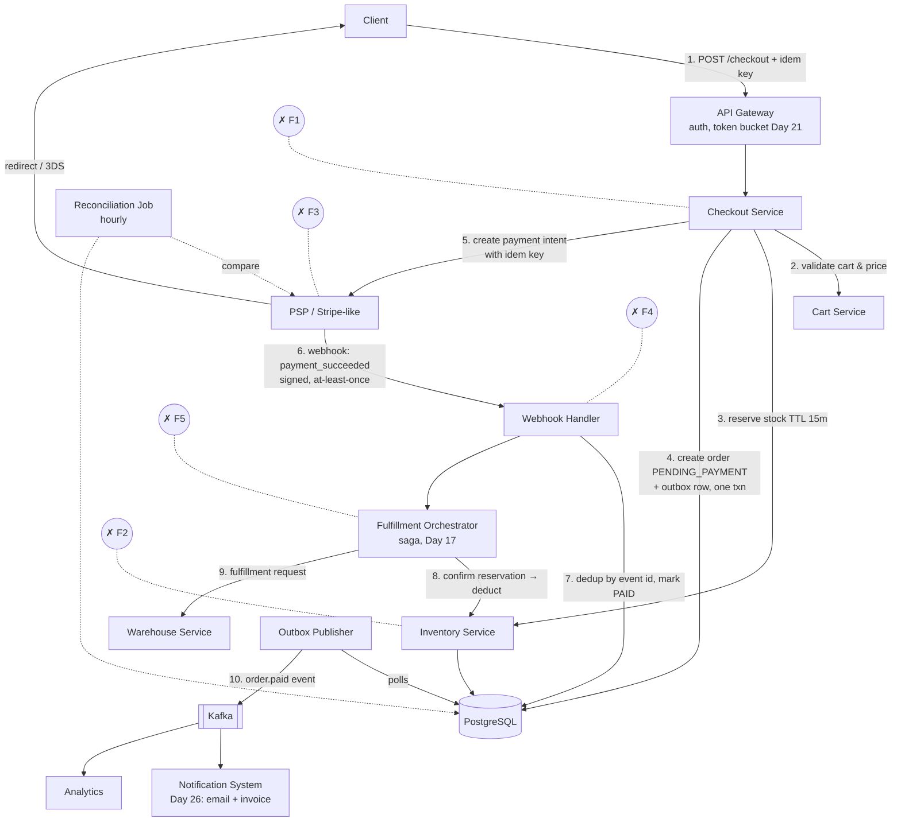
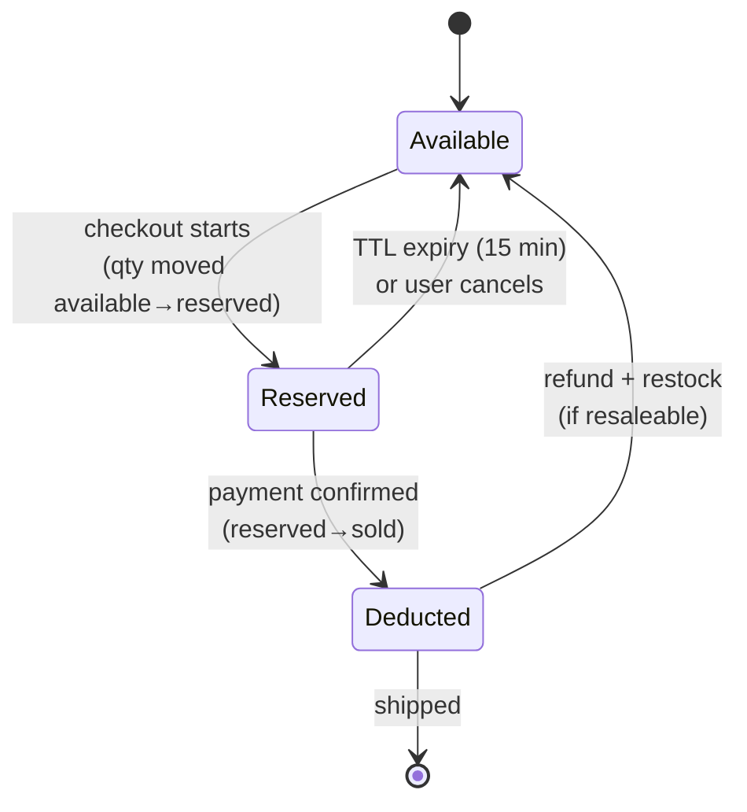
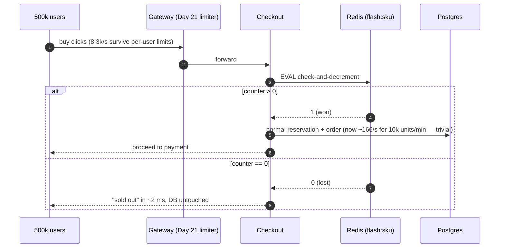
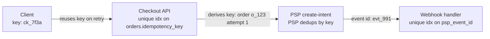
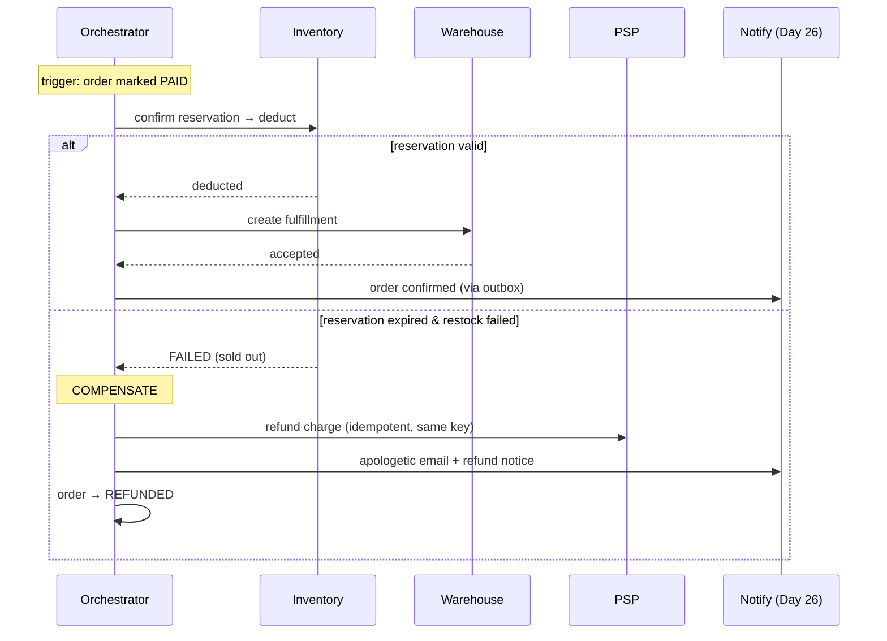
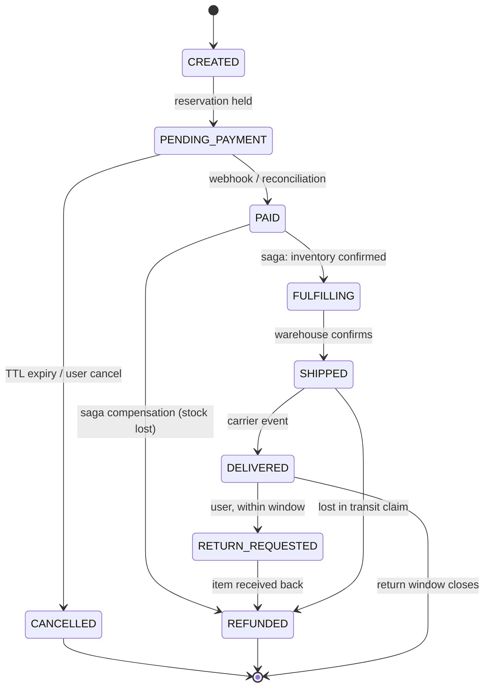
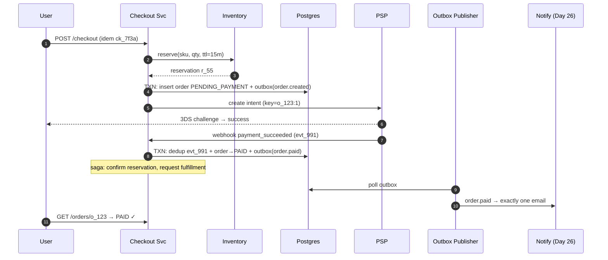

# Day 27 — Design E-commerce Checkout

> **Week 4, Day 27.** Yesterday's system dropped a push notification and nobody died. Today's system drops a message and someone gets charged twice, or a warehouse ships a product that was never paid for. Checkout is the canonical "money path" design: every pattern from Weeks 2–3 — idempotency (Day 19), sagas (Day 17), the outbox (Day 15) — earns its keep here.

---

## 0) ⏱️ Attempt First

**45 minutes, alone, before reading on.**

> *"Design the checkout flow for an e-commerce site: cart → order → payment → confirmation. 10M orders/day, flash sales with 500× spikes on single SKUs. Never oversell inventory, never double-charge, always send exactly one confirmation email. Payments go through a third-party PSP (Stripe-like)."*

The three traps hiding in that prompt: overselling, double-charging, and the PSP webhook that arrives twice — or never. If your design has an answer for all three, you're in good shape. Diff against below.

---

## 1) Requirements

### Functional — in scope
- Cart management (add/remove items, price display).
- Checkout: validate cart, reserve inventory, compute totals (tax, shipping, discounts).
- Payment via external PSP (card, wallets); 3-D Secure redirect possible.
- Order lifecycle: created → paid → fulfilled → delivered, plus cancel/refund paths.
- Exactly-one confirmation email + invoice per order.
- Flash-sale mode: a single SKU with limited stock hit by enormous concurrent demand.

### Functional — out of scope (state it)
- Search, recommendations, catalog ingestion.
- Building a payment processor — we integrate a PSP; PCI scope stays minimal (card data never touches our servers; PSP tokenization).
- Shipping logistics beyond emitting a fulfillment request.

### Non-functional targets
| NFR | Target | Note |
|---|---|---|
| Scale | 10M orders/day, peak ~10× average | flash sale: 500× on one SKU |
| Consistency | **inventory never oversold**; **no double charge** | correctness > latency here |
| Checkout latency | p99 < 2 s (excluding PSP/3DS redirect) | PSP adds 1–3 s we don't control |
| Availability | 99.95% for checkout | every minute down is measurable revenue |
| Auditability | full order/payment event history | finance + disputes need it |

Key framing sentence for the interview: **"This is a CP-leaning system on the money path. I will happily trade latency and availability at the margins for never double-charging."** That inverts most designs you've done this month — say so.

---

## 2) Estimates (all arithmetic)

**Orders.**
- 10M orders/day ÷ 86,400 ≈ **116 orders/s average**; ×10 peak → **~1,200 orders/s**.
- Browse-to-buy ratio ~100:1 (approximate industry shape) → catalog/cart traffic ~120k req/s peak, but that's read-heavy and cacheable — *the checkout write path itself is only ~1.2k/s*. Point this out: the scary number is small once isolated.

**Flash sale.**
- 1 SKU, 10,000 units, 500k users clicking "buy" within 60 s → **~8,300 attempts/s against one inventory row**. This single hot row is the real design problem, not aggregate QPS.

**Storage.**
- Order record + items + events ≈ 5 KB. 10M/day × 5 KB = **50 GB/day** ≈ 18 TB/year. Postgres with partitioning by month handles years of this; archive cold partitions to object storage.

**Payment ledger.** 10M payments/day × ~1 KB = 10 GB/day — small; keep forever (append-only ledger, finance requirement).

**Reservation churn.** If 30% of checkouts abandon, 1,200/s peak × 0.3 = ~360 reservations/s expiring — the TTL-cleanup path is not a corner case, it's a third of traffic.

---

## 3) API Design

```
POST /v1/cart/items                     { sku, qty }
GET  /v1/cart

POST /v1/checkout                       → creates order in PENDING_PAYMENT
{
  "idempotency_key": "ck_7f3a...",      // client-generated UUID, Day 19
  "cart_id": "c_991",
  "shipping_address_id": "a_4",
  "payment_method_token": "pm_tok_x"    // PSP token, never raw card data
}
→ 201 { "order_id": "o_123", "payment_intent": {...} }   // or 409 on stock fail

POST /v1/orders/{id}/confirm            // after 3DS redirect completes
GET  /v1/orders/{id}                    // status polling / order page

POST /v1/webhooks/psp                   // PSP → us: payment events (signed)
POST /v1/orders/{id}/cancel
POST /v1/orders/{id}/refund             { amount, reason }
```

Notes to voice:
- **`idempotency_key` on `POST /checkout` is the single most important field in this design.** The client generates it when the "Pay" button renders (not when clicked) so a double-click or network retry reuses it.
- The PSP webhook endpoint must verify signatures and be **idempotent by PSP event id** — webhooks are at-least-once by contract.
- `GET /orders/{id}` exists because the client may lose the response; state must always be re-fetchable (recovery by read, Day 19).

---

## 4) Data Model

| Table | Key fields | Notes |
|---|---|---|
| `orders` | id, user_id, status, total, currency, idempotency_key **(unique)**, created_at | the state machine lives here |
| `order_items` | order_id, sku, qty, unit_price_snapshot | snapshot prices — catalog prices change |
| `inventory` | sku, available, reserved | hot rows; see deep dive 1 |
| `reservations` | id, order_id, sku, qty, expires_at, status | TTL-based holds |
| `payments` | id, order_id, psp_intent_id, amount, status, idempotency_key | append-only-ish ledger |
| `payment_events` | psp_event_id **(unique)**, payload, processed_at | webhook dedup table |
| `outbox` | id, aggregate_id, event_type, payload, published_at NULL | Day 15, same DB as orders |

**In plain words:** When money is involved, you want all the related records living under one roof so a single "all-or-nothing" save either fully happens or fully doesn't — like recording a bank transfer where the debit and credit must both stick together. Splitting orders, inventory, and payments across separate databases would force you to coordinate them like three strangers signing a contract by mail (a distributed transaction), which is slow and error-prone. So we keep them in one PostgreSQL until the numbers genuinely demand splitting.

**DB choice: PostgreSQL, one database for orders + inventory + payments + outbox.** Why, when all month we've been sharding NoSQL?
- Write volume is ~1.2k/s peak — a single well-tuned Postgres does this comfortably (approximate but safe).
- The money path *needs* ACID: "decrement inventory + create order + write outbox row" in **one local transaction** eliminates a whole class of distributed failure.
- Sharding later (by user_id or region) is possible; starting sharded forfeits transactions for no current benefit. This is the Dark Side section's thesis — plant it here.

> **🤔 Wait — why cram orders, inventory, and payments into one database instead of a service per table with distributed transactions?**
> Because a single `BEGIN; ...; COMMIT;` gives you atomicity for free, while splitting the money path across services means rebuilding that atomicity by hand with two-phase commit or sagas. At 1.2k writes/s peak, one tuned Postgres isn't the bottleneck — the distributed coordination you'd add is pure downside. Split only when a boundary is *forced* (the PSP is genuinely external), not to make the diagram look microservice-y.

**✅ Good scenario (where this design choice wins):** "Decrement inventory + insert order + write the outbox row" commits or rolls back as one unit, so a crash mid-checkout can never leave stock reserved for an order that doesn't exist. One database keeps the correctness-critical writes ACID and lets you ship the feature in weeks, not quarters.

**❌ Bad scenario (when it backfires / the naive alternative):** A team splits into order-svc, inventory-svc, and payment-svc on day one, then wires a 2PC coordinator across all three. During a network blip the coordinator hangs in the "prepared" phase, inventory rows sit locked, and checkouts stall fleet-wide — an on-call page for a problem a single transaction never had.

**When NOT to over-do it:** If two of these datasets genuinely live in different teams' systems (warehouse stock owned by fulfillment), stop forcing them into one DB — that boundary is real and a saga is the honest answer.

Redis appears only for the flash-sale counter (deep dive 1) and cart cache. Cassandra/Dynamo has no seat at this table.

---

## 5) High-Level Architecture — the money path with every failure point marked

**In plain words:** Follow one order like a package moving through a shipping depot. It gets a tracking sticker at the door so scanning it twice never creates two packages (idempotent order creation), stock is set aside for it, payment is arranged with the outside card processor, and only once payment is confirmed does it move to the packing floor. The clever part is labeling every place it could go wrong (F1 through F5) and pre-deciding the rescue plan for each — because on the money path, "what if this step dies?" is the whole job.


*Numbered money path with failure points: F1 checkout crashes mid-flow, F2 stock insufficient/reservation lost, F3 PSP timeout or double-submit, F4 webhook duplicated or never arrives, F5 fulfillment fails after payment.*

### Flow walkthrough with each failure's answer
1–2. **Checkout validates cart** (prices re-checked server-side — never trust client totals).
3. **Inventory reserved** with a 15-minute TTL. *F2a: not enough stock* → 409 to client immediately, nothing to unwind. *F2b: reservation expires because user dawdled* → payment confirm re-checks reservation; expired → attempt re-reserve; sold out → refund path.
4. **Order + outbox row in one Postgres transaction.** *F1: checkout service dies right after* → order exists in PENDING_PAYMENT; client retries with the same idempotency key and gets the same order back (unique constraint on `idempotency_key`), no duplicate order.
5. **Payment intent created at PSP with our idempotency key.** *F3: timeout — did the PSP get it?* → retry with the same key; PSP returns the original intent. Never retry with a fresh key. (Deep dive 2.)
6–7. **Webhook** marks PAID, deduped by `psp_event_id`. *F4: arrives twice* → unique constraint swallows it. *Never arrives* → reconciliation job (deep dive 2).
8–9. **Saga** converts the reservation into a hard deduction and requests fulfillment. *F5: inventory confirm fails after payment* → compensation: refund (deep dive 3).
10. **Outbox publisher** emits `order.paid` → the Day 26 notification system sends exactly one email (deep dive: outbox section).

---

## 6) Deep Dives

### Deep dive 1 — Inventory consistency: the overselling problem

**In plain words:** Selling limited stock is like seating a concert with exactly 10,000 chairs. You can either hand out a ticket the moment someone starts buying and let it expire if they wander off (reserve-at-checkout), or only give the seat when they actually pay (deduct-at-payment). During a flash sale, thousands rush the same door at once, so we put a bouncer with a clicker-counter (Redis) at the entrance to instantly turn people away once the seats are gone — far faster than making everyone reach the ticket desk (the database) to find out.

**Two philosophies:**

| Strategy | How | Pro | Con |
|---|---|---|---|
| **Reserve at checkout** | Hold stock when checkout starts, TTL release | User who starts paying almost always succeeds; good UX | Held stock blocks other buyers; abandonment churn |
| **Deduct at payment** | Only decrement when payment confirms | No holds, max sellable | User pays, then "sorry, sold out" → refund; terrible UX |

We choose **reserve-at-checkout with TTL** — the UX of "paid but no product" is unacceptable, and TTL bounds the hold damage. State the trade-off explicitly.

> **🤔 Wait — why lock up stock the moment checkout starts instead of just deducting it when payment clears?**
> Because the alternative charges the customer's card and *then* discovers the last unit is gone — a refund plus a furious "you took my money and shipped nothing" ticket. Reserving at checkout guarantees anyone who reaches the pay button will actually get the item, and the TTL means an abandoned cart releases its hold in 15 minutes instead of blocking stock forever. You trade a little sellable inventory during the hold window for the promise that "paid" always means "yours."

**✅ Good scenario (where this design choice wins):** High-value or scarce goods — a $1,200 limited sneaker drop — where a customer charged for an item you can't ship is a chargeback, a support escalation, and a Twitter screenshot. The reservation converts "maybe in stock" into a hard promise the instant they commit to paying.

**❌ Bad scenario (when it backfires / the naive alternative):** Deduct-at-payment on a flash sale: two buyers both pass the "in stock" check on the last unit, both get charged, and one gets a "sorry, sold out" refund email seconds later. Or reserve-at-checkout with *no* TTL — bots start 10,000 checkouts, never pay, and real buyers see "sold out" on stock that's just stranded in dead reservations.

**When NOT to over-do it:** For effectively-infinite inventory (a digital download, a print-on-demand item), skip reservations entirely — there's nothing to oversell, and the TTL machinery is pure overhead.


*Inventory units flow between three buckets; every arrow is one atomic transition.*

**Normal path — DB row with optimistic check:**

```sql
UPDATE inventory
SET available = available - :qty, reserved = reserved + :qty
WHERE sku = :sku AND available >= :qty;
-- rows_affected == 0  →  insufficient stock, return 409
```

One statement, atomic, no explicit lock held across a network call. At 1.2k orders/s spread over many SKUs, row contention is negligible.

**Flash-sale path — the hot row.** 8,300 attempts/s on ONE row melts row-locking: each `UPDATE` serializes; even at 1 ms per lock-hold that's a ceiling of ~1,000/s with a growing lock queue and timeouts cascading upward. Two escapes:

1. **Atomic Redis decrement as gatekeeper** (chosen):

```java
// Lua script: atomic check-and-decrement, no race between GET and DECR.
// The whole script runs as one indivisible step inside Redis.
static final String LUA_RESERVE =
    "local stock = tonumber(redis.call('GET', KEYS[1])) " +
    "if stock and stock >= tonumber(ARGV[1]) then " +
    "    redis.call('DECRBY', KEYS[1], ARGV[1]) " +
    "    return 1 " +
    "end " +
    "return 0";

// Returns true only if this buyer successfully grabbed the stock.
boolean tryReserveFlash(String sku, int qty) {
    Object result = redis.eval(LUA_RESERVE,
                               List.of(String.format("flash:%s", sku)),   // KEYS
                               List.of(String.valueOf(qty)));             // ARGV
    return Long.valueOf(1L).equals(result);
}
```

Redis handles ~100k ops/s on one key (approximate) — 8.3k/s is easy. Losers get instant "sold out" without ever touching Postgres. Winners proceed into the normal reservation flow (Postgres is the source of truth; Redis is a pre-filter loaded with the stock count at sale start). If Redis dies mid-sale, fail closed: stop the sale, don't guess.

2. **Alternative worth naming:** queue-based serialization — all buy attempts enter a queue, a single consumer allocates stock in order. Perfectly fair, perfectly serial, adds seconds of latency. Some ticket vendors do exactly this (virtual waiting room).

Sub-trap to mention: **Redis says yes, Postgres reservation fails** (crash between). Consequence: Redis counter slightly undercounts → we *undersell* by a few units. Undersell is a lost sale; oversell is a scandal. The asymmetry is why the pre-filter is safe.

> **🤔 Wait — why front the count with Redis and reconcile later instead of just decrementing the SQL row on every attempt?**
> Because one hot SQL row serializes every `UPDATE` behind a row lock, and at ~1 ms per lock-hold that caps you near 1,000/s while 8,300 requests/s pile into a growing lock queue until timeouts cascade. Redis does a single atomic Lua check-and-decrement in memory at ~100k ops/s, so losers get "sold out" in ~2 ms without ever touching Postgres. The database stays the source of truth for the few hundred winners; Redis is just the bouncer at the door.

**✅ Good scenario (where this design choice wins):** A 10,000-unit drop with 500k people clicking in the same minute against one SKU. The gatekeeper turns an 8.3k/s stampede on a single row into a few hundred real reservations/s, and the 490k losers cost one Redis round-trip each instead of one blocked DB transaction each.

**❌ Bad scenario (when it backfires / the naive alternative):** Point the whole flash sale straight at `UPDATE inventory ... WHERE available >= qty`. The row lock queue backs up, checkout p99 climbs from 200 ms to 30 s, healthy connections exhaust the pool, and the lock contention on that one SKU starves *every other* checkout on the same database — a single sale takes the whole store down.

**When NOT to over-do it:** For everyday catalog traffic spread across thousands of SKUs at 1.2k/s total, row contention is negligible — the plain atomic SQL `UPDATE` is correct, simpler, and needs no Redis-to-Postgres reconciliation job.

The flash-sale path end-to-end, since interviewers often ask you to trace it:


*The gatekeeper converts an 8.3k/s hot-row stampede into a few hundred per second of real work — losers cost one Redis round-trip each.*

### Deep dive 2 — Payment idempotency end-to-end + the webhook problem

**In plain words:** An idempotency key is like writing a unique confirmation number on a form before you fax it. If the fax jams and you resend the same form, the other side sees the same number and knows "I already processed this — don't charge again." The webhook is the payment company faxing you back "it went through"; that fax might arrive twice (you ignore the duplicate) or get lost entirely (a nightly reconciliation job phones them to double-check the books). The cardinal sin is inventing a *new* confirmation number when a call times out — that is exactly how a customer gets charged twice.

This is **Day 19's idempotency keys** applied at every hop of the chain:


*Three independent dedup points; a duplicate can be born at any hop and dies at the next.*

- **Client → us:** double-click, flaky wifi retry → same `ck_7f3a` → unique constraint returns the existing order. 
- **Us → PSP:** our call times out. We do NOT know if the charge exists. Retrying with a *new* key is how double-charges happen. Retry with the *same* key; PSPs contractually return the original result. (Stripe-style semantics — approximate, check your PSP.)
- **PSP → us (webhooks):** at-least-once. Handler:

```java
int handleWebhook(WebhookEvent event) {
    verifySignature(event);                       // reject forgeries
    try {
        // The unique index on psp_event_id IS the dedup mechanism.
        db.insert("payment_events", event.getId(), event);
    } catch (UniqueViolationException e) {
        return 200;                               // duplicate — ack & drop
    }
    applyTransition(event);                        // state machine, deep dive 3
    return 200;                                    // non-2xx → PSP retries
}
```

> **🤔 Wait — why bother with an idempotency key on the PSP call instead of just retrying when it times out?**
> Because a timeout tells you nothing about whether the charge happened — the request may have succeeded and only the *response* got lost. Retry with a fresh key and the PSP treats it as a brand-new charge: the customer pays twice. Send the *same* key and the PSP recognizes it, returns the original result, and the retry is a safe no-op. The key is what makes "did it go through?" answerable without gambling the customer's money.

**✅ Good scenario (where this design choice wins):** A mobile buyer on flaky 4G whose payment request times out and auto-retries three times. All three carry the same `o_123:1` key, the PSP charges exactly once, and the customer sees one line on their statement instead of three plus two refund reversals a week later.

**❌ Bad scenario (when it backfires / the naive alternative):** The client generates a new UUID per click (or per retry) "to be safe." A double-click during a slow response fires two distinct keys, the PSP happily creates two charges, and finance spends the afternoon reconciling duplicate settlements while the customer disputes the card — the classic double-charge incident.

**When NOT to over-do it:** If the operation is naturally idempotent already (a pure status read, or a PUT that overwrites to a fixed value), you don't need a separate key — don't bolt idempotency machinery onto calls that can't double-apply.

**The webhook that never comes.** Networks drop it; the PSP's retry budget exhausts; our handler 500s for an hour. A user paid but their order sits in PENDING_PAYMENT forever. Answer: **reconciliation job** — hourly, list PSP charges for the window, diff against our `payments` table:

| Mismatch | Meaning | Action |
|---|---|---|
| PSP: succeeded, us: pending | lost webhook | apply transition now |
| PSP: no record, us: pending > TTL | intent never completed | cancel order, release reservation |
| PSP: succeeded, us: no order | 🚨 bug or fraud | page a human |
| Amount mismatch | 🚨 serious bug | page a human, freeze order |

Reconciliation is the safety net under every net. Finance teams run it regardless of how good your webhooks are — say that, it lands as real-world experience. The job itself is ~30 lines:

```java
void reconcile(Instant windowStart, Instant windowEnd) {
    // Index the PSP's charges by our order id for quick lookup.
    Map<String, Charge> pspCharges = new HashMap<>();
    for (Charge c : psp.listCharges(windowStart, windowEnd)) {
        pspCharges.put(c.getMetadata().get("order_id"), c);
    }
    List<Payment> ourPayments = db.query(
        "SELECT order_id, status, amount FROM payments WHERE created_at BETWEEN ? AND ?",
        windowStart, windowEnd);
    for (Payment p : ourPayments) {
        Charge charge = pspCharges.remove(p.getOrderId());   // remove = "matched"
        if (charge == null && p.getStatus().equals("pending") && p.age() > INTENT_TTL) {
            cancelOrder(p.getOrderId());                     // intent never completed
        } else if (charge != null && charge.getStatus().equals("succeeded")
                                  && p.getStatus().equals("pending")) {
            applyTransition(fakeWebhook(charge));            // lost webhook — heal
        } else if (charge != null && charge.getAmount() != p.getAmount()) {
            pageOncall("AMOUNT_MISMATCH", p.getOrderId());   // freeze + human
        }
    }
    for (Charge orphan : pspCharges.values()) {              // PSP has it, we don't
        pageOncall("ORPHAN_CHARGE", orphan.getId());
    }
}
```

One more resilience detail: **webhook ingestion should ack fast and process async** during our own incidents — persist the raw event to the `payment_events` table (that insert IS the dedup), return 200, and let a consumer apply transitions. If we processed inline and our order DB was slow, we'd 500, the PSP would retry, and we'd amplify our own outage with a retry storm.

### Deep dive 3 — Saga for fulfillment + the order state machine + exactly-once email

**In plain words:** After the money is taken, several separate teams must act — inventory, the warehouse, and the emailer — but there is no single "undo button" that spans all of them. A saga is like a wedding planner who runs the steps one by one and, if the caterer cancels last minute, knows exactly how to walk each earlier booking back (those walk-backs are called compensations — here, refunding the customer). The order's status is a board game where you may only move along drawn arrows (the state machine), and the confirmation email is sent through an outbox so the customer gets exactly one — never zero, never two.

**Why a saga (Day 17):** after payment succeeds, we must (a) hard-deduct inventory, (b) request warehouse fulfillment, (c) notify. These span services; there is no cross-service transaction. An **orchestrated saga** (a coordinator with explicit state, not choreography — easier to reason about and to show in an interview) drives it, with **compensations** for the awful case: *money taken, product unavailable.*

> **🤔 Wait — why a saga with hand-written compensations instead of one big distributed transaction (2PC) across the services?**
> Because two-phase commit requires every participant to support a prepare/commit protocol and to hold locks open until the coordinator decides — and the PSP and the third-party warehouse simply don't offer you that. External parties never enroll in your transaction. A saga runs the steps forward, and when step 3 fails it runs *compensating* actions (refund the charge) to walk the earlier steps back, giving you eventual consistency without a lock that spans companies.

**✅ Good scenario (where this design choice wins):** After payment succeeds you must deduct inventory, request warehouse fulfillment, and notify — three systems, one owned by an outside vendor. The orchestrator persists its state in Postgres, so if it crashes mid-fulfillment it resumes from the last completed step instead of re-charging or double-shipping.

**❌ Bad scenario (when it backfires / the naive alternative):** Try 2PC and the coordinator dies after "prepare" — every participant sits with locks held, waiting forever for a commit that never comes, and inventory is frozen across the fleet. Or build a saga but forget the compensation: payment clears, the reservation has expired and restock fails, and the order is stuck PAID-but-unfulfillable with no path to refund — money taken, nothing shipped, no automatic recovery.

**When NOT to over-do it:** If all the steps live inside your one Postgres (order + inventory + outbox), skip the saga entirely — a single local transaction is atomic already. Reach for the saga only when a step crosses a service or company boundary you can't wrap in `COMMIT`.


*Forward steps left to right; the compensation path is a first-class citizen, not an afterthought.*

Saga rules to voice: every step **idempotent** (orchestrator crashes and replays), every step has a **compensation or is terminal**, saga state persisted in Postgres so a restarted orchestrator resumes, not restarts.

**The full order state machine** — draw this; interviewers love seeing refunds handled:


*Transitions are the ONLY way status changes — guard every one in code (`ALLOWED = {("PAID","FULFILLING"), ...}`), reject illegal jumps loudly.*

**Exactly-once confirmation email via outbox (Day 15).** The trap: `UPDATE orders SET status='PAID'` then `kafka.publish(...)` — crash between them and the customer paid but got no email (or publish-first: email for an unpaid order). Fix: the webhook handler's transaction writes the status change AND an `outbox` row atomically; a publisher polls the outbox and publishes to Kafka, marking rows published. Publisher is at-least-once → Kafka may see the event twice → the **Day 26 notification system's idempotency key** (`order:o_123:confirmation`) dedupes it. Local transaction + at-least-once + consumer dedup = user-visible exactly-once. That sentence is the whole pattern.

> **🤔 Wait — why write to an outbox table and poll it, instead of just publishing to Kafka right inside the transaction?**
> Because the DB transaction and the Kafka publish are two separate systems — you can't commit both atomically. If you publish then the commit rolls back, you've emailed a confirmation for an order that doesn't exist; if you commit then crash before publishing, the customer paid and never hears from you. The outbox folds the event into the *same* local transaction as the status change, so they're durable together; a separate publisher drains the table afterward. Kafka may then see the event twice, and the consumer's idempotency key mops that up.

**✅ Good scenario (where this design choice wins):** The webhook handler flips the order to PAID and inserts the `order.paid` outbox row in one commit. Even if the process is killed a millisecond later, the event is durably queued — the publisher picks it up on restart and the customer gets exactly one confirmation, guaranteed by the transaction boundary.

**❌ Bad scenario (when it backfires / the naive alternative):** The "dual write" — `UPDATE orders SET status='PAID'` then `kafka.publish(...)`. A broker hiccup between the two means a paid order with no confirmation email and no downstream fulfillment event; the customer's money is gone and every async consumer is blind to the order. These gaps surface as "I paid but nothing happened" tickets that are miserable to reconstruct after the fact.

**When NOT to over-do it:** If the event consumer lives in the same database (a status flag another query already reads), skip the outbox and Kafka entirely — you don't need cross-system delivery guarantees for a write two tables away in the same transaction.

```java
// Inside the webhook consumer — ONE local transaction, both writes or neither:
try (Transaction txn = db.beginTransaction()) {
    db.execute("UPDATE orders SET status='PAID' WHERE id=? AND status='PENDING_PAYMENT'",
               orderId);                       // guarded transition!
    db.execute("INSERT INTO outbox (aggregate_id, event_type, payload) "
             + "VALUES (?, 'order.paid', ?)", orderId, payload);
    txn.commit();
}
// A separate publisher process:
//   SELECT * FROM outbox WHERE published_at IS NULL ORDER BY id LIMIT 100
//   → kafka.send(...) → UPDATE outbox SET published_at = now()
```

### Deep dive 4 (bonus) — pricing integrity and the money-path dashboard

**In plain words:** Never let the customer's browser tell you the price — that is like letting a diner write their own bill. The server recomputes every line and freezes (snapshots) the price actually agreed, so a hacked page claiming "total: $0.01" is simply ignored. And because the money path can fail invisibly, the dashboard watches how long orders *sit* in each stage, not just how fast the API replies — a snappy API that quietly strands paid orders is still an outage.

**Server-side pricing, always.** The cart the client displays is advisory; checkout recomputes every line from the catalog + active promotions and *snapshots* unit prices into `order_items`. Two reasons: catalog prices change between add-to-cart and pay (the snapshot is your legal record of what was agreed), and a tampered client that POSTs `"total": 0.01` must be irrelevant by construction. Discounts/coupons validate at checkout time with usage counters (atomic `UPDATE coupons SET uses = uses + 1 WHERE code = %s AND uses < max_uses` — the same rows-affected trick as inventory).

**What to monitor on the money path** — every one of these has paged someone, somewhere:

| Metric | Alert on | What it catches |
|---|---|---|
| checkout → PAID conversion rate | drop > 10% vs baseline | PSP degradation, broken 3DS flow, price bug |
| PENDING_PAYMENT older than intent TTL | count > small N | webhook loss beyond reconciliation's window |
| reservation-expiry rate | step change | checkout latency pushing users past the TTL |
| outbox unpublished backlog | age > 1 min | dead publisher = paid customers with no emails |
| refund rate + saga-compensation rate | step change | inventory drift, fulfillment failures |
| idempotency-key conflict rate | spike | a client stuck in a retry loop, or a replay attack |

The theme: on the money path you monitor *state-machine residency times* ("how long do orders sit in each state?") more than request latencies — a fast API that strands orders in PENDING_PAYMENT is still an outage, just an invisible one.

---

## 7) Sequence Diagram — happy path end-to-end


*Every write that must travel with a state change rides in the same local transaction as the outbox row.*

---

## 8) Bottlenecks & Evolution at 10×

At **100M orders/day (~12k orders/s peak)**:

| Bottleneck | Symptom | Evolution |
|---|---|---|
| Single Postgres | write saturation, vacuum pressure | shard by user_id/region — sagas already tolerate cross-shard; keep order+its items+outbox co-located per shard |
| Inventory hot rows (always-on, not just flash) | lock queues on popular SKUs | Redis-gatekeeper pattern becomes the default for top-N SKUs; or split stock into buckets (`sku:shard1..8`) summed logically |
| Reconciliation window | hourly diff too slow at volume | stream PSP reports; near-real-time reconciliation |
| Orchestrator | single logical coordinator lag | partition sagas by order_id; each partition an independent orchestrator consumer |
| Webhook ingest | PSP bursts on our incidents (retry storms) | queue-buffer webhooks (ack fast, process async) — carefully: ack only after durable enqueue |
| Cross-region | latency + DR | regional cells with home-region per user; inventory per fulfillment center is *naturally* regional — exploit it |

Note the theme: 10× here means **sharding a relational system carefully**, not swapping to NoSQL. The money path's transactional needs don't dissolve with scale.

---

## 9) Trade-offs Summary

| Decision | Alternative | Why |
|---|---|---|
| Reserve-at-checkout + TTL | Deduct-at-payment | "paid but sold out" is a worse failure than briefly held stock |
| One Postgres, local transactions | Microservice-per-table + distributed txns | 1.2k/s doesn't need sharding; local ACID deletes failure modes for free |
| Redis Lua gatekeeper for flash sales | DB row locks / queue serialization | hot-row lock ceiling ~1k/s; Redis pre-filter offloads losers; undersell ≪ oversell in cost |
| Orchestrated saga | Choreography (event chains) | explicit state, visible compensation, easier debugging & interviews |
| Outbox + consumer dedup | Publish after commit ("dual write") | dual write loses or duplicates events on crash; outbox closes the gap |
| Same-key PSP retry | Fresh key per retry | fresh key on timeout = the classic double-charge bug |
| Reconciliation job | Trust webhooks fully | webhooks are at-least-once *and* at-most-eventually; finance needs ground truth |
| PSP tokenization | Storing card data | PCI scope reduction; never be the breach headline |

---

## 10) Interview Calibration

**Junior answer:** "Checkout service saves the order, calls Stripe, and when Stripe says OK we mark it paid and decrement inventory and send an email." Inventory decremented after payment (oversell window), no idempotency anywhere, webhook duplication unhandled, email published outside the transaction, no refund path in the state machine.

**Senior answer:** "The write path is only ~1.2k/s, so one Postgres with real transactions — the hard problems are the hot inventory row and the PSP boundary. I reserve with TTL at checkout because 'paid-but-sold-out' is the worst outcome; flash sales get a Redis Lua gatekeeper because row locks cap near 1k/s on one row. Idempotency keys run end-to-end: client→us on the orders table, us→PSP with same-key retries, PSP→us deduped by event id, and a reconciliation job catches the webhook that never arrives. Post-payment fulfillment is an orchestrated saga whose compensation is a refund, and the confirmation email rides the outbox so it's user-visibly exactly-once." Every failure point has a named owner.

The delta: **juniors design the happy path; seniors design F1–F5 and treat the happy path as the special case where nothing broke.**

---

## Dark Side — when this design is over-engineering

**Distributed transactions where a single-DB transaction was available.** The most common self-inflicted wound in this domain: splitting orders, inventory, and payments into three services with three databases *on day one*, then spending months building sagas to reassemble the atomicity that `BEGIN; ...; COMMIT;` gave for free. At 116 orders/s average, a modular monolith on one Postgres — with the outbox for the genuinely-async edges (email, analytics) — is strictly better: simpler, more correct, faster to change. Reach for the saga when a boundary is *forced* (the PSP is genuinely external; the warehouse system genuinely belongs to another company), not to make an architecture diagram look impressive. The interviewer's respect for "I'd keep this in one database until the numbers say otherwise" is enormous.

**Premature payment-provider abstraction.** Teams love building a `PaymentProvider` interface with pluggable Stripe/Adyen/PayPal adapters before they've processed dollar one. The abstraction leaks instantly — 3DS flows, webhook schemas, refund semantics, and dispute handling differ so much that the "abstraction" becomes a lowest-common-denominator that supports nobody well, plus an adapter layer to maintain per provider. Integrate ONE PSP directly and cleanly; add the second when the business signs the contract (and expect real rework — that's cheaper than speculative generality carried for years). Contrast with Day 26: notification providers are genuinely interchangeable commodities, so the Adapter pattern paid off there. Knowing *when* the same pattern helps vs. hurts is the actual skill.

---

## 11) Self-Check

1. Why reserve-at-checkout over deduct-at-payment, and what bounds the cost of that choice?
2. Do the flash-sale math: why does a single DB row cap near ~1k/s, and how does the Redis Lua script dodge it? What's the failure asymmetry that makes the pre-filter safe?
3. Trace one idempotency key across all three hops. What is the cardinal sin when a PSP call times out?
4. Webhooks: what makes duplicates harmless, and what catches the one that never arrives?
5. Draw the order state machine from memory, including both refund entry points.
6. What exactly does the saga compensate, and why must every saga step be idempotent?
7. Explain "local transaction + at-least-once + consumer dedup = user-visible exactly-once" using the confirmation email.
8. Why is one Postgres the *senior* choice here at current scale — and what changes at 10×?
9. Which failure point (F1–F5) would you deep-dive if the interviewer gave you only one? Defend it.
10. When is the PaymentProvider abstraction premature, and why did the same pattern succeed in Day 26?

≥8 correct → ready. Tomorrow, Day 28: we stop *using* Redis and build one.

---

## Appendix — earlier-day patterns cashed in today

| Earlier day | Pattern | Where it appeared today |
|---|---|---|
| Day 15 | Outbox | order.paid → exactly-one confirmation email; status change + event in one txn |
| Day 17 | Saga (orchestrated) | post-payment fulfillment with refund-as-compensation |
| Day 19 | Idempotency keys | client→API (orders unique index), API→PSP (same-key retry), PSP→API (event-id dedup) |
| Day 21 | Token bucket | gateway limits absorbing the flash-sale click storm |
| Day 26 | Notification idempotency | the Kafka duplicate that outbox at-least-once can produce dies at the notifier |
| Day 4 / Day 29 | State pattern / guarded transitions | the order lifecycle stateDiagram enforced in code |

And one forward reference: the reservation-with-TTL you built here reappears almost verbatim in Day 30's parking-availability mock — spot-the-isomorphism is half of interview skill.

## Appendix — rapid-fire follow-ups (one-breath answers)

- **"User closes the tab mid-3DS — what happens?"** Order sits in PENDING_PAYMENT; reservation TTL expires → stock released; if the PSP later reports success anyway, reconciliation finds it and we either fulfill (stock permitting) or refund.
- **"Two tabs, same cart, both click pay?"** Same idempotency key (generated at cart render) → second request returns the first order. Different keys because keys were generated per-click? That's the bug — generate at render.
- **"Why not two-phase commit with the PSP?"** The PSP doesn't offer you a prepare/commit protocol — external parties never do. That's *the* reason sagas exist (Day 17).
- **"Partial stock — 3 of 5 items available?"** Product decision surfaced as design: split-shipment (per-line reservations and per-line states) or all-or-nothing (simplest; reject with what's missing). Ask, don't assume.
- **"Where would you put fraud checks?"** Between checkout and payment-intent creation — synchronous risk scoring with a hard time budget (~200 ms), async deep review post-payment with delayed fulfillment for flagged orders.
- **"What stops an admin from setting an order to DELIVERED directly?"** Nothing in the DB — which is why transitions live in one code path with an allowed-transition set, and the DB user for apps has no raw UPDATE grant on `orders.status` (belt and suspenders).
