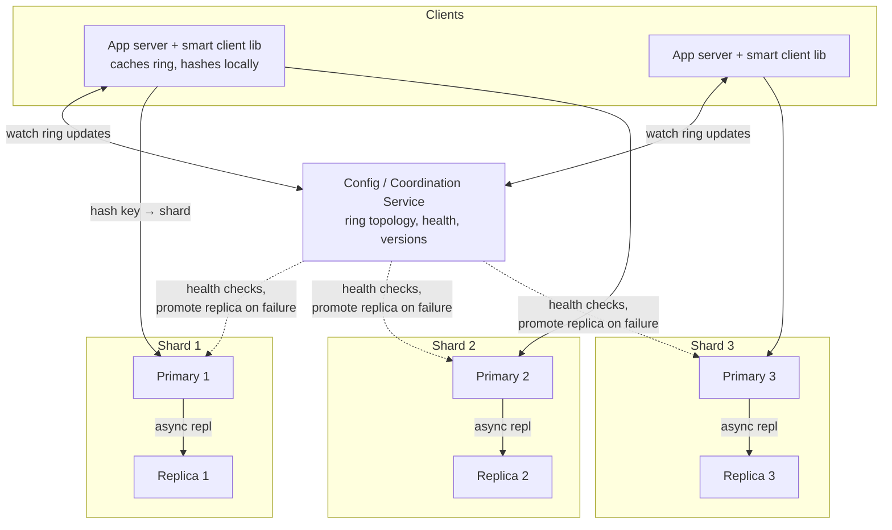
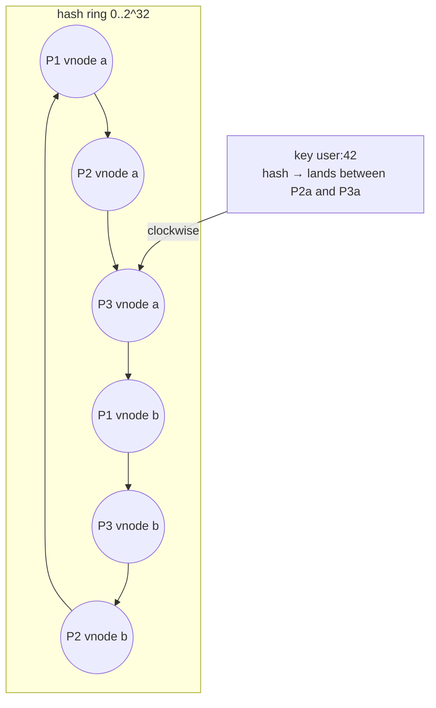
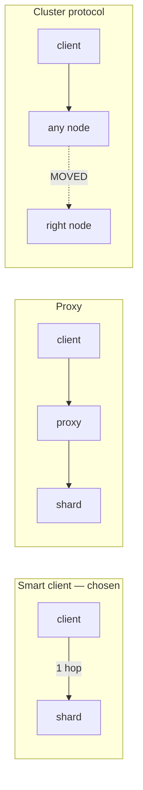
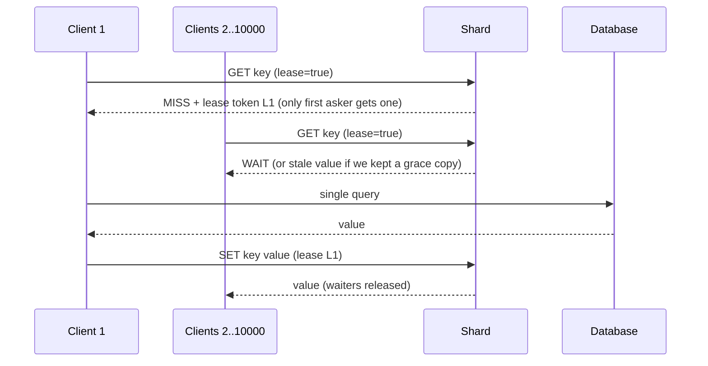
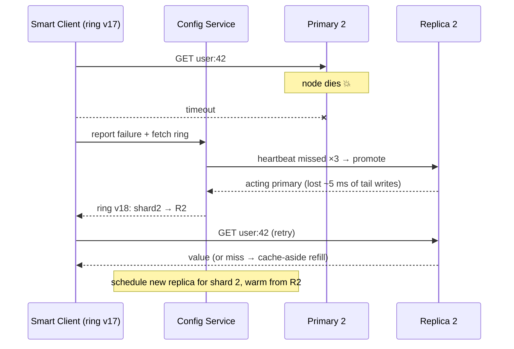
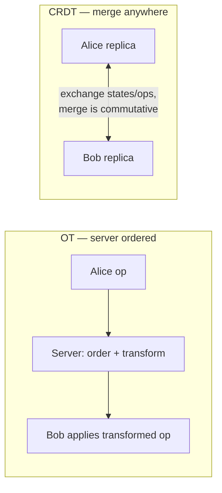

# Day 28 — Design a Distributed Cache (+ Google Docs alternative)

> **Week 4, Day 28.** All month you've drawn a box labeled "Redis" and moved on. Today you open the box. "Design a distributed cache" is a favorite senior-round question precisely because there's nothing to hide behind — no PSP, no FCM, just data structures, consistent hashing, and honest trade-offs about what a cache refuses to promise. An optional lighter section at the end covers "Design Google Docs" if that was your pick instead.

---

## 0) ⏱️ Attempt First

**45 minutes, whiteboard, no notes.**

> *"Design a distributed in-memory cache — think Redis-lite. Support GET/SET/DELETE with TTLs, ~1M ops/s, 1 TB of cached data, sub-millisecond p99. Handle node failures without losing the whole cache, handle hot keys, and protect backing databases from stampedes. You may NOT answer 'use Redis'."*

Design single-node first (storage + eviction + TTL), then distribute (placement + replication + routing). If you only distributed and never designed the node, that's the gap. Compare below.

---

## 1) Requirements

### Functional — in scope
- `GET(key)`, `SET(key, value, ttl?)`, `DELETE(key)`; values are opaque bytes up to ~1 MB.
- TTL expiry; LRU eviction under memory pressure.
- Horizontal scaling: add/remove nodes with minimal cache-miss storm.
- Per-shard replication so one node's death doesn't vaporize its slice.
- Built-in thundering-herd protection (this is usually left to clients; we'll do better).

### Functional — out of scope (say it)
- Rich data structures (lists, sets, streams) — mention they layer on the same skeleton.
- Multi-key transactions, Lua scripting, pub/sub.
- Strong durability — **a cache that promises durability is a database with extra steps** (deep dive 4 makes this precise).

### Non-functional targets
| NFR | Target |
|---|---|
| Throughput | 1M ops/s aggregate, read:write ≈ 10:1 |
| Latency | p99 < 1 ms in-region (network included) |
| Capacity | 1 TB of values |
| Availability | a node failure degrades hit-rate, never availability of the *service* |
| Consistency | eventual between replicas; **stale reads are acceptable** — it's a cache |

That last row is the design's soul: everything a database agonizes over, we get to shrug at — and that shrug is what buys sub-millisecond latency.

---

## 2) Estimates (all arithmetic)

**Node count from capacity.**
- 1 TB of values ÷ 64 GB usable RAM per node (of a 96 GB box; overhead + headroom eats a third — approximate) = **16 nodes** for one copy.
- With replication factor 2 → **32 nodes**.

**Node count from throughput.**
- One tuned node handles ~100k ops/s (single-threaded event loop, Redis-like — approximate).
- 1M ops/s ÷ 100k = **10 nodes** minimum. Capacity (16) dominates → 16 primaries is the binding constraint. Always compute *both* and take the max — say this.

**Per-key overhead.**
- Entry ≈ key (~40 B) + value (avg ~2 KB here: 1 TB ÷ ~500M keys) + metadata: 2 linked-list pointers (16 B), expiry (8 B), hash bucket pointer (8 B), sizes/flags (~12 B) ≈ **~85 B overhead/key**.
- 500M keys × 85 B = **~42 GB of pure bookkeeping** across the fleet — this is why "just add a couple pointers per entry" is a real capacity line-item, not noise.

**Network.** 900k reads/s × 2 KB = **~1.8 GB/s aggregate egress** ≈ 115 MB/s per node — fine on 10 GbE, but a single 200 KB hot value at 100k reads/s would be 20 GB/s. Hot keys are a bandwidth problem before they're a CPU problem (deep dive 5).

**Replication traffic.** 100k writes/s × 2 KB = **~200 MB/s aggregate** primary→replica — a rounding error next to read egress, which is why async replication costs essentially nothing on the wire and everything in semantics.

**Connections.** 2,000 app servers × 16 shards × a small pool ≈ **tens of thousands of TCP connections cluster-wide** — fine, but it's why the client library pools and multiplexes instead of connect-per-request (and why Redis ops teams fear connection storms more than traffic).

---

## 3) API Design

Binary protocol over TCP (like RESP) for the hot path; shown here as pseudo-HTTP for readability:

```
GET    /kv/{key}                  → 200 value | 404
PUT    /kv/{key}?ttl=300          body: bytes → 200
DELETE /kv/{key}                  → 200
GET    /kv/{key}?lease=true       → 200 value | 404 + lease token   (herd protection, deep dive 6)

# Admin plane (separate port)
GET  /admin/ring                  → current hash ring topology + versions
POST /admin/nodes                 → join a node
GET  /admin/stats                 → hit rate, evictions/s, memory, hot keys
```

Notes:
- **Text/HTTP is wrong for the data plane** at 1 ms budgets — parsing cost and header bloat matter; use a length-prefixed binary framing. Saying why is worth points.
- The **ring endpoint** exists because smart clients cache the topology and route directly (deep dive 3).
- `lease=true` is our built-in stampede answer — most caches make every client team reinvent it.

---

## 4) Data Model (in-memory layout — this IS the data model)

**In plain words:** There are no database tables here — the "data model" is just how memory is arranged inside one node. Think of a coat-check room: a numbered ticket board lets you find any coat instantly (the hash table), while the coats also hang on a rail ordered by who arrived most recently (the linked list) so you know which to bump when the rail is full. Every coat is on the board *and* on the rail at the same time, which is what makes both "find it" and "evict the oldest" instant.

There's no external DB; the "schema" is the node's memory layout:

```
HashTable:   key → Entry*                    (O(1) lookup)
Entry:       { key, value, expires_at, prev*, next* }
LRU list:    doubly-linked list of Entries   (O(1) move-to-front, O(1) evict-tail)
Expiry index: optional min-heap / wheel on expires_at (active expiry)
```

```mermaid
flowchart LR
    subgraph HashTable
        H1[hash A] --> E1
        H2[hash B] --> E2
        H3[hash C] --> E3
    end
    subgraph LRU list — most recent on left
        HEAD((head)) --- E1[Entry A] --- E3[Entry C] --- E2[Entry B] --- TAIL((tail))
    end
```
*Every entry lives in BOTH structures at once: the hash table finds it in O(1), the list ranks it in O(1) — the exact structure you'll hand-build tomorrow in Day 29.*

**Why not an ordered map / skip list?** We don't need range queries over keys; a hash table's O(1) beats O(log n) and we can pay memory for speed. **Why a doubly-linked list?** Removal from the middle in O(1) — a singly-linked list would need the predecessor, an array would need shifting. Tomorrow (Day 29) you implement this pair from scratch; today you deploy 32 of them.

---

## 5) High-Level Architecture


*Smart clients hash keys onto a consistent-hashing ring of primary shards; each primary streams async to a replica; a small coordination service owns the ring truth.*

### Step-by-step flow: a GET
1. App calls `cache.get("user:42")`. The **client library** hashes the key, looks up its locally cached ring (version 17), finds shard 2, opens/reuses a pooled TCP connection to Primary 2. One network hop.
2. Primary 2: hash-table lookup → found. **Lazy-expiry check:** `expires_at < now` → treat as miss, delete, return 404. Alive → move entry to LRU head, return value. Total on-node work: two pointer ops and a memcpy — microseconds.
3. Miss → client fetches from the real database and `SET`s the result back with a TTL (cache-aside, Day 11), unless the herd-protection lease path is in play (deep dive 6).
4. A SET on Primary 2 is appended to its **replication stream**; Replica 2 applies it milliseconds later, async — the client never waits for the replica.
5. If Primary 2 stops answering health checks, the coordination service **promotes Replica 2**, bumps the ring to version 18; clients pick it up on their next watch tick and re-route. Writes in the unreplicated tail (last few ms) are lost — acceptable, it's a cache.

---

## 6) Deep Dives

### Deep dive 1 — Single node first: hash table + LRU + TTL

**In plain words:** A cache node is like a small kitchen fridge with limited shelf space. To find food instantly you keep a labelled index of what's inside (the hash table), and when the fridge is full you throw out whatever you haven't touched in the longest time (LRU eviction). Some items also have a "use by" date stamped on them (TTL) — you either notice it's expired when you reach for it (lazy expiry) or you do an occasional cleanout sweep (active expiry). Do both, and the fridge stays fast and never overflows.

**Eviction: why LRU.** Under memory pressure something must go. LRU bets that recent past predicts near future — usually right for cache workloads. Name the alternatives in one breath: LFU (better for stable popularity, worse for shifting), FIFO (cheap, dumb), random-sample-LRU (what Redis actually does — sampling ~5 keys and evicting the oldest approximates LRU without a global list; approximate detail). We'll spec true LRU because Day 29 builds it.

> **🤔 Wait — why LRU instead of just evicting a random key or the oldest-inserted one?**
> Random eviction is genuinely cheap and needs no bookkeeping, but it discards hot and cold keys with equal probability — it can toss the celebrity profile as readily as the key nobody's touched in an hour. FIFO (oldest-inserted) is just as blind: a key inserted once and then hammered a million times still gets evicted on a timer, not on usefulness. LRU spends a few pointers per entry to evict by *recency of access*, which for real cache workloads (Zipfian, strong temporal locality) is the single best cheap predictor of what won't be needed next.

**✅ Good scenario (where this design choice wins):** A session or feed cache where the same few thousand users are active in any given minute — LRU keeps that working set resident and evicts the long tail, holding hit rate above 95% even when the keyspace is 100× the RAM.

**❌ Bad scenario (when it backfires / the naive alternative):** A full-table scan or nightly analytics job streams millions of one-shot keys through the cache; pure LRU dutifully evicts your hot working set to make room for keys that will never be read again — a *cache-pollution / scan-eviction* incident that quietly tanks hit rate. This is exactly why Redis added LFU and why memcached segregates slabs by size class.

**When NOT to over-do it:** If your keyspace fits in RAM with headroom, eviction never fires — don't agonize over LRU-vs-LFU, ship a TTL-only cache and move on.

**TTL: lazy vs active expiry — do both.**

| Strategy | How | Pro | Con |
|---|---|---|---|
| **Lazy** | check `expires_at` on every GET | zero background cost; perfectly accurate at read time | dead keys nobody reads squat on RAM forever |
| **Active** | background loop scans/samples for expired keys | reclaims memory of unread dead keys | CPU spikes; scan pacing needed |

Redis-style hybrid: lazy check on every access, plus a paced sampler (e.g., every 100 ms sample 20 keys with TTLs; if >25% were expired, sample again immediately — approximate description of the real heuristic). Say "lazy alone leaks memory on write-heavy, read-rare workloads" — that's the sentence that shows you get *why* both exist.

```java
// Look up a key; returns the value, or null if missing or expired.
public byte[] get(String key) {
    Entry e = table.get(key);                       // O(1) hash-table lookup
    if (e == null) {
        return null;                                // key not present
    }
    if (e.expiresAt != 0 && e.expiresAt < now()) {
        unlink(e);                                  // lazy expiry: unlink from LRU list
        table.remove(key);                          // and drop from the hash table
        return null;
    }
    lru.moveToHead(e);                              // mark as most-recently-used
    return e.value;
}
```

The SET path, with eviction and memory accounting in one place:

```java
// Insert or overwrite a key, then evict from the tail until we fit in memory.
public void set(String key, byte[] value, Long ttl) {           // ttl may be null = no expiry
    long incoming = sizeOf(key, value);
    if (incoming > maxItemSize) {
        throw new IllegalArgumentException("value too large");   // protect tail latency
    }
    Entry e = table.get(key);
    if (e != null) {                                             // overwrite in place
        usedBytes += value.length - e.value.length;             // adjust accounting by the delta
        e.value = value;
        e.expiresAt = exp(ttl);
        lru.moveToHead(e);
    } else {
        e = new Entry(key, value, exp(ttl));                     // brand-new entry
        table.put(key, e);
        lru.pushHead(e);
        usedBytes += incoming;
    }
    while (usedBytes > maxBytes) {                               // evict by BYTES, not count
        Entry victim = lru.tail();                              // oldest entry sits at the tail
        unlink(victim);
        table.remove(victim.key);
        usedBytes -= sizeOf(victim.key, victim.value);
        stats.evictions++;
    }
}
```

Two details worth voicing: eviction is **byte-based, not count-based** (500M small keys and 1M large ones need the same governor), and the loop may evict several victims for one large insert.

**Memory fragmentation** — the silent killer of long-lived in-memory stores. Values churn at mixed sizes; a general-purpose `malloc` leaves the heap looking like Swiss cheese, and "resident memory" drifts far above "live bytes." Production answer: **slab allocation** (memcached's approach — approximate): pre-carve memory into size-classes (64 B, 128 B, 256 B, ... chunks); a value occupies the smallest chunk that fits. Internal waste is bounded (~25% worst case per class step), external fragmentation is ~zero, and eviction can be per-slab-class. Mentioning "I'd watch RSS-vs-live-bytes ratio and use a slab or jemalloc-style allocator" is a genuinely senior flourish.

**Concurrency model:** single-threaded event loop per core (shared-nothing, keys partitioned across cores) beats a lock-happy multithreaded design — no lock contention, cache-friendly, and it's the design Redis validated. Multi-threaded I/O with single-threaded command execution is the modern refinement.

### Deep dive 2 — Distribution: the consistent hashing ring (Day 12 pays off)

**In plain words:** Imagine seating guests (keys) around a big round table (the ring) where the servers (nodes) also have assigned seats. Each guest is handled by the next server clockwise from them. If you add one more server, only the guests sitting just before its new seat switch servers — everyone else stays put. Compare that to renumbering *every* seat when a server joins (`hash % N`), which reshuffles almost the whole room at once and stampedes your databases.

Naive `hash(key) % N` is a trap: adding a 17th node remaps **~16/17 ≈ 94% of all keys** — a cluster-wide miss storm that stampedes the databases behind the cache. **Consistent hashing (Day 12):** nodes and keys hash onto a ring; a key belongs to the first node clockwise. Adding a node steals only **~1/N of keys (~6% at N=16)** from its neighbors.

> **🤔 Wait — why consistent hashing instead of the obvious `hash(key) % N`?**
> `mod N` is one line and perfectly balanced — right up until N changes. Because the divisor is baked into every key's placement, adding or removing a single node re-derives almost every key's home: at N=16→17, roughly 94% of keys suddenly map to a different node. Consistent hashing makes placement depend on *where a node sits on the ring*, not on the node count, so a join or leave disturbs only the ~1/N of keys near that point.

**✅ Good scenario (where this design choice wins):** An autoscaling fleet that adds capacity during a traffic surge — with vnodes on a ring, a new node lifts ~6% of keys off its neighbors while the other 94% keep hitting warm cache; the DB never notices the scale-up.

**❌ Bad scenario (when it backfires / the naive alternative):** One node dies at peak under `mod N` and every client silently recomputes `% 15`; ~94% of the keyspace instantly misses and stampedes the origin DB, which falls over — turning one dead cache node into a full-site outage. This is the textbook "we added a shard and took down prod" postmortem.

**When NOT to over-do it:** For a fixed, hand-managed set of nodes that never changes (or a single node), `mod N` is fine — consistent hashing's machinery only pays off once membership actually churns.


*Each physical node appears as ~100–200 virtual nodes so load spreads evenly and a dead node's keys scatter across ALL survivors instead of dumping onto one neighbor.*

Two refinements to voice: **virtual nodes** (above) fix both load variance and failure-redistribution clumping; **ring versioning** (the config service stamps every topology change) lets a node reject requests routed by a stale ring (`MOVED`-style response with the new version) instead of silently serving wrong shards.

The whole ring is ~25 lines — knowing that it's *small* is part of knowing it:

```java
import java.security.MessageDigest;
import java.nio.charset.StandardCharsets;
import java.util.List;
import java.util.Map;
import java.util.TreeMap;

// A consistent-hashing ring: physical nodes are scattered as many virtual points.
public class Ring {
    // TreeMap keeps points sorted by hash so we can find the next point clockwise in O(log n).
    private final TreeMap<Long, String> points = new TreeMap<>();

    public Ring(List<String> nodes) {
        this(nodes, 150);                            // default: 150 virtual nodes per box
    }

    public Ring(List<String> nodes, int vnodes) {
        for (String node : nodes) {
            for (int v = 0; v < vnodes; v++) {
                long h = hash(node + "#" + v);
                points.put(h, node);                 // place this virtual node on the ring
            }
        }
    }

    private long hash(String s) {
        try {
            MessageDigest md = MessageDigest.getInstance("MD5");
            byte[] d = md.digest(s.getBytes(StandardCharsets.UTF_8));
            // take the first 4 bytes as an unsigned 32-bit number
            return ((long) (d[0] & 0xff) << 24) | ((d[1] & 0xff) << 16)
                 | ((d[2] & 0xff) << 8) | (d[3] & 0xff);
        } catch (Exception ex) {
            throw new RuntimeException(ex);
        }
    }

    public String nodeFor(String key) {
        long h = hash(key);
        // ceilingEntry finds the first point clockwise; if past the end, wrap to the first.
        Map.Entry<Long, String> e = points.ceilingEntry(h);
        if (e == null) {
            e = points.firstEntry();                 // wrap around the circle
        }
        return e.getValue();
    }
}
```

Lookup is O(log V) over ~16 × 150 = 2,400 points — nanoseconds. When the ring changes, keys that moved become cache misses on their new home and idle garbage on the old one; the garbage ages out via TTL/LRU with no migration protocol at all. (Contrast with a *database* reshard, which must actually move the data — Day 12's discussion. A cache gets correctness for free because the source of truth is elsewhere.)

### Deep dive 3 — Routing: smart client vs proxy vs cluster protocol

**In plain words:** This is about who knows the seating chart. Either every guest memorizes it and walks straight to the right server (smart client — fastest, but each guest must keep their copy up to date), or there's a host at the door who escorts everyone (proxy — simple guests, but one extra stop), or you walk up to any server and it says "not me, go to that one" (cluster protocol — no host needed, but more back-and-forth). We pick the smart client because in a 1-millisecond budget there's no time for an extra stop.

| Approach | How | Pro | Con | Real-world echo |
|---|---|---|---|---|
| **Smart client** | client lib holds the ring, hashes locally, connects direct | one hop, minimum latency, no extra tier | logic reimplemented per language; stale-ring handling in every client | memcached clients, Redis Cluster clients |
| **Proxy tier** | dumb clients → proxy → shards | trivial clients; ops absorb topology changes centrally | +1 hop (~0.2–0.5 ms), a tier to scale & pay for | Twemproxy, Envoy |
| **Cluster protocol** | any node answers; wrong node replies "MOVED → node X"; clients learn | no external coordinator for routing | most complex node code; redirect latency on topology change | Redis Cluster |


*Pick smart clients for the p99 < 1 ms budget; concede the polyglot-client maintenance cost honestly.*

We choose **smart client**: the 1 ms p99 leaves no room for a proxy hop, and our config service already exists to publish the ring. If the org had 9 languages calling the cache, the proxy answer flips — trade-offs depend on context, and *saying which context flips your answer* is senior behavior.

> **🤔 Wait — if a proxy tier makes clients dumb and centralizes topology, why push routing into every client?**
> A proxy is operationally lovely: one place to change the ring, thin clients in any language. But it adds a full network hop on the hottest path in your infrastructure, and when the entire p99 budget is ~1 ms — basically one same-DC round trip — spending a second round trip on routing is half your latency gone. Smart clients hash locally and connect direct, so the only hop is the one that actually fetches the data.

**✅ Good scenario (where this design choice wins):** A latency-critical read path from a small number of first-party services, all in one or two languages, at 1 ms p99 — the smart client's single hop is the difference between hitting and blowing the SLO, and the config service already publishes the ring for free.

**❌ Bad scenario (when it backfires / the naive alternative):** A polyglot org with 9 languages each reimplementing ring math and stale-ring handling; one client library ships a subtle vnode bug and routes a slice of keys to the wrong shard, serving the wrong data until someone notices — a class of bug a single proxy tier would have eliminated. Here the proxy's extra hop is the cheaper trade.

**When NOT to over-do it:** With a handful of clients and generous latency headroom, don't build and maintain smart-client libraries per language — drop a proxy in front and let ops own topology changes centrally.

### Deep dive 4 — Replication, failover, and why this is NOT a database

**In plain words:** Each server keeps a understudy (replica) that copies its notes a beat behind. If the main server drops dead, the understudy steps on stage and the show continues — you only lose the last few notes it hadn't copied yet. That's fine here, because a cache is a photocopy, not the original: the real document lives in the database. The moment you demand that a cache never loses a single note, you've stopped building a cache and started rebuilding a database — which already exists.

**Async replication, factor 2.** Primary appends every write to an in-memory replication buffer; replica tails it. On primary death: coordination service (leases + heartbeats; or Raft among a small config quorum — don't Raft the data path, it would murder latency) promotes the replica, publishes ring v+1.

**What we lose:** writes in the replication tail (milliseconds). **Why that's fine:** the contract of a cache is "may forget; never lies about *having* data it doesn't." The database behind us is the source of truth; a lost cache write is a future cache miss, not corruption.

> **🤔 Wait — why replicate each shard at all? Why not keep one copy per key and just re-fetch from the DB on failure?**
> Because "re-fetch from the DB" isn't free at cache scale. A 64 GB primary holds tens of millions of hot keys; if it dies with no replica, every one of those keys becomes a simultaneous miss that lands on the origin DB at once — the very stampede consistent hashing works so hard to avoid, now triggered by a single failure. A warm replica ready to promote turns a node death into a millisecond blip instead of a DB-melting cold start.

**✅ Good scenario (where this design choice wins):** A fleet where something is always dying — at 160 nodes, hardware failures are a weekly event — RF=2 means each death costs only milliseconds of un-replicated tail writes plus a promote, never a hit-rate cliff or a DB overload.

**❌ Bad scenario (when it backfires / the naive alternative):** Single-copy sharding on a cache fronting a DB provisioned for a 95% hit rate — one primary dies, its whole slice cold-misses, and the DB suddenly sees ~20× its normal read load and tips over, cascading into the exact outage the cache existed to prevent.

**When NOT to over-do it:** If the backing store can comfortably absorb full read traffic (small dataset, over-provisioned DB, or a cache that's merely a nice-to-have), skip replication — RF=2 doubles your node bill for availability you don't need; let misses refill.

**Why not make it durable?** Redis offers AOF (append-only log, fsync policies) and RDB snapshots — mention them to show you know — but the moment you fsync on the write path you're doing disk I/O in a system whose entire reason to exist is *not doing disk I/O*. Durable + replicated + consistent in-memory store = you are now building a database, and databases already exist. The honest framing: **persistence in a cache is for faster warm-up after restart, not for truth.** Cold-start matters though — a restarted 64 GB node at 0% hit rate shoves its full read load onto the DB; snapshot-on-shutdown or replica-warming makes restarts boring.

**Cache coherence limits.** With async replicas and cache-aside writers, readers can see: stale values (TTL not yet expired after a DB write), a replica behind its primary post-failover, or the classic interleaving (read-miss reads DB, a write lands, the stale read-miss result is SET back). Mitigations to name: short TTLs as the backstop, delete-on-write rather than set-on-write (Day 11), and versioned/compare-and-set for the few keys that care. But the headline stays: **if a use case can't tolerate any staleness, it shouldn't be reading a cache.**

### Deep dive 5 — Hot keys

**In plain words:** A hot key is the one item everyone wants at once — like the single most popular dish when a food-truck goes viral. It doesn't matter that you have 16 counters open; if 300,000 people all queue at the one selling that dish, that counter melts while the rest stand idle. The best fix is to hand out that dish from a tray each app server keeps at its own desk for a second or two (a client-local micro-cache), so the busy counter only gets asked to refill the tray occasionally.

A celebrity profile or flash-sale SKU (hello, Day 27) concentrates 300k reads/s on ONE key → one shard's CPU/NIC saturates while 15 idle. Layered defenses:

> **🤔 Wait — if consistent hashing spreads keys evenly, why do hot keys still break it?**
> Even hashing balances the *number* of keys per node, not the *traffic* per key. One key is still one key — it lives on exactly one shard — so if a single celebrity SKU draws 300k reads/s, all 300k pile onto one node's CPU and NIC while 15 nodes sit idle. Balance across keys does nothing for skew *within* a key; that's a different axis entirely, and hashing can't touch it.

**✅ Good scenario (where this design choice wins):** A flash sale or viral post concentrates demand on a handful of keys — a 1–5 s client-local micro-cache collapses 300k/s across 200 app servers into ~200/s at the shard, absorbing the skew almost for free with a tolerably stale window.

**❌ Bad scenario (when it backfires / the naive alternative):** You trust even hashing and skip hot-key handling; a single 200 KB trending value at 100k reads/s demands 20 GB/s and saturates one node's 10 GbE link — and that shard's p99 blows out for *every* key it owns, not just the hot one. One key just caused a noisy-neighbor incident.

**When NOT to over-do it:** If the access distribution is genuinely flat — no celebrities, no virality — don't build top-K sketches and key-splitting; even hashing already does the job and the machinery is dead weight.

1. **Detect:** per-node top-K sketch (count-min sketch + heap, cheap) exports hot keys to stats.
2. **Client-local micro-cache:** hot keys cached in the app process for 1–5 s. 300k/s across 200 app servers → each refreshes once per second-ish → shard sees ~200/s. A 1 s stale window on a *cache* is nearly free. This is the biggest lever.
3. **Key replication:** write hot key to R shards as `key#0..key#R-1`; readers pick a random suffix — R-way read fan-in reduction, at write-amplification cost.
4. **Never** try to "split" a single hot key's value across shards — complexity with no payoff at this layer.

### Deep dive 6 — Thundering herd protection, built in

**In plain words:** When a popular cached item expires, thousands of requests all miss at the exact same instant and stampede the database like a crowd rushing one door — and the door (database) gets trampled. The fix is a "someone's already on it" ticket: the first requester gets a lease to go fetch the value, and everyone else waits (or is handed a slightly stale copy) until it comes back. One trip to the database instead of ten thousand.

A hot key expires; 10,000 concurrent requests all miss; all 10,000 hit the database; the database dies; the outage begins. (This is the stampede we warned about in Day 11 and again in Day 21's failure catalog.) Build the fix into the cache:

> **🤔 Wait — keys expire all the time and the DB is fine; why is a stampede any different?**
> Steady-state expirations are staggered, so misses trickle to the DB one at a time. A stampede is different because a *popular* key expires at one instant and thousands of in-flight requests miss simultaneously — they don't queue politely, they all fire the same DB query in the same millisecond. The DB that easily serves the trickle gets hit with 10,000× that as a burst and falls over; then every other cache miss piles onto the dying DB.

**✅ Good scenario (where this design choice wins):** A homepage-featured item with a 60 s TTL and tens of thousands of concurrent viewers — a lease lets exactly one request refill while the rest wait or get a stale-while-revalidate copy, turning a potential 10,000-query spike into a single query.

**❌ Bad scenario (when it backfires / the naive alternative):** You "just let keys expire" on pure cache-aside; a hot key's TTL lapses during peak, the herd stampedes an origin DB already at 70% CPU, queries queue, latency climbs, and more requests miss as they time out — a self-amplifying cache-stampede outage, one of the most common cache-fronted-DB failure modes on call.

**When NOT to over-do it:** For low-concurrency or rarely-read keys the herd never forms — skip the lease machinery and just add TTL jitter so batch-loaded keys don't expire in lockstep.


*One lease, one DB query, 9,999 waiters served from the fill — memcached's lease mechanism as popularized by Facebook's memcache paper (approximate provenance).*

Two companions: **stale-while-revalidate** (keep the expired value for a grace period, serve it to waiters while the lease holder refreshes — zero user-visible latency spike) and **TTL jitter** (`ttl + random(0, 0.1*ttl)`) so a batch-loaded set of keys doesn't expire in the same second. Cheap, boring, saves databases.

### Deep dive 7 — operating it: the four numbers that matter

**In plain words:** Running a cache blind is like driving with the dashboard taped over — it feels fine right up until it doesn't. Four gauges tell you almost everything: how often you find what you're looking for (hit rate), whether you're throwing out live data to make room (evictions), whether one server is doing all the sweating (per-shard latency), and whether memory is quietly bloating (RSS vs live bytes). And watch the database behind the cache too — if its query rate suddenly jumps, your cache is silently failing at its one job.

A cache without instrumentation is a rumor. The node exports, and the fleet dashboard aggregates:

| Metric | Healthy shape | Pathology it reveals |
|---|---|---|
| **Hit rate** | stable, workload-dependent (often 90–99%) | slow decline = capacity too small or TTLs too short; cliff = a deploy changed key formats and orphaned everything |
| **Evictions/s vs expirations/s** | mostly expirations | eviction-dominated = memory pressure — you're churning live data, hit rate is about to sag |
| **p99 per shard, spread across shards** | tight band | one outlier shard = hot key or noisy neighbor; wide band = uneven ring (raise vnodes) |
| **Memory: RSS vs live bytes** | ratio near 1.0–1.3 | climbing ratio = fragmentation (see the slab discussion) |

Plus the client-side view — **error/timeout rate per shard from the callers' perspective** — because a node can look healthy to itself while a switch eats its packets. The DB behind the cache gets one alert above all others: *query rate step-up*, the earliest symptom of a cache losing hit rate for any reason. Protecting that DB was the cache's entire job; watch the protected thing, not just the protector.

---

## 7) Sequence Diagram — node failure and recovery


*Failure costs milliseconds of tail writes and a transient hit-rate dip — never an outage. That asymmetry is the whole product.*

---

## 8) Bottlenecks & Evolution at 10×

At **10M ops/s and 10 TB**:

| Bottleneck | Symptom | Evolution |
|---|---|---|
| Node count (≈160 primaries) | ops burden, failure frequency (something is always dying) | autopilot: automated replacement, replica auto-warm; failure is routine, not incident |
| Config service watch fan-out | thousands of clients watching the ring | hierarchical distribution of ring updates; gossip between clients |
| Cross-region reads | 50–100 ms inter-region kills the 1 ms promise | regional clusters + async cross-region invalidation stream; accept inter-region staleness explicitly |
| Hot-key ceiling | single-key demand beyond one NIC | client micro-cache becomes mandatory, not optional; hot-key replication automated from the top-K sketch |
| Large values | 1 MB values wreck tail latency for neighbors on the event loop | value-size cap + chunking, or a separate large-object tier |
| Warm-up at scale | restarting 64 GB nodes stampedes DBs | snapshot-assisted restarts; drain + prewarm orchestration in the deploy pipeline |

---

## 9) Trade-offs Summary

| Decision | Alternative | Why |
|---|---|---|
| Hash table + doubly-linked LRU | sampled-LRU (Redis-style) | true LRU, O(1) both ops; sampling saves 16 B/entry — fine either way, know both |
| Lazy + active TTL hybrid | lazy only | lazy-only leaks memory on write-heavy/read-rare keys |
| Consistent hashing + vnodes | hash mod N | node change remaps ~1/N of keys instead of ~all — Day 12's core payoff |
| Smart client routing | proxy tier | saves a hop inside a 1 ms budget; cost: per-language client maintenance |
| Async replication | sync replication | sync doubles write latency to protect data that is, by contract, forgettable |
| Coordination service owns ring | Raft on the data path | consensus per-operation would destroy latency; consensus only for topology |
| Leases + stale-while-revalidate | leave stampedes to callers | every client team reinvents it badly once; build it in once |
| No durability (warm-up snapshots only) | AOF/fsync on write path | fsync in a cache reinvents a database, badly |

---

## 10) Interview Calibration

**Junior answer:** "Shard the keys across nodes with hashing, use LRU eviction, add replicas for reliability." Uses `mod N` without noticing the remap disaster, can't say how LRU is O(1), replication is "for reliability" with no story about what's lost on failover, no herd/hot-key handling.

**Senior answer:** "Single node first: hash table plus intrusive doubly-linked list — every entry in both — so GET and eviction are O(1); TTL is lazy-check plus a paced active sampler because lazy alone leaks. Capacity math says 16 primaries (64 GB usable each), throughput would only need 10, so capacity binds; RF=2 doubles it. Placement is a consistent-hashing ring with virtual nodes — mod-N would remap ~94% of keys on a node add and stampede the DBs. Routing is smart-client because a proxy hop doesn't fit the 1 ms p99; I'd flip that in a polyglot org. Replication is async and I can say precisely what dies on failover: milliseconds of tail writes, which a cache is allowed to forget. Herd protection is built in — leases plus stale-while-revalidate plus TTL jitter. And no, I wouldn't make it durable; fsync on this write path is a database cosplaying as a cache."

The delta: **node internals before distribution, both estimate paths computed, every guarantee stated with its exact loss window.**

---

## Dark Side — building a cache when Redis exists

The honest answer interviewers respect: **in a real job, you should almost never build this.** Redis/Valkey and Memcached are two decades of hardened engineering — battle-tested eviction heuristics, cluster protocols, client ecosystems in every language, and failure modes that are *documented* instead of *discovered at 3 a.m.* The realistic justifications for building are thin: extreme specialization (an in-process cache with domain-aware eviction), pathological scale where per-node licensing/ops of managed offerings breaks down, or embedding constraints. "We thought it would be fun" has produced more postmortems than products.

So why does the interview question exist? Because the *point* was never to ship it — it's that you can't reason about the box labeled "Redis" in every other design (Days 11, 21, 26, 27...) until you've mentally built one. The best closing line in this interview: *"Everything I've designed here is why I'd buy it instead of building it — and now I know exactly what I'm buying."*

---

## OPTIONAL — If you chose Google Docs instead (lighter treatment)

> Skim or skip; this is the concept-level version of the alternative Day 28 problem. Don't attempt full depth today — collaborative editing is its own rabbit hole.

**Core problem:** two users edit the same document concurrently; both must converge to the same result without locking.

**In plain words:** When two people edit the same sentence at once, their edits can step on each other — if Alice adds a letter at the start, Bob's "delete the 3rd character" now points at the wrong spot. Operational Transformation is like a referee who rewrites each person's move to account for what the other just did, so everyone ends up with the same final text. CRDTs take a different route: they design the edits so cleverly (each character gets a permanent unique ID) that the order they arrive in no longer matters — the pieces just always fit.

**Operational Transformation (OT).** Operations (insert/delete at position) are *transformed* against concurrent operations before applying. Tiny worked example — doc is `"cat"`, both users act on the same base version:
- Alice: `insert(0, "s")` intending `"scat"`.
- Bob: `delete(2)` (the `t`) intending `"ca"`.
- Server applies Alice first → `"scat"`. Bob's `delete(2)` would now delete `a` — wrong! Transform it against Alice's insert: positions ≥ 0 shift by +1 → `delete(3)` → `"sca"`. Both converge on `"sca"`: Alice's insert AND Bob's delete both honored.
- The transform function must satisfy convergence properties (TP1: apply mine-then-yours-transformed ≡ yours-then-mine-transformed). Correct transforms for rich text are notoriously fiddly — hence central servers: **Google Docs uses OT with an authoritative server ordering ops (approximate description)**, which sidesteps the hardest distributed cases.

**CRDTs.** Data structures whose merges are commutative/associative/idempotent — replicas converge *without* a central orderer. Text CRDTs give every character a unique, totally-ordered ID (fractional/tree positions); inserts reference neighbor IDs, deletes tombstone. Cost: metadata overhead and tombstone growth; benefit: true peer-to-peer and offline-first (used by Figma-adjacent tools, Yjs, Automerge — approximate landscape).

**Choosing:** central server + battle-tested libraries + minimal metadata → **OT**. Offline-first, P2P, or you'd rather reason about merge algebra than transform case-explosions → **CRDT**.


*OT centralizes ordering; CRDTs make order irrelevant by construction.*

**Presence** (cursors, "Bob is typing") is the easy part: ephemeral state over WebSockets (Day 22), no persistence, last-write-wins per user, dropped on disconnect. Never store presence in the document model.

---

## 11) Self-Check

1. Why must every entry live in two data structures, and what operation breaks if the list is singly-linked?
2. Lazy vs active expiry: which workload makes lazy-only leak, and what does the hybrid look like?
3. Reproduce both node-count estimates. Which constraint binds and why must you always compute both?
4. What fraction of keys remap on node-add under mod-N vs consistent hashing at N=16? What do vnodes fix?
5. Defend smart-client routing here — then name the org context that flips you to a proxy.
6. Exactly what is lost when a primary dies under async replication, and why is that acceptable *for this system and not for Day 27's*?
7. Why does fsync-on-write turn this into "a database with extra steps"? What's persistence legitimately for in a cache?
8. Walk the lease mechanism: how do 10,000 concurrent misses become one DB query?
9. Two hot-key mitigations and which one gives the biggest reduction for the least cost.
10. (Optional) In the OT example, why does Bob's `delete(2)` become `delete(3)`, and what property must transforms satisfy?

≥8 → solid. Tomorrow, Day 29: you hand-build this node's heart — the LRU cache — plus the vending machine, and drill every pattern from Week 1.

---

## Appendix A — how our Redis-lite compares to the real thing

| Feature | Our design | Real Redis/Valkey (approximate) | Why the delta |
|---|---|---|---|
| Eviction | true LRU (map + list) | sampled approximate LRU/LFU | saves 16 B/entry at hundreds of millions of keys |
| TTL | lazy + paced active sampler | same idea, tuned heuristics | we copied the homework — correctly |
| Routing | smart client + config service | cluster protocol (MOVED redirects, 16384 hash slots) | Redis chose no-external-coordinator; we chose simpler nodes |
| Replication | async, promote-on-failure | async by default; WAIT for opt-in semi-sync | identical philosophy |
| Durability | warm-up snapshots only | optional RDB + AOF | Redis serves people who *do* misuse it as a store |
| Herd protection | built-in leases + SWR | left to clients / libraries | our one genuine improvement — and memcached had it first |

Being able to produce this table IS the answer to "why not just use Redis?" — you're not avoiding the comparison, you're winning it.

## Appendix B — earlier-day patterns cashed in today

| Earlier day | Pattern | Where it appeared today |
|---|---|---|
| Day 11 | Cache-aside, delete-on-write | the client fill path and the coherence discussion |
| Day 12 | Consistent hashing + vnodes | the entire placement layer, now with code |
| Day 19 | Idempotency thinking | idempotent replication stream application |
| Day 21 | Stampede/limiter lore | leases, SWR, TTL jitter promoted from client folklore to a server feature |
| Day 27 | Hot-key economics | the flash-sale SKU is tomorrow-morning's hot cache key |
| Day 29 (tomorrow) | LRU internals | today's Entry/list layout is tomorrow's from-scratch build |

## Appendix C — rapid-fire follow-ups (one-breath answers)

- **"What if a value is 500 MB?"** Reject at the API (max-item-size); large objects go to object storage with the cache holding the pointer — one giant value on a single-threaded event loop stalls every neighbor behind it.
- **"How do clients know the ring changed mid-request?"** They don't, instantly — the node rejects with the new ring version attached; client refreshes and retries. One extra round-trip per topology change per client, amortized to nothing.
- **"Can I use this as a session store?"** Only if losing a session on failover is acceptable (usually: user re-logs-in, annoying but survivable). If not, that's a database requirement wearing a cache costume — see deep dive 4.
- **"Why MD5 in the ring, isn't it broken?"** Broken for *cryptography*; fine for *distribution* — we need uniform spread, not collision resistance. Faster non-crypto hashes (murmur/xxhash) are the production pick.
- **"What's your cold-start plan for a whole-cluster restart?"** Never restart the whole cluster. Rolling restarts one shard at a time, replica-warmed, with DB headroom verified between steps — a full cold cache at 90%+ hit rate means the DB takes ~10× its normal read load (the arithmetic: 1/(1-hit rate)).

## Appendix D — latency numbers this design lives and dies by (approximate, memorize)

| Operation | Cost | Consequence in this design |
|---|---|---|
| L1 cache reference | ~1 ns | why the hash lookup itself is never the bottleneck |
| Main-memory reference | ~100 ns | a GET is a few of these — the node does microseconds of work |
| Same-DC network round trip | ~0.5 ms | the p99 budget is basically ONE of these; hence no proxy hop |
| SSD random read | ~100 µs | what the cache saves the DB from doing, millions of times |
| Disk fsync | ~1–10 ms | why durability-on-write would 1000× our latency |
| Cross-region round trip | ~50–150 ms | why "global cache" is an oxymoron; caches are regional |
| Cold 64 GB node refill from DB | minutes-to-hours of elevated DB load | why warm-up is an operational feature, not a nicety |

The design in one line of arithmetic: **memory (100 ns) is ~1,000× closer than SSD (100 µs), which is ~10–100× closer than another region** — every architectural choice above is just refusing to cross a slower boundary than necessary.
