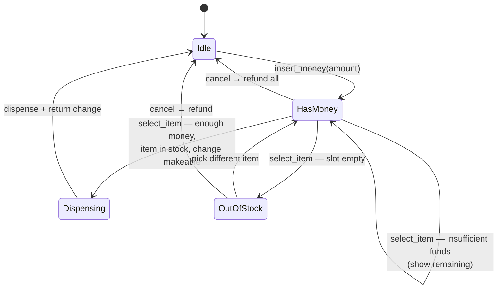
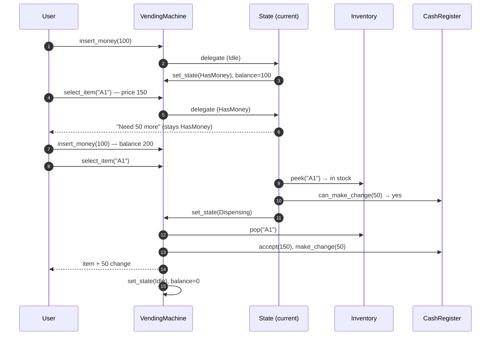
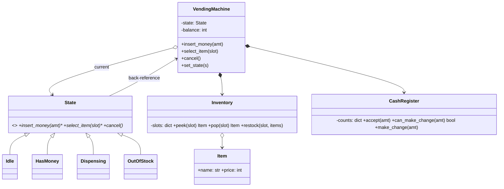
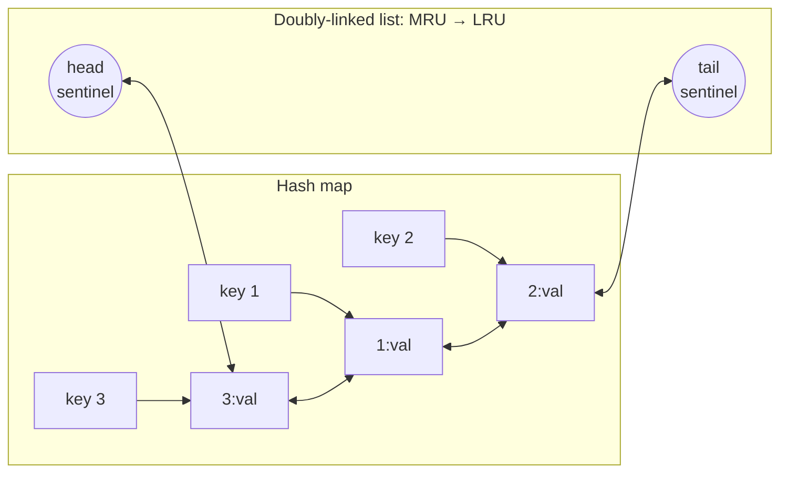
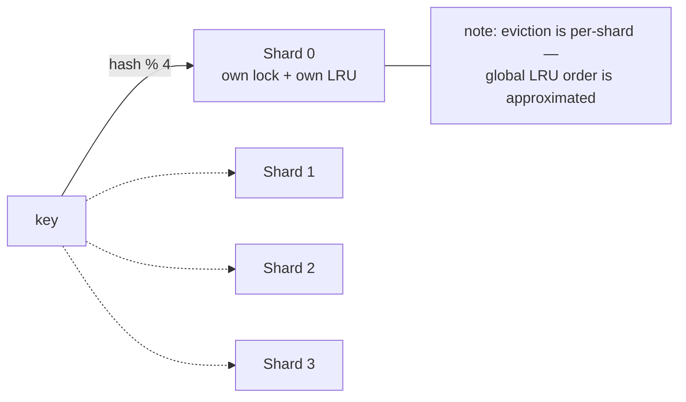
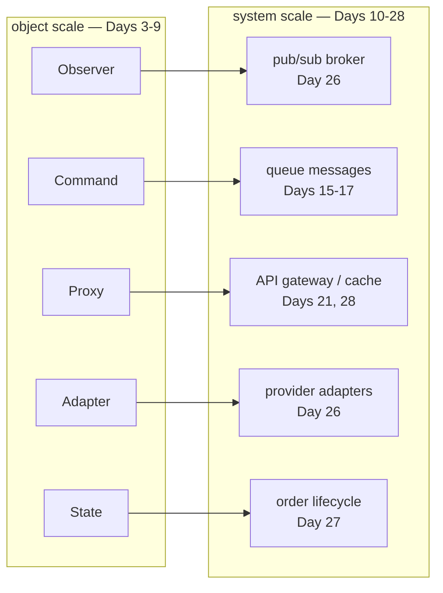

# Day 29 — LLD Revision: Vending Machine + LRU Cache

> **Week 4, Day 29.** Penultimate day. HLD week is done; today we sharpen the low-level design blade before tomorrow's mock interviews. Two classics — the vending machine (the State pattern's home turf) and the LRU cache (the data-structure design question, and literally the heart of yesterday's Day 28 node) — plus a full-recall drill of every pattern from Days 3–5.

---

## ⏱️ Attempt First

Two timers today:
1. **30 min:** LLD a vending machine on paper — requirements questions, class diagram, state diagram, then code skeletons.
2. **25 min:** implement an LRU cache with O(1) `get` and `put` in Java, **without** `LinkedHashMap`, from a blank file. Then test it mentally with capacity 2: `put(1),put(2),get(1),put(3),get(2)` → should be miss.

Done? Read on and diff.

---

# Part 1 — Vending Machine (full LLD walkthrough)

## 1.1 Requirements questions to ASK (never skip this in an LLD interview)

- Payment: coins only, or bills/cards? → *Coins + bills; card is an extension point.*
- Multiple items with independent stock and price? → *Yes, slot-based (A1, A2, ...).*
- Change-making: must it give exact change, and what if it can't? → *Refund and cancel the sale.*
- Cancel mid-transaction? → *Yes, full refund.*
- Concurrency? → *Single physical machine — one user at a time; the state machine enforces it.*
- Admin operations (restock, collect cash)? → *Yes, but keep them simple.*

Two minutes of questions like these are worth more than ten minutes of code. It shows you don't build before you scope — same discipline as Day 26–28's "out of scope" sections, shrunk to object level.

## 1.2 The state machine — the design's spine

**In plain words:** A vending machine can only be in one "mode" at a time — waiting for money, holding your money, busy dropping a can — and what each button *does* depends entirely on which mode it's in. It's exactly like a traffic light: the same "car arrives" event means something completely different at green versus red. Instead of scattering `if (mode == ...)` checks everywhere, we make each mode its own little object that knows how to behave. That's the State pattern.

A vending machine is a physical state machine; if your design has `if (this.mode == Mode.WAITING && ...)` chains, you've missed the pattern. **The State pattern (Day 4) is the star.**


*Every arrow becomes a method on exactly one State class; every illegal action (select while Idle) is a polite error, never a crash.*

## 1.3 State classes in Java — the pattern made concrete

**In plain words:** We give every mode the same three buttons — insert money, select item, cancel — but each mode implements them differently. The machine itself is "dumb": when you press a button, it just forwards the press to whichever state object is currently in charge, and that object decides what happens and which state comes next. Think of it as a shift manager handing off the store keys — whoever holds the keys runs the shop, and hands them to the next person when their shift ends.

Each state is a class implementing the same interface; the machine delegates every event to its current state; **states themselves decide the next state.** Conditionals about mode disappear — replaced by polymorphism (this is the Day 4 punchline).

```java
// Every state implements the same three actions; the machine hands each user
// action to its *current* state, and each state decides which state comes next.
interface State {
    void insertMoney(int amount);   // user drops in coins/bills
    void selectItem(String slot);   // user picks a slot like "A1"
    void cancel();                  // user aborts the transaction
}

// IDLE: no money in the machine yet.
class Idle implements State {
    private final VendingMachine m;               // back-reference to the machine
    Idle(VendingMachine m) { this.m = m; }

    public void insertMoney(int amount) {
        m.balance += amount;
        m.setState(new HasMoney(m));              // money in -> move to HasMoney
    }
    public void selectItem(String slot) { System.out.println("Insert money first"); }
    public void cancel() { System.out.println("Nothing to cancel"); }
}

// HAS_MONEY: balance > 0, waiting for a selection.
class HasMoney implements State {
    private final VendingMachine m;
    HasMoney(VendingMachine m) { this.m = m; }

    public void insertMoney(int amount) {
        m.balance += amount;                      // stay in HasMoney (accumulate)
    }

    public void selectItem(String slot) {
        Item item = m.inventory.peek(slot);
        if (item == null) {                       // null == empty slot
            System.out.println(slot + " is empty");
            m.setState(new OutOfStock(m));
            return;
        }
        if (m.balance < item.price) {
            System.out.println(String.format("Need %d more", item.price - m.balance));
            return;                               // stay in HasMoney
        }
        int change = m.balance - item.price;
        if (!m.cash.canMakeChange(change)) {
            System.out.println("Cannot make change — refunding");
            cancel();
            return;
        }
        m.setState(new Dispensing(m));
        m.dispense(slot, change);                 // does the physical work
    }

    public void cancel() {
        m.refund(m.balance);
        m.balance = 0;
        m.setState(new Idle(m));
    }
}

// DISPENSING: hardware is busy — reject ALL user input until it finishes.
class Dispensing implements State {
    private final VendingMachine m;
    Dispensing(VendingMachine m) { this.m = m; }

    public void insertMoney(int amount) { m.refund(amount); }   // hand coins straight back
    public void selectItem(String slot) { System.out.println("Busy dispensing"); }
    public void cancel() { System.out.println("Too late to cancel"); }
}

// OUT_OF_STOCK: the chosen slot was empty; let the user pick another or cancel.
class OutOfStock implements State {
    private final VendingMachine m;
    OutOfStock(VendingMachine m) { this.m = m; }

    public void insertMoney(int amount) { m.balance += amount; }
    public void selectItem(String slot) {         // try another slot
        m.setState(new HasMoney(m));
        m.state.selectItem(slot);
    }
    public void cancel() { new HasMoney(m).cancel(); }   // reuse HasMoney's refund logic
}
```

```java
class VendingMachine {
    final Inventory inventory;
    final CashRegister cash;
    int balance = 0;
    State state;                                   // current state — swapped at runtime

    VendingMachine(Inventory inventory, CashRegister cash) {
        this.inventory = inventory;
        this.cash = cash;
        this.state = new Idle(this);               // machines boot up Idle
    }

    void setState(State s) { this.state = s; }

    // Public API just delegates — the machine is dumb, the states are smart.
    void insertMoney(int amt) { state.insertMoney(amt); }
    void selectItem(String slot) { state.selectItem(slot); }
    void cancel() { state.cancel(); }

    void refund(int amt) { /* physically return coins/bills to the tray */ }

    void dispense(String slot, int change) {
        inventory.pop(slot);                       // decrement stock
        cash.accept(balance - change);             // keep the price
        refund(change);                            // give change
        balance = 0;
        setState(new Idle(this));
    }
}
```

**Why this beats an enum + if/else:** adding a `Maintenance` state = one new class, zero edits to existing states (Open/Closed, Day 3's O in SOLID). Illegal transitions are unrepresentable — `Dispensing` simply has no path back to accepting selections. (You *can* model states with a Java `enum` where each constant overrides the actions, but one class per state keeps each state's fields and logic together and scales better as behavior grows.)

> **🤔 Wait — why the State pattern instead of a big switch/if-else on the current state?**
> A `switch (mode)` in every method looks simpler at first — until you count the edit surface. Each new state or transition means hunting down every method that switches on mode and touching all of them, and each edit is a chance to forget a case or allow an illegal move. The State pattern gives each mode one class that owns its behavior *and* its legal exits, so illegal transitions become literally unwritten methods, not runtime checks you might miss.

**✅ Good scenario (where this design choice wins):** The machine grows a `Maintenance` mode and a `CardAuthorizing` mode next sprint. With State you add two classes and touch nothing existing; `Dispensing` still has no path that accepts a selection, so "cancel mid-dispense" cannot regress. Each state's fields and rules stay in one readable place.

**❌ Bad scenario (when it backfires / the naive alternative):** A single `enum Mode` plus a `switch` in `insertMoney`, `selectItem`, and `cancel` starts clean, then every new state bolts a case onto three-plus switches. Six months in it's a 200-line if/else thicket where one misplaced `mode == HAS_MONEY` lets a user select an item mid-dispense — the exact class of bug State makes unrepresentable.

**When NOT to over-do it:** If the machine only ever has two stable modes and the transitions will never grow, a small enum + switch is fewer lines and ships fine — reach for State when the state count or transition rules are clearly going to expand.

## 1.4 Coin/change handling

**In plain words:** When you overpay, the machine has to hand back the exact difference using the coins it actually has in its hopper. The simple approach is greedy — always give the biggest coin that still fits, like a cashier counting change from largest to smallest. That works for normal currencies, but the machine must also *check first* that it can make change at all, before it commits to the sale — otherwise it might pocket your money and then discover it can't give the coins back.

```java
class CashRegister {
    static final int[] DENOMS = {500, 100, 25, 10, 5};   // cents; largest-first

    private final Map<Integer, Integer> counts = new HashMap<>();  // denom -> how many on hand

    CashRegister() {
        for (int d : DENOMS) counts.put(d, 0);
    }

    boolean canMakeChange(int amount) {
        return make(amount) != null;
    }

    // Returns a denomination -> count plan, or null if exact change is impossible.
    private Map<Integer, Integer> make(int amount) {
        Map<Integer, Integer> plan = new HashMap<>();
        int remaining = amount;
        for (int d : DENOMS) {                            // greedy — correct for canonical
            int use = Math.min(remaining / d, counts.get(d));   // coin systems like
            if (use > 0) plan.put(d, use);                // US/EU denominations
            remaining -= use * d;
        }
        return remaining == 0 ? plan : null;
    }

    void accept(int amount) { /* add the accepted cash into counts */ }
}
```

Say it in the interview: **greedy works for canonical denominations; arbitrary denomination sets need DP** (the classic coin-change problem). Have the DP version in your pocket in case they push:

> **🤔 Wait — why not always use the DP change-maker and skip the greedy version?**
> DP is provably optimal for *any* denomination set, so it's tempting to always run it. But greedy is a handful of lines, allocates almost nothing, and is provably correct for canonical currencies (US/EU coins) — which is exactly what real machines stock. Reaching for a bounded-knapsack DP on every sale is more code, more allocation, and more surface to get wrong for a case that never occurs.

**✅ Good scenario (where this design choice wins):** A machine stocked with standard `{500,100,25,10,5}`-cent coins — greedy always finds the minimum-coin plan, loops over just five denominations, and the `canMakeChange` pre-check is effectively free per sale. Simple, fast, and obviously correct to a reviewer.

**❌ Bad scenario (when it backfires / the naive alternative):** Deploy greedy on a machine with an oddball denomination set — say `{1, 3, 4}` — and it can fail to make change (or use too many coins) that DP would have found, silently refusing sales the machine could actually serve. That's when the greedy shortcut is outright wrong, not merely suboptimal.

**When NOT to over-do it:** If your denominations are the standard canonical set (and they almost always are), ship greedy and keep the DP in your back pocket for the interviewer's "what if the coins were weird?" follow-up.

```java
// Min-coin change with LIMITED coin counts. dp[a] = a plan (map) or null.
static Map<Integer, Integer> makeChangeDp(int amount, Map<Integer, Integer> counts) {
    @SuppressWarnings("unchecked")
    Map<Integer, Integer>[] dp = new Map[amount + 1];
    dp[0] = new HashMap<>();
    for (Map.Entry<Integer, Integer> e : counts.entrySet()) {
        int d = e.getKey(), avail = e.getValue();
        for (int i = 0; i < avail; i++) {                // bounded knapsack, small n
            for (int a = amount; a >= d; a--) {
                if (dp[a - d] != null && (dp[a] == null
                        || coinCount(dp[a - d]) + 1 < coinCount(dp[a]))) {
                    Map<Integer, Integer> next = new HashMap<>(dp[a - d]);
                    next.merge(d, 1, Integer::sum);      // one more coin of value d
                    dp[a] = next;
                }
            }
        }
    }
    return dp[amount];
}

// Helper: total number of coins across a plan.
static int coinCount(Map<Integer, Integer> plan) {
    return plan.values().stream().mapToInt(Integer::intValue).sum();
}
```

Also note the design decision hiding in `canMakeChange` being checked *before* dispensing — verify-then-act, so we never take money we can't make change for. (The same look-before-you-leap vs. compensate-after tension as Day 27's reservations, at 1/1000th scale.)

## 1.4b One full purchase, end to end


*Every user action routes through the current state; the machine itself never decides anything — it delegates and executes.*

## 1.5 Class diagram


*Composition for the parts the machine owns (inventory, cash); the state is held by reference and swapped at runtime.*

## 1.6 SOLID audit (30-second version — do this aloud after any LLD)

| Principle | Where it shows |
|---|---|
| **S**RP | `CashRegister` knows money, `Inventory` knows stock, states know transitions — no god class |
| **O**CP | new states / new payment types are new classes, not edits |
| **L**SP | any `State` substitutes anywhere the machine holds one |
| **I**SP | interface is small; if `Maintenance` doesn't need `selectItem`, split `UserState` from `AdminState` |
| **D**IP | machine depends on abstract `State`; add a `PaymentMethod` abstraction the day cards arrive (and not a day sooner — Day 27's premature-abstraction warning) |

## 1.7 Edge cases table

| Edge case | Expected behavior | Guarded by |
|---|---|---|
| Select with no money | error message, stay Idle | `Idle.selectItem` |
| Exact change unavailable | refuse sale, refund | `canMakeChange` pre-check |
| Coin inserted mid-dispense | returned immediately | `Dispensing.insertMoney` |
| Cancel after dispense started | rejected | `Dispensing.cancel` |
| Item jams (hardware fault) | refund, alert, → Maintenance state | extension: new state class |
| Balance overflow / absurd input | validate at boundary | machine API layer |
| Restock while user mid-transaction | admin ops locked unless Idle | state check on admin API |

---

# Part 2 — LRU Cache from scratch

## 2.1 Why hashmap + doubly-linked list is THE answer

**In plain words:** An LRU cache is a fixed-size drawer that, when full, throws out the item you touched longest ago. You need two superpowers at once: *find any item instantly* and *know instantly which item is stalest*. A hash map gives you the first; a linked list kept in "most-recently-used → least" order gives you the second. The clever bit is that the map's values point directly at nodes in the list, so it's one object living in two structures at the same time.

Requirements: `get(key)` and `put(key, value)` both **O(1)**, evict least-recently-used at capacity. Check each structure alone:

| Structure | get | update recency | evict LRU | Verdict |
|---|---|---|---|---|
| Hash map alone | O(1) | ✗ no order | ✗ can't find oldest | fails |
| Array/list alone | O(n) | O(n) shift | O(1) | fails |
| Balanced BST / heap by time | O(log n) | O(log n) | O(log n) | works, but not O(1) |
| **Hash map + doubly-linked list** | **O(1)** | **O(1)** unlink+relink | **O(1)** pop tail | ✓ |

The trick: the map answers *"where is key K?"* in O(1) by pointing **directly at the list node**; the list answers *"who's oldest?"* in O(1) at its tail. **Doubly**-linked because unlinking a node in O(1) requires knowing its `prev` — singly-linked would force an O(n) predecessor hunt. This is *exactly* the per-entry layout inside yesterday's Day 28 cache node; today you build the miniature.

> **🤔 Wait — why a HashMap + doubly-linked list instead of just an array or a single map with timestamps?**
> The cache needs two O(1) operations at once: look up any key, *and* move that key to "most recent" (or drop the least recent). A plain array can evict from one end in O(1), but refreshing a hit is an O(n) scan-and-shift. A map with a `lastUsed` timestamp makes lookup O(1) but finding the minimum timestamp to evict is an O(n) scan. Only the map-plus-list combo hits O(1) on *both* — the map finds the node, the list reorders it by pointer surgery.

**✅ Good scenario (where this design choice wins):** A hot read cache serving millions of `get`s per second — every hit must refresh recency without stalling. The map jumps straight to the node in O(1), `unlink` + `pushFront` are four pointer writes, and eviction pops the tail in O(1). Throughput stays flat regardless of capacity.

**❌ Bad scenario (when it backfires / the naive alternative):** The "just a HashMap with timestamps" version looks tidy until the cache fills: every eviction now scans all N entries to find the oldest timestamp, turning `put` into O(n). Under load that's a per-write linear scan on a hot path — the cache becomes the very bottleneck it was meant to remove.

**When NOT to over-do it:** For a tiny fixed cache (a handful of entries) or a lookup that's rarely full, an array or a `LinkedHashMap` one-liner is plenty — hand-building nodes and sentinels only earns its keep when O(1) at scale genuinely matters (or the interviewer asks you to prove it).


*Map values ARE list nodes — one object in two structures. Sentinels (dummy head/tail) mean no null checks at the ends.*

## 2.2 Full implementation — WITHOUT LinkedHashMap (the interview version)

**In plain words:** This is the "prove you understand the machinery" version — build the map and the linked list by hand. The two dummy sentinel nodes (a fake head and tail that never hold data) are the trick that removes every "is the list empty?" or "am I at the end?" special case, so the pointer surgery stays short and correct.

```java
// One list node. It stores its own key so eviction can delete the map entry.
class Node {
    int key, value;
    Node prev, next;
    Node() {}                                       // sentinel constructor (empty)
    Node(int key, int value) { this.key = key; this.value = value; }
}

class LRUCache {
    private final int cap;
    private final Map<Integer, Node> map = new HashMap<>();
    private final Node head = new Node();           // sentinel: front = most recent
    private final Node tail = new Node();           // sentinel: back  = least recent

    LRUCache(int capacity) {
        assert capacity > 0;
        this.cap = capacity;
        head.next = tail;                           // wire the two sentinels together
        tail.prev = head;
    }

    // -- internal list surgery ------------------------------------
    private void unlink(Node n) {                   // detach n from wherever it is
        n.prev.next = n.next;
        n.next.prev = n.prev;
    }

    private void pushFront(Node n) {                // front = most recent
        n.prev = head;
        n.next = head.next;
        head.next.prev = n;
        head.next = n;
    }

    // -- public API -----------------------------------------------
    public int get(int key) {
        Node n = map.get(key);
        if (n == null) return -1;                   // miss
        unlink(n); pushFront(n);                    // touch = move to front
        return n.value;
    }

    public void put(int key, int value) {
        Node n = map.get(key);
        if (n != null) {                            // update existing
            n.value = value;
            unlink(n); pushFront(n);
            return;
        }
        if (map.size() == cap) {                    // evict LRU first
            Node lru = tail.prev;
            unlink(lru);
            map.remove(lru.key);                    // node stores key for this!
        }
        n = new Node(key, value);
        map.put(key, n);
        pushFront(n);
    }
}
```

**The three classic bugs** (check your attempt against these):
1. Forgetting `key` on the Node → at eviction you can unlink the node but can't delete its map entry. This is *why* the node stores its key.
2. Pointer surgery order in `unlink`/`pushFront` — write both, draw the four pointers, verify. Sentinels eliminate the "empty list" and "single element" special cases entirely.
3. Evicting before checking whether the key already exists → an update to a full cache wrongly evicts.

## 2.3 Step-by-step walkthrough (capacity = 2)

| Op | map | list (MRU→LRU) | Notes |
|---|---|---|---|
| `put(1, A)` | {1} | 1 | |
| `put(2, B)` | {1,2} | 2 → 1 | |
| `get(1)` → A | {1,2} | 1 → 2 | touch moves 1 to front |
| `put(3, C)` | {1,3} | 3 → 1 | **evicts 2** — tail was 2, not 1, *because* the get refreshed 1 |
| `get(2)` → -1 | | | miss, as predicted in the warm-up |

If your mental test in the Attempt First box evicted key 1 instead, your `get` isn't updating recency — the single most common conceptual slip.

## 2.4 WITH LinkedHashMap (the "in real code" version)

**In plain words:** Java already ships an LRU-shaped tool. `LinkedHashMap` in *access-order* mode is literally a hash map wired to a linked list — the same design you just hand-built — and it exposes a hook, `removeEldestEntry`, that fires on every insert so you can auto-evict the stalest entry. In real code you reach for this; in an interview you offer it *and* prove you can build the raw version.

```java
import java.util.LinkedHashMap;
import java.util.Map;

// LinkedHashMap in access-order mode IS a hashmap + linked list under the hood.
class LRUCache {
    private final int cap;
    private final LinkedHashMap<Integer, Integer> map;

    LRUCache(int capacity) {
        this.cap = capacity;
        // accessOrder=true -> get() moves the touched entry to the most-recent end.
        this.map = new LinkedHashMap<>(16, 0.75f, true) {
            @Override
            protected boolean removeEldestEntry(Map.Entry<Integer, Integer> eldest) {
                return size() > cap;                // auto-evict the least-recent entry
            }
        };
    }

    public int get(int key) {
        return map.getOrDefault(key, -1);           // -1 on miss; also refreshes recency
    }

    public void put(int key, int value) {
        map.put(key, value);                        // removeEldestEntry handles eviction
    }
}
```

Interview etiquette: **offer this, then say** "`LinkedHashMap` in access-order mode is internally the same hashmap-plus-linked-list; happy to build it raw" — and build it raw. Using the stdlib without being able to open the box is exactly what the question screens for.

## 2.5 Complexity table

| Operation | Time | Space notes |
|---|---|---|
| `get` | O(1) | — |
| `put` (hit/miss/evict) | O(1) all paths | — |
| Overall space | O(capacity) | per entry: map slot + node (2 ptrs + key + value) ≈ ~85 B overhead — the same line-item we budgeted 42 GB for at Day 28 scale |

## 2.6 Thread-safety variant

**In plain words:** Rewiring the linked list is several pointer changes that must all land together; if two threads interleave those steps, the list tangles. The subtle trap: in an LRU even `get` *writes* (it moves the touched node to the front), so you cannot use a read-write lock that lets readers run in parallel — every operation needs exclusive access. The simplest correct answer is one lock around everything.

The pointer surgery is a multi-step invariant — two threads interleaving `unlink` corrupt the list. Simplest correct fix: one lock around everything (note: **`get` mutates** — recency — so even "reads" need the lock; a plain reader-writer lock does NOT fit LRU).

> **🤔 Wait — why one big lock instead of a read-write lock that lets many readers run at once?**
> A read-write lock is the reflex for a cache: reads dominate, so let them run in parallel. But in an LRU, `get` is not a read — it moves the touched node to the front, which is a multi-pointer *write*. Two "readers" doing that surgery at once tangle the list. The read-write lock's whole advantage evaporates; every operation needs exclusive access, and one plain lock is the simplest thing that's actually correct.

**✅ Good scenario (where this design choice wins):** Moderate concurrency where correctness matters more than squeezing out parallelism — a single `ReentrantLock` around `get` and `put` is a few lines, has no subtle interleaving bugs, and is trivially reviewable. You ship a provably safe cache before you spend effort on contention.

**❌ Bad scenario (when it backfires / the naive alternative):** Someone "optimizes" by wrapping `get` in a read lock so hits run concurrently. Under load two threads `unlink` the same neighborhood at once, `prev`/`next` pointers cross, and the list silently corrupts — intermittent, load-dependent, and nearly impossible to reproduce in a debugger. The classic wrong tool for LRU.

**When NOT to over-do it:** If the cache is contended enough that one lock is a real bottleneck, don't hand-roll clever locking — reach for segmented/sharded LRUs (later in this section) or a per-core event loop; for everything below that bar, one lock is the right answer.

```java
import java.util.concurrent.locks.ReentrantLock;

// One lock around everything. Because get() mutates recency, even "reads"
// must take the lock — a plain read-write lock does NOT fit an LRU.
class ThreadSafeLRU extends LRUCache {
    private final ReentrantLock lock = new ReentrantLock();

    ThreadSafeLRU(int capacity) { super(capacity); }

    @Override
    public int get(int key) {
        lock.lock();
        try {
            return super.get(key);
        } finally {
            lock.unlock();                          // always release, even on exception
        }
    }

    @Override
    public void put(int key, int value) {
        lock.lock();
        try {
            super.put(key, value);
        } finally {
            lock.unlock();
        }
    }
}
```

Scaling past one lock (mention, don't build): **segmented locking** — N independent LRU shards, key hashed to a shard, contention ÷ N (LRU-ness becomes per-shard approximate — usually fine); or Day 28's answer at the systems level: a **single-threaded event loop per core**, no locks at all. Same problem, three altitudes: lock → segmented locks → shared-nothing.


*Segmented LRU: contention divides by shard count; the price is that the evicted key is only the LRU of its shard, not of the whole cache — in practice indistinguishable.*

Notice the fractal: this diagram IS Day 28's cluster diagram with "machine" replaced by "lock." Sharding-by-hash to reduce contention is the same idea at every scale from a mutex to a datacenter — consistent hashing (Day 12) is what it grows into when shards can come and go.

---

# Part 3 — Pattern recall drill (Days 3–5)

**In plain words:** Design patterns are named solutions to problems that keep coming back — like recipes every cook eventually memorizes. The point of this drill is recognition speed: in an interview you want to *see* "oh, this is Strategy" the moment the problem appears, and — the deeper insight — to notice that the same handful of patterns reappear at system scale, just spread across machines instead of objects.

## 3.1 The pattern table — where each one actually appeared

| Pattern | Problem it solves | Where you used it this month |
|---|---|---|
| **Singleton** | exactly one instance, global access | `VendingMachine` per physical unit; config/connection pools in every HLD service |
| **Factory Method** | create objects without naming concrete classes | `VehicleFactory` in parking lot (Day 6); spawning the right notification payload builder |
| **Abstract Factory** | families of related objects | UI themes example (Day 5); per-provider client families |
| **Builder** | many-step/optional-arg construction | `Order` construction in checkout (Day 27's items, address, discounts) |
| **Strategy** | swap an algorithm at runtime | parking fee calculation (hourly vs flat, Day 6); elevator scheduling policy (Day 7); cache eviction policy (LRU vs LFU, Day 28) |
| **State** | behavior varies by internal state; kill mode-conditionals | vending machine (today!); elevator door states (Day 7); order state machine (Day 27) |
| **Observer** | notify many dependents on change | elevator floor displays (Day 7); the ENTIRE Day 26 notification system is Observer at planetary scale |
| **Decorator** | stack behavior without subclass explosion | pricing add-ons (parking valet/EV charging, Day 6); logging/retry wrappers on providers |
| **Adapter** | make foreign interfaces conform | Day 26 provider adapters (FCM/Twilio/SES) — the pattern's biggest win this month |
| **Facade** | one simple front over a messy subsystem | `checkout()` hiding cart+inventory+payment (Day 27); every service's public API |
| **Command** | reify requests: queue, log, undo | elevator button presses (Day 7); every message on every queue in Weeks 3–4 is a Command |
| **Template Method** | fixed skeleton, overridable steps | notification pipeline: validate→render→send with per-channel overrides (Day 26) |
| **Proxy** | stand-in controlling access | cache-aside is a caching proxy (Days 11, 28); API gateway (Day 21) |
| **Composite** | tree of parts treated uniformly | parking lot → floors → spots (Day 6); nested UI/menus |

The meta-lesson before tomorrow: **HLD is LLD with the objects moved to different machines.** Observer became a pub/sub bus; Command became queue messages; Proxy became a gateway; Adapter became an anti-corruption layer; State became the order lifecycle. Same vocabulary, bigger boxes.


*Every arrow is the same pattern surviving the addition of a network. This one diagram is the course's thesis.*

## 3.1b The five LLD interview mistakes that repeat forever

1. **Coding before scoping.** Two minutes of requirements questions (§1.1) prevents building the wrong machine beautifully.
2. **Status-as-string, mutated from anywhere.** `obj.status = "done"` scattered across a codebase is how illegal states are born. Guarded transitions or the State pattern — always.
3. **Pattern-stuffing.** Six patterns crowbarred into a vending machine reads as memorization. Two patterns with a *because* each reads as judgment.
4. **The god class.** If one class's name could plausibly be the name of the whole problem (`VendingMachine`, `ParkingLot`, `Kiosk`) and it also holds all the logic, SRP died. The top class should coordinate collaborators, not *be* them.
5. **No edge-case pass.** Finish every LLD with three minutes of "what breaks this?" — the table in §1.7 style. Interviewers frequently withhold the strongest scores precisely for this missing pass.

## 3.2 Twelve-question mixed quiz

Answer before expanding. Target ≥10.

**Q1.** You have `PaymentA`, `PaymentB`, `PaymentC` classes and a checkout that must pick one at runtime by config. Pattern?
<details><summary>Answer</summary>**Strategy** (the algorithms are interchangeable behaviors). If the question were about *constructing* the right one from a config string, that construction bit is a **Factory**. Strategy = use; Factory = create.</details>

**Q2.** Your vending machine code has `if (this.mode == Mode.IDLE) { ... } else if (this.mode == Mode.HAS_MONEY) { ... }` repeated in five methods. Refactor to?
<details><summary>Answer</summary>**State pattern** — one class per mode, machine delegates, each state returns the successor. Five conditional blocks collapse into polymorphic dispatch (Part 1 of today's file).</details>

**Q3.** A third-party SMS SDK exposes `sendSms(to, txt, senderId)` but your worker calls `provider.send(recipient, payload)`. Pattern, and what's its *most important* normalization job (per Day 26)?
<details><summary>Answer</summary>**Adapter** — and its most important job is normalizing **errors** (retryable vs permanent vs invalid-recipient), so the retry/DLQ loop is written once against a uniform `SendResult`.</details>

**Q4.** Base parking fee, then optionally +EV charging, +valet, +car wash, in any combination. Subclassing gives 2³ classes. Pattern?
<details><summary>Answer</summary>**Decorator** — each add-on wraps a `PriceComponent`, composing at runtime: `new Valet(new EV(new BaseFee()))`. Adding a fourth add-on = one class, not doubling the hierarchy.</details>

**Q5.** Every elevator button press should be queueable, loggable, and cancellable. Pattern, and what's its Week-3+ systems-scale equivalent?
<details><summary>Answer</summary>**Command** — the press becomes an object with `execute()`. At systems scale it's a **message on a durable queue** (Kafka/SQS): serialized commands with retry, ordering, and audit for free.</details>

**Q6.** `OrderService.place()` internally coordinates inventory, pricing, payment, and email, but callers see one method. Pattern? And what's the failure risk if that class keeps growing?
<details><summary>Answer</summary>**Facade.** Risk: it swells into a **god class** violating SRP — the facade should *delegate and coordinate*, never *own* the subsystem logic.</details>

**Q7.** In today's LRU cache, why must the `Node` store its own key?
<details><summary>Answer</summary>Eviction finds the victim via the **list tail** (not the map), then must delete the map entry — without the key on the node there's no O(1) way to know *which* map entry to remove. Classic bug #1 from Part 2.</details>

**Q8.** Why is a plain reader-writer lock the wrong tool for a thread-safe LRU `get`?
<details><summary>Answer</summary>Because LRU `get` **writes** — it mutates recency ordering (unlink + push-front). Multiple concurrent "readers" doing pointer surgery corrupt the list; every operation needs exclusive access (or segmented/sharded locks).</details>

**Q9.** Day 26's system in one pattern name, and who are the subjects/observers?
<details><summary>Answer</summary>**Observer** at scale — producer services are subjects emitting events; the queue is the subject-observer decoupling; channel workers/users are observers. Pub/sub is Observer with a broker in the middle.</details>

**Q10.** The vending machine refuses the sale if it can't make change, *before* taking the item. Day 27 instead reserves inventory and *compensates* (refund) if a later step fails. Name both strategies and why each fits its context.
<details><summary>Answer</summary>Verify-then-act (pessimistic pre-check) vs **saga with compensation** (optimistic + undo). The machine can check everything locally and atomically, so pre-checking is free. Checkout spans services and an external PSP — no global pre-check is possible, so it must act and compensate. Distribution is what forces the switch.</details>

**Q11.** You add a `CardPayment` option to the vending machine by editing `HasMoney.insertMoney` with an `if (paymentType == PaymentType.CARD)`. Which SOLID principle did you just violate, and what's the fix?
<details><summary>Answer</summary>**OCP** (and arguably DIP). Fix: introduce a `PaymentMethod` abstraction and add a new implementation — extend, don't modify. (And remember Day 27's caveat: introduce that abstraction when the second payment method is *real*, not speculative.)</details>

**Q12.** Which pattern is Redis/Day 28's pluggable eviction policy (LRU vs LFU vs random) an instance of — and which pattern is the cache itself, from the application's point of view?
<details><summary>Answer</summary>Eviction policy = **Strategy**. The cache as seen by the app = **Proxy** (specifically a caching proxy standing between the app and the database, controlling access and short-circuiting reads).</details>

---

## Self-check before Day 30

- [ ] I can draw the vending machine's stateDiagram and write any one State class cold.
- [ ] I can explain why illegal transitions are *unrepresentable* in the State pattern, not just checked.
- [ ] I can write the raw LRU (no LinkedHashMap) in under 20 minutes with sentinels and no pointer bugs.
- [ ] I can say precisely why the node stores its key and why `get` needs the lock.
- [ ] I can name the systems-scale twin of Observer, Command, Adapter, Proxy, and State without looking at the table.
- [ ] Quiz score ≥ 10/12.

All boxes ticked → close the notes. Tomorrow you perform, no reading allowed: **Day 30 — Mock Interview Day.**
