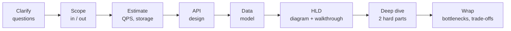
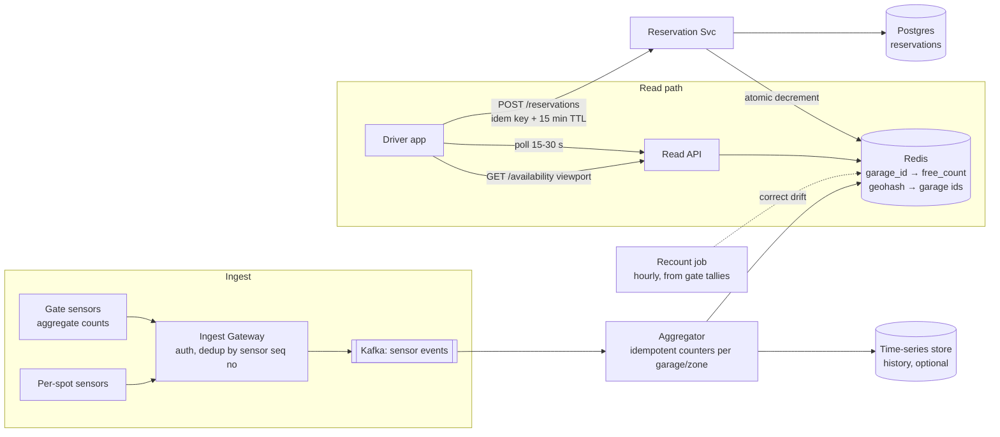
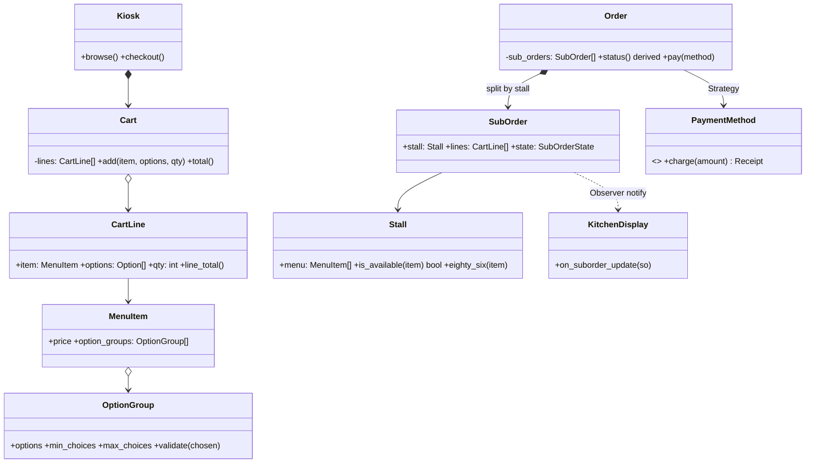
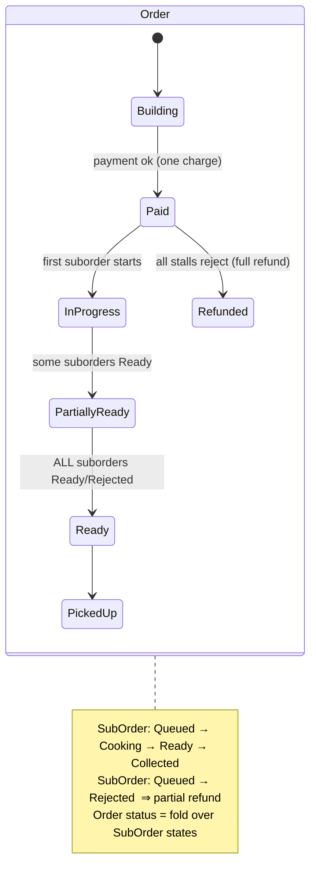
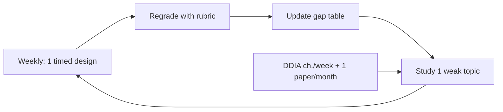

# Day 30 — Mock Interview Day + Beyond

> **Week 4, Day 30. The finale.** No new material today. Today you find out whether 29 days of patterns, estimates, queues, sagas, and state machines come out of your mouth under a ticking clock. Then we chart what comes after the 30 days.

---

## How to run today

**Rules — non-negotiable:**
1. **Unseen problems only.** The two below are deliberately NOT variants of Days 22–28. Practicing a problem you've studied measures memory, not skill.
2. **Strict 45-minute timer** per problem, visible, no pausing. Interviews don't pause.
3. **Whiteboard or paper.** No IDE, no autocomplete, no notes, no this-file open on a second monitor.
4. **Speak out loud the whole time** — even alone. The silent-genius interview is a failed interview; interviewers grade what they hear.
5. If you have a partner (strongly recommended — see Beyond section), they play interviewer: they answer clarifying questions using the "what a complete answer covers" sections below, inject one curveball at minute 25 ("what if a region goes down?" / "what if two kiosks sell the last burger?"), and grade with the rubric. Solo: record yourself, grade the recording an hour later. You will be amazed (horrified) at what you actually said.

**Schedule:** Problem A (HLD) 45 min → break 15 min → self/partner grade A (15 min) → Problem B (LLD) 45 min → grade B → gap analysis.

**What "good" feels like from the inside** — calibrate your expectations before you start:
- Minutes 0–10 feel *slow* and slightly boring. That's correct. Rushing here is the #1 rookie tell.
- Around minute 20 you'll feel the urge to keep polishing the HLD diagram. Resist — the deep dive is worth more points than a fourth arrow style.
- At some point you will not know something. The plan for that moment is pre-made: "I haven't built this; reasoning from first principles, I'd expect…" and keep moving.
- The last five minutes are a *performance* of control: bottlenecks, 10×, one honest trade-off, done on time. Interviews are remembered by their endings.

---

## The universal framework (your only allowed "notes" — memorize, then recycle the paper)

**In plain words:** This is the recipe you follow for every design question, the same way a pilot runs the same checklist before every flight no matter the destination. You always start by asking what's actually being ordered (clarify and scope), then rough out portions (estimates), then build up the dish in the same eight steps. Memorizing the eight beats means you never freeze wondering "what do I do next?" — the structure carries you even when the specific problem is brand new.


*Eight beats. Every design this month followed them; every design you ever do can.*

> **🤔 Wait — why clarify requirements before drawing any boxes?**
> Because the boxes you'd draw for "strongly consistent, low-latency, 100 QPS" are a different system than the ones for "eventually consistent, 100k QPS, cost-sensitive" — and you can't know which until you ask. Interviewers deliberately hand you an under-specified prompt; the first thing they grade is whether you notice. Drawing first means you're designing for a problem no one gave you. The two minutes of questions are the cheapest points in the whole round.

**✅ Good scenario (where this approach wins):** A strong candidate spends the first five minutes pinning read/write ratio, consistency needs, and scale, then writes an in/out list the interviewer can see. The interviewer notes "asked about consistency unprompted" — a senior signal — and every later decision now has a stated reason to point back to.

**❌ Bad scenario (when it backfires / the naive alternative):** The candidate hears "design Twitter" and immediately draws load balancer → app server → database, then spends minute 30 discovering the fan-out problem they could have surfaced in minute 3. The interviewer reads it as pattern-matching, not reasoning, and the design is now built on assumptions that turn out wrong.

**When NOT to over-do it:** Once you've nailed the 3–4 questions that actually change the architecture (scale, consistency, core use case, one hard constraint), stop interrogating and start designing — asking a tenth clarifying question at minute 8 reads as stalling, not rigor.

**Time budget for 45 minutes:**

| Step | Minutes | Notes |
|---|---|---|
| Clarify + scope | 5 | ask, don't assume; write in/out list where interviewer can see |
| Estimates | 4 | arithmetic OUT LOUD; round aggressively |
| API | 4 | main endpoints only; flag idempotency where money/duplicates lurk |
| Data model | 5 | tables/entities + DB choice with a one-sentence why |
| HLD diagram + walkthrough | 10 | draw, then narrate one request end-to-end |
| Deep dives | 12 | the differentiator — pick the 1–2 hardest parts, go deep |
| Wrap: bottlenecks, 10×, trade-offs | 5 | finish strong; never end mid-sentence in a deep dive |

For LLD, swap the middle: clarify (5) → core classes & relationships (8) → state/sequence diagram (7) → code the heart (15) → edge cases + SOLID audit (7) → wrap (3).

> **🤔 Wait — why say what you're cutting / out-of-scope instead of trying to design everything?**
> Because a 45-minute round can't cover payments *and* search *and* notifications *and* the core problem with any depth, and the candidate who tries produces a shallow tour of everything. Naming scope out loud ("payments I'll treat as a black box behind an interface, focus here on the availability path") shows judgment about what matters. It also protects your clock: the deep dive, where the real points live, needs the time you'd otherwise bleed on tangents.

**✅ Good scenario (where this approach wins):** The candidate writes an explicit out-of-scope list — "no payment internals, no admin tooling, no analytics pipeline unless we have time" — and the interviewer relaxes, because now they're collaborating on a bounded problem instead of watching someone drown. Depth on the in-scope parts becomes possible, and that depth is what gets scored.

**❌ Bad scenario (when it backfires / the naive alternative):** The candidate treats every sub-feature as mandatory, sketches a box for each, and reaches minute 40 with eight shallow components and zero deep dives. The debrief reads "broad but no depth anywhere" — a mid-level ceiling no matter how much was drawn.

**When NOT to over-do it:** Don't scope out the actual heart of the problem to make life easy — if the prompt is about ticketing and you declare the seat-reservation race "out of scope," you've cut the one thing they wanted to see you handle.

```mermaid
gantt
    dateFormat mm
    axisFormat %M
    title The 45-minute HLD clock (know where you should be at all times)
    section Interview
    Clarify + scope      :a, 00, 5m
    Estimates            :b, after a, 4m
    API                  :c, after b, 4m
    Data model           :d, after c, 5m
    HLD + walkthrough    :e, after d, 10m
    Deep dives           :f, after e, 12m
    Wrap                 :g, after f, 5m
```


*Check the clock at each boundary. If you're at minute 20 and haven't drawn the HLD, cut estimates short — the diagram and deep dive carry 55% of the rubric.*

> **🤔 Wait — why do back-of-envelope estimates instead of jumping straight to the architecture?**
> Because the numbers *decide* the architecture — 100 QPS fits on one box, 100k QPS forces sharding, caching, and async, and you can't pick between them by intuition. A rough estimate done out loud tells the interviewer you size systems rather than cargo-cult them, and it catches you before you over-build for load that isn't there. Aggressive rounding is fine; the point is the order of magnitude, not the third digit.

**✅ Good scenario (where this approach wins):** The candidate computes reads/s and writes/s aloud, rounds hard, and concludes "reads dominate 100:1, so this is a caching problem, not a write problem" — then designs to that shape. The interviewer writes "identified the read-heavy shape from the numbers," a senior signal, and the whole design now has a spine.

**❌ Bad scenario (when it backfires / the naive alternative):** The candidate skips the math and reaches for Kafka, Cassandra, and a CDN because they sound impressive, unable to say why any of them fit *this* load. That's the "said 'I'd use Kafka' but couldn't say why not SQS" tell — reads as name-dropping, and often the design is wildly over-provisioned for a problem a single Postgres could serve.

**When NOT to over-do it:** Don't spend minute 4 through 10 chasing precise figures — one significant digit and a stated peak multiplier is enough; if you're deriving bytes-per-row to three decimals, you're polishing estimates at the deep dive's expense.

**What interviewers actually write down** (paraphrased from how debriefs really sound — approximate but representative):

| Signal | Reads as | Level |
|---|---|---|
| "Asked about consistency requirements unprompted" | knows requirements shape architecture | senior |
| "Did arithmetic out loud, caught own error" | comfortable with numbers, honest | senior |
| "Named what breaks at 10× before I asked" | operates systems, doesn't just draw them | senior+ |
| "Said 'I'd use Kafka' but couldn't say why not SQS" | pattern-matching, not reasoning | junior |
| "Silent for 4 minutes while drawing" | can't collaborate under pressure | flag |
| "Claimed exactly-once delivery to an external API" | hasn't been burned yet | junior |
| "Offered me a choice of deep dives" | manages the room, not just the problem | senior |

---

## Problem A (HLD) — "Design a parking-availability system for a city"

**In plain words:** This is a high-level design (HLD) problem — you're sketching the whole city block, not wiring one house. The trap hidden inside it is that it *feels* like a write-heavy sensor problem, but the real load is a million drivers reading "how many spots are free?" So the whole game is: cache the answer, keep the messy sensor data honest with occasional recounts, and don't lie about staleness. Treat it like a live scoreboard for parking — the crowd reads it constantly, and it only needs to be roughly right, refreshed often.

> *"The city wants a system where drivers open an app and see, in real time, how many spaces are free in every garage and metered zone, get guided to the nearest available spot, and optionally reserve one for 15 minutes. ~2,000 garages/zones, ~500k spaces, ~1M app users, sensor updates from gates and per-spot sensors."*

Set the timer. Go. Grade after.

### What a complete answer covers (grader's key — do not read before attempting)

- **Clarify/scope:** Sensor types and update rates (gate counters = aggregate per garage; per-spot sensors = exact)? Staleness tolerance (drivers tolerate ~30 s)? Reservations binding or advisory? Payment in scope? (Good answer: availability + reservations in; payment out, integrates Day 27-style.)
- **Estimates:** 500k spaces; per-spot sensors reporting on change + heartbeat ≈ say 1 event/spot/min avg → ~8.3k events/s, peak ×3 ≈ 25k/s — modest. Read side: 1M users, 10% concurrent at rush, polling/streaming a viewport ≈ 30k reads/s — **read-heavy; cache the aggregates**. Storage trivial (state) + time-series history if analytics wanted.
- **API:** `GET /availability?lat&lng&radius` (viewport query), `GET /garages/{id}`, `POST /reservations` (with idempotency key + TTL — Day 19 + Day 27's reservation-with-TTL reappearing), sensor ingest endpoint/stream, WebSocket or polling for live updates (Day 22 trade-off: polling every 15–30 s is honestly fine here — saying so is a plus, not a cop-out).
- **Data model:** garages (static metadata, Postgres), spot/zone availability counters (Redis — hot, small, tolerates loss because sensors re-report), reservations (Postgres with TTL expiry — money-adjacent, wants transactions), sensor event history (time-series/append store, optional).
- **HLD:** sensors → ingest gateway → stream (Kafka) → aggregator (per-garage counters) → Redis → read API + geo-index (geohash/quadtree — cover it even shallowly) → app. Reservations decrement the counter transactionally and expire via TTL sweeper.
- **Deep-dive-worthy hard parts (any two):** (1) counter consistency — sensor events arrive late/duplicated/out-of-order; counters drift; answer: idempotent event handling + periodic full-recount reconciliation from gate tallies (reconciliation! Day 27's habit). (2) Reservation race — two drivers reserve the last spot: atomic decrement, exactly the flash-sale hot-row problem from Day 27 in a small hat. (3) Geo-queries at read scale — geohash buckets cached in Redis vs PostGIS. (4) Staleness UX — show "~12 free, 30 s ago" rather than lying with false precision.
- **Wrap:** 10× = more cities → shard by city (natural cells!), regional Redis, sensor ingest fan-in per region.

### Scoring rubric — Problem A

| Dimension | Weight | 1 (weak) | 3 (solid) | 5 (strong) |
|---|---|---|---|---|
| Requirements & scoping | 20% | dove into boxes without asking anything | asked 3+ questions, wrote in/out list | also pinned NFRs: staleness budget, read-heavy ratio, reservation semantics |
| Estimates | 10% | none, or numbers with no arithmetic | QPS + storage computed aloud | both sides (ingest vs read) computed; identified read-heavy + cacheable as the shape of the problem |
| Architecture | 30% | single box "server + DB"; no data flow | coherent diagram, walked one request end-to-end, sane DB choices | clean separation of ingest/aggregate/read paths; cache placement justified; every arrow narrated |
| Deep dive | 25% | stayed shallow everywhere | one hard part handled credibly (races OR drift OR geo) | two hard parts with mechanisms: idempotent ingest + reconciliation, atomic reservation decrement; trade-offs stated |
| Communication | 15% | silent stretches, no structure, ignored hints | followed the 8-beat framework, checked in with interviewer | managed the clock visibly, offered choices ("I can go deep on races or geo — preference?"), incorporated curveball gracefully |

**Score:** Σ(dimension score × weight) → out of 5. **≥4.0** strong-hire territory; **3.0–3.9** hire-with-hesitation, drill the weak dimension; **<3.0** rerun a Week-4 design day before re-attempting.

**Common failure modes (check yourself against every one):**
- Jumped to Kafka before asking what a "sensor" even sends. (Clarify first — Day 20's lesson.)
- Designed for 25k writes/s as if it were hard, missing that the *read* side is the actual load.
- No answer for duplicate/late sensor events — counters silently drift forever.
- Reservation race handled with "we'll use a lock" and no mechanism (what lock? where? what timeout?).
- Promised real-time WebSockets everywhere when 30 s polling meets the stated staleness budget at a fraction of the complexity — gold-plating (Day 24's dark side).
- Ran the clock out inside the geo-index and never mentioned bottlenecks or trade-offs.

### Reference sketch — Problem A (look ONLY after your attempt and grading)


*Ingest, aggregate, and read paths kept separate; Redis holds the answer to the only question drivers ask; a recount job forgives every sin the sensors commit.*

The two sentences that anchor the deep dives: *"Sensor events are duplicated and out of order, so counter updates must be idempotent (sequence numbers per sensor) and a periodic recount from gate tallies re-bases the truth — drift is corrected, not prevented."* And: *"The last-spot reservation race is Day 27's flash sale wearing a hi-vis vest: atomic decrement, refuse at zero, TTL releases abandoners."*

**Worked grading example** so the math is unambiguous — say your partner scores you: requirements 4, estimates 3, architecture 4, deep dive 3, communication 4:

> 4(0.20) + 3(0.10) + 4(0.30) + 3(0.25) + 4(0.15) = 0.80 + 0.30 + 1.20 + 0.75 + 0.60 = **3.65 → hire-with-hesitation.**
> The weighted table also tells you *where the next point is cheapest*: moving deep-dive 3→4 buys +0.25; moving estimates 3→5 buys only +0.20. Drill deep dives first.

---

## Problem B (LLD) — "Design a food-court ordering kiosk"

**In plain words:** This is a low-level design (LLD) problem — instead of city blocks you're drawing the individual rooms and how they connect: the actual classes, how they relate, and the rules for how an order changes state. The heart of it is that one order splits into several kitchen tickets (one combined receipt, three stalls cooking) — like a single group dinner bill that still gets sent to three different kitchens. Nail the "parent order status is just a summary of its children" idea and guard every status change so nobody can flip an order to "ready" out of nowhere.

> *"Design the software for a self-service kiosk in a food court: browse a menu from multiple food stalls, build a combined cart, pay at the kiosk, and the order is split and routed to each stall's kitchen display. Handle item customizations (no onions, extra cheese), stall-specific availability (a stall can 86 an item mid-day), and order status ('burger ready, fries in progress'). Classes, state machines, and the core code."*

Timer. Go.

### What a complete answer covers

- **Clarify:** One order spanning multiple stalls — one payment, split fulfillment? (Yes — that's the interesting part.) Customizations: predefined option groups or free text? Refund if one stall can't fulfill its slice? Concurrency: multiple kiosks against shared stall inventory?
- **Core classes:** `Menu`/`Stall`/`MenuItem`/`OptionGroup`, `Cart`/`CartLine` (item + chosen options + qty), `Order` composed of `SubOrder` per stall (**Composite** flavor), `KitchenDisplay` as **Observer** of SubOrder status, payment behind a small interface (**Strategy** — card/wallet/cash-code), pricing with option modifiers (**Decorator** or a modifier list — either is defensible if argued).
- **The star: two coordinated state machines.** Order: `Building → Paid → InProgress → PartiallyReady → Ready → PickedUp` (+ `Cancelled`/`Refunded`); SubOrder: `Queued → Cooking → Ready → Collected` (+ `Rejected` → triggers partial refund). Order state is *derived* from its SubOrders — saying "parent state is a fold over children" is a strong-hire sentence.
- **Code the heart:** the SubOrder state transitions (guarded, State pattern or explicit transition table — either fine if illegal jumps are rejected) and cart total with modifiers.
- **Edge cases:** stall 86s an item after it's in a cart (validate at pay time, not add time); payment succeeds then a stall rejects (partial refund — the kiosk-sized **saga**, Day 17/27); two kiosks sell the last portion (stall-side atomic availability check); customization conflicts (mutually exclusive options enforced by `OptionGroup` rules).
- **SOLID audit** out loud, 30 seconds, per Day 29's habit.

### Scoring rubric — Problem B

| Dimension | Weight | 1 (weak) | 3 (solid) | 5 (strong) |
|---|---|---|---|---|
| Requirements & scoping | 20% | started coding immediately | asked about multi-stall split, customizations, refunds | also pinned concurrency (shared availability) and derived-status expectations |
| Estimates / sizing | 10% | n/a treated as excuse to skip thinking | noted scale is small (one kiosk) so clarity > cleverness | used the smallness: justified simple in-process design, named what changes with 200 kiosks |
| Design (classes & relationships) | 30% | god class `Kiosk` doing everything | clean entities, Order/SubOrder composite, a drawn class diagram | patterns *fitted* not forced: Observer for KDS, Strategy for payment, and said WHY each |
| Deep dive (state machines + code) | 25% | statuses as loose strings, no guards | both state machines drawn; transitions guarded in code | parent-derived-from-children status; partial-refund path designed; code runs in the head |
| Communication | 15% | silent coding | narrated design before code, invited interruption | explicitly traded off (Decorator vs modifier list), managed time, finished with edge-case table |

**Common failure modes:**
- One `Order` with a `stall_id` field — misses that the entire problem is the multi-stall split.
- Status as strings mutated from anywhere: `order.status = "ready"` scattered across the codebase; no transition guards (Day 27 and Day 29 both warned you).
- Forcing all 14 patterns from Day 29's table into a kiosk. Pattern-stuffing reads as junior; two patterns with reasons beat six without.
- No answer for "paid, then stall rejects" — the one distributed-ish wrinkle in an otherwise local problem.
- Never drew a diagram; 45 minutes of prose.

### Reference sketch — Problem B (after your attempt only)


*One payment, one Order, N SubOrders — the composite split IS the problem; everything else is furniture.*


*Parent status is computed from children, never stored independently — two sources of truth for one fact is how "burger ready" screens lie.*

And the heart in code — the derived status plus a guarded child transition:

```java
import java.util.Set;
import java.util.HashSet;
import java.util.List;

// One stall's slice of the order, with guarded state transitions.
class SubOrder {
    // The only legal state hops, encoded as "from>to"; anything else is rejected.
    static final Set<String> TRANSITIONS = Set.of(
        "QUEUED>COOKING", "COOKING>READY", "READY>COLLECTED", "QUEUED>REJECTED");

    String state;
    boolean refunded;
    Order order;

    void advance(String next) {
        if (!TRANSITIONS.contains(state + ">" + next)) {
            throw new IllegalTransitionException(state, next);   // reject illegal jumps
        }
        this.state = next;
        order.recompute();              // parent derives its status, observers notified
    }
    // subtotal() and other fields omitted for brevity
}

class Order {
    List<SubOrder> subOrders;
    String status;
    PaymentMethod payment;

    void recompute() {
        // Collect the distinct states across all child suborders.
        Set<String> s = new HashSet<>();
        for (SubOrder so : subOrders) {
            s.add(so.state);
        }
        if (s.equals(Set.of("REJECTED"))) {                          // every stall said no
            status = "REFUNDED";
            refundAll();
        } else if (Set.of("READY", "COLLECTED", "REJECTED").containsAll(s)) {
            status = "READY";                                        // nothing still cooking
        } else if (s.contains("READY")) {
            status = "PARTIALLY_READY";                              // some ready, some not
        } else {
            status = "IN_PROGRESS";
        }
        notifyObservers();              // kiosk screen + kitchen displays
        for (SubOrder so : subOrders) { // partial refund for rejected slices
            if (so.state.equals("REJECTED") && !so.refunded) {
                payment.refund(so.subtotal());
                so.refunded = true;
            }
        }
    }
}
```

---

## Curveball bank (for the person playing interviewer)

Inject exactly one at minute 25. The grade is not whether they solve it — it's whether they *absorb it into the framework* (re-scope, adjust, continue) or panic and abandon the board.

**For Problem A:**
- "The city now wants historical occupancy analytics for urban planning." (Tests: do they bolt on a warehouse pipeline calmly, or redesign the hot path?)
- "A garage's network link dies for 2 hours — what do drivers see?" (Tests: staleness handling — mark data stale after N minutes of silence, degrade honestly in the UI.)
- "Reservations become paid, binding, and refundable." (Tests: do they recognize they've just been handed Day 27 in miniature — idempotent payment, state machine, refunds?)
- "10× the cities next year." (Tests: city-as-cell sharding; nothing about this problem is global.)

**For Problem B:**
- "The food court chain wants 200 locations with centralized menu management." (Tests: local-first design with sync, not a rewrite to cloud-per-keystroke.)
- "A stall's kitchen display loses power mid-order." (Tests: SubOrder state is on the kiosk/server, display is a dumb Observer that re-syncs on reconnect.)
- "Add loyalty points redeemable as partial payment." (Tests: payment becomes composite — points + card — does their PaymentMethod abstraction survive contact?)
- "Two kiosks, last portion of pad thai." (Tests: stall-side atomic availability — the hot-row answer at kiosk scale.)

## The day of a real interview (keep this list)

- Warm up an hour before with one 10-minute mini-design (estimates + boxes for something small); never walk in cold.
- First 30 seconds: restate the problem in your own words — catches misunderstanding when it costs nothing.
- Narrate trade-offs in the form "I'm choosing X over Y because Z" — the sentence rubric-graders are listening for.
- If you don't know something, say so and reason from first principles out loud; a confident wrong fact is graded far below an honest derivation.
- Keep 5 minutes for the wrap no matter what. A design without stated bottlenecks reads as unfinished, however good the middle was.
- After the interview, dump notes immediately into the gap-analysis table while it's fresh — real interviews are the highest-quality practice data you'll ever get.

> **🤔 Wait — why drive the conversation yourself instead of waiting for the interviewer to ask questions?**
> Because a system-design round is not a quiz where you answer prompts — it's a simulation of you leading a design discussion, and passivity is itself the signal being graded. An interviewer who has to pull every step out of you is watching someone who can't run a design meeting. Announcing your plan ("I'll clarify, estimate, then go deep on the two hard parts") and narrating each move keeps you in the driver's seat, which is exactly the seat the role requires.

**✅ Good scenario (where this approach wins):** The candidate states the framework upfront, checks in at boundaries ("estimates done — I'm moving to the data model unless you want to dig here"), and offers the interviewer choices of deep dive. The debrief reads "managed the room, not just the problem" — the difference between a hire and a strong hire.

**❌ Bad scenario (when it backfires / the naive alternative):** The candidate goes silent for four minutes while drawing, answers only what's directly asked, and waits to be told what to do next. It reads as "can't collaborate under pressure," and even a technically sound design gets capped, because the interviewer never saw ownership.

**When NOT to over-do it:** Driving isn't steamrolling — when the interviewer interjects or drops a hint, stop talking and absorb it; plowing through your script while ignoring a nudge reads worse than the silence you were trying to avoid.

> **🤔 Wait — why state trade-offs out loud instead of presenting your design as the one right answer?**
> Because in real systems there is no free lunch, and a candidate who presents a design as flawless is telling the interviewer they can't see its costs. Every choice buys something and pays for it elsewhere — the sentence "I'm choosing X over Y because Z, and I accept W as the cost" is precisely what senior graders listen for. Naming what you lose is not weakness; it's the mark of someone who has operated systems, not just drawn them.

**✅ Good scenario (where this approach wins):** The candidate says "I'll use eventual consistency here to hit the latency budget, accepting that a user might see a stale count for a few seconds — acceptable for this use case." The interviewer writes "stated the trade-off and tied it to the requirement," a senior signal, and trusts every other choice more because this one was honest.

**❌ Bad scenario (when it backfires / the naive alternative):** The candidate defends their design as strictly best on every axis, and when the interviewer asks "what does this cost you?" has no answer — or worse, claims exactly-once delivery to an external API. That reads as "hasn't been burned yet," junior, because real experience is mostly a catalog of trade-offs you've paid for.

**When NOT to over-do it:** Don't hedge every sentence into mush — pick the two or three trade-offs that actually matter and commit to a decision on each; a design that's all "well, it depends" with no choices made reads as indecisive, not thoughtful.

## After grading: self-review checklist

Run each problem's recording/notes against this:

- [ ] Did I ask ≥3 clarifying questions before drawing anything?
- [ ] Did I state what's OUT of scope, out loud?
- [ ] Did every estimate show its arithmetic?
- [ ] Did I justify each datastore in one sentence?
- [ ] Did I walk one request end-to-end through my own diagram?
- [ ] Did I *choose* my deep dives, or drift into them?
- [ ] Did I name at least one honest trade-off ("I lose X to get Y")?
- [ ] Did I handle the curveball without abandoning the framework?
- [ ] Did I finish with bottlenecks/wrap, or die mid-tunnel?
- [ ] Would the recording's speaker sound like someone I'd want on-call with me?

## Gap-analysis template

Fill this honestly today; it is your syllabus for the next month.

| Topic | Confidence 1–5 | Evidence (from today) | Action |
|---|---|---|---|
| Estimation arithmetic | | e.g., froze on read-QPS math | redo estimates for Days 22–28 cold, 5 min each |
| Queues & delivery semantics | | | reread Day 15/26; explain outbox to a friend |
| Idempotency & dedup | | | rewrite Day 19 key flow from memory |
| Consistent hashing / sharding | | | re-derive Day 12 ring; Day 28 §6.2 |
| Sagas & compensation | | | redraw Day 27 saga without notes |
| State machines (LLD) | | | re-code vending machine states, 20 min |
| Data structure design (LRU-class) | | | one new structure/week (LFU, rate limiter, skip list) |
| Geo / specialized indexes | | | study geohash + quadtree (new material) |
| Communication under time | | | 2 more mocks with a partner this month |

Rule: any row at ≤2 gets an action with a *date*, not an intention.

A note on honest scoring: the table only works if today's evidence column contains *quotes from your recording*, not vibes. "Froze for 40 seconds when asked about sensor dedup" is actionable; "estimates felt shaky" is not. Confidence 5 means "I could teach it tomorrow with no prep" — by that bar, most rows start at 3, and that's fine. The table isn't a report card; it's a routing algorithm for your study hours.

Also add rows for anything the curveball exposed. Curveballs are the highest-signal data of the whole day: they show what you can do when the script runs out, which is the only thing interviews actually measure.

---

## Beyond the 30 days — the roadmap

**Read (in order):**
1. **DDIA** — *Designing Data-Intensive Applications* (Kleppmann). The book behind half this course. Read slowly; one chapter/week with notes beats a binge.
2. **Papers, once DDIA lands:** Dynamo (the paper behind Day 12's consistent hashing in anger), Kafka's design docs, Google's Spanner and MapReduce, the Facebook memcache paper (Day 28's lease trick came from there), Raft ("In Search of an Understandable Consensus Algorithm").
3. Company engineering blogs (Netflix, Uber, Cloudflare, Discord) — real postmortems and migrations, the closest thing to experience you can read.

**Staff-level topics to grow into (recognize now, master later):**
- **Cell-based architecture** — partition the *whole stack* into independent cells so blast radius is a cell, not a region (we brushed it in Days 26 and 27's 10× sections).
- **Multi-region active-active** — data residency, conflict resolution, regional failover; where CRDTs (Day 28's optional section) stop being optional.
- **Exactly-once stream processing** — transactional Kafka, checkpointing (Flink-style), and why "exactly-once" there means "effectively-once" — the grown-up sibling of Day 19.
- Capacity planning, load shedding and graceful degradation, privacy/compliance as design inputs.

**Practice cadence (the part people skip):**
- **One full design per week**, 45 minutes, timer, unseen problem, forever. Skill decays in weeks; the habit is the moat.
- **Mock partners:** trade interviews with a colleague or an online partner-matching community — being the *interviewer* teaches you what graders actually hear; grade with today's rubric.
- Rotate: 3 HLD : 1 LLD. Keep the gap-analysis table alive; retire rows at 5, add new ones.

**A problem bank for the next 20 weeks** — all gradeable with today's rubrics; none are reskins of Days 22–28:

| # | HLD | Stretch beyond this course |
|---|---|---|
| 1 | URL shortener with analytics | key generation at scale, click-stream aggregation |
| 2 | Distributed job scheduler (cron-as-a-service) | exactly-once firing, misfire policies |
| 3 | Web crawler | politeness, frontier prioritization, dedup at web scale |
| 4 | Metrics/monitoring system (mini-Datadog) | time-series compression, downsampling |
| 5 | Collaborative whiteboard | Day 28's OT/CRDT section, for real this time |
| 6 | Ad-click counter with exactly-once billing | streams + Day 19 at adversarial scale |
| 7 | Multi-region key-value store | consensus, conflict resolution — Dynamo paper first |
| 8 | Ticketmaster (event ticketing) | Day 27's flash sale as the WHOLE product + seat maps |
| 9 | Rate limiter as a service | Day 21 productized: multi-tenant, distributed counters |
| 10 | Search autocomplete | tries, top-K, typo tolerance, per-keystroke latency |
| 11 | File-sync service (Dropbox-like) | chunking, delta sync, conflict handling |
| 12 | Leaderboard for 100M players | sorted sets, rank queries, anti-cheat |
| 13 | Payment ledger (double-entry) | append-only correctness, balance reads |
| 14 | Live-comments on streams | Day 22 + Day 23 fused, at burst scale |
| 15 | Feature-flag delivery system | config propagation, kill switches, evaluation SDKs |

| # | LLD | The pattern likely to star |
|---|---|---|
| 16 | Chess game | State + Command (undo!) |
| 17 | Splitwise (expense sharing) | Strategy (split rules), graph simplification |
| 18 | Library management system | classic entity modeling + reservations |
| 19 | Snake-and-ladders / board game engine | Template Method, clean rule injection |
| 20 | ATM | State machine + Day 27-style cash-dispense atomicity |


*The flywheel: practice reveals gaps, study fills them, practice re-tests. Twelve loops from now you will not recognize your old diagrams.*

**The first 12 weeks, made concrete** (adapt freely — the point is that every week has a design, a chapter, and a target):

| Week | Timed design (from the bank) | Reading | Focus skill |
|---|---|---|---|
| 1 | URL shortener (#1) | DDIA ch. 1–2 | estimates fluency |
| 2 | Job scheduler (#2) | DDIA ch. 3 | storage-engine intuition |
| 3 | LLD: Chess (#16) | DDIA ch. 4 | State + Command under time |
| 4 | Web crawler (#3) | DDIA ch. 5 | replication trade-offs |
| 5 | Metrics system (#4) | DDIA ch. 6 | partitioning — re-derive Day 12 |
| 6 | Ticketmaster (#8) | DDIA ch. 7 | transactions vs your Day 27 instincts |
| 7 | LLD: Splitwise (#17) | Dynamo paper | eventual consistency, for real |
| 8 | Multi-region KV (#7) | DDIA ch. 8 | the trouble with distributed systems |
| 9 | Autocomplete (#10) | DDIA ch. 9 | consensus, linearizability |
| 10 | File sync (#11) | memcache paper | leases — you built these on Day 28 |
| 11 | LLD: ATM (#20) | Raft paper | understandable consensus |
| 12 | Ad-click counter (#6) | DDIA ch. 10–11 | batch + stream, effectively-once |

Week 13: re-run today's two problems cold and compare rubric scores against today's. That diff is your progress report.

---

## Closing note — from Day 0 to here

Thirty days ago you were labeling UML arrows — learning that a hollow diamond means aggregation and being careful to point inheritance the right way. Look at what happened since: those class boxes became services (Day 5's Adapter became Day 26's provider layer), the humble state diagram became Day 27's order lifecycle guarding real money, Day 12's hash ring became the spine of a cache you can now build from a blank file, and the composition arrows of the parking lot became the composition of whole systems — queues, sagas, outboxes, caches — each one just an object pattern that learned to survive a network between its parts.

That's the real lesson of the 30 days: **system design was never a different subject from the UML you started with — it's the same discipline of drawing honest boxes and honest arrows, with failure added.** You now clarify before you draw, estimate before you architect, name what you lose with every trade, and say "I wouldn't build this" when it's true — which is exactly what the people on the other side of the table are listening for.

One last connection: on Day 0 the hardest question was "which way does the inheritance arrow point?" Today you graded yourself on saga compensation and hot-row contention. The distance between those two questions is 30 days of showing up. The distance to staff-level judgment is the same walk, continued — one honest, timed, graded design at a time.

Set the timer. Run the mocks. Then go design something real.

**— End of the 30-day curriculum. Day 31 is yours.**
