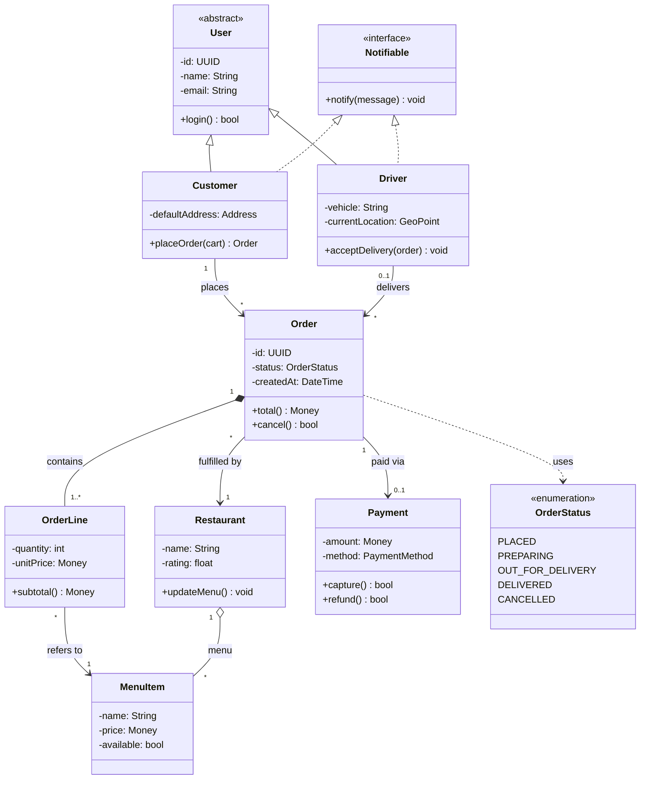
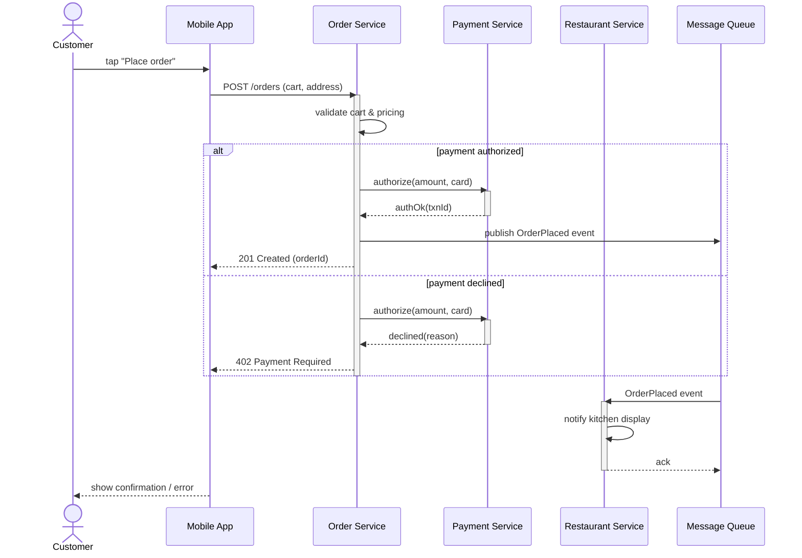
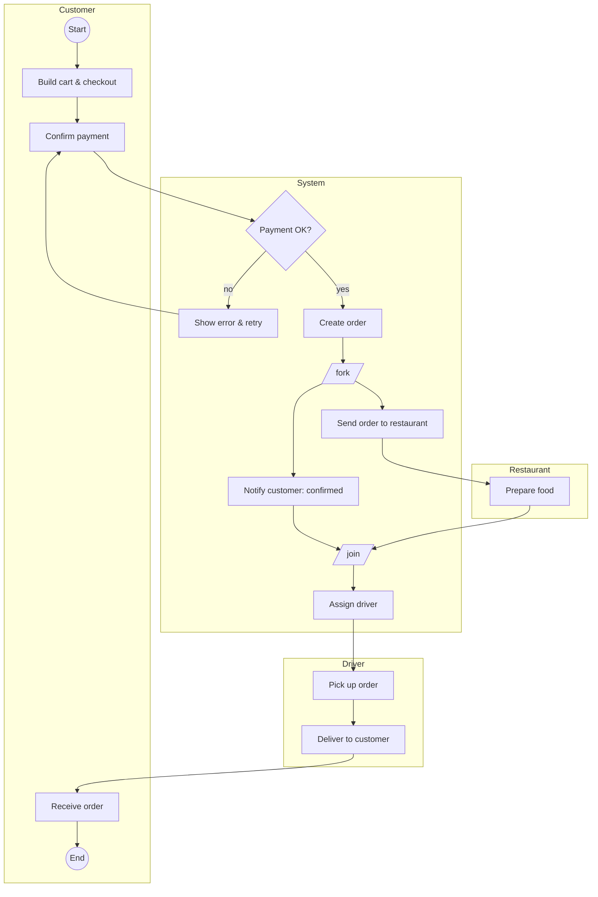
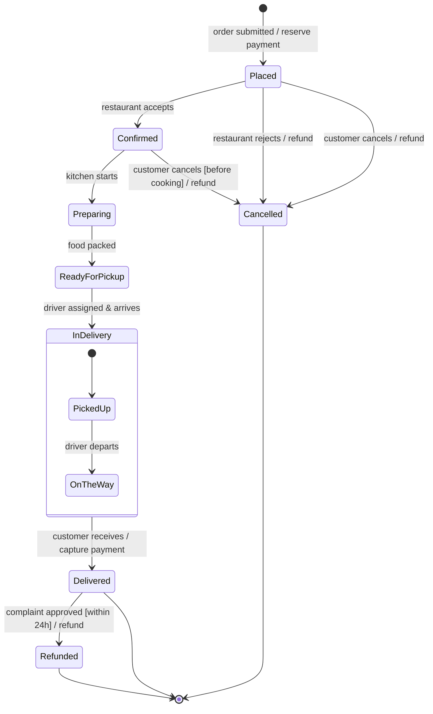

# UML for System Designers — The Complete Study Guide

**Covers the 7 diagrams you'll actually use:** Class · Sequence · Use Case · Activity · State Machine · Component · Deployment

To make everything concrete, this guide uses **one running example system**: *QuickBite*, an online food delivery platform (customers order food, restaurants prepare it, drivers deliver it, payments are processed). You'll see the same system modeled from seven different angles — which is exactly how UML is used in real system design.

---

## Part 0 — UML in 5 Minutes

**UML (Unified Modeling Language)** is a standardized visual language for describing the structure and behavior of software systems. It is *not* a methodology or a programming language — it's a communication tool. Its job is to let you think, design, and explain before (and while) you build.

UML diagrams split into two families:

| Family | Question it answers | Diagrams in this guide |
|---|---|---|
| **Structural** (static) | "What is the system made of?" | Class, Component, Deployment |
| **Behavioral** (dynamic) | "What does the system do, and in what order?" | Use Case, Sequence, Activity, State Machine |

### How the six diagrams fit together in a real design workflow

1. **Use Case diagram** — start here. Who uses the system and for what? (Scope & requirements)
2. **Activity diagram** — for each important use case, what's the workflow/business logic?
3. **Sequence diagram** — how do objects/services talk to each other, step by step, to realize a use case?
4. **State Machine diagram** — for entities with a lifecycle (an Order, a Payment), what states can they be in and what moves them between states?
5. **Class diagram** — what data structures and relationships does all of that imply?
6. **Component diagram** — how is the code organized into replaceable, deployable parts with interfaces?
7. **Deployment diagram** — where does each part physically run (servers, containers, devices)?

Requirements → Behavior → Interactions → Data model → Architecture → Infrastructure. That's the mental pipeline of a system designer.

---

## Part 1 — Class Diagram (Structural)

**Purpose:** Shows the static structure of a system — its classes, their attributes and operations, and the relationships between them. This is the single most-used UML diagram; it maps almost directly to code and to database schemas.

**Use it when:** designing your domain model, planning a database, explaining code structure, or reviewing an OO design.

### 1.1 The class box

A class is drawn as a rectangle with three compartments:

```
┌────────────────────────────┐
│          Order             │  ← Name (bold, centered)
├────────────────────────────┤
│ - id: UUID                 │  ← Attributes
│ - status: OrderStatus      │
│ - createdAt: DateTime      │
├────────────────────────────┤
│ + place(): void            │  ← Operations (methods)
│ + cancel(): bool           │
│ + total(): Money           │
└────────────────────────────┘
```

**Attribute syntax:** `visibility name: Type [multiplicity] = default`
**Operation syntax:** `visibility name(param: Type): ReturnType`

### 1.2 Visibility markers

| Symbol | Meaning | Java/C# equivalent |
|---|---|---|
| `+` | public | `public` |
| `-` | private | `private` |
| `#` | protected | `protected` |
| `~` | package | (default/internal) |

Other markers: **underlined** member = static (class-level); *italic* name = abstract class or method.

### 1.3 Special class flavors

- **Abstract class** — name in *italics* (or `{abstract}`). Cannot be instantiated.
- **Interface** — labeled `«interface»` above the name. Only operation signatures.
- **Enumeration** — labeled `«enumeration»`, lists literal values (e.g., `OrderStatus: PLACED, PREPARING, DELIVERED, CANCELLED`).
- **«stereotypes»** in guillemets customize meaning: `«entity»`, `«service»`, `«controller»`.

### 1.4 Relationships — the heart of the diagram

This is what beginners get wrong most, so learn these cold:

| Relationship | Notation | Meaning | Code smell test |
|---|---|---|---|
| **Association** | plain solid line | "knows about / has a reference to" | field pointing to the other class |
| **Aggregation** | solid line, **hollow diamond** at owner | "has-a", but parts can live independently | `Team ◇— Player` (player exists without team) |
| **Composition** | solid line, **filled diamond** at owner | "owns", parts die with the whole | `Order ◆— OrderLine` (line item is meaningless without its order) |
| **Inheritance (generalization)** | solid line, **hollow triangle** at parent | "is-a" | `extends` |
| **Realization (implementation)** | **dashed** line, hollow triangle at interface | "implements" | `implements` |
| **Dependency** | **dashed** arrow | "uses temporarily" (parameter, local var, method call) | import without a field |

**Memory aids:**
- Diamond sits on the **whole**, not the part. Filled = **f**illed = **f**used lifecycle (composition).
- Triangle always points at the **more general** thing (parent / interface).
- Dashed = weaker. Dashed line + triangle = realization; dashed arrow alone = dependency.

### 1.5 Multiplicity

Written at each end of an association:

| Notation | Meaning |
|---|---|
| `1` | exactly one |
| `0..1` | optional (zero or one) |
| `*` or `0..*` | any number |
| `1..*` | at least one |
| `2..5` | between two and five |

Read it from the far end: `Customer 1 —— * Order` = "one Customer has many Orders; each Order belongs to exactly one Customer."

You can also label the association ("places ▶") and name the roles at each end (`+buyer`, `+items`).

### 1.6 Worked example — QuickBite domain model



**How to read the key decisions:**
- `Order *-- OrderLine` is **composition**: delete the order and its lines vanish.
- `Restaurant o-- MenuItem` is **aggregation**: a menu item conceptually survives menu reshuffles (looser ownership).
- `Customer` and `Driver` **inherit** from abstract `User` and **realize** the `Notifiable` interface (dashed triangle).
- `Order --> Payment` is `0..1`: an order may exist before it's paid.

### 1.7 Common mistakes

1. **Every line is a plain association.** If lifecycle ownership exists, say so (composition/aggregation) — it drives cascade-delete and object-construction decisions.
2. **Modeling everything.** A class diagram is a view, not a dump. 7–12 classes per diagram; make multiple diagrams for multiple concerns.
3. **Missing multiplicities.** `Customer — Order` without numbers hides the most important design fact.
4. **Using inheritance for "has-a".** `Order extends Customer` is wrong; inheritance is strictly "is-a". Prefer composition when in doubt.
5. **Arrows backwards on dependency/generalization.** The arrow points *at the thing being depended on / generalized*.

---

## Part 2 — Sequence Diagram (Behavioral)

**Purpose:** Shows *how* objects, services, or systems interact over **time** to accomplish one scenario. Time flows **top → bottom**; interactions flow left ↔ right. It's the best diagram for designing APIs, microservice calls, and debugging "who calls whom."

**Use it when:** designing a request flow (e.g., "what happens when a user checks out?"), documenting an API interaction, or reasoning about latency, failures, and race conditions.

### 2.1 Core notation

| Element | Notation | Meaning |
|---|---|---|
| **Lifeline** | box at top + vertical dashed line | A participant (object, service, actor) existing over time |
| **Actor** | stick figure lifeline | Human or external system initiating things |
| **Activation bar** | thin vertical rectangle on lifeline | Period when the participant is actively executing |
| **Synchronous message** | solid arrow, **filled** head `──▶` | Caller waits for response (method call, HTTP request) |
| **Asynchronous message** | solid arrow, **open** head `──>` | Caller doesn't wait (event, message queue) |
| **Return message** | **dashed** arrow back `◀╌╌` | The reply/return value |
| **Self message** | arrow looping to same lifeline | Object calls its own method |
| **Create message** | dashed arrow to a new lifeline box | Object instantiation |
| **Destroy** | large `X` at bottom of lifeline | Object destroyed |

### 2.2 Combined fragments (the control-flow boxes)

Fragments are labeled frames drawn around parts of the diagram:

| Operator | Meaning |
|---|---|
| `alt` | if/else — mutually exclusive branches, each with a guard `[condition]` |
| `opt` | optional — executes only if guard is true (an `if` with no else) |
| `loop` | repetition — `loop [for each item]` |
| `par` | parallel — sections run concurrently |
| `break` | exits the enclosing fragment when guard is true (early exit / error path) |
| `ref` | reference to another sequence diagram (keeps diagrams small) |

### 2.3 Worked example — QuickBite "Place Order" flow



**Reading notes:**
- `->>` with a solid head is synchronous (the app *waits* for the 201); the queue publish is fire-and-forget — in strict UML you'd draw it with an open arrowhead.
- The `alt` frame cleanly separates the success and decline paths — one diagram, two outcomes.
- Activation bars show *where the work happens* — long bars on one service are a latency smell.

### 2.4 Common mistakes

1. **Cramming every scenario into one diagram.** One diagram = one scenario (happy path). Draw error paths separately or with small `alt`/`break` frames.
2. **Missing returns.** If a caller waits, show the dashed return — otherwise readers can't see what unblocks whom.
3. **Wrong arrowheads.** Sync (filled) vs async (open) is not decoration; it changes the concurrency story completely.
4. **Skipping activation bars.** They show causality and nesting of calls.
5. **Too many participants.** More than ~7 lifelines → split with `ref` fragments.

---

## Part 3 — Use Case Diagram (Behavioral)

**Purpose:** Shows *what the system does* from the outside — its functionality as seen by its users (actors) — and the system's boundary. It deliberately says **nothing about how**. It's a requirements/scoping tool and usually the first diagram drawn on a project.

**Use it when:** kicking off a project, agreeing on scope with stakeholders, or organizing functional requirements.

### 3.1 Core notation

| Element | Notation | Meaning |
|---|---|---|
| **Actor** | stick figure | A *role* (not a person!) outside the system that interacts with it. Can be human or another system. |
| **Use case** | oval with verb phrase | A goal the actor achieves with the system ("Place Order", not "Order Screen") |
| **System boundary** | rectangle around the use cases, named | What's inside the system vs outside |
| **Association** | solid line actor↔use case | The actor participates in that use case |
| **«include»** | dashed arrow → included use case | Mandatory, always-executed sub-behavior (like a function call) |
| **«extend»** | dashed arrow → base use case | Optional/conditional behavior that inserts itself into the base |
| **Generalization** | hollow triangle | One actor/use case is a specialized version of another |

**«include» vs «extend» — the classic exam question:**
- `Place Order ╌╌«include»╌▶ Process Payment` — placing an order **always** processes payment. Arrow points at the *included* (reused) piece.
- `Place Order ◀╌╌«extend»╌╌ Apply Promo Code` — applying a promo is **optional**. Arrow points at the *base* use case being extended.

Rule of thumb: include = "always happens, factored out for reuse"; extend = "sometimes happens, on a condition."

### 3.2 Worked example — QuickBite use case diagram (text form)

```
                    ┌────────────────────────────────────────────┐
                    │              QuickBite System              │
                    │                                            │
   Customer ────────│──  (Browse Restaurants)                    │
      │             │                                            │
      ├─────────────│──  (Place Order) ╌╌«include»╌╌▶ (Process   │
      │             │        ▲                         Payment)──│──── Payment
      │             │        ╎«extend»                           │      Gateway
      │             │   (Apply Promo Code)                       │      (actor)
      │             │                                            │
      ├─────────────│──  (Track Delivery)                        │
      └─────────────│──  (Rate Restaurant)                       │
                    │                                            │
   Restaurant ──────│──  (Manage Menu)                           │
     Staff          │──  (Accept/Reject Order)                   │
                    │                                            │
   Driver ──────────│──  (Accept Delivery Job)                   │
                    │──  (Update Delivery Status)                │
                    │                                            │
   Admin ───────────│──  (Suspend Account)                       │
                    └────────────────────────────────────────────┘
```

**Reading notes:**
- **Payment Gateway** is an actor even though it's software — it's outside the system boundary.
- Every use case is a **verb phrase** describing a user goal, not a UI screen or a function name.
- "Process Payment" is factored out with «include» because "Place Order" always needs it (and other use cases might too).
- If Admin "is-a" special kind of Restaurant Staff, you'd draw actor generalization (triangle) instead of duplicating lines.

### 3.3 Common mistakes

1. **Modeling steps as use cases.** "Enter password" is not a use case; "Log in" barely is. A use case = a complete goal with value for the actor.
2. **«include»/«extend» arrow direction confusion.** Include points at the reused piece; extend points at the base. Getting these backwards inverts the meaning.
3. **Overusing «include»/«extend».** They're the most abused notation in UML. If in doubt, use neither — plain use cases communicate better.
4. **Actors inside the boundary.** Actors are by definition external.
5. **Treating it as a flow diagram.** Use case diagrams have **no order/sequence**. Order lives in activity/sequence diagrams; the details live in written use-case scenarios.

---

## Part 4 — Activity Diagram (Behavioral)

**Purpose:** Models a **workflow** — the flow of control (and objects) through actions, decisions, parallel paths, and across responsibility boundaries. It's UML's flowchart, but with real support for concurrency and swimlanes. Great for business processes and complex algorithms.

**Use it when:** describing a business process end-to-end, detailing the logic inside one use case, or showing how work moves between departments/services (swimlanes).

### 4.1 Core notation

| Element | Notation | Meaning |
|---|---|---|
| **Initial node** | ● filled circle | Where flow starts (exactly one per diagram) |
| **Activity final** | ◉ bullseye | Whole workflow ends |
| **Flow final** | ⊗ circled X | Just this branch ends; others continue |
| **Action** | rounded rectangle | One step ("Validate cart") |
| **Control flow** | arrow | Order of execution |
| **Decision** | ◇ diamond, guards on outgoing arrows `[in stock]` `[else]` | Exclusive branch — exactly one path taken |
| **Merge** | ◇ diamond, many in → one out | Branches rejoin (no synchronization) |
| **Fork** | thick black bar, one in → many out | Start **parallel** paths |
| **Join** | thick black bar, many in → one out | Wait for **all** parallel paths |
| **Swimlane (partition)** | vertical/horizontal lanes | Who/what performs the actions in that lane |
| **Object node** | rectangle on a flow | Data/object passed between actions |
| **Time/accept event** | hourglass / concave pentagon | Wait for time or an external event |

**Decision vs Fork — critical distinction:** a decision picks **one** outgoing path (XOR); a fork takes **all** outgoing paths **simultaneously** (AND). A merge just funnels paths together; a join **waits** for all incoming paths to arrive.

### 4.2 Worked example — QuickBite "Order fulfillment" with swimlanes



*(Drawn as a flowchart for rendering; in strict UML the `fork`/`join` are thick black bars, the start is a filled circle, and the end is a bullseye. The subgraphs are swimlanes.)*

**Reading notes:**
- After payment, the system **forks**: notifying the customer and sending the order to the restaurant happen in parallel.
- The **join** before "Assign driver" means the driver isn't assigned until the parallel work has completed.
- The `Payment OK?` **decision** loops back on failure — decisions + merges model retries naturally.
- **Swimlanes** make responsibility visible: you instantly see every handoff between customer, system, restaurant, and driver. Handoffs are where processes break — this is why ops people love this diagram.

### 4.3 Common mistakes

1. **Using a decision where you mean a fork.** "Send email AND update DB" in parallel is a fork; a diamond would mean pick one.
2. **Forgetting the join.** Forked paths that never join can leave the reader unsure when downstream work may start.
3. **Guard conditions that aren't exhaustive/exclusive.** Every decision needs guards covering all cases (`[else]` is your friend), and only one should be true.
4. **No swimlanes when actors matter.** A cross-team workflow without lanes hides the most valuable information.
5. **Action names that aren't verbs.** "Payment" is a thing; "Process payment" is an action.

---

## Part 5 — Component Diagram (Structural)

**Purpose:** Shows how the system is organized into **replaceable, encapsulated parts (components)** and how they're wired together through **interfaces**. Where the class diagram is about code-level structure, the component diagram is about *architecture*: modules, services, libraries, and their contracts.

**Use it when:** designing microservices or modular monolith boundaries, showing what talks to what through which API, or planning what can be swapped out (e.g., replacing a payment provider).

### 5.1 Core notation

| Element | Notation | Meaning |
|---|---|---|
| **Component** | rectangle with `«component»` and/or the "lollipop-plug" icon in the corner | A modular unit with a well-defined interface (service, module, library) |
| **Provided interface** | **lollipop** ─○ | An interface the component *implements/offers* |
| **Required interface** | **socket** ─( | An interface the component *needs* from someone else |
| **Assembly connector** | lollipop plugged into socket ○─( | "This provider satisfies that requirement" — the key symbol of the diagram |
| **Port** | small square on the component edge | A specific interaction point grouping interfaces |
| **Dependency** | dashed arrow | Looser "uses" relationship when you don't model explicit interfaces |
| **Artifact / manifestation** | `«artifact»` note | The physical file (jar, image) that implements the component |

**The ball-and-socket is the whole idea:** components never depend on each other directly — they depend on *interfaces*. Any component providing the same lollipop can replace the current one. That's dependency inversion, drawn.

### 5.2 Worked example — QuickBite service architecture (text form)

```
 ┌──────────────┐        ┌───────────────────┐          ┌───────────────────┐
 │ «component»  │  REST  │   «component»     │ IPayment │   «component»     │
 │  Mobile App  ├──(  ○──┤   Order Service   ├──(   ○───┤  Payment Service  │
 └──────────────┘ IOrder │                   │          └─────────┬─────────┘
                         │                   │ IMenu              │ IGateway
 ┌──────────────┐        │                   ├──(  ○──┐           (
 │ «component»  │  REST  │                   │        │      ┌────○──────────┐
 │   Web App    ├──(  ○──┘                   │   ┌────┴────┐ │ Stripe Adapter │
 └──────────────┘        └────────┬──────────┘   │«component» └───────────────┘
                                  │ publishes    │ Restaurant │
                                  ▼              │  Service   │
                         ┌─────────────────┐     └───────────┘
                         │  «component»    │
                         │  Message Broker │───▶ INotify ○──┤ Notification Svc │
                         └─────────────────┘
```

Reading it: the ball `○` is *provided*, the socket `(` is *required*, and a plugged pair means "wired together."

**Reading notes:**
- Mobile App and Web App both **require** `IOrder`; Order Service **provides** it. Two consumers, one contract.
- Payment Service **requires** `IGateway`. Today the Stripe Adapter provides it; swap in a PayPal adapter and *nothing else changes*. This is the diagram's superpower — it makes replaceability visible.
- The Message Broker decouples Order Service from Notification Service: no direct interface between them.

### 5.3 Common mistakes

1. **Drawing components but no interfaces.** Boxes with plain arrows is just a boxes-and-lines sketch. The interfaces (lollipops/sockets) *are* the architectural content.
2. **Confusing components with classes.** A component is a deployable/replaceable unit (a service, a module), typically containing many classes.
3. **Confusing components with nodes.** "Order Service" is a component; "AWS EC2 instance" is a node (deployment diagram). Don't mix hardware into this diagram.
4. **Interfaces without names.** `IOrder`, `IPayment` — the name is the contract; label every lollipop.
5. **One giant diagram.** Model one subsystem or one architectural slice per diagram.

---

## Part 6 — Deployment Diagram (Structural)

**Purpose:** Shows the **physical** architecture: hardware/execution environments (**nodes**), the software **artifacts** deployed on them, and the **communication paths** between them. It's the last mile — where your components actually run.

**Use it when:** planning infrastructure, communicating topology to DevOps, reasoning about scaling, latency, redundancy, network zones, and protocols.

### 6.1 Core notation

| Element | Notation | Meaning |
|---|---|---|
| **Node** | 3-D box | Physical hardware (`«device»`) or software host (`«executionEnvironment»` — JVM, Docker, K8s pod, browser) |
| **Nested nodes** | box inside box | e.g., a Docker container inside a VM inside a data center |
| **Artifact** | rectangle with `«artifact»` + doc icon | Physical deployable file: `order-service.jar`, Docker image, `.war`, script |
| **Deploy relationship** | artifact drawn inside node (or dashed `«deploy»` arrow) | This artifact runs on this node |
| **Communication path** | solid line between nodes | Network connection; label with protocol (`HTTPS`, `gRPC`, `TCP:5432`) |
| **«manifest»** | dashed arrow artifact → component | The artifact implements that component (ties this diagram back to the component diagram) |
| **Multiplicity / stereotypes** | `[3]`, `«loadBalancer»` | Replicas, node roles |

### 6.2 Worked example — QuickBite production deployment (text form)

```
 «device» Customer Phone            «device» Restaurant Tablet
 ┌───────────────────────┐          ┌─────────────────────────┐
 │ «executionEnvironment»│          │ «executionEnvironment»  │
 │      iOS / Android    │          │       Browser           │
 │  ┌─────────────────┐  │          │  ┌───────────────────┐  │
 │  │«artifact»       │  │          │  │«artifact»         │  │
 │  │ quickbite.apk   │  │          │  │ kitchen-app (SPA) │  │
 │  └─────────────────┘  │          │  └───────────────────┘  │
 └──────────┬────────────┘          └──────────┬──────────────┘
            │ HTTPS                            │ HTTPS (WSS)
            ▼                                  ▼
 ┌───────────────────────────────────────────────────────────────┐
 │ «executionEnvironment» AWS Region (us-east-1)                 │
 │  ┌──────────────────┐                                         │
 │  │ «loadBalancer»   │                                         │
 │  │  ALB             │                                         │
 │  └───────┬──────────┘                                         │
 │          │ HTTP                                               │
 │  ┌───────▼───────────────────────────────────────┐            │
 │  │ «executionEnvironment» Kubernetes Cluster     │            │
 │  │  ┌──────────────────────┐ [3 replicas]        │            │
 │  │  │ «container» order-svc│──────────┐          │            │
 │  │  │  order-service.jar   │          │ AMQP     │            │
 │  │  └──────────┬───────────┘  ┌───────▼────────┐ │            │
 │  │  ┌──────────▼───────────┐  │«container»     │ │            │
 │  │  │«container» payment-svc│ │ rabbitmq       │ │            │
 │  │  │  payment-service.jar │  └────────────────┘ │            │
 │  │  └──────────┬───────────┘                     │            │
 │  └─────────────│─────────────────────────────────┘            │
 │                │ TCP:5432                 HTTPS               │
 │  ┌─────────────▼──────────┐          ┌────────────────┐       │
 │  │ «device» RDS PostgreSQL│          │ external:      │       │
 │  │  (primary + replica)   │          │ Stripe API     │       │
 │  └────────────────────────┘          └────────────────┘       │
 └───────────────────────────────────────────────────────────────┘
```

**Reading notes:**
- Every box with the 3-D/stereotype treatment is a **node**; nesting shows containment (region → cluster → container).
- **Artifacts** (`order-service.jar`) live inside the nodes that execute them — this is what "deployment" literally means here.
- Communication paths carry **protocols and ports** — that's the info security and ops teams need (firewall rules, TLS termination).
- `[3 replicas]` and primary/replica DB capture scaling and redundancy decisions.
- Stripe is drawn as an external node: outside your boundary, but on the network map.

### 6.3 Common mistakes

1. **Putting components instead of artifacts on nodes.** Strictly, nodes host *artifacts* (files/images), and artifacts *manifest* components. In practice teams blur this — fine, but know the rule.
2. **No protocols on communication paths.** "A line" tells ops nothing; `HTTPS`, `gRPC`, `TCP:5432` tells them everything.
3. **Ignoring execution environments.** "Runs on a server" vs "runs in a JVM in a container in a pod on a node" are different diagrams; nest nodes to show the stack.
4. **Missing multiplicity.** One box that is secretly an autoscaled group of 12 misleads capacity planning.
5. **Mixing logical and physical.** If you find yourself drawing "Order Module" here without a node hosting it, you've drifted into a component diagram.

---

## Part 7 — State Machine Diagram (Behavioral)

**Purpose:** Shows the **lifecycle of a single object/entity**: every state it can be in, and exactly which events move it from one state to another. Where a sequence diagram shows one scenario across many objects, a state machine shows *all* scenarios for one object.

**Use it when:** an entity has a meaningful lifecycle — Order status, Payment status, User account (active/suspended/deleted), a connection (connecting/open/closed), a ticket, a document workflow. If your class has a `status` field and `if status == X` logic scattered around, it's begging for a state diagram. This maps directly to the **State pattern** you'll learn in LLD.

### 7.1 Core notation

| Element | Notation | Meaning |
|---|---|---|
| **Initial pseudostate** | ● filled circle | Where the lifecycle begins (exactly one) |
| **Final state** | ◉ bullseye | Lifecycle over — the object is done/dead |
| **State** | rounded rectangle | A condition the object can be *in* for some time ("Preparing") — a noun/adjective, not an action |
| **Transition** | arrow, labeled `event [guard] / action` | Movement between states, caused by an event |
| **Event/trigger** | first part of the label | What happened: `paymentConfirmed`, `cancelRequested` |
| **Guard** | `[condition]` | Transition fires only if true: `cancel [not yet cooking]` |
| **Action/effect** | `/ doSomething` | What executes during the transition: `/ refund customer` |
| **Internal activities** | inside the state: `entry / …`, `do / …`, `exit / …` | Work on entering, while inside, and on leaving a state |
| **Composite state** | state containing sub-states | Nested lifecycle ("InDelivery" contains PickedUp → OnTheWay) |
| **Choice pseudostate** | ◇ diamond | Dynamic branch based on guards |
| **Self-transition** | arrow looping back to the same state | Event handled, state unchanged (`retryPayment`) |

**Transition label anatomy — memorize this:** `event [guard] / action`
Example: `cancelRequested [food not yet cooking] / refund customer` — *when* cancel is requested, *if* cooking hasn't started, move states *and* refund.

### 7.2 Worked example — QuickBite Order lifecycle



**Reading notes:**
- Every state is a **noun/condition** (`Preparing`), never an action (`Prepare food` — that belongs in an activity diagram).
- The **guard** `[before cooking]` encodes a business rule: customers can't cancel once the kitchen starts. State diagrams are where such rules become explicit and reviewable.
- `InDelivery` is a **composite state** — from outside, the order is simply "in delivery"; inside, it has its own sub-lifecycle. This keeps the top level readable.
- Money actions (`/ refund`, `/ capture payment`) ride on transitions — you can audit every path money takes just by reading arrows.
- Three ways to reach `[*]` (final): Delivered, Cancelled, Refunded. If a state has **no path to final**, you've designed a trap (bug!).

### 7.3 State vs Activity diagram — the classic confusion

| | State Machine | Activity |
|---|---|---|
| Models | **One object's** lifecycle | A **workflow/process** across many actors |
| Boxes are | States (nouns: `Preparing`) | Actions (verbs: `Prepare food`) |
| Arrows are | Events that *happen to* the object | Control flow — what to *do* next |
| QuickBite example | The Order's status field | The fulfillment process across customer/system/restaurant/driver |

Rule of thumb: if you're modeling a `status` column → state machine. If you're modeling "who does what next" → activity.

### 7.4 Common mistakes

1. **States that are actions.** "Sending email" is an activity; "AwaitingConfirmation" is a state. If it completes by itself, it's an action.
2. **Missing events on transitions.** An unlabeled arrow says the object moves states for no reason. Every transition needs its trigger.
3. **Unreachable or dead-end states.** Every state must be reachable from initial, and must have a path to final (or be intentionally terminal).
4. **Modeling several objects in one machine.** One diagram = one entity's lifecycle. Order and Payment each get their own.
5. **Guard/event confusion.** Events are *moments* (`cancelRequested`); guards are *conditions checked at that moment* (`[not yet cooking]`). Swapping them breaks the logic.

---

## Part 8 — Putting It All Together

### One system, seven views (QuickBite recap)

| Diagram | Question answered | QuickBite example insight |
|---|---|---|
| Use Case | Who can do what? | Customers order & track; payment gateway is external |
| Activity | What's the workflow? | Notify customer ∥ send to restaurant happen in parallel |
| Sequence | Who calls whom, when? | Order Service authorizes payment *before* publishing the event |
| State Machine | What's the entity's lifecycle? | Cancel is only allowed before cooking; every refund path is visible |
| Class | What's the data model? | Order *composes* OrderLines; Customer/Driver are Users |
| Component | What are the modules & contracts? | Stripe Adapter is swappable behind `IGateway` |
| Deployment | Where does it run? | 3 order-svc replicas behind an ALB, Postgres over TCP:5432 |

### Quick chooser — "which diagram do I need?"

- Explaining scope to a stakeholder → **Use Case**
- Designing/reviewing an API call chain, debugging latency → **Sequence**
- A business process with handoffs, branches, parallelism → **Activity**
- An entity with a `status` field and lifecycle rules → **State Machine**
- Domain model, DB schema, OO design → **Class**
- Service boundaries, contracts, replaceability → **Component**
- Infrastructure, scaling, network, protocols → **Deployment**

### A 7-day self-study plan

1. **Day 1 — Use Case:** pick an app you use daily (e.g., Spotify). Identify actors and 8–10 use cases; apply one «include» and one «extend» correctly.
2. **Day 2 — Class:** model that app's domain in 8–10 classes. Force yourself to use each relationship type at least once, with multiplicities everywhere.
3. **Day 3 — Sequence:** diagram one scenario ("play a song") across app → API → services, with one `alt` and one async message.
4. **Day 4 — Activity + State Machine:** diagram a cross-role process (food delivery, loan approval) with swimlanes, one decision, one fork/join; then model one entity's lifecycle (order status) with a guard and a composite state.
5. **Day 5 — Component:** carve the same system into 5–7 components; name every provided/required interface.
6. **Day 6 — Deployment:** deploy those components onto nodes with protocols, replicas, and an external dependency.
7. **Day 7 — Integrate:** review all seven for consistency (does every sequence participant exist as a component? does every component land on a node? does every state transition appear in some sequence/activity?). Inconsistencies you find are exactly what UML is for.

### Tools to practice with

- **Mermaid** (text-based; renders in GitHub, VS Code, Notion) — great for class & sequence.
- **PlantUML** (text-based; covers all 6 diagram types with true UML notation).
- **draw.io / diagrams.net** (free, visual, has full UML shape libraries).
- **Lucidchart / Excalidraw** — polished visuals for docs and interviews.

### Golden rules of the working system designer

1. A diagram is for **communication**, not decoration — if it doesn't answer a question, delete it.
2. **One diagram, one message.** Multiple small diagrams beat one mural.
3. Model at the level of your audience: stakeholders get use cases, developers get sequence/class, ops gets deployment.
4. Diagrams **age** — keep the few that matter next to the code (text-based tools help), throw the rest away without guilt.
5. Notation precision matters most where it changes meaning: diamonds, arrowheads, dashed vs solid, fork vs decision. Nail those five and you're ahead of most professionals.

